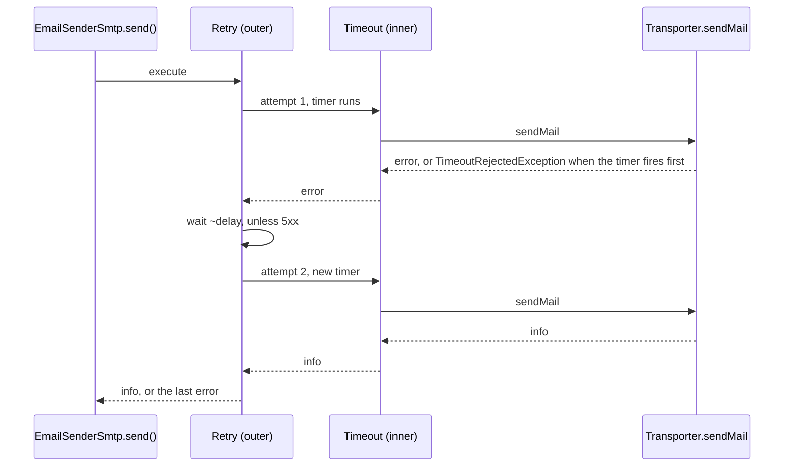

# Send resilience

`EmailSenderSmtp` wraps every `Transporter.sendMail()` call in a resilience pipeline from `@spinajs/util`: an exponential retry with jitter around a per-attempt timeout. It covers short SMTP outages inside one `send()` call; the queue retry of `sendDeferred()` covers longer ones.

## How it works

1. **Build.** `resolve()` calls `buildSendPipeline()` once and stores the result in `SendPipeline`.
2. **Default pipeline.** `buildSendPipeline()` returns `new ResiliencePipelineBuilder().addRetry({ MaxRetryAttempts: retries, Delay: delay, BackoffType: BackoffType.Exponential, UseJitter: true, ShouldHandle }).addTimeout(timeout).build()`.
3. **Order.** The first strategy added is the outermost. The retry wraps the timeout, so `timeout` bounds each attempt; a timed-out attempt is retried.
4. **Execute.** `send()` calls `SendPipeline.execute(() => Transporter.sendMail(message))`.
5. **Retry.** Any error except an SMTP `5xx` reply (`responseCode` 500 or above) is retried, up to `retries` times; a timeout counts as retryable. Retry `n` waits `delay * 2^(n-1)` ms, with jitter of 0.5x to 1.5x.
6. **Give up.** After the last attempt, or on a `5xx` reply, the last error is rethrown. When the last attempt times out, that error is `TimeoutRejectedException`.
7. **Report.** `send()` redacts, logs and rethrows the error; see [Sending mail](02-sending-mail.md). Under `sendDeferred()`, the queue job then fails and the queue retries it, up to `email.retry.count` times.



## Configuration

| Key | Type | Default | Allowed values | Meaning |
| --- | --- | --- | --- | --- |
| `email.connections[].resilience.retries` | `number` | `2` | `0` or more | Retries after the first attempt. `0` sends once. |
| `email.connections[].resilience.delay` | `number` | `500` | ms, `0` or more | Base delay before the first retry; doubles each retry, with jitter. |
| `email.connections[].resilience.timeout` | `number` | `30000` | ms, above `0` | Budget for one attempt. |
| `email.retry.count` | `number` | `3` | `0` or more | Queue-level retries of a deferred mail, in `@spinajs/email`. |

```ts
// config/email.ts
export default {
  email: {
    retry: { count: 3 },
    connections: [
      {
        service: 'EmailSenderSmtp',
        name: 'smtp-main',
        host: 'smtp.example.com',
        port: 587,
        resilience: { retries: 2, delay: 500, timeout: 30000 },
      },
    ],
  },
};
```

With the defaults a failing server costs up to 3 attempts of at most 30 s each, plus about 1.5 s of delays.

## Services and extension points

| Service | DI token and lifetime | Default implementation | Alternatives | How to replace or extend |
| --- | --- | --- | --- | --- |
| Send pipeline | `protected buildSendPipeline(): ResiliencePipeline<SentMessageInfo>`, called once per sender in `resolve()`; not in DI | exponential retry with jitter, skipping `5xx`, around a per-attempt timeout | any pipeline from `ResiliencePipelineBuilder`: retry, timeout, circuit breaker, concurrency limiter, fallback, hedging | Subclass `EmailSenderSmtp`, override `buildSendPipeline()`, register the subclass under `EmailSender` and set `service` to its class name |

### Send pipeline: custom implementation

Override `buildSendPipeline()` when the config keys are not enough:

- a timeout for the whole send instead of per attempt (timeout outside, retry inside);
- a different retry filter, for example no retry on timeouts;
- a circuit breaker, so a dead server fails fast instead of holding every send for the full timeout;
- a concurrency limit per connection.

The method runs inside `resolve()`, so `this.Options` and `this.Log` are available. It is called once per sender; stateful strategies such as the circuit breaker are shared by all sends of that connection.

```ts sample
import { Injectable, NewInstance } from '@spinajs/di';
import { EmailSender } from '@spinajs/email';
import { EmailSenderSmtp } from '@spinajs/email-smtp-transport';
import { BackoffType, Outcome, ResiliencePipeline, ResiliencePipelineBuilder } from '@spinajs/util';
import type { SentMessageInfo } from 'nodemailer';

function isTransient(outcome: Outcome<SentMessageInfo>): boolean {
  if (outcome.Error === undefined) {
    return false;
  }
  const code = (outcome.Error as { responseCode?: number }).responseCode;
  return code === undefined || code < 500;
}

@Injectable(EmailSender)
@NewInstance()
export class GuardedSmtpSender extends EmailSenderSmtp {
  protected buildSendPipeline(): ResiliencePipeline<SentMessageInfo> {
    const r = this.Options.resilience;

    return new ResiliencePipelineBuilder<SentMessageInfo>()
      .addCircuitBreaker({ FailureRatio: 0.5, MinimumThroughput: 10, SamplingDuration: 60_000, BreakDuration: 30_000, ShouldHandle: isTransient })
      .addRetry({
        MaxRetryAttempts: r?.retries ?? 3,
        Delay: r?.delay ?? 1_000,
        BackoffType: BackoffType.Exponential,
        UseJitter: true,
        ShouldHandle: isTransient,
        OnRetry: ({ AttemptNumber, RetryDelay }) => {
          this.Log.warn({ connection: this.Options.name, attempt: AttemptNumber, delay: RetryDelay.totalMilliseconds }, 'Retrying smtp send on ${connection}, attempt ${attempt} in ${delay} ms');
        },
      })
      .addTimeout(r?.timeout ?? 15_000)
      .build();
  }
}

// config/email.ts: select the subclass by its class name
export const config = {
  email: {
    connections: [
      {
        service: 'GuardedSmtpSender',
        name: 'smtp-main',
        host: 'smtp.example.com',
        port: 587,
        resilience: { retries: 3, delay: 1000, timeout: 15000 },
      },
    ],
  },
};
```

Here `timeout` applies to each attempt and a 5xx rejection fails at once. When half of at least 10 sends within 60 s fail, the circuit opens for 30 s. An open circuit throws `BrokenCircuitException` without contacting the server.

## Important behaviour

- `timeout` is the budget of one attempt. A whole `send()` can take up to `(retries + 1) * timeout` plus the delays.
- The timeout does not cancel `sendMail()`. `nodemailer` ignores the abort signal, so a timed-out message can still be delivered later. The in-process retry, and under `sendDeferred()` the queue retry, can then deliver it twice.
- A `5xx` reply (for example a `550` mailbox rejection) is not retried in-process. The queue retry of `sendDeferred()` still retries it.
- SMTP sends are not idempotent. A retry after a connection drop that happened after the server accepted the message delivers a duplicate.
- In-process and queue retries multiply. A deferred mail with `email.retry.count: 3` and `retries: 2` can reach the server up to 12 times.
- With `IEmail.redact` set, the thrown error is a new plain `Error`: `instanceof TimeoutRejectedException` no longer matches.
- Template render errors and attachment read errors happen before the pipeline and are never retried by it.
- `retries: 0` and `delay: 0` are honoured: the code uses `??`, not `||`.

## Best practices

- Keep `retries` low (`0` to `2`) on connections used with `sendDeferred()`; the queue already retries.
- Set `timeout` above the server's slowest normal response for one message.
- Set `nodemailer` socket timeouts (`options: { connectionTimeout, socketTimeout }`) below `timeout`. They close the socket; the pipeline timeout only stops waiting.
- Test a custom pipeline without a server: replace `Transporter` with a fake and build `SendPipeline` the way the package tests do.

```ts
const sender = new GuardedSmtpSender({ service: 'GuardedSmtpSender', name: 'test', host: 'localhost', resilience: { retries: 1, delay: 1, timeout: 1000 } });
Object.defineProperty(sender, 'Log', { value: { warn() {}, error() {}, trace() {} }, configurable: true });
(sender as any).Transporter = { sendMail: async () => ({ messageId: 'test' }) };
(sender as any).SendPipeline = (sender as any).buildSendPipeline();
await sender.send({ connection: 'test', from: 'a@example.com', to: ['b@example.com'], subject: 'Test', text: 'Hi' });
```

## Patterns and antipatterns

```ts
// Don't: high in-process retries on a deferred connection. Each queue attempt
// holds a worker for the whole retry chain, and duplicates multiply.
{ service: 'EmailSenderSmtp', name: 'bulk', host: 'smtp.example.com', resilience: { retries: 10, delay: 2000, timeout: 600000 } }

// Do: fail fast in-process, let the queue retry with its own backoff
{ service: 'EmailSenderSmtp', name: 'bulk', host: 'smtp.example.com', resilience: { retries: 0, timeout: 20000 } }
```

## Examples

### Fail fast on an interactive connection

A new sign-in alert is sent while the user waits for the login response: one attempt, 10 s budget, and a timeout must not fail the login.

```ts sample
import '@spinajs/email-smtp-transport';
import { DI } from '@spinajs/di';
import { EmailService } from '@spinajs/email';
import { TimeoutRejectedException } from '@spinajs/util';

export const config = {
  email: {
    connections: [
      {
        service: 'EmailSenderSmtp',
        name: 'smtp-interactive',
        host: 'smtp.example.com',
        port: 587,
        defaults: { mailFrom: 'no-reply@example.com' },
        resilience: { retries: 0, timeout: 10000 },
        options: { connectionTimeout: 5000, socketTimeout: 8000 },
      },
    ],
  },
};

export async function sendSignInAlert(address: string, device: string): Promise<'sent' | 'timeout'> {
  const emails = await DI.resolve(EmailService);

  try {
    await emails.send({ connection: 'smtp-interactive', to: [address], subject: 'New sign-in to your account', text: `A new sign-in from ${device}.` });
    return 'sent';
  } catch (err) {
    if (err instanceof TimeoutRejectedException) {
      return 'timeout';
    }
    throw err;
  }
}
```

## Related

- [Sending mail](02-sending-mail.md): what runs before and after the pipeline.
- [Extending the SMTP sender](04-extending-the-smtp-sender.md): registering and selecting a subclass.
- [`@spinajs/util`](../util/README.md): `ResiliencePipelineBuilder` and every strategy option.
- [`@spinajs/email`](../email/README.md): `sendDeferred()`, `email.retry.count` and `EmailSendFailed`.
