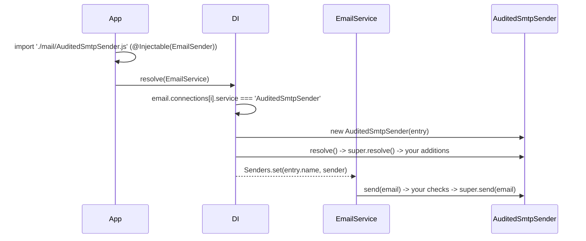

# Extending the SMTP sender

`EmailSenderSmtp` is a plain class registered under the `EmailSender` token. Subclass it to change how the transporter is built, what `send()` does before or after the SMTP call, or how failures are retried. Then point a connection at the subclass with its class name in `service`.

## How it works

1. **Register the subclass.** Decorate it `@Injectable(EmailSender)` and `@NewInstance()`. `@Injectable()` registers only the class it decorates, so a subclass without it is invisible to the connection lookup.
2. **Import it before `EmailService` resolves.** The decorator runs when the module is imported. Import the module from your app's entry or bootstrap code.
3. **Select it.** Set `service: '<ClassName>'` on the connection entries that should use it. DI compares `service` with `class.name` of every `EmailSender` registration.
4. **Build.** DI calls `new Subclass(entry)`, then `resolve()`. Your overrides run in place of the parent's; call `super` to keep the parent's steps.
5. **Use.** `EmailService` stores the instance in its `Senders` map under `entry.name` and calls `send()` for every mail on that connection.

Errors on the way: a `service` with no matching class name throws `ServiceNotFound('Service <name> is not registered in DI container')` when `EmailService` resolves.



## Configuration

| Key | Type | Default | Allowed values | Meaning |
| --- | --- | --- | --- | --- |
| `email.connections[].service` | `string` | none, required | class name of an `EmailSender` registration | Selects the subclass for this connection. |
| `email.connections[].<custom key>` | any | none | any | Extra keys pass the schema and reach the instance in `this.Options`. |

```ts
// config/email.ts
export default {
  email: {
    connections: [
      { service: 'EmailSenderSmtp', name: 'smtp-main', host: 'smtp.example.com', port: 587 },
      { service: 'AuditedSmtpSender', name: 'smtp-audited', host: 'smtp.example.com', port: 587, allowedFromDomains: ['example.com'] },
    ],
  },
};
```

## Services and extension points

| Service | DI token and lifetime | Default implementation | Alternatives | How to replace or extend |
| --- | --- | --- | --- | --- |
| Email transport | `EmailSender`, selected by class name from `email.connections[].service`; `@NewInstance()`, one per connection entry | `EmailSenderSmtp` | `BlackHoleEmailSender` (`@spinajs/email`), your subclass, your own `EmailSender` | Register a class `@Injectable(EmailSender)` and name it in `service` |
| Transporter setup | `public async resolve()` | builds options, `createTransport()`, `buildSendPipeline()`, `verify()` | | Override, call `super.resolve()`, then adjust `this.Transporter` |
| Message send | `public async send(email: IEmail)` | the flow in [Sending mail](02-sending-mail.md) | | Override, check or change the mail, call `super.send(email)` |
| Send pipeline | `protected buildSendPipeline()` | exponential retry around a per-attempt timeout | | Override; see [Send resilience](03-send-resilience.md) |
| `nodemailer` transporter | `protected Transporter: nodemailer.Transporter` | SMTP transport | pool, OAuth2, DKIM through `options` | `this.Transporter.use('compile' \| 'stream', plugin)`, `this.Transporter.on(...)` after `super.resolve()` |
| Template renderer | `protected Templates`, `@Autoinject(Templates)` | `Templates` from `@spinajs/templates` | | `DI.register(MyTemplates).as(Templates)`; see [Sending mail](02-sending-mail.md) |
| Logger | `protected Log`, `@Logger('email')` | the `email` logger | | Configure `logger.rules` for `email` |

Protected state a subclass can read:

| Member | From | Holds |
| --- | --- | --- |
| `Options` | `EmailSenderSmtp` (public) | The connection entry, custom keys included |
| `Transporter` | `EmailSenderSmtp` | The `nodemailer` transporter, set in `resolve()` |
| `SendPipeline` | `EmailSenderSmtp` | The pipeline from `buildSendPipeline()` |
| `defaultTemplateFs` | `EmailSender` | The `email.templateFs` filesystem, or `undefined` |
| `DefaultFileProvider` | `EmailSender` | `fs.defaultProvider` |

### Email transport: custom implementation

Extend `EmailSenderSmtp` when the mail still goes over SMTP and you add checks, headers or setup. Extend `EmailSender` from `@spinajs/email` when the mail goes somewhere else (an HTTP API, a test outbox); see [`@spinajs/email`](../email/README.md).

The sample enforces a sender-domain allow list read from a custom connection key, and adds an audit header to every message with a `nodemailer` compile plugin.

```ts sample
import { Injectable, NewInstance } from '@spinajs/di';
import { EmailConnectionOptions, EmailSender, IEmail } from '@spinajs/email';
import { EmailSenderSmtp } from '@spinajs/email-smtp-transport';
import { InvalidArgument } from '@spinajs/exceptions';

interface AuditedConnectionOptions extends EmailConnectionOptions {
  allowedFromDomains?: string[];
}

@Injectable(EmailSender)
@NewInstance()
export class AuditedSmtpSender extends EmailSenderSmtp {
  public async resolve(): Promise<void> {
    await super.resolve();

    this.Transporter.use('compile', (mail, done) => {
      mail.data.headers = { ...(mail.data.headers as Record<string, string> | undefined), 'X-Mail-Connection': this.Options.name };
      done();
    });
  }

  public async send(email: IEmail): Promise<void> {
    const allowed = (this.Options as AuditedConnectionOptions).allowedFromDomains;
    const from = email.from ?? this.Options.defaults?.mailFrom ?? '';
    const domain = from.replace(/>$/, '').split('@').pop()?.toLowerCase();

    if (allowed && (!domain || !allowed.includes(domain))) {
      throw new InvalidArgument(`Sender domain ${domain ?? '(none)'} is not allowed on connection ${this.Options.name}`);
    }

    await super.send(email);
  }
}

// config/email.ts
export const config = {
  email: {
    connections: [
      {
        service: 'AuditedSmtpSender',
        name: 'smtp-audited',
        host: 'smtp.example.com',
        port: 587,
        defaults: { mailFrom: 'Example <no-reply@example.com>' },
        allowedFromDomains: ['example.com'],
      },
    ],
  },
};
```

## Important behaviour

- `service` is matched against `class.name`. A minifier that renames classes breaks the lookup; keep class names in production builds.
- `DI.register(MySender).as(EmailSenderSmtp)` does **not** replace the sender for `service: 'EmailSenderSmtp'`: the lookup goes through the `EmailSender` token and compares class names. Change `service` in config instead.
- Two `EmailSender` classes with the same class name are ambiguous; the first registration with that name wins.
- `super.resolve()` creates `Transporter` and `SendPipeline` before it verifies. A subclass that catches the verify error keeps a usable sender.
- Anything you set before `super.resolve()` on `Transporter` or `SendPipeline` is overwritten.
- `send()` is the only place the `IEmail` is available. A `nodemailer` plugin sees the compiled message, not the `IEmail`.
- A subclass inherits `@Logger('email')` and `@Autoinject(Templates)`; its own `@Autoinject` fields are injected too.

## Best practices

- Call `super.resolve()` first and `super.send()` last; add your logic around them, not in place of them, so redaction, template rendering and the pipeline stay.
- Read custom settings from `this.Options` through an interface that extends `EmailConnectionOptions`, so the connection entry stays the single place to configure a connection.
- Give the subclass a name that says what it adds (`AuditedSmtpSender`), and use it only on the connections that need it.
- Throw from `send()` before `super.send()` for checks that must stop a mail; `EmailService` logs it and counts `email.send.failed`.

## Patterns and antipatterns

```ts
// Don't: copy the body of send() into the subclass to add one header.
// The copy misses later fixes in redaction, templates and attachments.
public async send(email: IEmail) { /* 70 lines copied from EmailSenderSmtp */ }

// Do: add the header with a nodemailer plugin and keep the parent's send()
public async resolve() {
  await super.resolve();
  this.Transporter.use('compile', (mail, done) => { mail.data.headers = { ...(mail.data.headers as Record<string, string> | undefined), 'X-Tenant': 'acme' }; done(); });
}
```

```ts
// Don't: a subclass without its own @Injectable(EmailSender). `service: 'MySender'`
// then fails with ServiceNotFound.
export class MySender extends EmailSenderSmtp {}

// Do
@Injectable(EmailSender)
@NewInstance()
export class MySender extends EmailSenderSmtp {}
```

## Examples

### Boot without the SMTP server in staging

The stock sender fails the boot when `verify()` fails. This subclass logs a warning and boots; sends fail and retry later through the pipeline and the queue.

```ts sample
import { Injectable, NewInstance } from '@spinajs/di';
import { EmailSender } from '@spinajs/email';
import { EmailSenderSmtp } from '@spinajs/email-smtp-transport';
import { UnexpectedServerError } from '@spinajs/exceptions';

@Injectable(EmailSender)
@NewInstance()
export class TolerantSmtpSender extends EmailSenderSmtp {
  public async resolve(): Promise<void> {
    try {
      await super.resolve();
    } catch (err) {
      if (!(err instanceof UnexpectedServerError)) {
        throw err;
      }
      this.Log.warn({ connection: this.Options.name }, 'SMTP server for ${connection} not reachable at boot, sends will be retried');
    }
  }
}

// config/email.staging.ts
export const config = {
  email: {
    connections: [{ service: 'TolerantSmtpSender', name: 'smtp-main', host: 'mail.staging.internal', port: 25, options: { auth: {} } }],
  },
};
```

### Add List-Unsubscribe to newsletter mail

Mail clients show an unsubscribe button when the `List-Unsubscribe` header is set. A compile plugin adds it to every message on the newsletter connection.

```ts sample
import { Injectable, NewInstance } from '@spinajs/di';
import { EmailSender } from '@spinajs/email';
import { EmailSenderSmtp } from '@spinajs/email-smtp-transport';

@Injectable(EmailSender)
@NewInstance()
export class NewsletterSmtpSender extends EmailSenderSmtp {
  public async resolve(): Promise<void> {
    await super.resolve();

    this.Transporter.use('compile', (mail, done) => {
      mail.data.list = {
        unsubscribe: { url: 'https://example.com/newsletter/unsubscribe', comment: 'Unsubscribe' },
      };
      done();
    });
  }
}

export const config = {
  email: {
    connections: [
      {
        service: 'NewsletterSmtpSender',
        name: 'newsletter',
        host: 'bulk.smtp.example.com',
        port: 587,
        defaults: { mailFrom: 'Example News <news@example.com>' },
        options: { pool: true, maxConnections: 5 },
      },
    ],
  },
};
```

### Capture mail in end-to-end tests

For tests that assert on sent mail, replace the transport on the test connection with an `EmailSender` that keeps each mail in memory. The production config keeps `EmailSenderSmtp`. `EmailSender.resolve()` still looks up `email.templateFs`; set it to `''` when the test app has no template filesystem.

```ts sample
import { Injectable, NewInstance } from '@spinajs/di';
import { EmailConnectionOptions, EmailSender, IEmail } from '@spinajs/email';

export const outbox: IEmail[] = [];

@Injectable(EmailSender)
@NewInstance()
export class OutboxEmailSender extends EmailSender {
  constructor(public Options: EmailConnectionOptions) {
    super();
  }

  public async send(email: IEmail): Promise<void> {
    outbox.push(email);
  }
}

// config/email.test.ts: same connection name, different service
export const config = {
  email: {
    templateFs: '',
    connections: [{ service: 'OutboxEmailSender', name: 'smtp-main' }],
  },
};
```

## Related

- [SMTP connection](01-smtp-connection.md): the connection entry and the boot-time verify.
- [Sending mail](02-sending-mail.md): what `super.send()` does.
- [Send resilience](03-send-resilience.md): overriding `buildSendPipeline()`.
- [`@spinajs/email`](../email/README.md): `EmailSender`, `EmailService` and `BlackHoleEmailSender`.
- [`@spinajs/di`](../di/README.md): `@Injectable`, `@NewInstance` and named resolution.
