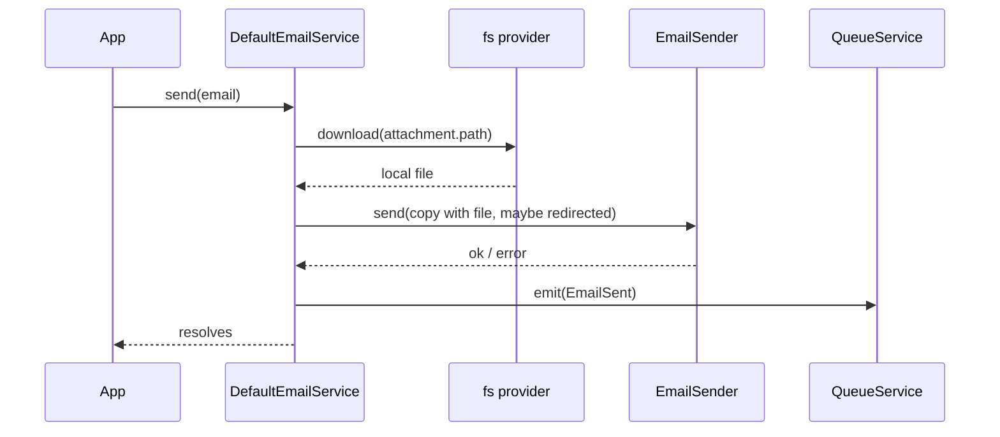

# Sending email

`EmailService.send()` sends one mail now, in the current process, through the connection the mail names. Use it for any mail the caller waits on; use [deferred sending](04-deferred-sending.md) to hand the mail to a queue worker.

## How it works

`DefaultEmailService.send(email)` runs these steps:

1. **Find the connection.** It looks up `email.connection` in its `Senders` map (one [`EmailSender`](02-transports.md) per `email.connections` entry). A missing name logs an error, counts `email.send.failed` and throws `InvalidOperation` (`Email sender <name> not exists...`).
2. **Read attachments.** `readAttachments()` reads every attachment through its filesystem as the caller, see [Attachments](05-attachments.md). A failed read is logged, counted and rethrown unchanged; nothing is sent.
3. **Redirect recipients.** Outside production, a connection with `redirectTo` gets a copy of the mail with the recipients replaced, see [Recipient redirect](06-recipient-redirect.md).
4. **Call the transport.** `EmailSender.send()` runs inside the `Perf` span `email.send` with the label `connection`. A transport error is redacted with `redactError(err, email.redact)` before it leaves the span, see [Secret redaction](07-secret-redaction.md).
5. **On failure** it logs the subject and the recipient count at error level, the addresses at trace level, counts `email.send.failed` and rethrows the (redacted) error.
6. **On success** it counts `email.sent`, logs at info level and emits an `EmailSent` event through `QueueService.emit()`. A failed emit is logged and swallowed, so a sent mail never rejects.



The service does **not** render templates or build MIME messages. It hands the `IEmail` to the transport, which reads `template`, `model`, `lang` and the rest.

### The `IEmail` shape

| Field | Type | Read by | Meaning |
| --- | --- | --- | --- |
| `connection` | `string` | service | Name of the `email.connections` entry to send through. Required; `email.defaultConnection` is **not** used as a fallback. |
| `to` | `string[]` | transport | Recipients. |
| `cc`, `bcc` | `string[]` | transport | Copy recipients. Dropped by a redirect. |
| `from` | `string` | transport | Sender. The SMTP transport falls back to the connection's `defaults.mailFrom`. |
| `subject` | `string` | transport, logs | Subject line. Logged at info and error level; keep secrets out of it. |
| `text` | `string` | transport | Plain-text body. |
| `template` | `string \| IEmailTemplate` | transport | A file in the `email.templateFs` filesystem, or `{ file, fs }` for another filesystem. |
| `templateId` | `string` | transport | Id of a template stored by a mail provider. Not read by the SMTP transport. |
| `model` | `any` | transport | Data for the template. |
| `lang` | `string` | transport | Language passed to the template renderer. |
| `attachements` | `IEmailAttachement[]` | service, transport | Files to attach. Note the spelling. See [Attachments](05-attachments.md). |
| `replyTo` | `string` | transport | Reply-To header. |
| `priority` | `string` | transport | Not read by the SMTP transport. |
| `tag` | `string` | events | Category, e.g. the module that sends it. Copied to `EmailSendFailed`. |
| `emailId` | `string` | events | Your id for the mail. Copied to `EmailSendFailed`. |
| `retryCount` | `number` | `sendDeferred()` | Queue retry count for this mail. |
| `schedule` | `{ cron?, delay?, period?, repeat? }` | `sendDeferred()` | Queue schedule. See [Deferred sending](04-deferred-sending.md). |
| `redact` | `readonly string[]` | service, transport | Secret values in `model` or `text`. See [Secret redaction](07-secret-redaction.md). |

### Helpers

| Function | Effect |
| --- | --- |
| `emailSend(email)` | Resolves `EmailService` from the root container and calls `send(email)`. |
| `emailDeferred(email)` | Resolves `EmailService` and calls `sendDeferred(email)`. Returns the `EmailSend` job. |
| `_emailSend(email)`, `_emailDeferred(email)` | Same as above, kept for compatibility. |

### The `EmailSent` event

Emitted after every successful `send()`, including each delivered deferred mail. Routed by `queue.routing.EmailSent`.

| Field | Type | Meaning |
| --- | --- | --- |
| `Connection` | `string` | `email.connection`. |
| `From` | `string` | `email.from`, or `''`. |
| `To` | `string[]` | The original recipients, also when the mail was redirected. |
| `Subject` | `string` | The original subject, without a redirect prefix. |
| `Template` | `string \| IEmailTemplate` | `email.template`. |
| `Model` | `any` | `email.model`; left out when the mail has `redact` values. |
| `Content` | `string` | `email.text`; left out when the mail has `redact` values. |
| `SentAt` | `DateTime` | When the event was built (luxon). |

### Metrics and logs

| Name | Kind | Labels | When |
| --- | --- | --- | --- |
| `email.send` | `Perf.measure` span | `connection` | Around every transport call. A failed span carries the redacted error. |
| `email.sent` | counter | `connection` | After a successful transport call. |
| `email.send.failed` | counter | `connection` | Unknown connection, failed attachment read, or failed transport call. |

All logs go to the `email` logger. Recipient addresses appear only at trace level; info and error lines carry the count.

## Configuration

The `email` section is validated by the schema `spinajs/email.configuration.schema.json`. The schema registers itself when the package is imported, and again from the `LogBotstrapper` bootstrapper.

| Key | Type | Default | Allowed values | Meaning |
| --- | --- | --- | --- | --- |
| `email.connections` | `EmailConnectionOptions[]` | not set | unique entries, each with `name` and `service` | One transport per entry. Without it `send()` cannot find any connection. |
| `email.connections[].name` | `string` | required | any | Connection name; `IEmail.connection` selects it. |
| `email.connections[].service` | `string` | required | class name of a registered `EmailSender` | Transport class, see [Transports](02-transports.md). |
| `email.connections[].host`, `port`, `user`, `password`, `ssl` | `string`, `number`, `string`, `string`, `boolean` | not set | transport-specific | Server access, read by the transport. |
| `email.connections[].defaults.mailFrom` | `string` | not set | address | Sender used by the SMTP transport when `IEmail.from` is missing. |
| `email.connections[].templates.defaults` | `object` | not set | any | Template values the SMTP transport merges into `model`. |
| `email.connections[].redirectTo` | `string[]` | not set | addresses | Test inboxes, see [Recipient redirect](06-recipient-redirect.md). |
| `email.connections[].resilience.retries`, `delay`, `timeout` | `number` | transport defaults | ms for `delay` and `timeout` | In-process retry of one send, applied by the transport. |
| `email.connections[].options` | `object` | not set | transport-specific | Extra options; the SMTP transport merges them into the nodemailer transport. |
| `email.defaultConnection` | `string` | not set | a connection name | Read by [`EmailPasswordMailer`](08-password-mailer.md) and by other packages; not by `send()`. |
| `email.templateFs` | `string` | `'email-templates'` | a registered fs provider name | Filesystem each `EmailSender` resolves for string templates. Must exist when set. |
| `email.retry.count` | `number` | `3` | `>= 0` | Queue retry count for deferred mails. |
| `email.attachments.check` | `boolean` | `true` | `true`, `false` | Read attachments in the service as the caller, see [Attachments](05-attachments.md). |
| `email.password.*` | object | see [Password mails](08-password-mailer.md) | | Reset and invite mails. |
| `email.queue` | `string` | `'email-queue-black-hole'` | any | Shipped and validated, but read by no code. |
| `configuration.isProduction` | `boolean` | from the configuration package | | Turns off `redirectTo`. |
| `fs.defaultProvider` | `string` | not set | fs provider name | Filesystem of attachments without `provider`. |

```ts
// config/email.ts in your app
export default {
  email: {
    defaultConnection: 'main',
    templateFs: 'mail-templates',
    attachments: { check: true },
    connections: [
      {
        name: 'main',
        service: 'EmailSenderSmtp',
        host: 'smtp.acme.com',
        port: 465,
        ssl: true,
        user: 'billing@acme.com',
        password: process.env.SMTP_PASSWORD,
        defaults: { mailFrom: 'Acme Billing <billing@acme.com>' },
        resilience: { retries: 2, delay: 500, timeout: 30000 },
      },
      { name: 'silent', service: 'BlackHoleEmailSender' },
    ],
  },
};
```

## Services and extension points

| Service | DI token and lifetime | Default implementation | Alternatives | How to replace or extend |
| --- | --- | --- | --- | --- |
| Email service | `EmailService`, singleton, resolved by type | `DefaultEmailService` | your subclass | [Replacing or extending `EmailService`](03-email-service.md) |
| Transport | `EmailSender`, new instance per connection | none | `BlackHoleEmailSender`, `EmailSenderSmtp` | [Transports](02-transports.md) |
| Config schema | `Bootstrapper` `LogBotstrapper` | registers the schema | none | not meant to be replaced |

## Important behaviour

- **All transports connect when `EmailService` is first resolved.** `Senders` is injected at construction, and each sender's `resolve()` runs then. The SMTP transport verifies its server there, so a down server fails that resolve.
- **`connection` is mandatory.** `send()` never falls back to `email.defaultConnection`.
- **`send()` never mutates the mail you pass.** Attachments and redirects work on copies, so a retried job sends the same mail again.
- **A successful send never rejects.** An `EmailSent` emit failure is only logged; rethrowing would make a queue retry and send a duplicate.
- **The caller's mail goes to logs and events.** The redirected copy goes only to the transport.
- **Shipped defaults route `EmailSent` to a black-hole queue.** Subscribers see nothing until you route it to a real queue connection, see [Deferred sending](04-deferred-sending.md#configuration).

## Best practices

- Read the connection name from config (`@Config('email.defaultConnection')`) instead of hard-coding it in every call.
- Put a `{ file, fs }` template on a mail whose templates live outside `email.templateFs`.
- Set `tag` and `emailId`; they are what `EmailSendFailed` gives you to find the lost mail.
- Use a `BlackHoleEmailSender` connection in tests and local runs. It still reads attachments, so permission errors show up.

## Patterns and antipatterns

```ts
// Don't: send() does not fall back to email.defaultConnection; this throws InvalidOperation
await emails.send({ to: ['client@acme.com'], subject: 'Your invoice' } as IEmail);

// Do
await emails.send({ connection: this.Connection, to: ['client@acme.com'], subject: 'Your invoice', text: 'See attachment.' });
```

```ts
// Don't: the subject is logged at info level and copied into EmailSent
await emails.send({ connection: 'main', to: [user], subject: `Your code is ${code}`, text: '' });

// Do: keep secrets in text or model and list them in redact
await emails.send({ connection: 'main', to: [user], subject: 'Your sign-in code', text: `Your code is ${code}`, redact: [code] });
```

## Examples

### Send a templated welcome mail from a service

```ts sample
import { Autoinject, Injectable } from '@spinajs/di';
import { Config } from '@spinajs/configuration';
import { EmailService } from '@spinajs/email';

@Injectable()
export class WelcomeMailer {
  @Autoinject(EmailService)
  protected Emails: EmailService;

  @Config('email.defaultConnection')
  protected Connection: string;

  public async sendWelcome(address: string, name: string): Promise<void> {
    await this.Emails.send({
      connection: this.Connection,
      to: [address],
      subject: 'Welcome to Acme',
      template: { file: 'welcome.pug', fs: 'mail-templates' },
      model: { Name: name },
      lang: 'en',
      tag: 'onboarding',
      emailId: `welcome-${address}`,
    });
  }
}
```

### Send from a function without a class

```ts sample
import { emailSend } from '@spinajs/email';

export async function notifyOpsOfFailedImport(fileName: string, rows: number): Promise<void> {
  await emailSend({
    connection: 'main',
    to: ['ops@acme.com'],
    subject: `Import of ${fileName} failed`,
    text: `The import stopped after ${rows} rows. See the import log for details.`,
    tag: 'imports',
  });
}
```

## Related

- [Transports](02-transports.md): what runs inside step 4.
- [Replacing or extending `EmailService`](03-email-service.md): change any step of this flow.
- [`@spinajs/email-smtp-transport`](../email-smtp-transport/README.md): how templates, `from` and attachments become an SMTP message.
- [`@spinajs/queue`](../queue/README.md): where `EmailSent` goes.
