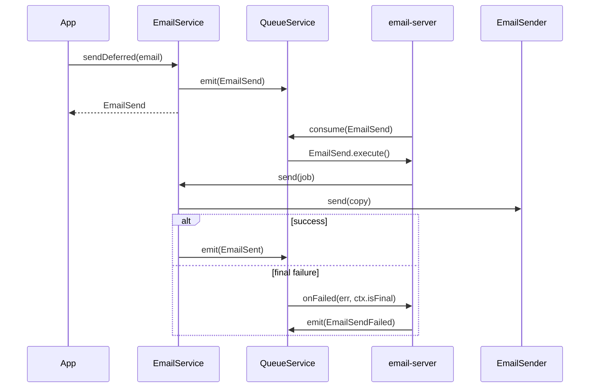

# Deferred sending

`EmailService.sendDeferred()` puts the mail on a queue as an `EmailSend` job and returns at once; a worker running `processDeferredEmails()` sends it later with queue-level retry. Use it for mails the request does not wait on, scheduled mails, and mails that must survive an SMTP outage.

## How it works

Queueing, in `DefaultEmailService.sendDeferred(email)`:

1. A mail with any non-empty `redact` value is refused with `InvalidOperation` (`An email with secret values (redact) cannot be sent deferred, use send()`). Nothing is emitted.
2. A new `EmailSend` job is built and `hydrate(email)` copies every field of the mail onto it.
3. `RetryCount` is set to `email.retryCount`, else `email.retry.count`, else `3`.
4. `email.schedule` is copied to `ScheduleCron`, `ScheduleDelay`, `SchedulePeriod` and `ScheduleRepeat`.
5. `QueueService.emit(job)` sends it to the connection routed by `queue.routing.EmailSend`. The job is returned.

Delivery, in the worker:

1. `processDeferredEmails()` calls `QueueService.consume(EmailSend)`. The `email-server` CLI command does this, see [CLI commands](09-cli-commands.md).
2. For each message the queue runs `EmailSend.execute()`, which calls `emailSend(this)`: the normal [send pipeline](01-sending-email.md#how-it-works) on the resolved `EmailService`. It returns `{ result: true }`.
3. `EmailSend` is `@Job({ runAs: 'initiator' })`: with `@spinajs/authz-queue`, the job runs as the principal that queued it, so attachments are read with that principal's rights.
4. A failed run is retried by the queue up to `RetryCount` times.
5. `EmailSend.onFailed(err, ctx)` emits an `EmailSendFailed` event through `ev()` only when `ctx.isFinal` is true: once per mail, after the last attempt.



## Configuration

| Key | Type | Default | Allowed values | Meaning |
| --- | --- | --- | --- | --- |
| `email.retry.count` | `number` | `3` | `>= 0` | Queue retries of a deferred mail; `IEmail.retryCount` overrides it per mail. |
| `queue.routing.EmailSend.connection` | `string` | `'email-queue-black-hole'` | a `queue.connections` name | Queue connection that carries the jobs. |
| `queue.routing.EmailSent.connection` | `string` | `'email-queue-black-hole'` | a `queue.connections` name | Where `EmailSent` events go. |
| `queue.routing.EmailSendFailed.connection` | `string` | `'email-queue-black-hole'` | a `queue.connections` name | Where `EmailSendFailed` events go. |
| `queue.connections[name='email-queue-black-hole']` | object | `BlackHoleQueueClient`, channels `email-jobs`, `email-events`, `email-jobs-dlq` | | Shipped connection that drops every message. |
| `system.dirs.jobs` | `string[]` | includes this package's `lib/jobs` | | Lets the queue discover `EmailSend`. |

Route all three to a real broker to make deferred mail work:

```ts
// config/queue.ts in your app
export default {
  queue: {
    routing: {
      EmailSend: { connection: 'mail-broker' },
      EmailSent: { connection: 'mail-broker' },
      EmailSendFailed: { connection: 'mail-broker' },
    },
    connections: [
      {
        name: 'mail-broker',
        service: 'StompQueueClient',
        host: 'ws://broker.internal:61614/ws',
        defaultQueueChannel: '/queue/email-jobs',
        defaultTopicChannel: '/topic/email-events',
      },
    ],
  },
  email: { retry: { count: 5 } },
};
```

### `IEmail.schedule`

| Field | Copied to | Meaning |
| --- | --- | --- |
| `cron` | `ScheduleCron` | Cron entry for the schedule. |
| `delay` | `ScheduleDelay` | Milliseconds to wait before the first delivery. |
| `period` | `SchedulePeriod` | Milliseconds between repeated deliveries. |
| `repeat` | `ScheduleRepeat` | How many times to repeat. |

Whether a schedule is honoured depends on the queue transport; see [`@spinajs/queue`](../queue/README.md).

### The `EmailSendFailed` event

Emitted once per deferred mail, after its last attempt fails. It carries only wire-safe fields: no model, no text, no stack.

| Field | Type | Meaning |
| --- | --- | --- |
| `Connection` | `string` | `email.connection`. |
| `From` | `string` | `email.from`, or `''`. |
| `To` | `string[]` | Recipients. |
| `Subject` | `string` | Subject. |
| `Template` | `string \| IEmailTemplate` | Template. |
| `Tag` | `string` | `email.tag`. |
| `EmailId` | `string` | `email.emailId`. |
| `JobId` | `string` | Id of the failed queue job. |
| `Error` | `string` | Error message only. |
| `Attempt` | `number` | Attempt that failed last. |
| `MaxAttempts` | `number` | Retries plus one. |
| `FailedAt` | `DateTime` | When the event was built. |

## Services and extension points

| Service | DI token and lifetime | Default implementation | Alternatives | How to replace or extend |
| --- | --- | --- | --- | --- |
| Deferred job | `EmailSend` (`@Job({ runAs: 'initiator' })`), discovered from `system.dirs.jobs` | `EmailSend` | none | Not meant to be subclassed: `@Job` options are not inherited. Change behaviour in `EmailService` instead. |
| Sent and failed events | `EmailSent`, `EmailSendFailed` (`@Event()`) | emitted by the service and the job | | Subscribe with `QueueService.consume(EmailSent, callback)`; route with `queue.routing`. |
| Queue transport | `QueueClient` from `@spinajs/queue` | `BlackHoleQueueClient` for email routes | any `QueueClient` | Route `EmailSend` to another `queue.connections` entry. |
| Email service | `EmailService` | `DefaultEmailService` | | Override `sendDeferred()` or `processDeferredEmails()`, see [03](03-email-service.md). |

### Subscribe: alert when a mail is finally lost

```ts sample
import { DI } from '@spinajs/di';
import { QueueService } from '@spinajs/queue';
import { EmailSendFailed } from '@spinajs/email';

export async function alertOnLostMail(alert: (message: string) => Promise<void>): Promise<void> {
  const queue = await DI.resolve(QueueService);

  await queue.consume<EmailSendFailed>(EmailSendFailed, async (failed) => {
    await alert(`Mail ${failed.EmailId ?? failed.Subject} (${failed.Tag ?? 'untagged'}) to ${failed.To.length} recipient(s) lost after ${failed.Attempt}/${failed.MaxAttempts} attempts: ${failed.Error}`);
  });
}
```

### Subscribe: count delivered mails per connection

```ts sample
import { DI } from '@spinajs/di';
import { QueueService } from '@spinajs/queue';
import { EmailSent } from '@spinajs/email';

export async function countDeliveries(counts: Map<string, number>): Promise<void> {
  const queue = await DI.resolve(QueueService);

  await queue.consume<EmailSent>(EmailSent, async (sent) => {
    const connection = sent.Connection ?? 'unknown';
    counts.set(connection, (counts.get(connection) ?? 0) + 1);
  });
}
```

## Important behaviour

- **Shipped routing drops deferred mail.** `EmailSend`, `EmailSent` and `EmailSendFailed` go to `BlackHoleQueueClient` until you route them elsewhere. `sendDeferred()` still resolves.
- **The whole mail sits on the queue**, and with a persistent queue in a table. That is why mails with `redact` values are refused.
- **Two retry layers.** The transport retries one send in-process (`resilience`); the queue retries the job (`RetryCount`) after the transport gives up.
- **A refused attachment read is retried too**, although the answer stays the same.
- **A mail queued without a principal**, or by a delegated or impersonating one, runs unattended: a guarded attachment is refused on delivery.
- **`EmailSent` failures do not fail the job**, so a sent mail is never sent twice by a retry.

## Best practices

- Set `emailId` and `tag` on deferred mails; `EmailSendFailed` has no model or text to identify them by.
- Lower `retryCount` for mails that are worthless late, e.g. sign-in codes (or send those with `send()`).
- Run `email-server` as its own process; `processDeferredEmails()` keeps consuming.

## Patterns and antipatterns

```ts
// Don't: sendDeferred() throws for any mail with redact values
await emails.sendDeferred({ connection: 'main', to: [user], subject: 'Reset your password', text: link, redact: [token, link] });

// Do: secrets are sent at once and never queued
await emails.send({ connection: 'main', to: [user], subject: 'Reset your password', text: link, redact: [token, link] });
```

## Examples

### Send a monthly usage report on a schedule

```ts sample
import { EmailSend, emailDeferred } from '@spinajs/email';

export async function scheduleMonthlyUsageReport(accountManager: string): Promise<EmailSend> {
  return emailDeferred({
    connection: 'main',
    to: [accountManager],
    subject: 'Monthly usage report',
    template: 'usage-report.pug',
    model: { Period: 'previous-month' },
    tag: 'reports',
    emailId: `usage-report-${accountManager}`,
    retryCount: 5,
    schedule: { cron: '0 7 1 * *' },
  });
}
```

## Related

- [Sending email](01-sending-email.md): what the worker runs for each job.
- [Secret redaction](07-secret-redaction.md): why secrets are never queued.
- [CLI commands](09-cli-commands.md): `email-server`.
- [`@spinajs/queue`](../queue/README.md): routing, retries, schedules and `QueueClient` transports.
- [`@spinajs/authz`](../authz/README.md): `runAs: 'initiator'` and unattended jobs.
