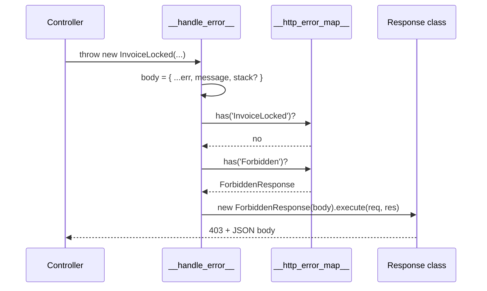

# HTTP error mapping

`@spinajs/http` turns a thrown exception into an HTTP response by looking up the exception's class name in the `__http_error_map__` DI map. `@HandleException` fills that map. Use it to give your own exception a status, or to change the status of a shipped one.

The mapping code lives in `@spinajs/http`; this page covers it from the exception side. `@spinajs/exceptions` itself registers nothing.

## How it works

1. **Registration, at import time.** `@HandleException(ResourceNotFound)` on a `Response` subclass calls `DI.register(NotFound).asMapValue('__http_error_map__', 'ResourceNotFound')`. The DI root container keeps one `Map<string, Constructor<Response>>` under that string token; `Map.set` means the last registration for a name wins.
2. **Handler setup.** `HttpServer.start()` calls `ErrorHandlerMiddleware.after()`, which runs `__handle_error__()`. It reads the map once with `DI.get('__http_error_map__')`, plus `configuration.isProduction`, `http.AcceptHeaders` and `http.FatalTemplate`.
3. **A request fails.** A controller, route argument or middleware throws or calls `next(err)`. `NotFoundMiddleware` calls `next(new ResourceNotFound(...))` for an unmatched route.
4. **Body-parser failures.** An invalid JSON body answers 400 with the fixed message `request body is not valid JSON`. A `verify` hook failure keeps its mapped answer when the thrown class is mapped; otherwise it answers 400 with `request body was refused`. These two fixed answers use the response mapped for `BadRequest`.
5. **Error body.** Otherwise the handler builds `{ ...err, message: err.message }`: every own enumerable field of the exception plus its message. Outside production it adds `stack`. It logs the error at `error` level.
6. **Lookup.** `__resolve_error_response__(map, err)` walks from `err.constructor` up the prototype chain and returns the response class of the first name found in the map.
7. **No match.** The handler logs a warning (`Error type X dont have assigned http response`) and uses `ServerError` (500).
8. **Answer.** It runs `new ResponseClass(errorBody).execute(req, res)`. The response renders JSON, or its pug `_template` for an HTML client, with its `_errorCode` as the status.
9. **Last resort.** If `execute()` throws, the handler logs at `fatal`, sets 500, and sends `http.FatalTemplate` (with `{ticket}` replaced by a random 7-character id) to HTML clients or the JSON error body to the rest.



## Decorators

| Decorator | Target | Options | Effect |
| --- | --- | --- | --- |
| `@HandleException(exception)` (from `@spinajs/http`) | Class: a `Response` subclass | `exception`: one exception class or an array of them | For each class, sets `__http_error_map__[exception.name] = target`. Runs when the decorated class is defined. |

`@HandleException` is a plain function. Calling `HandleException(Cls)(ResponseClass)` registers a mapping for a response class you do not own.

## Configuration

These `@spinajs/http` keys change the error answer. The handler reads them once, when the server starts.

| Key | Type | Default | Allowed values | Meaning |
| --- | --- | --- | --- | --- |
| `configuration.isProduction` | `boolean` | `false` when the `Configuration` service is missing | `true`, `false` | `true` leaves `stack` out of the error body. |
| `http.AcceptHeaders` | `HttpAcceptHeaders` flags | `1 \| 2` (`JSON \| HTML`) | `HttpAcceptHeaders.JSON` (1), `HttpAcceptHeaders.HTML` (2), or both | When it includes `HTML`, an HTML client gets `http.FatalTemplate` in the last-resort case. |
| `http.FatalTemplate` | `string` | built-in "HTTP 500" page with a ticket number | HTML with an optional `{ticket}` placeholder | Page sent when rendering the mapped response itself fails. |

## Services and extension points

| Service | DI token and lifetime | Default implementation | Alternatives | How to replace or extend |
| --- | --- | --- | --- | --- |
| Exception-to-response map | String token `'__http_error_map__'`; one `Map<string, Constructor<Response>>` in the root container cache, filled by `asMapValue` | Entries registered by `@spinajs/http` (table below) | Entries from other packages, for example `ValidationFailed` from `@spinajs/validation` | Add an entry with `@HandleException` on your `Response` subclass; override one by registering the same name again after `@spinajs/http` has loaded. |
| Error response class | Map value: the constructor, created per error with `new` | `ServerError` for unmapped errors | `BadRequestResponse`, `Unauthorized`, `ForbiddenResponse`, `NotFound`, `Conflict`, `EntityTooLarge`, `UnsupportedMediaType`, `ValidationError`, `NotAcceptable` | Subclass `Response` or `BadRequestResponse`; set `_errorCode` and `_template`; override `execute()` for headers. |

### Default entries

| Exception name | Response class | Status |
| --- | --- | --- |
| `InvalidArgument`, `BadRequest`, `JsonValidationFailed`, `ExpectedResponseUnacceptable` | `BadRequestResponse` | 400 |
| `ValidationFailed` (`@spinajs/validation`) | `ValidationError` | 400 |
| `AuthenticationFailed` | `Unauthorized` | 401 |
| `Forbidden` | `ForbiddenResponse` | 403 |
| `ResourceNotFound` | `NotFound` | 404 |
| `ResourceDuplicated` | `Conflict` | 409 |
| `EntityTooLargeException` (`@spinajs/http`), `LimitExceeded` | `EntityTooLarge` | 413 |
| `UnsupportedMediaTypeException` (`@spinajs/http`) | `UnsupportedMediaType` | 415 |
| `MethodNotImplemented`, `IOFail`, `UnexpectedServerError` | `ServerError` | 500 |

`Exception`, `ConnectionNotFound`, `NotSupported`, `InvalidOption` and `InvalidOperation` have no entry: they answer 500 through the fallback.

### Error response: custom implementation

Write your own response class when an exception needs a status no shipped response has, or extra headers. Extend `BadRequestResponse` (or `Response`), set `_errorCode` and `_template`, and decorate it with `@HandleException`. The decorator runs when the module is imported, so import the module before `HttpServer.start()`.

`responseData` holds the error body: the exception's enumerable fields plus `message`.

```ts sample
import { Exception } from '@spinajs/exceptions';
import { BadRequestResponse, HandleException, HTTP_STATUS_CODE } from '@spinajs/http';
import type { Request, Response } from 'express';

export class ExportQuotaExceeded extends Exception {
  constructor(public readonly retryAfterSeconds: number) {
    super(`export quota exceeded, retry in ${retryAfterSeconds}s`);
    this.name = new.target.name;
  }
}

@HandleException(ExportQuotaExceeded)
export class TooManyRequestsResponse extends BadRequestResponse<{ retryAfterSeconds?: number }> {
  protected _errorCode = HTTP_STATUS_CODE.TOO_MANY_REQUESTS;
  protected _template = 'badRequest.pug';

  public async execute(req: Request, res: Response) {
    const data = await this.responseData;
    if (data?.retryAfterSeconds) {
      res.set('Retry-After', String(data.retryAfterSeconds));
    }
    return super.execute(req, res);
  }
}

const exportsToday = new Map<number, number>();

export function startExport(userId: number): void {
  const used = exportsToday.get(userId) ?? 0;
  if (used >= 10) {
    // 429, Retry-After: 3600, body { retryAfterSeconds, name, message }
    throw new ExportQuotaExceeded(3600);
  }
  exportsToday.set(userId, used + 1);
}
```

### Override a shipped mapping

The map is keyed by name and `Map.set` replaces, so a later registration for the same name wins. Register after `@spinajs/http` is imported; an ES `import` from `@spinajs/http` guarantees that.

```ts sample
import { ExpectedResponseUnacceptable, InvalidOperation } from '@spinajs/exceptions';
import { Conflict, HandleException, NotAcceptable } from '@spinajs/http';

// 406 instead of the default 400
HandleException(ExpectedResponseUnacceptable)(NotAcceptable);

// 409 instead of the unmapped 500, for every InvalidOperation and its subclasses
HandleException(InvalidOperation)(Conflict);
```

## Important behaviour

- Lookup is by class **name**. Two classes with the same name share one entry, and a minifier that renames classes breaks the lookup.
- The most specific mapped class wins: an exact entry for `InvoiceLocked` beats the inherited `Forbidden` entry.
- Every own enumerable field of the exception goes into the response body, in production too: `inner`, `fieldName`, `errorCode`, and fields such as `OrmException`'s `query` and `bindings`. Only `stack` depends on `configuration.isProduction`.
- The map lives in the DI root container cache. `DI.clearCache()` wipes it, and nothing re-runs the import-time registrations, so every error then answers 500.
- The handler holds the map instance it read at start. Entries added later to that same map still apply.
- The mapped response gets only the error body; the handler passes no `IResponseOptions`. Set headers by overriding `execute()`.
- `ExpectedResponseUnacceptable` answers 400, although `@spinajs/http` ships a 406 `NotAcceptable` response.

## Best practices

- Prefer extending a mapped exception ([Domain exceptions](02-domain-exceptions.md)) over adding a map entry; add an entry only for a status no base class gives.
- Keep `@HandleException` classes in a module your app imports at startup, next to the exceptions they map.
- In tests, uncache only the types you registered instead of calling `DI.clearCache()`, or the map is gone for the rest of the run.

## Patterns and antipatterns

```ts
// Don't: map in a response class whose module nothing imports; the decorator never runs and the error answers 500
// src/responses/quota.ts (never imported)
@HandleException(ExportQuotaExceeded)
export class TooManyRequestsResponse extends BadRequestResponse {}

// Do: import the module from the app entry before the server starts
import './responses/quota.js';
```

```ts
// Don't: catch in every controller to pick a status by hand
try {
  return new Ok(await invoices.edit(id, data));
} catch (err) {
  if (err instanceof InvoiceLocked) return new ForbiddenResponse({ message: err.message });
  throw err;
}

// Do: let the exception propagate; the error map answers 403
return new Ok(await invoices.edit(id, data));
```

## Examples

### Answer 503 while a dependency is down

```ts sample
import { Exception } from '@spinajs/exceptions';
import { BadRequestResponse, HandleException } from '@spinajs/http';

export class SearchIndexUnavailable extends Exception {
  constructor() {
    super('search is temporarily unavailable');
    this.name = new.target.name;
  }
}

@HandleException(SearchIndexUnavailable)
export class ServiceUnavailableResponse extends BadRequestResponse {
  protected _errorCode = 503;
  protected _template = 'serverError.pug';
}

export async function search(query: string, indexUp: () => Promise<boolean>): Promise<string[]> {
  if (!(await indexUp())) {
    throw new SearchIndexUnavailable();
  }
  return [query];
}
```

## Related

- [Exception classes](01-exception-classes.md): the shipped classes and the status each one gets.
- [Domain exceptions](02-domain-exceptions.md): inherit a mapping instead of adding one.
- [`@spinajs/http`](../http/README.md): the error handler, `Response` classes and `HttpServer`.
- [`@spinajs/di`](../di/README.md): `asMapValue` and the root container cache that holds the map.
