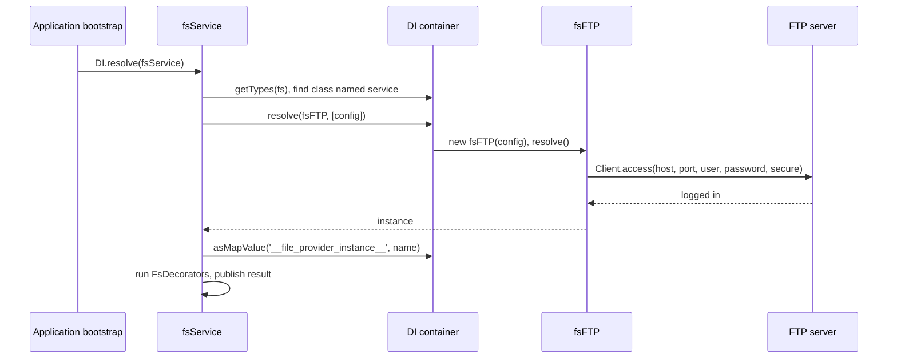

# FTP provider

`fsFTP` is a file provider that stores files on an FTP or explicit-FTPS server. Add it to `fs.providers` with `service: 'fsFTP'`, then get it by its `name` anywhere you would use a local provider.

## How it works

1. Importing `@spinajs/fs-ftp` runs `@Injectable('fs')` and `@PerInstanceCheck()` on `fsFTP`. The class is registered under the `fs` token, next to `fsNative`, `fsTemp` and any other provider.
2. `FsBootsrapper.bootstrap()` (from `@spinajs/fs`) registers the `__file_provider__` factory that `getFs()` and `@FileSystem()` call.
3. `fsService.resolve()` reads `fs.providers`. Entries with the same `name` collapse; the last one wins.
4. `fsService` finds the type registered under `fs` whose class name equals `service` (`'fsFTP'`). No match throws `ResolveException('Type fsFTP not registered ...')`: you did not import `@spinajs/fs-ftp`.
5. `fsService` calls `DI.resolve(fsFTP, [providerConfig])`. The config object becomes `fsFTP.Options`.
6. `fsFTP.resolve()` creates a `basic-ftp` `Client`, routes its log to the `fs` logger, and calls `Client.access()` with `host`, `port` (default `21`), `user`, `password` and `secure` (default `false`).
7. On success it logs `Connected to ftp server at <host>:<port>` at `info` and installs a `trackProgress()` handler that logs every transfer at `debug`.
8. On failure it throws `IOFail('Cannot connect to ftp server: <reason>')`. `fsService.resolve()` fails with it, so the application does not boot.
9. `fsService` publishes the instance in the `__file_provider_instance__` map under its `name`, then replaces it with the result of every registered `FsDecorator` (see [Decorating the FTP provider](04-decorating-the-ftp-provider.md)).
10. Your code gets the published instance with `getFs('<name>')`, `@FileSystem('<name>')`, the helper functions of `@spinajs/fs` with `'<name>'`, or an `fs://<name>/<path>` URI.



## Configuration

Each FTP provider is one entry in `fs.providers`.

| Key | Type | Default | Allowed values | Meaning |
| --- | --- | --- | --- | --- |
| `fs.providers[].service` | `string` | none | `'fsFTP'`, or the class name of an `fsFTP` subclass | Selects the class `fsService` instantiates |
| `fs.providers[].name` | `string` | none | unique across providers | Provider name for `getFs()`, `@FileSystem()` and `fs://` URIs; also the `fsFTP.Name` |
| `fs.providers[].host` | `string` | none | host name or IP | FTP server address |
| `fs.providers[].port` | `number` | `21` | TCP port | FTP control port |
| `fs.providers[].user` | `string` | none | | Login user |
| `fs.providers[].password` | `string` | none | | Login password; `basic-ftp` masks it as `PASS ###` in the command log |
| `fs.providers[].secure` | `boolean` | `false` | `true`, `false` | `true` upgrades the control connection with `AUTH TLS` (explicit FTPS) |
| `fs.providers[].logVerbose` | `boolean` | none | `true`, `false` | Sets `Client.ftp.verbose`; see [Important behaviour](#important-behaviour) |
| `fs.defaultProvider` | `string` | none | a provider `name` | Set it to the FTP provider's name to make the `@spinajs/fs` helpers use FTP when no provider is passed |

`fsFTP` also needs a provider named **`fs-temp`**. Every download, `read()`, `copy()`, cross-provider `move()`, `zip()` and `unzip()` goes through a local temp file on it. `@spinajs/fs` ships no default `fs-temp` entry; configure it yourself.

```ts
fs: {
  defaultProvider: 'local',
  providers: [
    { service: 'fsNative', name: 'fs-temp', basePath: '/var/app/temp' },
    {
      service: 'fsFTP',
      name: 'ftp-partner',
      host: 'ftp.partner.example',
      port: 21,
      user: 'reports',
      password: process.env.PARTNER_FTP_PASSWORD,
      secure: true,
      logVerbose: false,
    },
  ],
}
```

The config interface (`IFtpConfig`) is not exported. Type a config object as `fsFTP['Options']` when you build it in code.

## Services and extension points

| Service | DI token and lifetime | Default implementation | Alternatives | How to replace or extend |
| --- | --- | --- | --- | --- |
| FTP file provider | `fs` (registered as the string `'fs'`, which is the same key as the `fs` class), by `@Injectable('fs')` at import. `@PerInstanceCheck()`: one instance per `name` | `fsFTP` | `fsNative`, `fsTemp` (`@spinajs/fs`), `fsS3` (`@spinajs/fs-s3`), `fsOneDrive` (`@spinajs/fs-onedrive`) | Subclass it, register the subclass under `fs` and set `service` to its class name: [Extending the FTP provider](03-extending-the-ftp-provider.md) |
| Temp file storage | Provider named `fs-temp`, looked up through `getFs('fs-temp')` by the `@FileSystem('fs-temp')` getter on every access | Whatever `fs-temp` entry you configure | `fsNative`, or `fsTemp` with a local backend for automatic cleanup | Configure another provider under the name `fs-temp`. It must return local absolute paths from `tmppath()` and support `writeStream()` |
| Provider wrappers | `FsDecorator`, resolved as `Array.ofType(FsDecorator)` once by `fsService` | none | `AuthzFsDecorator` (`@spinajs/authz-fs`) | Register your own `FsDecorator`: [Decorating the FTP provider](04-decorating-the-ftp-provider.md) |
| Logger | `@Logger('fs')`, shared with every other provider | `@spinajs/log` | | Route the `fs` logger with logger rules |
| File info | `FileInfoService`, `@Autoinject()` into `fsFTP.FileInfo` | `DefaultFileInfo` | | Injected but never called by `fsFTP`; `metadata()` does not work on FTP paths |

### Several FTP servers

`@PerInstanceCheck()` makes `fsFTP.__checkInstance__()` compare `Name` with the creation options. Each `fs.providers` entry with its own `name` gets its own `fsFTP`, its own `Client` and its own connection.

```ts sample
import { FileSystem, fs } from '@spinajs/fs';
import '@spinajs/fs-ftp';

// fs.providers holds two fsFTP entries, named 'ftp-partner' and 'ftp-archive'
export class ReportDistributor {
  @FileSystem('ftp-partner')
  protected Partner: fs;

  @FileSystem('ftp-archive')
  protected Archive: fs;

  public async distribute(day: string, csv: string) {
    await this.Partner.write(`incoming/${day}.csv`, csv, 'utf-8');
    await this.Archive.write(`reports/${day.slice(0, 4)}/${day}.csv`, csv, 'utf-8');
  }
}
```

## Important behaviour

- The connection opens in `resolve()`, at application boot. A server that is down at boot stops the application with `IOFail`.
- There is no reconnect. If the server closes the idle control connection, later calls fail with the `basic-ftp` error `Client is closed because ...` until the process restarts.
- `fsFTP` does not override `dispose()`. The connection stays open until the process exits.
- `logVerbose` has no effect. `fsFTP` replaces `Client.ftp.log` with a function that always writes to the `fs` logger at `debug`, which bypasses the `verbose` check inside `basic-ftp`. Every FTP command and response reaches the logger; filter it with logger rules for `fs` at `debug`.
- Transfer progress is logged at `debug` for every chunk `basic-ftp` reports: file name, bytes of this transfer and bytes overall.
- `secure` is typed `boolean`. `basic-ftp` also accepts `'implicit'` for implicit FTPS on port 990; the value passes through to `Client.access()` untouched.
- `@FileSystem('fs-temp')` is a getter. `fsFTP` reads `fs-temp` on every operation, so `fs-temp` does not need to be resolved before the FTP provider.

## Best practices

- Keep the password out of the config file: read it from `process.env` in your `FrameworkConfiguration` subclass.
- Give every FTP server its own provider `name`; never reuse a name to point at a second server, because the last entry silently wins.
- Point `fs-temp` at a local disk with enough space for the largest file you download: every `read()` writes the whole file there first.
- Use `fsTemp` with `cleanup: true` over a local `fsNative` as `fs-temp` when you call `download()` yourself, so forgotten temp files get deleted.

## Patterns and antipatterns

```ts
// Don't: fsFTP.download() returns a local temp path, and resolvePath() cannot map an FTP path to one
const local = ftp.resolvePath('incoming/order.xml');

// Do
const local = await ftp.download('incoming/order.xml');
```

```ts
// Don't: fs-temp backed by FTP; fsFTP.tmppath() throws MethodNotImplemented
providers: [
  { service: 'fsFTP', name: 'ftp', host: 'ftp.example.com', user: 'app', password: 'secret' },
  { service: 'fsTemp', name: 'fs-temp', provider: 'ftp' },
]

// Do: fs-temp on local disk
providers: [
  { service: 'fsFTP', name: 'ftp', host: 'ftp.example.com', user: 'app', password: 'secret' },
  { service: 'fsNative', name: 'fs-temp-local', basePath: '/var/app/temp' },
  { service: 'fsTemp', name: 'fs-temp', provider: 'fs-temp-local', cleanup: true, maxFileAge: 3600 },
]
```

## Examples

### Send invoices to an accounting FTP server over FTPS

```ts sample
import { DI } from '@spinajs/di';
import { Configuration, FrameworkConfiguration } from '@spinajs/configuration';
import { getFs } from '@spinajs/fs';
import '@spinajs/fs-ftp';
import _ from 'lodash';

export class AccountingConfiguration extends FrameworkConfiguration {
  public async resolve(): Promise<void> {
    await super.resolve();

    this.Config = _.merge(this.Config, {
      fs: {
        defaultProvider: 'local',
        providers: [
          { service: 'fsNative', name: 'local', basePath: '/var/app/files' },
          { service: 'fsNative', name: 'fs-temp-local', basePath: '/var/app/temp' },
          { service: 'fsTemp', name: 'fs-temp', provider: 'fs-temp-local', cleanup: true, maxFileAge: 3600 },
          {
            service: 'fsFTP',
            name: 'ftp-accounting',
            host: 'ftp.accounting.example',
            port: 21,
            user: 'invoices',
            password: process.env.ACCOUNTING_FTP_PASSWORD,
            secure: true,
          },
        ],
      },
    });
  }
}

DI.register(AccountingConfiguration).as(Configuration);

export async function sendInvoice(invoiceNo: string, localPdfPath: string) {
  const accounting = getFs('ftp-accounting');
  await accounting.upload(localPdfPath, `invoices/${invoiceNo}.pdf`);
  return accounting.exists(`invoices/${invoiceNo}.pdf`);
}
```

### Resolve the provider directly from the container

```ts sample
import { DI } from '@spinajs/di';
import { fs } from '@spinajs/fs';
import { fsFTP } from '@spinajs/fs-ftp';

export async function partnerFtp(): Promise<fs> {
  const ftp = await DI.resolve<fs>('__file_provider__', ['ftp-partner']);

  if (!(ftp instanceof fsFTP)) {
    throw new Error('ftp-partner is not an FTP provider');
  }

  return ftp;
}
```

`instanceof fsFTP` holds for a `Proxy` over the instance and for an `Object.create(instance)` wrapper. It is `false` when an `FsDecorator` returns an unrelated object.

## Related

- [File operations](02-file-operations.md): what each `fs` method does on FTP.
- [Extending the FTP provider](03-extending-the-ftp-provider.md): subclass `fsFTP` and select it with `service`.
- [`@spinajs/fs`](../fs/README.md): `fsService`, `getFs()`, `@FileSystem()`, `fsNative` and `fsTemp`.
