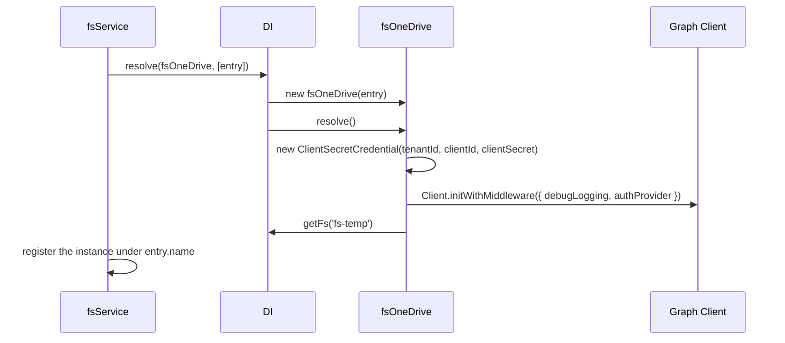

# OneDrive provider

`fsOneDrive` is an `fs` provider that connects to Microsoft Graph with a client-secret credential. Configure it as an entry in `fs.providers` and resolve it by name like any other provider.

It is a work in progress: the connection is built at boot, but every file operation throws `MethodNotImplemented`. To read or write files, extend it as shown in [Extending the provider](02-extending-the-provider.md).

## How it works

1. `fsService.resolve()` (from `@spinajs/fs`) reads `fs.providers`, orders the entries by their `provider` key, and looks up the registered `fs` type whose class name equals the entry's `service` (`'fsOneDrive'`).
2. `DI.resolve(fsOneDrive, [entry])` creates the instance with the whole provider entry as `Options`. `@PerInstanceCheck()` returns the existing instance when one with the same `name` exists.
3. `fsOneDrive.resolve()` runs:
   1. creates `OneDriveCredentials`, a `ClientSecretCredential` from `tenantId`, `clientId` and `clientSecret`, with `fs.onedrive.aad_endpoint` as authority host;
   2. creates `Client` with `Client.initWithMiddleware()`, with `debugLogging` set from `debug`, the base URL taken from `fs.onedrive.graph_endpoint` (plus `v1.0`) and an auth provider that requests a token for `GRAPH_SCOPE` (`https://graph.microsoft.com/.default`, read from the instance's class, so a subclass can override it) on every Graph call.

   `TempFs` is not set in `resolve()`: it is looked up lazily from `fs-temp` when first used.
4. `fsService` publishes the instance itself under its `name`. Nothing wraps it.
5. Callers get it through `getFs('<name>')`, `@FileSystem('<name>')` or `DI.resolve('__file_provider__', ['<name>'])`.
6. Any file operation on the instance first runs the registered [middlewares](../fs/07-middlewares.md), then reaches a `doX` hook. Every `doX` hook is a stub that throws `MethodNotImplemented` with the message `fs onedrive provider does not implement '<method>' yet`. The probes that middlewares run (`ctx.exists()`, `ctx.isDir()`, `ctx.hasEntries()`) throw as well, so with `AuthzFsMiddleware` enabled on this filesystem every create and `rm` is refused.

Boot fails when:

- `tenantId`, `clientId` or `clientSecret` is empty: `ClientSecretCredential` throws an `Error` in step 3.1.

No token is requested at boot. A wrong secret or tenant surfaces on the first Graph call a subclass makes.



## Configuration

Each OneDrive provider is one entry in `fs.providers`. `IOnedriveConfig` types the OneDrive-specific keys.

| Key | Type | Default | Allowed values | Meaning |
| --- | --- | --- | --- | --- |
| `fs.providers[].service` | `string` | none | `'fsOneDrive'` or the class name of a registered subclass | Selects the provider class |
| `fs.providers[].name` | `string` | none | unique provider name | Name used by `getFs()`, `@FileSystem()` and as `fsOneDrive.Name`; one instance per name |
| `fs.providers[].tenantId` | `string` | none | Entra ID tenant id or domain | Tenant of the app registration; required |
| `fs.providers[].clientId` | `string` | none | application (client) id | App registration id; required |
| `fs.providers[].clientSecret` | `string` | none | client secret value | App registration secret; required |
| `fs.providers[].drive` | `string` | none | Graph drive id | Stored in `Options.drive`; `fsOneDrive` does not read it, subclasses use it to build drive paths |
| `fs.providers[].debug` | `boolean` | `undefined` (off) | `true`, `false` | Passed as `debugLogging` to the Graph client |
| `fs.providers[].provider` | `string` | none | `'fs-temp'` | Not read by `fsOneDrive`; `fsService` creates the named provider first. Optional: `TempFs` is resolved lazily |
| `fs.onedrive.aad_endpoint` | `string` | `'https://login.microsoftonline.com/'` | URL | Authority host of the credential |
| `fs.onedrive.graph_endpoint` | `string` | `'https://graph.microsoft.com/'` | URL | Graph host; the client base URL is this plus `v1.0`. The token scope stays `GRAPH_SCOPE` |

Subclasses that use `TempFs` need a temp provider named exactly `fs-temp`. The name is hard-coded, but it is resolved on first use, so config order does not matter.

```ts
export default {
  fs: {
    providers: [
      { service: 'fsTemp', name: 'fs-temp', provider: 'fs-local' },
      {
        service: 'fsOneDrive',
        name: 'sharepoint-documents',
        provider: 'fs-temp',
        tenantId: process.env.AZURE_TENANT_ID,
        clientId: process.env.AZURE_CLIENT_ID,
        clientSecret: process.env.AZURE_CLIENT_SECRET,
        drive: 'b!x7Hk...',
        debug: false,
      },
    ],
  },
};
```

The provider always requests the `https://graph.microsoft.com/.default` scope, so the Graph application permissions granted to the app registration decide which drives it can reach.

## Services and extension points

| Service | DI token and lifetime | Default implementation | Alternatives | How to replace or extend |
| --- | --- | --- | --- | --- |
| `fsOneDrive` | Registered under the `fs` key (`@Injectable('fs')`) at import; `@PerInstanceCheck()`: one instance per `name` | `fsOneDrive` (connection only, no operations) | Other `fs` providers: `fsNative`, `fsTemp` (`@spinajs/fs`), `fsS3`, `fsFTP` | Subclass it, decorate the subclass with `@Injectable('fs')` and `@PerInstanceCheck()`, set `service` to the subclass name. See [Extending the provider](02-extending-the-provider.md) |
| Graph client and credential | Protected fields `Client` and `OneDriveCredentials`, built in `fsOneDrive.resolve()`; not in DI | `Client.initWithMiddleware()` with a `ClientSecretCredential` | none shipped | Override `resolve()`, call `super.resolve()`, then replace `this.Client`. See [Change the Graph cloud or token](02-extending-the-provider.md#change-the-graph-cloud-or-token) |
| `FsMiddleware` | `Array.ofType(FsMiddleware)`, resolved on every top-level action | none | `AuthzFsMiddleware` and any registered middleware | Defined in [`@spinajs/fs`](../fs/07-middlewares.md); applies to `fsOneDrive` like to any provider |

Members a subclass can use:

| Member | Type | Meaning |
| --- | --- | --- |
| `Options` | `IOnedriveConfig` | The provider entry from `fs.providers`, including extra keys you add |
| `Client` | `Client` (`@microsoft/microsoft-graph-client`) | Authenticated Graph client, ready after `resolve()` |
| `OneDriveCredentials` | `ClientSecretCredential` | Credential behind `Client` |
| `TempFs` | `fs` | The `fs-temp` provider, for staging downloads |
| `Logger` | `Log` | Logger named `fs-onedrive` |
| `fsOneDrive.GRAPH_SCOPE` | `string` | `'https://graph.microsoft.com/.default'` |

## Important behaviour

- Every method of the `fs` contract throws `MethodNotImplemented`: `download`, `upload`, `read`, `readStream`, `write`, `writeStream`, `append`, `exists`, `dirExists`, `copy`, `move`, `rename`, `rm`, `mkdir`, `stat`, `isDir`, `list`, `tmppath`, `zip`, `unzip`, `resolvePath`.
- The async methods return a rejected promise. `tmppath()` and `resolvePath()` are synchronous and throw directly.
- The inherited `hash()` and `metadata()` call `resolvePath()`, so they reject with `MethodNotImplemented` too.
- `fsOneDrive` does not implement `signedUrl()`.
- The temp provider name `fs-temp` is hard-coded and resolved lazily on first `TempFs` access; a missing provider throws `ResolveException` then, not at boot.
- The `Config` field (`@Config('fs.onedrive')`) holds the `{ aad_endpoint, graph_endpoint }` object, not provider options. Provider options come from `Options`.
- The auth provider calls `ClientSecretCredential.getToken()` on each Graph request and sends an empty token when the call returns `null`.

## Best practices

- Keep `clientSecret` out of config files: read it from `process.env` in the config entry.
- Declare an `fs-temp` provider if your subclass uses `TempFs`.
- Give each drive its own entry and `name`; `@PerInstanceCheck()` keeps one Graph client per name.
- Check for `MethodNotImplemented` in code that accepts any `fs` provider, until the operations you call are implemented.


## Examples

### Inject the OneDrive provider into a report service

```ts sample
import '@spinajs/fs-onedrive';
import { fs, FileSystem } from '@spinajs/fs';
import { MethodNotImplemented } from '@spinajs/exceptions';

export class QuarterlyReportPublisher {
  @FileSystem('sharepoint-documents')
  protected Documents: fs;

  public async publish(quarter: string, csv: string): Promise<boolean> {
    try {
      await this.Documents.write(`reports/${quarter}.csv`, csv, 'utf-8');
      return true;
    } catch (err) {
      if (err instanceof MethodNotImplemented) {
        // Register a subclass of fsOneDrive that implements write().
        return false;
      }
      throw err;
    }
  }
}
```

## Related

- [`@spinajs/fs`](../fs/README.md): provider contract, `fsService`, `getFs()`, `@FileSystem()`, temp provider and middlewares.
- [Extending the provider](02-extending-the-provider.md): implement the operations and swap the Graph client.
