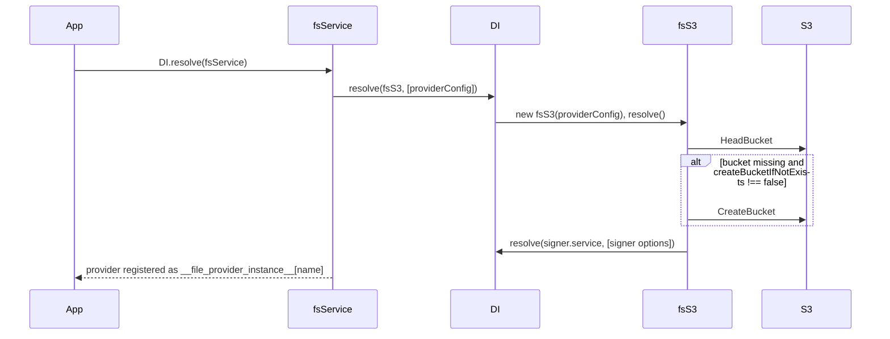

# S3 file provider

`fsS3` exposes one S3 bucket as an `fs` provider. Configure it under `fs.providers` with `service: 'fsS3'`, then inject it by name like any other filesystem.

## How it works

1. Importing `@spinajs/fs-s3` runs `@Injectable('fs')` on `fsS3`: the class is registered under the `fs` key and under itself.
2. `fsService.resolve()` (from `@spinajs/fs`) reads `fs.providers`, finds the type registered under `fs` whose class name equals the entry's `service` (`fsS3`), and calls `DI.resolve(fsS3, [entry])`.
3. `@PerInstanceCheck()` makes DI create one `fsS3` per provider `name`: `fs.__checkInstance__()` compares the cached instance's `Name` with `entry.name`.
4. `fsS3.resolve()` creates an `S3Client` from `fs.s3.config` and routes the AWS SDK logger to the `fs` logger. Credentials are masked in the debug log.
5. `fsS3.ensureBucketExists()` sends `HeadBucketCommand`. On `NotFound` or HTTP 404 it sends `CreateBucketCommand` (with `LocationConstraint` set to the client region outside `us-east-1`), unless `createBucketIfNotExists` is `false`, which throws `IOFail`. Any other error (403, network) is logged and rethrown.
6. When the entry has a `signer`, `fsS3.resolve()` resolves it by name. See [Signed URLs](04-signed-urls.md).
7. `fsService` publishes the instance under `__file_provider_instance__`; `@FileSystem('<name>')`, `getFs('<name>')` and `DI.resolve('__file_provider__', ['<name>'])` return it.

A failure in step 4, 5 or 6 rejects `fsService.resolve()`, so the application does not start.



## Configuration

| Key | Type | Default | Allowed values | Meaning |
| --- | --- | --- | --- | --- |
| `fs.s3.config` | `S3ClientConfig` | none, required | any `@aws-sdk/client-s3` client config | Passed to `new S3Client()`. Shared by **every** `fsS3` provider. |
| `fs.providers[].service` | `string` | none | `'fsS3'`, or the class name of an `fsS3` subclass | Selects the provider class. |
| `fs.providers[].name` | `string` | none, required | unique provider name | Name used by `@FileSystem()` and `getFs()`. |
| `fs.providers[].bucket` | `string` | none, required | S3 bucket name | Bucket every operation targets. Paths are object keys. |
| `fs.providers[].createBucketIfNotExists` | `boolean` | `undefined` (creates) | `true`, `false` | Only `false` stops `resolve()` from creating a missing bucket. |
| `fs.providers[].signer` | `object` | none | see [Signed URLs](04-signed-urls.md) | Enables `signedUrl()` and `getSignedUrl()`. |
| `fs.defaultProvider` | `string` | none, required by `fsService` | a provider name | Provider used when none is named. |

The provider also needs `fs-temp-s3`, which the package config ships; see [Temporary files](02-temporary-files.md).

```ts
fs: {
  s3: {
    config: {
      region: 'eu-central-1',
      credentials: { accessKeyId: '...', secretAccessKey: '...' },
      // LocalStack or MinIO:
      // endpoint: 'http://localhost:4566',
      // forcePathStyle: true,
    },
  },
  providers: [
    { service: 'fsS3', name: 'media', bucket: 'acme-media', createBucketIfNotExists: false },
  ],
}
```

## Services and extension points

| Service | DI token and lifetime | Default implementation | Alternatives | How to replace or extend |
| --- | --- | --- | --- | --- |
| `fsS3` | `'fs'` and `fsS3`; `PerInstanceCheck`, one instance per provider `name`, created by `fsService` at boot | `fsS3` | other `fs` providers: `fsNative`, `fsTemp`, `@spinajs/fs-ftp`, `@spinajs/fs-onedrive` | Subclass it with `@Injectable('fs')` and `@PerInstanceCheck()` and set `service` to the subclass name. See [Custom S3 provider](05-custom-s3-provider.md). |
| `FsDecorator` (from `@spinajs/fs`) | `Array.ofType(FsDecorator)`, applied by `fsService` after all providers exist | none | access guards, auditing wrappers | Applies to `fsS3` like to any provider; `getFs()` returns the decorated instance. |

## Operations

| Method | S3 call | Behaviour |
| --- | --- | --- |
| `write(path, data, encoding?)` | `Upload` (multipart) | Stores `hash` (SHA-256) and `md5` metadata. A string `data` is stored as bytes in `encoding` (default `utf8`). |
| `writeStream(path, encodingOrStream?, encoding?)` | `Upload` with a `PassThrough` body | Returns the `PassThrough`, whose default string encoding is `encoding`. It emits `close` when the upload finished, and is destroyed with `IOFail` when the upload fails. Stores no hash metadata. |
| `upload(srcPath, destPath?)` | `Upload` | `srcPath` must be an **absolute** local path. `destPath` defaults to `basename(srcPath)`. Sets `ContentType` to the detected `MimeType`. Stores file info and hashes; see [Object metadata](03-object-metadata.md). |
| `read(path, encoding?)` | `GetObject` | Downloads to `fs-temp-s3`, reads, deletes the local copy. |
| `readStream(path, encoding?)` | `GetObject` | Returns the response body. With `encoding`, pipes it through `iconv-lite` `decodeStream`. |
| `download(path)` | `GetObject` | Writes to a `fs-temp-s3` temp path with the same extension and returns that local path. The caller deletes it. |
| `append(path, data, encoding?)` | `GetObject` + `Upload` | Downloads, appends locally, uploads the whole file again. |
| `exists(path)` | `HeadObject` | `false` on a `NotFound` error; any other error is rethrown. |
| `stat(path)` | `HeadObject` | `IsFile: true`, `IsDirectory: false`, `Size` from `ContentLength`, `ModifiedTime` from `LastModified`, `Version` from `ETag`. |
| `copy(path, dest, dstFs?)` | `CopyObject`, or download + `dstFs.upload()` | Without `dstFs`, a server-side copy in the same bucket; the key in `CopySource` is URL-encoded per segment. With `dstFs`, a download and an upload. |
| `move(old, new, dstFs?)`, `rename(old, new)` | `copy()` then `rm()` | Two steps, not atomic. |
| `rm(path)` | `DeleteObject` | Deletes one key. It does **not** delete a prefix. |
| `list(path)` | `ListObjectsV2` with `Delimiter: '/'` | Full keys directly under the prefix `path`, from every result page. |
| `metadata`, `getMetadata`, `setMetadata`, `hash` | `HeadObject`, `CopyObject` | See [Object metadata](03-object-metadata.md). |
| `signedUrl`, `getSignedUrl` | signer | See [Signed URLs](04-signed-urls.md). |
| `zip`, `unzip` | `GetObject` | Work on local copies; see [Temporary files](02-temporary-files.md). |
| `mkdir()` | none | No-op. |
| `dirExists()` | none | Always `true`. |
| `isDir()` | none | Always `false`. |
| `tmppath()` | none | Throws `MethodNotImplemented`. Use `fs-temp-s3`. |
| `resolvePath(path)` | none | Returns an absolute path unchanged; throws `MethodNotImplemented` for anything else. |
| `dispose()` | none | Destroys the `S3Client`, so the process can exit. `fs-temp-s3` is a separate provider and is not disposed. |

## Important behaviour

- **One AWS client config for all buckets.** Every `fsS3` provider reads `fs.s3.config`. Buckets in other accounts or regions need a subclass; see [Custom S3 provider](05-custom-s3-provider.md).
- **A missing bucket is created by default.** Set `createBucketIfNotExists: false` in production, where the bucket and its policies come from infrastructure code.
- **No `Content-Type` is set** by `write` or `writeStream`. S3 stores its default, which browsers then receive from signed URLs. `upload()` sets the detected `MimeType` when file info found one.
- **`list()` is shallow.** Keys under deeper prefixes and the sub-prefixes themselves are not returned.
- **`stat()` has no creation or access time.** `CreationTime` and `AccessTime` are `undefined`.
- **`stat().Version` is the ETag.** For multipart uploads it is not the content MD5; compare it only for equality.
- **Errors are AWS SDK errors.** A missing key on `read`, `stat` or `getMetadata` rejects with the SDK's `NotFound` or `NoSuchKey` error, not with an `@spinajs/exceptions` type.

## Best practices

- Keep `fs.s3.config.credentials` out of committed config; load them from the environment, or omit `credentials` to use the AWS default provider chain (instance role, `AWS_PROFILE`).
- Use `forcePathStyle: true` and `endpoint` for LocalStack or MinIO in tests.
- Prefer `readStream()` over `read()` for large objects: `read()` writes the whole object to local disk first.
- Prefer `writeStream()` with a source stream for large uploads: it streams a multipart upload without a local copy.
- Wait for the `close` event of the stream returned by `writeStream()` before reading the object back.
- Call `dispose()` on S3 providers in test teardown, or Mocha keeps running on the open sockets.

## Patterns and antipatterns

```ts
// Don't: 'finish' fires when the PassThrough is drained, before S3 has the object
const out = await media.writeStream('videos/intro.mp4', source);
out.on('finish', () => publish('videos/intro.mp4'));

// Do: fsS3 emits 'close' after the multipart upload completed
const out = await media.writeStream('videos/intro.mp4', source);
out.on('close', () => publish('videos/intro.mp4'));
out.on('error', (err) => logger.error(err));
```

```ts
// Don't: upload() hashes the source through resolvePath(), which rejects relative paths
await media.upload('uploads/photo.jpg');

// Do: pass an absolute local path, for example from the local provider
await media.upload(local.resolvePath('uploads/photo.jpg'), 'photos/photo.jpg');
```

## Examples

### Stream a camera recording into S3

```ts sample
import { Injectable } from '@spinajs/di';
import { FileSystem, fs } from '@spinajs/fs';
import '@spinajs/fs-s3';
import { createReadStream } from 'fs';

@Injectable()
export class RecordingUploader {
  @FileSystem('recordings')
  protected Recordings: fs;

  public async upload(localFile: string, cameraId: string, startedAt: string): Promise<string> {
    const key = `cameras/${cameraId}/${startedAt}.mp4`;
    const out = await this.Recordings.writeStream(key, createReadStream(localFile));

    await new Promise<void>((resolve, reject) => {
      out.on('close', () => resolve());
      out.on('error', reject);
    });

    return key;
  }
}
```

### Move processed reports to another bucket

```ts sample
import { getFs } from '@spinajs/fs';
import '@spinajs/fs-s3';

export async function archiveReports(prefix: string): Promise<number> {
  const inbox = getFs('reports-inbox');
  const archive = getFs('reports-archive');

  const keys = await inbox.list(prefix);
  for (const key of keys) {
    // another provider as dstFs: download from inbox, upload to archive, delete from inbox
    await inbox.move(key, key, archive);
  }

  return keys.length;
}
```

### Check a file before serving it

```ts sample
import { getFs } from '@spinajs/fs';
import '@spinajs/fs-s3';

export async function describeAttachment(key: string) {
  const attachments = getFs('attachments');

  if (!(await attachments.exists(key))) {
    return null;
  }

  const stat = await attachments.stat(key);
  return { key, size: stat.Size, modified: stat.ModifiedTime?.toISO(), etag: stat.Version };
}
```

## Related

- [Temporary files](02-temporary-files.md): the local filesystem behind `read`, `download`, `append`, `zip` and `unzip`.
- [Object metadata](03-object-metadata.md): what `upload` and `write` store next to the object.
- [Signed URLs](04-signed-urls.md): links to objects without exposing the bucket.
- [Custom S3 provider](05-custom-s3-provider.md): subclassing `fsS3`.
- [`@spinajs/fs`](../fs/README.md): `fsService`, `@FileSystem()`, `getFs()` and the `fs` contract.
