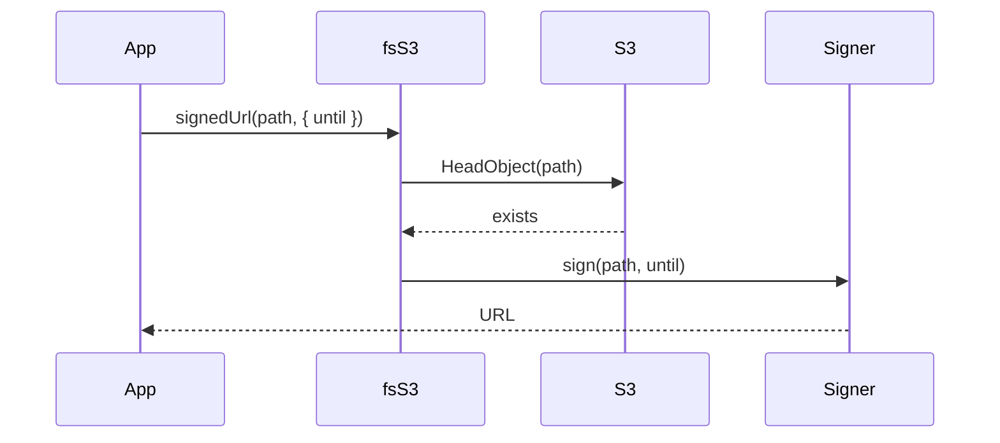

# Signed URLs

`fsS3.signedUrl()` returns a time-limited URL to an object, so a browser downloads it without credentials and without the bucket being public. A signer service, named in the provider config, builds the URL: an S3 presigned URL, a CloudFront signed URL, or your own.

## How it works

At boot, in `fsS3.resolve()`:

1. When the provider entry has a `signer`, `fsS3` calls `DI.resolve(signer.service, [{ ...signer, bucket, s3Client }])`.
2. DI looks up `signer.service` as a registration name and creates the last class registered under it, passing the object as the only constructor argument.
3. The instance is kept in `fsS3.Signer`. An unknown name rejects `resolve()`, so the application does not start.

On each call to `signedUrl(path, { until?, disposition? })`:

1. `doSignedUrl` throws `InvalidOperation` (`no signer service configured`) when the provider has no `signer`.
2. Calls `exists(path)` (one `HeadObject`). Throws `IOFail` (`does not exists`) when the object is missing.
3. Returns `Signer.sign(path, until)`.

`signedUrl(path, { until?, disposition? })` and `getSignedUrl(path, until?)` are base methods of `fs` checked as `share`: [middlewares](../fs/07-middlewares.md) run first, and `fsS3` implements the protected `doSignedUrl` through the configured signer. `getSignedUrl(path, until?)` is `signedUrl(path, { until })`.



## Configuration

| Key | Type | Default | Allowed values | Meaning |
| --- | --- | --- | --- | --- |
| `fs.providers[].signer.service` | `string` | none | `'S3UrlSigner'`, `'S3BucketSigner'`, `'CloudFrontUrlSigner'`, `'CloudFrontSigner'`, or the name of your registered signer | DI name of the signer to create. |
| `fs.providers[].signer.domain` | `string` | none | `https://<distribution>.cloudfront.net`, no trailing slash | CloudFront only: URL prefix; the URL is `${domain}/${path}`. |
| `fs.providers[].signer.publicKeyId` | `string` | none | CloudFront public key ID | CloudFront only: sent as `Key-Pair-Id`. |
| `fs.providers[].signer.privateKey` | `string` | none | PEM RSA private key | CloudFront only: signs the policy. |
| `fs.providers[].signer.<any>` | any | none | anything your signer reads | Every key of `signer` reaches the signer's constructor. |

`fsS3` adds `bucket` (the provider's bucket) and `s3Client` (its `S3Client`) to the signer options.

```ts
fs: {
  providers: [
    { service: 'fsS3', name: 'exports', bucket: 'acme-exports', signer: { service: 'S3UrlSigner' } },
    {
      service: 'fsS3',
      name: 'videos',
      bucket: 'acme-videos',
      signer: {
        service: 'CloudFrontUrlSigner',
        domain: 'https://d111111abcdef8.cloudfront.net',
        publicKeyId: process.env.CF_PUBLIC_KEY_ID,
        privateKey: process.env.CF_PRIVATE_KEY,
      },
    },
  ],
}
```

## Services and extension points

| Service | DI token and lifetime | Default implementation | Alternatives | How to replace or extend |
| --- | --- | --- | --- | --- |
| `S3UrlSigner` | names `'S3UrlSigner'` and `'S3BucketSigner'`; `NewInstance`, one per provider; resolved by name from `signer.service` in `fsS3.resolve()` | `S3BucketSigner` | `CloudFrontSigner`, your own | Subclass `S3BucketSigner` and override `sign()`, register it under its own name and set `signer.service` to it. `DI.register(MySigner).as('S3UrlSigner')` replaces it for every provider that names `S3UrlSigner`. |
| `CloudFrontUrlSigner` | names `'CloudFrontUrlSigner'` and `'CloudFrontSigner'`; `NewInstance`; resolved the same way | `CloudFrontSigner` | `S3BucketSigner`, your own | Subclass `CloudFrontSigner` and override `sign()`, or `DI.register(MySigner).as('CloudFrontUrlSigner')`. |
| any signer | any DI name | none | a standalone class | Any class with `sign(path: string, until?: DateTime): Promise<string>` and a constructor taking the options object works: `fsS3` only calls `sign()`. |

### Shipped signers

| Signer | URL | Expiry | Options used |
| --- | --- | --- | --- |
| `S3BucketSigner` | S3 presigned `GetObject` URL (`getSignedUrl` from `@aws-sdk/s3-request-presigner`) | `until` minus now in whole seconds, at least 1; **900 s** (15 minutes) without `until` | `bucket`, `s3Client` |
| `CloudFrontSigner` | `${domain}/${path}` with a canned policy (`getSignedUrl` from `@aws-sdk/cloudfront-signer`) | `until`; **1 hour** without `until` | `domain`, `publicKeyId`, `privateKey` |

Protected helpers for subclasses:

- `S3UrlSigner.getExpiresInSeconds(until?)`: seconds until `until`, `900` without it, never below `1`.
- `CloudFrontUrlSigner.getDateLessThan(until?)`: `until`, or now plus one hour, as an ISO string.

The abstract `S3UrlSigner` and `CloudFrontUrlSigner`, and the option types `IS3Config`, `IS3UrlSigner` and `ICloudfrontUrlSignerOptions`, are exported from `@spinajs/fs-s3`.

### Signer: one instance per bucket

The shipped signers are `@NewInstance()`: every provider gets its own signer with its own `bucket`, `s3Client` and keys. Keep `@NewInstance()` on a subclass, or the first provider that resolves it fixes the options for all of them.

```ts sample
import { Injectable, NewInstance } from '@spinajs/di';
import { S3BucketSigner } from '@spinajs/fs-s3';

// fs.providers: { service: 'fsS3', name: 'exports', bucket: 'acme-exports', signer: { service: 'PerBucketS3Signer' } }
@Injectable()
@NewInstance()
export class PerBucketS3Signer extends S3BucketSigner {}
```

### Signer: force a download with a file name

`signedUrl()` accepts `disposition`, but the shipped signers ignore it. This signer makes browsers save the file instead of opening it, and gives links a 10-minute default.

```ts sample
import { GetObjectCommand } from '@aws-sdk/client-s3';
import { getSignedUrl } from '@aws-sdk/s3-request-presigner';
import { Injectable, NewInstance } from '@spinajs/di';
import { S3BucketSigner } from '@spinajs/fs-s3';
import { DateTime } from 'luxon';
import { basename } from 'path';

@Injectable()
@NewInstance()
export class AttachmentS3Signer extends S3BucketSigner {
  public async sign(path: string, until?: DateTime): Promise<string> {
    const command = new GetObjectCommand({
      Bucket: this.options.bucket,
      Key: path,
      ResponseContentDisposition: `attachment; filename="${basename(path)}"`,
    });

    const expiresIn = until ? this.getExpiresInSeconds(until) : 600;
    return getSignedUrl(this.options.s3Client, command, { expiresIn });
  }
}

// fs.providers: { service: 'fsS3', name: 'invoices', bucket: 'acme-invoices', signer: { service: 'AttachmentS3Signer' } }
```

### Signer: public CDN without signing

A bucket behind a public CDN needs plain URLs, not signatures. A standalone class works, because `fsS3` only calls `sign()`. It still gets the `exists()` check of `signedUrl()`.

```ts sample
import { Injectable, NewInstance } from '@spinajs/di';
import { DateTime } from 'luxon';

interface PublicCdnSignerOptions {
  cdnUrl: string;
  bucket: string;
}

@Injectable()
@NewInstance()
export class PublicCdnSigner {
  constructor(protected options: PublicCdnSignerOptions) {}

  public async sign(path: string, _until?: DateTime): Promise<string> {
    return `${this.options.cdnUrl}/${path.split('/').map(encodeURIComponent).join('/')}`;
  }
}

// fs.providers: { service: 'fsS3', name: 'assets', bucket: 'acme-assets', signer: { service: 'PublicCdnSigner', cdnUrl: 'https://cdn.acme.com' } }
```

### Signer: replace the default for every provider

Register under the shipped name to change all providers that use `signer.service: 'S3UrlSigner'`. DI creates the last class registered under a name, so register before `fsService` resolves.

```ts sample
import { DI, Injectable, NewInstance } from '@spinajs/di';
import { S3BucketSigner } from '@spinajs/fs-s3';
import { DateTime } from 'luxon';

@Injectable()
@NewInstance()
export class ShortLivedS3Signer extends S3BucketSigner {
  public async sign(path: string, until?: DateTime): Promise<string> {
    const cap = DateTime.now().plus({ minutes: 5 });
    return super.sign(path, until && until.toMillis() < cap.toMillis() ? until : cap);
  }
}

// before DI.resolve(fsService)
DI.register(ShortLivedS3Signer).as('S3UrlSigner');
```

## Important behaviour

- **With `authz-fs` the effective `until` is capped.** It is `min(asked ?? now + defaultTtl, now + maxTtl, decision.validUntil)`: [Checks on file actions](../authz-fs/02-checks-on-file-actions.md).
- **Each `signedUrl()` costs one `HeadObject`.** A page with 50 thumbnails sends 50 requests before signing.
- **`disposition` is ignored** by both shipped signers.
- **S3 presigned URLs last at most 7 days.** The presigner rejects a longer `until`.
- **An `until` in the past** gives a 1-second S3 URL, and a CloudFront URL that is already expired. Neither signer throws.
- **The CloudFront URL is not encoded.** `path` is appended to `domain` as is; keys with spaces or `?` produce broken URLs.
- **The CloudFront signer does not check the distribution.** The URL works only when the distribution serves this bucket and trusts `publicKeyId`.

## Best practices

- Use `S3UrlSigner` for short-lived links to private files, `CloudFrontUrlSigner` for media served at volume through a CDN.
- Pass an explicit `until` that matches the use: minutes for a download button, hours for a video session.
- Keep `privateKey` out of committed config: read it from the environment or a secret store in your configuration class.
- Keep `@NewInstance()` on your own signers, so two buckets that sign do not share options.

## Patterns and antipatterns

```ts
// Don't: signing on a provider without `signer` throws InvalidOperation on every call
const url = await getFs('uploads').signedUrl(key);

// Do: configure a signer on the provider whose files you link to
// { service: 'fsS3', name: 'uploads', bucket: 'acme-uploads', signer: { service: 'S3UrlSigner' } }
const url = await getFs('uploads').signedUrl(key, { until: DateTime.now().plus({ minutes: 15 }) });
```

## Examples

### Link to a generated export for 30 minutes

```ts sample
import { getFs } from '@spinajs/fs';
import { fsS3 } from '@spinajs/fs-s3';
import { DateTime } from 'luxon';

export async function exportDownloadLink(exportKey: string) {
  const exports = getFs('exports') as fsS3;
  const expiresAt = DateTime.now().plus({ minutes: 30 });

  return {
    url: await exports.signedUrl(exportKey, { until: expiresAt }),
    expiresAt: expiresAt.toISO(),
  };
}
```

### Serve a video through CloudFront for one viewing session

```ts sample
import { getFs } from '@spinajs/fs';
import '@spinajs/fs-s3';
import { DateTime } from 'luxon';

export async function playbackUrl(videoKey: string, durationSeconds: number) {
  const videos = getFs('videos');
  const until = DateTime.now().plus({ seconds: durationSeconds + 15 * 60 });

  return videos.signedUrl(videoKey, { until });
}
```

## Related

- [S3 file provider](01-s3-file-provider.md): provider configuration and `exists()`.
- [Custom S3 provider](05-custom-s3-provider.md): subclass `fsS3` itself.
- [`@spinajs/di`](../di/README.md): name lookup, `@NewInstance()` and registration order.
