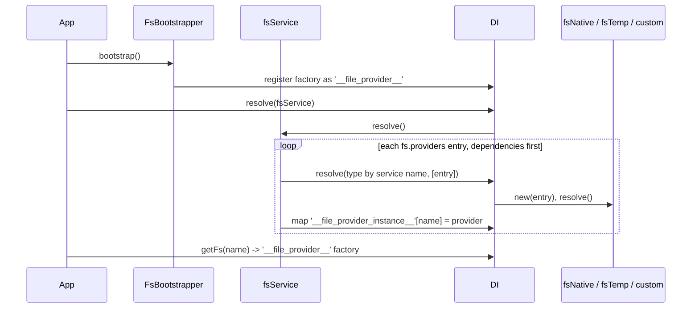

# Providers and configuration

A provider is a named file system instance, eg. `documents` on local disk or `media` on S3. You list providers under `fs.providers`; `fsService` creates them at boot, and your code gets one by name with `getFs()`, `@FileSystem()` or an `fs://` URI.

## How it works

1. The application runs every `Bootstrapper`. `FsBootstrapper.bootstrap()` registers the `'__file_provider__'` factory, which looks a provider up by name.
2. The application resolves `fsService` (`await DI.resolve(fsService)`). Nothing in this package resolves it for you, except the [CLI commands](11-cli-commands.md).
3. `fsService.resolve()` throws `InvalidConfiguration` when `fs.defaultProvider` is not set.
4. It collapses `fs.providers` by `name`: when two entries share a name, the last one wins.
5. It orders the entries with `sortByDependencies()`, so an entry whose `provider` key names another entry is created after it. A missing, self or circular reference fails the boot.
6. For each entry it finds the class registered under the `fs` token whose class name equals `service`. No match throws `ResolveException` (`Type <service> not registered`).
7. It resolves that class with the entry as the only constructor argument (`DI.resolve(type, [entry])`), awaits its `resolve()`, and stores it in the `'__file_provider_instance__'` map under `name`. The map holds the provider itself: nothing wraps it.
8. `getFs('documents')` resolves `'__file_provider__'` with `['documents']`. The factory returns the map entry, or throws `ResolveException` (`File provider documents not registered`). Every call on that provider then runs the registered [middlewares](07-middlewares.md).



## Decorators

| Decorator | Target | Options | Effect |
| --- | --- | --- | --- |
| `@FileSystem(provider)` | property | `provider`: provider name | Defines a getter on the class prototype that returns `getFs(provider)` on every read. Works on any class, also one not created by DI. |

## Configuration

| Key | Type | Default | Allowed values | Meaning |
| --- | --- | --- | --- | --- |
| `fs.defaultProvider` | `string` | required | a provider `name` | Provider used by the helper functions when you pass none. `fsService` fails to boot without it; it does **not** check that the name exists. |
| `fs.providers` | `IProviderConfiguration[]` | required | | Providers created at boot. |
| `fs.providers[].name` | `string` | required | unique name | Lookup key for `getFs()`, `@FileSystem()` and `fs://name/...`. |
| `fs.providers[].service` | `string` | required | class name of a provider registered under `fs`: `fsNative`, `fsTemp`, `fsS3`, `fsFTP`, `fsOneDrive`, or your own | Class created for this entry. |
| `fs.providers[].provider` | `string` | | another provider `name` | Dependency: that provider is created first. `fsTemp` reads it as its backend. |
| `fs.providers[].*` | | | | Every other key goes to the provider's constructor. See [Local provider](03-local-provider.md#configuration) and [Temp file system](04-temp-file-system.md#configuration). |
| `fs.hasher.defaultAlgorithm` | `string` | `sha256` | any `crypto.getHashes()` name | See [File hashing](09-file-hashing.md#configuration). |
| `fs.fileInfo.*` | | | | See [File metadata](10-file-metadata.md#configuration). |
| `system.dirs.cli` | `string[]` | the package's `lib/cli` under `node_modules/@spinajs/fs`, from `WORKSPACE_ROOT_PATH` or `cwd`, and one level up | directory paths | Shipped by the package config, so `@spinajs/cli` finds the [CLI commands](11-cli-commands.md). |

The package config contains **no** providers. Configure at least the default provider, and `fs-temp` when you zip with a local source (see [File operations](02-file-operations.md#zip-and-unzip)).

```ts sample
const config = {
  fs: {
    defaultProvider: 'documents',
    providers: [
      { service: 'fsNative', name: 'documents', basePath: './data/documents' },
      { service: 'fsNative', name: 'fs-temp-local', basePath: './data/temp' },
      {
        service: 'fsTemp',
        name: 'fs-temp',
        provider: 'fs-temp-local',
        cleanup: true,
        maxFileAge: 60 * 60,
      },
    ],
  },
};

export default config;
```

## Services and extension points

| Service | DI token and lifetime | Default implementation | Alternatives | How to replace or extend |
| --- | --- | --- | --- | --- |
| File provider | `fs` (the string `'fs'` is the same registry key), `PerInstanceCheck`: one instance per `name` | `fsNative` | `fsTemp`; `fsS3`, `fsFTP`, `fsOneDrive` in their packages | Register a subclass of `fs` with `@Injectable('fs')` and `@PerInstanceCheck()`, then set `service` to its class name. See [Custom providers](06-custom-providers.md). |
| `fsService` | `fsService` class, singleton (`AsyncService`) | `fsService` | none | Subclass and `DI.register(MyFsService).as(fsService)`. See [Boot service and provider lookup](08-boot-service-and-provider-lookup.md). |
| `FsBootstrapper` (`FsBootsrapper` is a deprecated alias) | `Bootstrapper`, singleton | `FsBootstrapper` | none | Register your own `'__file_provider__'` factory after it ran. See [Boot service and provider lookup](08-boot-service-and-provider-lookup.md#provider-lookup-factory). |
| Middlewares | `FsMiddleware`, all registrations as `Array.ofType(FsMiddleware)`, resolved on every top-level action | none | `AuthzFsMiddleware` in `@spinajs/authz-fs` (order `100`) | `@Injectable(FsMiddleware)` on the class. See [Middlewares](07-middlewares.md). |

### Getting a provider

| API | Returns | Unknown name |
| --- | --- | --- |
| `getFs(name)` | the provider; an `fs` instance passes through unchanged; `undefined` for an empty or `null` argument | throws `ResolveException` |
| `provider(name?)` | `getFs(name ?? fs.defaultProvider)` | throws `ResolveException`; throws `IOFail` when neither a name nor `fs.defaultProvider` is set |
| `@FileSystem(name)` | the provider, read lazily on every property access | throws on property access |
| `new URI('fs://name/path')` | `URI` with `Fs` (the provider) and `Path` (`path`, `''` for `fs://name`) | throws `ResolveException`; a malformed URI throws `InvalidArgument` |
| `_fs(name)` | a function returning `getFs(name)` | throws when called |
| `DI.resolve<fs>('__file_provider__', [name])` | the provider | throws `ResolveException` |

All of them return the provider itself, the instance `fsService` created. [Middlewares](07-middlewares.md) run inside its methods.

## Important behaviour

- `service` is matched against the **class name** (`constructor.name`). A bundler that renames classes breaks the lookup.
- Each provider is resolved once per `name`: the base class implements `__checkInstance__` by comparing `Options.name`.
- A provider that throws in its `resolve()` fails `fsService.resolve()`, and the rest of the boot with it.
- `getFs()` needs `FsBootstrapper` to have run. Before `fsService` resolves, it throws `No __file_provider_instance__ registered`.
- `getFs()` throws for an unknown name. It returns `null` only when `FsBootstrapper` has not run, so `provider()` then throws `IOFail` (`Filesystem <name> not found`) and `new URI()` throws `InvalidArgument`.
- `@FileSystem()` defines a non-configurable getter without a setter on the prototype. Assigning the property throws in strict mode. A class field compiled with `useDefineForClassFields: true` (default for `target` ES2022 and later) shadows the getter with `undefined`.

## Best practices

- Name providers by purpose (`documents`, `avatars`, `exports`), not by backend. Moving `avatars` from disk to S3 is then a config change only.
- Resolve `fsService` once in the application boot, before any code calls `getFs()`.
- Prefer `@FileSystem('name')` in services: the provider is read on access, so the service can be created before `fsService` resolves.
- Keep backend-only providers (eg. `fs-temp-local`) out of application code; use the wrapper (`fs-temp`) instead.

## Patterns and antipatterns

```ts
// Don't: getFs() throws for an unknown name, so the check never runs
const exportsFs = getFs('exports');
if (!exportsFs) {
  throw new Error('exports fs missing');
}

// Do: catch the ResolveException when the provider is optional
let exportsFs: fs | undefined;
try {
  exportsFs = getFs('exports');
} catch {
  exportsFs = undefined;
}
```

```ts
// Don't: getFs() throws when the field initialiser runs before fsService resolved
class ReportService {
  protected Reports = getFs('reports');
}

// Do: read it lazily
class ReportService {
  @FileSystem('reports')
  protected Reports: fs;
}
```

## Examples

### Store user avatars in a dedicated provider

```ts sample
import { DI, Injectable } from '@spinajs/di';
import { FileSystem, fs, fsService } from '@spinajs/fs';

// config: fs.providers = [{ service: 'fsNative', name: 'avatars', basePath: './data/avatars' }, ...]
@Injectable()
export class AvatarService {
  @FileSystem('avatars')
  protected Avatars: fs;

  public async save(userId: number, image: Buffer): Promise<string> {
    const path = `${userId}.png`;
    await this.Avatars.write(path, image);
    return path;
  }

  public async load(userId: number): Promise<Buffer> {
    return (await this.Avatars.read(`${userId}.png`)) as Buffer;
  }
}

export async function boot(): Promise<AvatarService> {
  await DI.resolve(fsService);
  return DI.resolve(AvatarService);
}
```

### Copy a file between providers by URI

```ts sample
import { fs, URI } from '@spinajs/fs';

export async function archiveReport(fileName: string): Promise<void> {
  const source = new URI(`fs://reports/${fileName}`);
  const target = new URI(`fs://archive/${new Date().getFullYear()}/${fileName}`);

  await fs.copy(source, target);
  await fs.rm(source);
}
```

## Related

- [File operations](02-file-operations.md): what you can do with a provider once you have it.
- [Boot service and provider lookup](08-boot-service-and-provider-lookup.md): replacing `fsService` or the lookup factory.
- [Middlewares](07-middlewares.md): checks and observers that run around every action of every provider.
