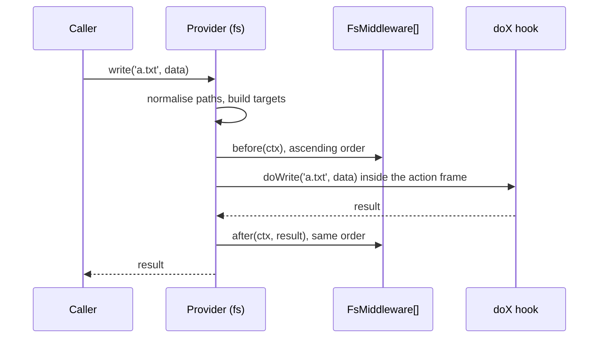

# Middlewares

An `FsMiddleware` runs before and after every public file method of every provider. Use it for cross-cutting rules: access control, read-only mounts, auditing, metrics. There is no Proxy and no wrapper: `getFs()` returns the provider itself, and the base `fs` class calls the middlewares from inside its public methods.

## How it works

1. You call a public method of a provider, eg. `getFs('archive').write('a.txt', 'x')`.
2. The method builds one `FsTarget` per path it touches and normalises each path with `normalizeFsPath` (see [Path normalisation](#path-normalisation)). A bad path rejects here, even with no middleware registered.
3. `executeFsAction()` resolves `Array.ofType(FsMiddleware)` from DI, sorts it by `order` ascending (ties keep registration order) and drops every middleware whose `isEnabled(fs)` answers `false` for all the filesystems the action touches.
4. Each remaining middleware runs `before(ctx)` in that order. A throw aborts the action; no provider IO has run.
5. The provider's protected `doX` hook runs with the normalised paths and the (possibly replaced) `ctx.args`, inside the action frame.
6. Each middleware that has `after` runs `after(ctx, result)` in the same order. Its return value replaces the result, except for the stream of `writeStream`.
7. The method returns the final result, or rejects with the first error.



## Configuration

| Key | Type | Default | Allowed values | Meaning |
| --- | --- | --- | --- | --- |
| `fs.middlewareTimeoutMs` | `number` | `30000` | milliseconds, greater than `0` | Longest wait for the `after` hooks of a `writeStream`. |

```ts
{ fs: { middlewareTimeoutMs: 10_000 } }
```

## Services and extension points

| Service | DI token and lifetime | Default implementation | Alternatives | How to replace or extend |
| --- | --- | --- | --- | --- |
| `FsMiddleware` | `FsMiddleware`, every registration, resolved as `Array.ofType(FsMiddleware)` on every top-level action; the lifetime is the class's own (singleton unless decorated otherwise) | none in `@spinajs/fs` | `AuthzFsMiddleware` (`@spinajs/authz-fs`, `order` `100`) | `@Injectable(FsMiddleware)` or `DI.register(MyMiddleware).as(FsMiddleware)`. Every registration runs; there is no replacing. A registration made before an action is seen by it, so import order against `fsService` does not matter. |

Register by class. `Array.ofType` cannot run a middleware registered through a DI factory or an instance, so while one is registered every file action throws `InvalidOperation` naming it.

### Members

| Member | Contract |
| --- | --- |
| `order` | `number`, default `0`. Lower runs first, in `before` and in `after`. `AuthzFsMiddleware` has `order = 100`. |
| `isEnabled?(fs)` | Asked for every distinct filesystem of the action: the provider called and the filesystem of each target. The middleware runs when any answer is `true`. Absent means `true`. |
| `before(ctx)` | Required. Throw to refuse the action. |
| `after?(ctx, result)` | Optional. Runs once the IO succeeded. Return the result to pass on: your return value replaces it. For `writeStream` the hooks run later and their results are ignored. |

### `FsActionContext`

| Member | Meaning |
| --- | --- |
| `action` | The public method name: `'write'`, `'copy'`, `'signedUrl'`, ... |
| `fs` | The provider the method was called on. |
| `targets` | `FsTarget[]`, read-only. |
| `args` | The non-path arguments in call order, replaceable. `upload`'s options `{ exclusive }` are `ctx.args[1]` (after the local source path). `signedUrl`'s options are `ctx.args[0]`: replace them to cap `until`. |
| `state` | `Map<symbol, unknown>`, one per action. Use it to hand data from `before` to `after`. |
| `exists(target)` | Whether the target exists (`dirExists` for a `dir` target, `exists` for a `file`). Memoised per target. |
| `isDir(target)` | Whether the path is a directory now. Memoised. On `fsS3` it is always `false`: a key is never a directory. |
| `hasEntries(target)` | Whether anything lives under the path. Memoised. A failing probe rejects, so it never passes for a free path. |

The probes run unchecked inside the action frame, on `target.fs`, and their errors propagate: a failed probe refuses the action.

### `FsTarget`

| Member | Meaning |
| --- | --- |
| `fs` | The filesystem the path lives on. A destination may be another provider. |
| `path` | Normalised path; `''` is the filesystem root. |
| `kind` | `'file'` or `'dir'`. |
| `access` | A list of `'read'`, `'stat'`, `'list'`, `'write'`, `'delete'`, `'share'`. |
| `role` | `'source'` or `'destination'`. |

### Targets per action

| Action | Targets |
| --- | --- |
| `read`, `readStream`, `download`, `hash`, `metadata` | file, `read` |
| `exists`, `stat` | file, `stat` |
| `isDir`, `dirExists` | dir, `stat` |
| `list`, `hasEntries` | dir, `list` |
| `write`, `writeStream`, `append` | file, `write` |
| `mkdir` | dir, `write` |
| `upload(src, dst?, options?)` | destination file, `write`. Absent `dst` is `basename(src)`. The local `src` is not a target. |
| `rm` | file, `delete` |
| `copy(src, dst, dstFs?)` | source `read`; destination `write` on `dstFs ?? this` |
| `move(src, dst, dstFs?)` | source `read` and `delete`; destination `write` on `dstFs ?? this` |
| `rename(src, dst)` | source `read` and `delete`; destination `write` |
| `zip(paths, dstFs?, dstFile?)` | each source `read`; destination file `write` on `dstFs ?? zipDestination()`. Absent `dstFile` is `tmpname('.zip')` of the destination. |
| `unzip(src, dst?, dstFs?)` | source `read`; destination dir `write` on `dstFs ?? unzipDestination()`. Absent `dst` is `tmpname()`. |
| `signedUrl`, `getSignedUrl` | file, `share`. `getSignedUrl` runs as `ctx.action` `'signedUrl'`. |

Not checked: `resolvePath`, `tmppath`, `tmpname`, `resolve`, `dispose`. Provider extras that touch files declare their own targets: see [Writing a provider](#writing-a-provider).

### `FsMiddleware`: custom implementation

Replace nothing; add a middleware. This one mounts the `archive` provider read-only: every write or delete target on it is refused before any IO runs.

```ts sample
import { Injectable } from '@spinajs/di';
import { InvalidOperation } from '@spinajs/exceptions';
import { fs, FsActionContext, FsMiddleware, getFs } from '@spinajs/fs';

const READ_ONLY = new Set(['archive']);

@Injectable(FsMiddleware)
export class ReadOnlyMountMiddleware extends FsMiddleware {
  public isEnabled(target: fs): boolean {
    return READ_ONLY.has(target.Name);
  }

  public async before(ctx: FsActionContext): Promise<void> {
    for (const target of ctx.targets) {
      if (READ_ONLY.has(target.fs.Name) && target.access.some((a) => a === 'write' || a === 'delete')) {
        throw new InvalidOperation(`File system ${target.fs.Name} is read-only, ${ctx.action}(${target.path}) is not allowed`);
      }
    }
  }
}

export async function tryToOverwriteContract(): Promise<boolean> {
  try {
    await getFs('archive').write('contracts/42.txt', 'changed', 'utf-8');
    return true;
  } catch (err) {
    if (!(err instanceof InvalidOperation)) throw err;
    return false;
  }
}
```

`copy` and `move` out of `archive` are refused too: the source of a `move` carries `delete`. Read it with `download()` and `upload()` it to the other provider instead.

## Important behaviour

- Every `before` runs before the provider touches the destination. A middleware that refuses `upload(..., { exclusive: true })` throws its own error, so the caller never learns whether the destination exists. When all `before` hooks pass, the provider throws `ResourceDuplicated` for an existing destination, and no `after` runs.
- The action frame: public calls made inside an action skip the middlewares but still normalise paths. That covers a provider calling its own `exists()`, `fsTemp` calling its backend, `copy` calling `dstFs.upload`, and a middleware's `ctx.exists()` and `ctx.isDir()`. `inFsAction()` tells whether code runs inside one. The frame closes when the action settles, so a stream callback that runs later is outside it and is checked again.
- `readStream` runs `after` as soon as the stream is returned; the hook may return another stream.
- `writeStream` runs `after` when the stream emits `'close'` (`fsS3` emits it once the upload is done), and holds that `'close'` until the hooks settle, for at most `fs.middlewareTimeoutMs`. A failing hook, or the timeout, goes to the stream's `'error'` listeners. An errored or unfinished stream runs no `after`.
- A middleware throwing in `before` stops the chain: later middlewares do not run.
- `signedUrl` on a provider without `doSignedUrl` throws `MethodNotImplemented` after the `before` hooks passed.
- Only top-level calls run middlewares. `before` and `after` hooks run outside the action frame, so a provider call made from `after` is a new action with its own middleware chain.

### Path normalisation

Normalisation is always on, with or without middlewares: every public action passes its paths through `normalizeFsPath(path, fs.BasePath)` (exported from `@spinajs/fs`), and the provider receives the result.

- `\` becomes `/`, `.` and `..` segments are resolved, repeated and trailing `/` are dropped.
- An absolute path inside `BasePath` becomes relative to it. A rooted path without a drive (`/x`) is relative to the provider root.
- `InvalidArgument` (400) for a path that climbs above the root with `..`, holds a NUL byte, is a drive or UNC path outside `BasePath`, or has a segment holding `:` or ending in `.` or a space.

The path a middleware checks is the path the provider touches, also on key stores where `/x` and `x` would be two keys.

## Writing a provider

A provider implements the protected `doX` hooks; they receive normalised paths. The public methods are final: the base constructor throws `InvalidOperation` when a subclass overrides one.

| Hook | Signature |
| --- | --- |
| `doDownload` | `(path)` |
| `doUpload` | `(srcPath, destPath, options?: IFsUploadOptions)` |
| `doRead` / `doReadStream` | `(path, encoding?)` |
| `doWrite` / `doAppend` | `(path, data, encoding?)` |
| `doWriteStream` | `(path, readStream?, encoding?)` |
| `doExists` / `doDirExists` / `doIsDir` / `doStat` / `doList` | `(path)` |
| `doMkdir` / `doRm` | `(path)` |
| `doCopy` / `doMove` | `(path, dest, dstFs?)` |
| `doRename` | `(oldPath, newPath)` |
| `doZip` | `(path, dstFs, dstFile)` |
| `doUnzip` | `(srcPath, destPath, dstFs)` |
| `doHash` / `doMetadata` | defaults use `resolvePath()` |
| `doHasEntries` | default: `doDirExists` and a non-empty `doList` |
| `doSignedUrl?` | `(path, { until?, disposition? })`; optional |

A provider extra that touches files declares its targets and calls `runAction(action, targets, args, impl, opts?)`; `fsS3.getMetadata` is a `stat`, `setMetadata` a `write`. `zipDestination()` and `unzipDestination()` choose the default destinations. See [Custom providers](06-custom-providers.md).

## Best practices

- Filter in `isEnabled(fs)` by provider name or `fs instanceof`, so a middleware does not run for providers it ignores.
- Check `ctx.targets`, not `ctx.fs`: a `copy`, `move` or `zip` also touches a destination on another provider.
- Keep `before` fast: it runs on every call.
- Pick `order` knowing `AuthzFsMiddleware` runs at `100`: a lower value runs before its check, a higher one after.
- Pass data from `before` to `after` through `ctx.state`, keyed by a module-level `Symbol`.

## Patterns and antipatterns

```ts
// Don't: `before` runs outside the frame, so exists() is a new top-level action that runs this middleware again
// and recurses endlessly
public async before(ctx: FsActionContext): Promise<void> {
  if (await ctx.fs.exists(ctx.targets[0].path)) {
    throw new InvalidOperation('already there');
  }
}

// Do: probe through the context; it runs unchecked inside the frame and is memoised
public async before(ctx: FsActionContext): Promise<void> {
  if (await ctx.exists(ctx.targets[0])) {
    throw new InvalidOperation('already there');
  }
}
```

## Examples

### Log every file action

```ts sample
import { Injectable } from '@spinajs/di';
import { FsActionContext, FsMiddleware } from '@spinajs/fs';
import { Log, Logger } from '@spinajs/log-common';

@Injectable(FsMiddleware)
export class AuditLogMiddleware extends FsMiddleware {
  public readonly order = 1000;

  @Logger('fs-audit')
  protected Log: Log;

  public async before(): Promise<void> {
    // nothing to check
  }

  public async after(ctx: FsActionContext, result: unknown): Promise<unknown> {
    const paths = ctx.targets.map((t) => `${t.fs.Name}:${t.path}`).join(', ');
    this.Log.info({ action: ctx.action, paths }, '${action} ${paths}');
    return result;
  }
}
```

## Related

- [`@spinajs/authz-fs`](../authz-fs/02-checks-on-file-actions.md): `AuthzFsMiddleware`, the access-control middleware.
- [Custom providers](06-custom-providers.md): writing a provider with `doX` hooks.
- [File operations](02-file-operations.md): the public API the middlewares run around.
- [Providers and configuration](01-providers-and-configuration.md): how `getFs()` hands out the providers.
