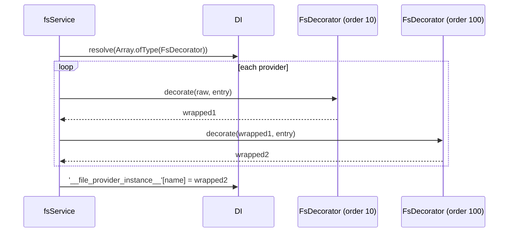

# Provider decorators

A provider decorator wraps every provider once at boot. Everything that gets a provider by name (`getFs()`, `@FileSystem()`, `fs://` URIs, the CLI) then gets the wrapper. Use it for cross-cutting rules: access control, read-only mounts, auditing, metrics.

## How it works

1. `fsService.resolve()` creates every provider and publishes the raw instances.
2. `fsService.decorate()` resolves `Array.ofType(FsDecorator)` and sorts the decorators by `order`, ascending. With none, it stops.
3. For each provider it calls `decorate(instance, entry)` on each decorator in turn; each one receives the previous result. A decorator returns the instance unchanged to skip a provider.
4. When every provider is decorated, it replaces each published entry with its result and logs the decorators applied.
5. When a decorator throws, `fsService` removes **every** provider of this boot from the published map and throws `ResolveException` (`Cannot decorate file provider <name>: <message>`). No raw provider stays reachable.



## Services and extension points

| Service | DI token and lifetime | Default implementation | Alternatives | How to replace or extend |
| --- | --- | --- | --- | --- |
| `FsDecorator` | `FsDecorator`, resolved as a list (`Array.ofType(FsDecorator)`), each with its own lifetime (singleton by default) | none | `AuthzFsDecorator` (`@spinajs/authz-fs`, order `100`): guards providers that have an `authz.fs.<name>` entry | `@Injectable(FsDecorator)` on the class, or `DI.register(MyDecorator).as(FsDecorator)`, before `fsService` resolves. Every registration runs; there is no replacing. |

### Abstract members

| Member | Contract |
| --- | --- |
| `order` | `number`, read-only. Lower runs first, so a higher `order` wraps the result of lower ones. |
| `decorate(instance, config)` | Returns the provider to publish: `instance` itself, or a wrapper that is still an `fs` (eg. a `Proxy`, or `Object.create(instance)` with overrides). `config` is the provider entry, custom keys included. Synchronous. |

### Custom decorator: read-only mounts

This decorator blocks every write on providers whose entry sets `readOnly: true`, eg. a shared archive mounted into several services.

```ts sample
import { DI, Injectable } from '@spinajs/di';
import { InvalidOperation } from '@spinajs/exceptions';
import { fs, FsDecorator, fsService, getFs, IProviderConfiguration } from '@spinajs/fs';

const WRITE_METHODS = new Set(['write', 'writeStream', 'append', 'upload', 'copy', 'move', 'rename', 'rm', 'mkdir', 'zip', 'unzip']);

// config: { service: 'fsNative', name: 'archive', basePath: '/mnt/archive', readOnly: true }
@Injectable(FsDecorator)
export class ReadOnlyFsDecorator extends FsDecorator {
  public readonly order = 10;

  public decorate(instance: fs, config: IProviderConfiguration): fs {
    if (!(config as IProviderConfiguration & { readOnly?: boolean }).readOnly) {
      return instance;
    }

    return new Proxy(instance, {
      get(target, property, receiver) {
        if (typeof property === 'string' && WRITE_METHODS.has(property)) {
          return () => Promise.reject(new InvalidOperation(`File system ${config.name} is read-only, ${property}() is not allowed`));
        }
        return Reflect.get(target, property, receiver);
      },
    });
  }
}

export async function readArchivedContract(contractId: string): Promise<string> {
  await DI.resolve(fsService);

  const archive = getFs('archive');
  return (await archive.read(`contracts/${contractId}.txt`, 'utf-8')) as string;
}
```

`copy()` and `move()` are blocked on the source too: they would write to the destination or delete the source. Copy out of a read-only provider with `download()` and `upload()` on the target instead.

### Extending: decorate selected methods only

To change one method and keep the rest, wrap with `Object.create(instance)` and override on the wrapper. This audit decorator logs every delete.

```ts sample
import { DI, Injectable } from '@spinajs/di';
import { Log, Logger } from '@spinajs/log-common';
import { fs, FsDecorator, IProviderConfiguration } from '@spinajs/fs';

@Injectable(FsDecorator)
export class AuditDeletesFsDecorator extends FsDecorator {
  public readonly order = 200;

  @Logger('fs-audit')
  protected Log: Log;

  public decorate(instance: fs, config: IProviderConfiguration): fs {
    const log = this.Log;
    const wrapper = Object.create(instance) as fs;

    wrapper.rm = async (path: string) => {
      log.info({ provider: config.name, path }, 'Deleting ${path} from ${provider}');
      await instance.rm(path);
    };

    return wrapper;
  }
}

export function registerAuditing(): void {
  DI.register(AuditDeletesFsDecorator).as(FsDecorator);
}
```

## Important behaviour

- Decorators run once, inside `fsService.resolve()`. A decorator registered after that has no effect.
- `decorate()` is synchronous. Finish async setup the decorator needs before `fsService` resolves.
- Providers that look up other providers in their own `resolve()` (eg. `fsTemp` and its backend) keep the **raw** instance. Calls through `fs-temp` bypass decorators on the backend.
- The wrapper must still be an `fs` instance: `getFs(instance)` passes `fs` instances through by `instanceof`. A `Proxy` and `Object.create()` both keep the prototype chain.
- A decorator that throws fails the whole boot and unpublishes every provider. This is deliberate: an access guard must never leave raw providers reachable.

## Best practices

- Return `instance` unchanged for providers your decorator does not handle, keyed on `config.name` or a custom key in the entry.
- Pick `order` with the shipped decorators in mind: below `100` runs inside `AuthzFsDecorator`'s guard, above `100` wraps it.
- Do not keep a reference to the raw instance outside the wrapper; that bypasses every decorator after yours.

## Patterns and antipatterns

```ts
// Don't: mutates the provider, so the raw instance held by fsTemp changes too and order is meaningless
public decorate(instance: fs): fs {
  instance.rm = async () => undefined;
  return instance;
}

// Do: return a wrapper
public decorate(instance: fs): fs {
  const wrapper = Object.create(instance) as fs;
  wrapper.rm = async () => undefined;
  return wrapper;
}
```

## Related

- [Providers and configuration](01-providers-and-configuration.md): the boot flow that runs decorators.
- [Boot service and provider lookup](08-boot-service-and-provider-lookup.md): overriding `fsService.decorate()` itself.
- [Custom providers](06-custom-providers.md): when a new provider fits better than a wrapper.
