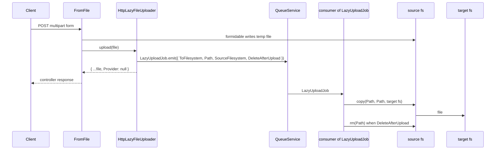

# Lazy file upload

`HttpLazyFileUploader` is a `FormFileUploader` you set on a `@File()` or `@Files()` route. It does not copy the file: it emits a `LazyUploadJob` and returns, so the response does not wait for a slow target such as S3.

## How it works

1. The client posts a multipart form. `FromFile.extract()` (from `@spinajs/http`) parses it with formidable into `__file_upload_default_provider__`, a local `fsNative` provider (`os.tmpdir()` by default).
2. `FromFile.extract()` builds an `IUploadedFile` per file, with `BaseName` set to formidable's generated file name and `Provider` set to the route's filesystem (`IUploadOptions.fs`, else `__file_upload_default_provider__`).
3. It runs the upload middlewares (`http.upload.middlewares`, then the route's `middlewares`).
4. When the route sets `fs` to another provider, `ImmediateFileUploader` copies the file there **synchronously** and deletes the temp file. `Provider` stays that filesystem.
5. `FromFile.extract()` resolves the route's uploader: `DI.resolve(HttpLazyFileUploader, [options])`, with `options` from `IUploadOptions.uploader.options`.
6. `HttpLazyFileUploader.upload()` throws `Error` when `file.Provider` is empty.
7. It calls `LazyUploadJob.emit()` with `ToFilesystem: options.fs`, `Path: file.BaseName`, `SourceFilesystem: file.Provider.Name` and `DeleteAfterUpload: options.deleteAfterUpload ?? true`. The job is persistent by default.
8. It returns a copy of the file with `Provider: null`. The controller receives that copy.
9. A failed `upload()` of any file becomes one `IOFail` (500), and `FromFile` removes every formidable temp file of the field.
10. Later a queue consumer runs `LazyUploadJob.execute()`, which copies `Path` from the source to the target filesystem. See [Upload job and worker](02-upload-job-and-worker.md).



## Configuration

`HttpLazyFileUploader` takes its options from the route, not from the configuration file.

| Key | Type | Default | Allowed values | Meaning |
| --- | --- | --- | --- | --- |
| `IUploadOptions.uploader.service` | `string \| Class<FormFileUploader>` | | `HttpLazyFileUploader`, `'HttpLazyFileUploader'`, a subclass | Uploader class or its registered name. |
| `IUploadOptions.uploader.options.fs` | `string` | none | a `fs.providers[].name` | Target filesystem. Not checked at request time: a missing or unknown name fails the job, not the request. |
| `IUploadOptions.uploader.options.deleteAfterUpload` | `boolean` | `true` | `true`, `false` | Remove the source file after the copy. With `false` the file stays in the source filesystem until you remove it. |
| `IUploadOptions.fs` | `string` | `__file_upload_default_provider__` | a `fs.providers[].name` | Source filesystem of the job. Another value adds a synchronous copy before the job is queued (step 4). |
| `fs.providers` (`__file_upload_default_provider__`) | `fsNative` entry | `basePath: os.tmpdir()`, shipped by `@spinajs/http` | a local `fsNative` provider | Where formidable writes; the source of the job unless the route sets `fs`. |

```ts
@File({
  uploader: {
    service: HttpLazyFileUploader,
    options: { fs: 'media-s3', deleteAfterUpload: true },
  },
})
```

## Services and extension points

| Service | DI token and lifetime | Default implementation | Alternatives | How to replace or extend |
| --- | --- | --- | --- | --- |
| `HttpLazyFileUploader` | class `HttpLazyFileUploader`, registered by `@Injectable()` under its own name; `@NewInstance()`, built on every resolve | `HttpLazyFileUploader` | `ImmediateFileUploader` from `@spinajs/http`, your own `FormFileUploader` | Subclass, `DI.register(MyUploader).as(HttpLazyFileUploader)`, or point `uploader.service` at your class. See [Custom uploaders and jobs](03-custom-uploaders-and-jobs.md). |
| `FormFileUploader` | abstract class from `@spinajs/http`; resolved per route from `IUploadOptions.uploader` | `ImmediateFileUploader` (only for the `fs` copy) | `HttpLazyFileUploader` | Implement `upload(file)`. See [Custom uploaders and jobs](03-custom-uploaders-and-jobs.md#write-your-own-uploader-and-job). |

`HttpLazyFileUploader` is resolved by `FromFile.extract()` on every request with that route's options, through `DI.resolve(type, [options])`. A string `service` resolves the class registered under that name, so `'HttpLazyFileUploader'` works once the package is imported.

## Important behaviour

- The uploader is `@NewInstance()`: every request builds it with its route's `Options`, so routes can queue to different targets.
- The controller gets `Provider: null`. Do not read the file through `file.Provider`; at that moment it is only in the source filesystem.
- The target path equals the source path: `file.BaseName`, formidable's random name. Store `BaseName` to find the file later; `Name` holds the client's file name.
- `LazyUploadJob.emit()` returns a job id, but `upload()` drops it. The controller cannot track the copy; write your own uploader to expose it.
- The worker reads the file from the source filesystem by name. With the default `os.tmpdir()` source, the worker must run on the same host as the web process.
- A route `fs` that is not the default provider makes the request copy the file synchronously first (step 4), which removes most of the benefit.
- When `emit()` fails for one file of a multi-file field, `FromFile` deletes all temp files, also those of files whose job is already queued. Those jobs then fail.
- `@Job({ runAs: 'initiator' })`: a `QueueMessageHook` such as the one in `authz-queue` runs the copy as the principal that uploaded. Without a hook the field has no effect.

## Best practices

- Set `options.fs` on every route that uses the uploader; `'HttpLazyFileUploader'` as a bare string passes `{}` and every job fails with `IOFail`.
- Keep `deleteAfterUpload` at `true` with the default temp source, or the temp directory fills up.
- Return `BaseName` to the client or store it with your entity; it is the only key to the copied file.
- Point the route's `fs` at a filesystem the worker can reach (eg. a shared mount) when the worker runs on another host, and accept the synchronous first copy.

## Patterns and antipatterns

```ts
// Don't: a bare class passes {} as options, so every job fails with IOFail.
@Post() invoice(@File({ uploader: HttpLazyFileUploader }) f: IUploadedFile) {}

// Do: name the target on every route; each route gets its own.
@Post() invoice(@File({ uploader: { service: HttpLazyFileUploader, options: { fs: 'invoices-s3' } } }) f: IUploadedFile) {}
@Post() avatar(@File({ uploader: { service: HttpLazyFileUploader, options: { fs: 'avatars-s3' } } }) f: IUploadedFile) {}
```

```ts
// Don't: Provider is null and the file is not in the target fs yet.
const content = await file.Provider!.read(file.BaseName);

// Do: remember the name and read it from the target fs after the job finished.
await Attachment.insert({ Path: file.BaseName, Fs: 'media-s3' });
```

## Examples

### Accept large video uploads and copy them to S3 in the background

```ts sample
import { BaseController, BasePath, Files, IUploadedFile, Ok, Post } from '@spinajs/http';
import { HttpLazyFileUploader } from '@spinajs/http-lazy-file-uploader';

@BasePath('videos')
export class VideoController extends BaseController {
  @Post()
  public async upload(
    @Files({
      maxFileSize: 2 * 1024 * 1024 * 1024,
      uploader: {
        service: HttpLazyFileUploader,
        options: { fs: 'videos-s3', deleteAfterUpload: true },
      },
    })
    videos: IUploadedFile[],
  ) {
    return new Ok(videos.map((v) => ({ key: v.BaseName, name: v.Name, size: v.Size })));
  }
}
```

### Keep the source copy for a virus scan

```ts sample
import { BaseController, BasePath, File, IUploadedFile, Ok, Post } from '@spinajs/http';
import { HttpLazyFileUploader } from '@spinajs/http-lazy-file-uploader';

@BasePath('documents')
export class DocumentController extends BaseController {
  @Post()
  public async upload(
    @File({
      // the source is a shared mount the scanner also reads
      fs: 'incoming-shared',
      uploader: { service: HttpLazyFileUploader, options: { fs: 'documents-s3', deleteAfterUpload: false } },
    })
    document: IUploadedFile,
  ) {
    return new Ok({ key: document.BaseName });
  }
}
```

## Related

- [Upload job and worker](02-upload-job-and-worker.md): what happens after `upload()` returns.
- [Custom uploaders and jobs](03-custom-uploaders-and-jobs.md): replacing the uploader, job id, own job.
- [`@spinajs/http`](../http/README.md): `@File()`, `@Files()`, `IUploadOptions` and upload middlewares.
- [`@spinajs/fs`](../fs/README.md): configuring the source and target providers.
