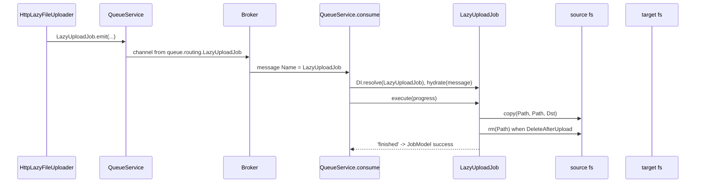

# Upload job and worker

`LazyUploadJob` is the `@spinajs/queue` job that `HttpLazyFileUploader` emits. A consumer of the job copies the file from the source to the target filesystem and removes the source copy.

`LazyUploadJob` and the `fs-lazy:process` command are **not** exported from `@spinajs/http-lazy-file-uploader`, and the package `exports` map blocks deep imports.

## How it works

1. `HttpLazyFileUploader.upload()` calls `LazyUploadJob.emit()`. `QueueJob.emit()` sets `Persistent: true`, `Type: Job`, `Name: 'LazyUploadJob'` and passes the message to `QueueService.emit()`.
2. `QueueService` sends it on the connection named by `queue.default`, to the channel in `queue.routing.LazyUploadJob`, else to the connection's `defaultQueueChannel` (with a `No routing for event` warning).
3. A consumer subscribed with `QueueService.consume(LazyUploadJob)` receives every message named `LazyUploadJob`. It resolves the job class from DI, hydrates it with the message and creates or reads its `JobModel` row.
4. `LazyUploadJob.execute()` resolves both filesystems with `getFs()`. An empty name throws `IOFail` (`Filesystem <name> not exists`); an unknown name throws `ResolveException` from `@spinajs/fs`.
5. It reports progress `0`, runs `sourceFs.copy(Path, Path, targetFs)`, runs `sourceFs.rm(Path)` when `DeleteAfterUpload` is `true`, and reports progress `100`.
6. It returns `'finished'`. The consumer stores it in `JobModel.Result` and sets `Status` to `success`.
7. An error marks the row `retrying` or `dead` (`RetryCount` is not set, so the first failure is final) and is rethrown to the transport for its dead-letter policy.



## Decorators

| Decorator | Target | Options | Effect |
| --- | --- | --- | --- |
| `@Job({ runAs: 'initiator' })` on `LazyUploadJob` | class | `runAs` | Marks the class as a queue job. A `QueueMessageHook` (eg. `authz-queue`) runs `execute()` as the principal that emitted it. |
| `@Command('fs-lazy:process', 'Process lazy file upload')` on `ProcessFiles` | class | name, description | Declares the `spinajs fs-lazy:process` CLI command. |

## Configuration

| Key | Type | Default | Allowed values | Meaning |
| --- | --- | --- | --- | --- |
| `queue.routing.LazyFileUpload` | `string` | `'/queue/lazy-file-upload'` (shipped) | channel name | Shipped by the package, but the key does not match the job name `LazyUploadJob`, so it routes nothing. |
| `queue.routing.LazyUploadJob` | `string \| IMessageRoutingOption \| (string \| IMessageRoutingOption)[]` | not set | channel name or routing option | Channel of the job. Set it yourself. See [`@spinajs/queue`](../queue/README.md). |
| `queue.default` | `string` | from your queue config | connection name | Connection the job is sent on and consumed from. |
| `system.dirs.cli` | `string[]` | the package does **not** add its `cli` folder | directory paths | Add `node_modules/@spinajs/http-lazy-file-uploader/lib/mjs/cli` (or `cjs`) so `@spinajs/cli` finds `fs-lazy:process`. |

```ts sample
const config = {
  queue: {
    routing: {
      LazyUploadJob: '/queue/lazy-file-upload',
    },
  },
  fs: {
    providers: [
      { service: 'fsNative', name: 'media-local', basePath: '/srv/media' },
    ],
  },
};

export default config;
```

## Schema

The job is tracked in the `@spinajs/queue` `JobModel` table (`queue_jobs`). This package adds no tables. Rows for this job have `Name = 'LazyUploadJob'`, `Result = 'finished'` on success, `Progress` `0` then `100`.

## Services and extension points

| Service | DI token and lifetime | Default implementation | Alternatives | How to replace or extend |
| --- | --- | --- | --- | --- |
| `LazyUploadJob` | not registered; the consumer calls `DI.resolve(LazyUploadJob)`, so it is a singleton hydrated per message | `LazyUploadJob` | none shipped | The consumer matches messages by class name: a worker can consume with its own class named `LazyUploadJob` (see the example below), or you emit your own job from your own uploader ([Custom uploaders and jobs](03-custom-uploaders-and-jobs.md)). |
| `ProcessFiles` (`fs-lazy:process`) | `CliCommand`, found by `@spinajs/cli` in `system.dirs.cli`; `QueueService` injected with `@Autoinject()` | `ProcessFiles` | a long-running process that calls `QueueService.consume()` | Not exported, so it cannot be subclassed. Use the worker example below. |
| source and target filesystem | named `@spinajs/fs` providers, looked up with `getFs(name)` per job | `__file_upload_default_provider__` (source) | any provider: `fsNative`, `fsS3`, `fsFTP`, `fsOneDrive`, your own | Configure `fs.providers`; see [`@spinajs/fs`](../fs/README.md). |

## Important behaviour

- `spinajs fs-lazy:process` exits right after `consume()` has subscribed, because `@spinajs/cli` calls `process.exit()` when the command resolves. It does not keep processing jobs. Run the consumer in a long-running process instead.
- The consumer resolves the job class as a DI singleton and hydrates it per message. Run one job at a time per process; concurrent deliveries share the instance.
- The copy is not atomic: a failure after `copy()` and before `rm()` leaves the file in both filesystems, and the job is marked `dead` with no retry.
- The worker needs the source file. With the default `os.tmpdir()` source, run the worker on the web host.
- The worker needs the same `fs.providers` names as the web process: the job carries names, not paths.
- Queue messages are at-least-once. With `queue.deduplicate` (default `true`) a redelivered job whose row is `success` or `dead` is skipped.

## Best practices

- Set `queue.routing.LazyUploadJob` to a dedicated channel so a slow S3 copy does not delay other jobs on the default channel.
- Watch `JobModel` rows with `Name = 'LazyUploadJob'` and `Status = 'dead'`; with `deleteAfterUpload` the source file of a dead job is still in the source filesystem and can be copied again.
- Give the worker the same configuration files as the web process, so provider names and routing match.

## Patterns and antipatterns

```ts
// Don't: the CLI process exits as soon as the subscription is made.
// package.json: "upload-worker": "spinajs fs-lazy:process"

// Do: consume in a process that stays up (see "Run the worker in a long-running process").
await (await DI.resolve(QueueService)).consume(LazyUploadJob);
```

## Examples

### Run the worker in a long-running process

The consumer matches messages by class name, so a worker can declare a class named `LazyUploadJob` with the same fields. This one also stays a new instance per message.

```ts sample
import { DI, NewInstance } from '@spinajs/di';
import { IOFail } from '@spinajs/exceptions';
import { getFs } from '@spinajs/fs';
import { Job, QueueJob, QueueService } from '@spinajs/queue';

@Job({ runAs: 'initiator' })
@NewInstance()
export class LazyUploadJob extends QueueJob {
  public ToFilesystem!: string;
  public Path!: string;
  public SourceFilesystem!: string;
  public DeleteAfterUpload!: boolean;

  public async execute(progress: (p: number) => Promise<void>) {
    const source = getFs(this.SourceFilesystem);
    const target = getFs(this.ToFilesystem);
    if (!source || !target) {
      throw new IOFail(`Filesystem ${this.SourceFilesystem} or ${this.ToFilesystem} not configured`);
    }

    await progress(0);
    await source.copy(this.Path, this.Path, target);
    if (this.DeleteAfterUpload) {
      await source.rm(this.Path);
    }
    await progress(100);

    return 'finished';
  }
}

export async function startUploadWorker() {
  const queue = await DI.resolve(QueueService);
  await queue.consume(LazyUploadJob);
}
```

### Enable the `fs-lazy:process` command

```ts sample
import { join } from 'path';

const config = {
  system: {
    dirs: {
      cli: [join(process.cwd(), 'node_modules', '@spinajs', 'http-lazy-file-uploader', 'lib', 'mjs', 'cli')],
    },
  },
};

export default config;
```

The command then appears in `spinajs --help`. It subscribes and exits; see Important behaviour.

## Related

- [Lazy file upload](01-lazy-file-upload.md): where the job comes from.
- [Custom uploaders and jobs](03-custom-uploaders-and-jobs.md): emit your own job and expose its id.
- [`@spinajs/queue`](../queue/README.md): routing, connections, `JobModel`, retries and `QueueMessageHook`.
- [`@spinajs/cli`](../cli/README.md): how `system.dirs.cli` and command exit work.
