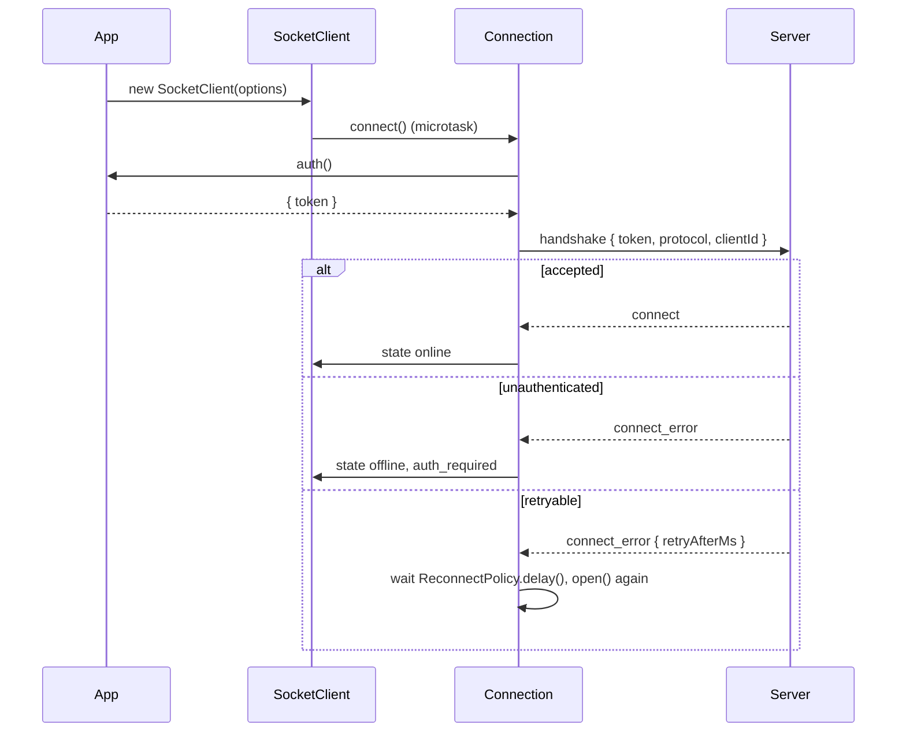

# Connection and reconnect

`SocketClient` owns one `socket.io-client` socket. It moves through four states, asks your `auth()` callback on every attempt, and retries with exponential backoff until the server refuses it for a reason no retry can fix.

## How it works

1. `new SocketClient(options)` validates the options and creates the socket with `autoConnect: false`. It throws a `RangeError` for an invalid `clientId`, timeout, reconnect or durable value, and for an `outbox` without a `clientId`.
2. Unless `autoConnect: false`, the client connects in a microtask, so listeners attached right after the constructor see the `connecting` state. A `connect()`, `disconnect()` or `close()` call made before that microtask wins over `autoConnect`.
3. `Connection.open()` sets the state to `connecting` and starts the `connectTimeoutMs` timer.
4. socket.io asks for the handshake. `Connection.provideAuth()` calls your `auth()` and sends `{ ...authFields, protocol: PROTOCOL_VERSION, clientId }`. Your fields cannot override `protocol` or `clientId`.
5. The server accepts: the state becomes `online`, the attempt counter resets, and held commands and streams go out.
6. The server refuses (`connect_error` with a `SocketError` in `data`):
   - `unauthenticated`: the client stops and emits `auth_required`.
   - `version_mismatch`: the client stops and emits `incompatible`.
   - any other code with `retryable: false`, except `internal`: the client stops and emits `refused`.
   - anything else, `internal` included: retry after `ReconnectPolicy.delay()`, honouring the error's `retryAfterMs`.
7. The connection drops (`disconnect`): the state becomes `offline`, everything socket.io buffered is discarded, and a retry is scheduled.
8. `connectTimeoutMs` passes without an answer: the attempt is aborted and a retry is scheduled.
9. `auth()` throws or rejects: the client stops and emits `auth_required` with `unauthenticated` and the message `auth callback failed: <reason>`.



### States

| State | Meaning |
| --- | --- |
| `connecting` | an attempt is in progress |
| `online` | connected; commands, events and streams are sent |
| `offline` | not connected: before the first connect, between retries, after `disconnect()` or after a stop |
| `closed` | `close()` was called; final |

`client.state` reads the current state; `client.on('state', (state, previous) => ...)` reports each change.

### Control methods

| Method | Effect |
| --- | --- |
| `connect()` | Starts connecting from `offline`, with a fresh backoff. Clears a stop. Throws `Error('the client is closed')` after `close()`. No effect while `connecting` or `online`. |
| `disconnect()` | Goes `offline` and stops reconnecting until `connect()`. No effect after `close()`. |
| `close()` | Goes `closed`, rejects pending commands and streams, releases the socket. Returns a promise; see [Durable commands](04-durable-commands.md#close). |

### Server notices

| Server event | Effect on the connection |
| --- | --- |
| `sys.shutdown { retryAfterMs }` | The next retry waits at least `retryAfterMs`. |
| `sys.disconnect { reason }` followed by a server disconnect | When `reason` is an error code that is not retryable by default (except `internal`), the client stops as in step 6 instead of retrying. The server sends `unauthenticated` for a revoked credential. |

Both notices also reach your `on('sys.shutdown', ...)` and `on('sys.disconnect', ...)` listeners. A `sys.disconnect` listener that calls `disconnect()` prevents the reconnect.

## Configuration

Constructor options of `SocketClientOptions`:

| Key | Type | Default | Allowed values | Meaning |
| --- | --- | --- | --- | --- |
| `url` | `string` | required | server origin | A path in it selects a socket.io namespace. |
| `path` | `string` | `'/socket.io'` (socket.io's default) | endpoint path | socket.io endpoint; wins over `io.path`. |
| `auth` | `AuthProvider` | none | sync or async function | Asked on every attempt; its fields go into the handshake. |
| `clientId` | `string` | random id | 1 to 128 printable ASCII characters | Stable per install. Required with `outbox`. |
| `reconnect.minMs` | `number` | `500` | `>= 0` | First retry delay. |
| `reconnect.maxMs` | `number` | `30_000` | `>= minMs` | Ceiling of the exponential delay. |
| `reconnect.jitter` | `number` | `0.3` | `0` to `1` | Fraction by which a delay is randomly shortened. |
| `defaultTimeoutMs` | `number` | `15_000` (`DEFAULT_TIMEOUT_MS`) | `1` to `2_147_483_647` | Timeout of a command or stream without its own `timeoutMs`. |
| `connectTimeoutMs` | `number` | `20_000` (`DEFAULT_CONNECT_TIMEOUT_MS`) | `1` to `2_147_483_647` | Limit for one connection attempt. |
| `autoConnect` | `boolean` | `true` | | Connect right after construction. |
| `io` | `IoOptions` | `{}` | `socket.io-client` options | Passed through; see below. |
| `outbox` | `OutboxStore` | `new MemoryOutboxStore()` | any `OutboxStore` | See [Outbox stores](05-outbox-stores.md). |
| `durable.*` | `DurableOptions` | `DEFAULT_DURABLE` | | See [Durable commands](04-durable-commands.md#configuration). |
| `onListenerError` | `(error: unknown) => void` | rethrow on a later tick | | See [Events](03-events.md#onlistenererror-custom-implementation). |

```ts
const client = new SocketClient({
  url: 'https://app.example.com',
  clientId: storedClientId,
  auth: async () => ({ token: await tokens.current() }),
  reconnect: { minMs: 500, maxMs: 30_000, jitter: 0.3 },
  connectTimeoutMs: 20_000,
  io: { transports: ['websocket'] },
});
```

### Backoff

`ReconnectPolicy.delay(attempt, retryAfterMs?)` computes each wait:

- Exponential part: `min(maxMs, minMs * 2^attempt) * (1 - jitter * random)`. Jitter only shortens it, so `maxMs` is a hard ceiling.
- Server hint: `min(retryAfterMs * (1 + jitter * random), MAX_SERVER_HINT_MS)`, where `MAX_SERVER_HINT_MS` is `300_000`. Jitter spreads it upwards, so clients told the same hint do not return at once.
- The delay is the larger of the two. A missing, non-finite or non-positive hint is ignored.

## Services and extension points

The client resolves nothing from a container. Each seam is a constructor option:

| Service | DI token and lifetime | Default implementation | Alternatives | How to replace or extend |
| --- | --- | --- | --- | --- |
| `AuthProvider` | none; `auth` option, called on every attempt | no auth fields | any function returning `AuthPayload` or a promise of it | Pass your function; throw from it to stop with `auth_required`. |
| `IoOptions` | none; `io` option, read once in the constructor | socket.io defaults | any `Partial<ManagerOptions & SocketOptions>` | Pass transports, headers, query or credentials settings. `reconnection`, `autoConnect`, `forceNew`, `retries` and `auth` are always overridden. |
| `ReconnectOptions` | none; `reconnect` option, one `ReconnectPolicy` per client and one per durable queue | `DEFAULT_RECONNECT` | any `Partial<ReconnectOptions>` | Tune the numbers. The policy class cannot be swapped inside the client; reuse it for your own retries ([Errors and retries](08-errors-and-retries.md#reconnectpolicy-reuse-for-your-own-retries)). |

The client forces four socket.io settings, each for a reason:

| socket.io option | Forced value | Why |
| --- | --- | --- |
| `reconnection` | `false` | socket.io does not retry refused handshakes and ignores `retryAfterMs`; the client's own policy covers every case. |
| `forceNew` | `true` | A shared Manager would share failures and closes with another client to the same URL. |
| `retries` | `0` | socket.io packet retries would resend commands without idempotency keys. |
| `autoConnect` | `false` | The client decides when to connect. |

### AuthProvider: custom implementation

Replace the default when the server needs a credential. The callback runs on every attempt, so return a fresh token each time instead of capturing one at construction. A late answer from an abandoned attempt is ignored.

```ts sample
import { SocketClient, type AuthPayload, type AuthProvider } from '@spinajs/http-socket-client';

/** Refreshes the access token when it is about to expire, then hands it to the handshake. */
class TokenSession {
  private token = '';
  private expiresAt = 0;

  constructor(private readonly refresh: () => Promise<{ token: string; expiresInMs: number }>) {}

  public readonly provider: AuthProvider = async (): Promise<AuthPayload> => {
    if (Date.now() > this.expiresAt - 30_000) {
      const fresh = await this.refresh();
      this.token = fresh.token;
      this.expiresAt = Date.now() + fresh.expiresInMs;
    }
    return { token: this.token, device: 'web' };
  };
}

export function connect(refresh: () => Promise<{ token: string; expiresInMs: number }>): SocketClient {
  const session = new TokenSession(refresh);
  const client = new SocketClient({ url: 'https://app.example.com', clientId: 'web-4f1c2a', auth: session.provider });

  // a rejected refresh stops the client with auth_required; connect() tries again after a new login
  client.on('auth_required', () => {
    window.location.assign('/login');
  });
  return client;
}
```

### IoOptions: custom transport settings

Pass `io` to change how socket.io reaches the server: WebSocket only, a proxy path, cookies, extra headers in Node.

```ts sample
import { SocketClient } from '@spinajs/http-socket-client';

export function connectBehindProxy(serviceKey: string): SocketClient {
  return new SocketClient({
    url: 'https://api.example.com/realtime',
    path: '/ws/socket.io',
    clientId: 'billing-worker-1',
    io: {
      transports: ['websocket'],
      extraHeaders: { 'x-service-key': serviceKey },
      withCredentials: true,
    },
  });
}
```

## Important behaviour

- `clientId` must be 1 to 128 printable ASCII characters (`MAX_ID_LENGTH`); the constructor throws a `RangeError` otherwise, since the server would refuse it with `invalid_argument` on every attempt.
- A generated `clientId` changes with every new client. Persist one per install when the server keys anything on it, and always with an `outbox`.
- On every drop the client clears socket.io's send buffer: a command never goes out twice by accident. Only the durable queue resends, with an idempotency key.
- A stop (`auth_required`, `incompatible`, `refused`) keeps the client `offline` until you call `connect()`.
- `refused` covers `forbidden` (for example a foreign origin) and `invalid_argument`; `internal` is always retried.
- `close()` is final: `connect()` afterwards throws. Create a new client instead.
- One client opens one socket (`forceNew`). Two clients to the same URL never share a Manager.

## Best practices

- Persist `clientId` once per install (for example in `localStorage` or a config file) and pass it to every client you create.
- Make `auth()` return a fresh credential; the client asks again on each attempt.
- Handle all three stop events. A client that stopped on `refused` or `incompatible` stays offline silently otherwise.
- Use `reconnect.maxMs` to cap how long a user waits after a long outage; leave `jitter` above `0` so many clients do not reconnect at the same instant.

## Patterns and antipatterns

```ts
// Don't: the token is captured once and goes stale; every reconnect after expiry fails with auth_required
const token = await tokens.current();
const client = new SocketClient({ url, auth: () => ({ token }) });

// Do: ask for the token on each attempt
const client = new SocketClient({ url, auth: async () => ({ token: await tokens.current() }) });
```

```ts
// Don't: the client forces socket.io's reconnection off; these settings do nothing
new SocketClient({ url, io: { reconnection: true, reconnectionDelayMax: 60_000 } });

// Do
new SocketClient({ url, reconnect: { maxMs: 60_000 } });
```

## Examples

### Show a connection badge and stop on a newer server

```ts sample
import { SocketClient, type ConnectionState } from '@spinajs/http-socket-client';

const LABELS: Record<ConnectionState, string> = {
  connecting: 'Connecting...',
  online: 'Online',
  offline: 'Offline, retrying',
  closed: 'Disconnected',
};

export function bindStatusBadge(badge: HTMLElement, clientId: string): SocketClient {
  const client = new SocketClient({ url: 'https://app.example.com', clientId, autoConnect: false });

  client.on('state', (state) => {
    badge.textContent = LABELS[state];
  });
  client.on('incompatible', () => {
    badge.textContent = 'A new version is available. Reload the page.';
  });
  client.on('refused', (error) => {
    badge.textContent = `Connection refused: ${error.message}`;
  });

  client.connect();
  return client;
}
```

## Related

- [Commands](02-commands.md): what happens to commands while the client is offline.
- [Events](03-events.md): the lifecycle events named above.
- [Errors and retries](08-errors-and-retries.md): the backoff class reused for your own retries.
- [`@spinajs/http-socket`](../http-socket/README.md): the handshake checks, `sys.shutdown` and `sys.disconnect` on the server side.
