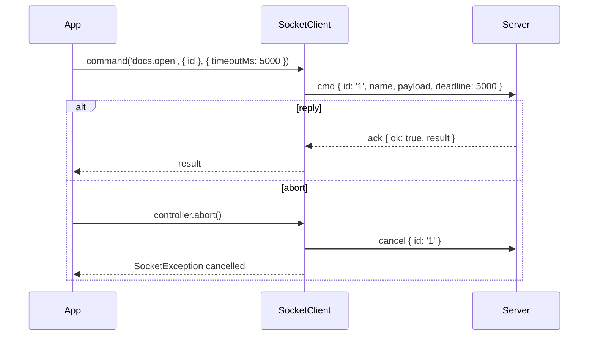

# Commands

`client.command(name, payload, options)` sends one request and resolves with the server's reply. It has a timeout, can be cancelled with an `AbortSignal`, and decides what to do while the client is offline. A plain command is sent at most once; use [durable commands](04-durable-commands.md) for commands that must survive a drop.

## How it works

1. `SocketClient.command()` hands the call to `CommandDispatcher.execute()`.
2. `execute()` checks, in order, and rejects at once when one fails:
   - `timeoutMs` is within `1` to `2_147_483_647`, else a `RangeError`;
   - the client is not `closed`, else `unavailable` (not retryable);
   - the signal is not already aborted, else `cancelled`;
   - the client is online, or `whenOffline` is `'wait'`, else `unavailable` (retryable).
3. The command gets an id unique per client and starts its `timeoutMs` timer, which covers the whole call.
4. Online: `transmit()` sends it with `deadline` set to the remaining time. Offline with `'wait'`: it is held and sent, in call order, once the state turns `online`.
5. The reply settles it:
   - `{ ok: true, result }`: resolves with `result`;
   - `{ ok: false, error }`: rejects with `SocketException.fromWire(error)`;
   - a stream reply: rejects with `failed_precondition` (use `stream()`);
   - anything malformed: rejects with `internal`.
6. On the way, the timer, the signal or the connection can end it:
   - the timer fires before the send: `unavailable`, "the client stayed offline until the timeout" (retryable);
   - the timer fires after the send: `deadline_exceeded` (retryable);
   - the signal aborts: a `cancel` frame goes to the server when the command was sent, and the call rejects with `cancelled`;
   - the connection drops after the send: `unavailable`, "the connection dropped before the reply" (retryable);
   - `close()`: `unavailable`, "the client is closed" (not retryable).



## Configuration

`CommandOptions`, per call:

| Key | Type | Default | Allowed values | Meaning |
| --- | --- | --- | --- | --- |
| `timeoutMs` | `number` | `defaultTimeoutMs` (`15_000`) | `1` to `2_147_483_647` | Budget for the whole call: the wait for a connection and for the reply. |
| `signal` | `AbortSignal` | none | | Aborting cancels the command, on the server too once it was sent. |
| `whenOffline` | `WhenOffline` | `'fail'` | `'fail'`, `'wait'` | `'fail'` rejects at once while offline; `'wait'` holds the command until online or the timeout. |
| `traceparent` | `string` | none | W3C trace context | Carried into the server handler. |

```ts
const doc = await client.command<OpenResult>('docs.open', { id }, { timeoutMs: 5_000, signal, whenOffline: 'wait' });
```

## Services and extension points

| Service | DI token and lifetime | Default implementation | Alternatives | How to replace or extend |
| --- | --- | --- | --- | --- |
| `SocketClient` | none; you construct it, one per connection | `SocketClient` | your subclass | Subclass and override the public `command()`, `durable()`, `stream()` or `emit()`; call `super`. All internals are private, so there are no protected hooks. |

### SocketClient: subclass that adds call defaults

Subclass when every call of your app needs the same option: a trace context, a shorter timeout, `whenOffline: 'wait'`. `typed()` returns the same instance, so typed calls go through your overrides too.

```ts sample
import { SocketClient, type CommandOptions, type SocketClientOptions, type StreamOptions } from '@spinajs/http-socket-client';

/** Gives every command and stream the active trace, and waits for the connection by default. */
export class TracedSocketClient extends SocketClient {
  constructor(options: SocketClientOptions, private readonly currentTrace: () => string | undefined) {
    super(options);
  }

  public override command<R = unknown>(name: string, payload?: unknown, options: CommandOptions = {}): Promise<R> {
    return super.command<R>(name, payload, this.defaults(options));
  }

  public override stream<T = unknown>(name: string, payload?: unknown, options: StreamOptions = {}): AsyncIterableIterator<T> {
    return super.stream<T>(name, payload, this.defaults(options));
  }

  private defaults<O extends CommandOptions>(options: O): O {
    return { whenOffline: 'wait', traceparent: this.currentTrace(), ...options };
  }
}

export async function renameDocument(client: TracedSocketClient, id: string, title: string): Promise<void> {
  await client.command('docs.rename', { id, title });
}

export const client = new TracedSocketClient({ url: 'https://app.example.com', clientId: 'web-4f1c2a' }, () => '00-4bf92f3577b34da6a3ce929d0e0e4736-00f067aa0ba902b7-01');
```

## Important behaviour

- A plain command is never sent twice. After a drop it rejects with a retryable `unavailable`; whether it ran on the server is unknown. Retry only commands that are safe to repeat, or use `durable()`.
- `deadline` is relative (the remaining milliseconds), so clock skew between client and server cannot expire it.
- Held commands (`whenOffline: 'wait'`) go out in the order they were called.
- The `R` type parameter is not checked at runtime. Use [typed contracts](07-typed-contracts.md) to tie it to the server.
- `command()` on a server command that answers with a stream rejects with `failed_precondition`.
- Every rejection is a `SocketException` from `@spinajs/http-socket-common`, except an invalid `timeoutMs` (`RangeError`). See [Errors and retries](08-errors-and-retries.md).

### Binary payloads

- `Uint8Array`, `ArrayBuffer` and `Buffer` anywhere in a payload travel as binary attachments.
- They count toward the server's `maxPayloadBytes` by byte length; over the limit the server answers `resource_exhausted`, not retryable.
- Binary results arrive as an `ArrayBuffer` in browsers and as a `Buffer` in Node. `new Uint8Array(result)` reads both.

## Best practices

- Pass `whenOffline: 'wait'` for user actions that should survive a short reconnect, and keep `'fail'` for reads the UI can redo.
- Use one `AbortController` per screen and abort it when the user leaves; the server handler's signal fires too.
- Decide on retries from `error.retryable` and `error.retryAfterMs`, not from the code alone.

## Patterns and antipatterns

```ts
// Don't: a plain command is not idempotent; a retry after a drop can charge twice
for (let i = 0; i < 3; i++) {
  try { return await client.command('billing.charge', order); } catch { /* retry */ }
}

// Do: a durable command carries an idempotency key, so the server runs it once
return await client.durable('billing.charge', order, { key: `charge:${order.id}` });
```

## Examples

### Cancel a search when the user types again

```ts sample
import { SocketClient, SocketException } from '@spinajs/http-socket-client';

interface SearchHit {
  id: string;
  title: string;
}

export function createSearch(client: SocketClient, render: (hits: SearchHit[]) => void): (query: string) => Promise<void> {
  let current: AbortController | undefined;

  return async (query: string) => {
    current?.abort();
    const controller = new AbortController();
    current = controller;

    try {
      const hits = await client.command<SearchHit[]>('docs.search', { query }, { signal: controller.signal, timeoutMs: 3_000 });
      render(hits);
    } catch (error) {
      if (error instanceof SocketException && error.code === 'cancelled') return;
      throw error;
    }
  };
}
```

### Upload a thumbnail as binary

```ts sample
import { SocketClient } from '@spinajs/http-socket-client';

export async function uploadThumbnail(client: SocketClient, documentId: string, image: Blob): Promise<Uint8Array> {
  const bytes = new Uint8Array(await image.arrayBuffer());
  const stored = await client.command<ArrayBuffer>('docs.thumbnail', { documentId, bytes }, { timeoutMs: 30_000 });
  // ArrayBuffer in browsers, Buffer in Node: both read the same way
  return new Uint8Array(stored);
}
```

## Related

- [Durable commands](04-durable-commands.md): commands that are persisted and sent again.
- [Streams](06-streams.md): commands that answer with many chunks.
- [Errors and retries](08-errors-and-retries.md): every error listed above, with retry advice.
- [`@spinajs/http-socket`](../http-socket/README.md): the server-side command pipeline, deadlines and cancellation.
