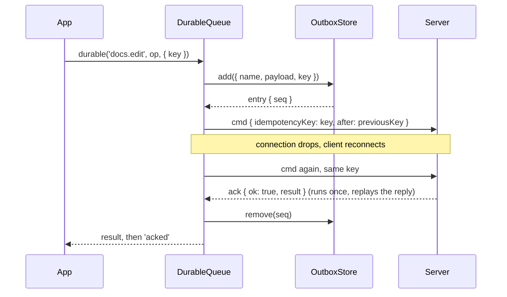

# Durable commands

`client.durable(name, payload, { key })` persists a command in an outbox before it is sent, sends it in order, sends it again after every drop, and settles callers in send order. With an idempotency key and the server's ordering, each command runs exactly once and never overtakes its predecessor, also across page reloads and process restarts.

Use it for writes that must not be lost or doubled: document edits, orders, payments. Use [`command()`](02-commands.md) for reads and for writes that may fail visibly.

## How it works

1. `SocketClient.durable()` hands the call to `DurableQueue.submit()`, which rejects at once when:
   - the client is closed: `unavailable` (not retryable), "the client is closed; the command stays in the outbox";
   - `key` is not 1 to 256 printable ASCII characters or starts with `${clientId}:`: `RangeError`;
   - `JSON.stringify(payload)` throws (a cycle, a `BigInt`): `invalid_argument`, "the payload cannot be serialized";
   - the payload is larger than `durable.maxPayloadBytes`: `invalid_argument` with `details { size, limit }`.
2. Adds run one at a time. Each first waits for the queue's single `OutboxStore.pending()` read, which resumes entries left from an earlier run, then calls `OutboxStore.add({ name, payload, key })`. Without your `key`, the key is `${clientId}:<random nonce>`, persisted with the entry.
3. `DurableQueue.pump()` sends queued entries in `seq` order, at most `durable.window` unanswered at once. Each request carries `idempotencyKey` and, except for the first, `after`: the key of the entry before it.
4. The server runs each key once and only after the command named in `after` completed.
5. A reply decides the entry's outcome:
   - result: `OutboxStore.remove(seq)`;
   - an error with `retryable: false` (other than `unauthenticated`), a stream reply or a malformed reply: `OutboxStore.fail({ ...entry, error, failedAt })`;
   - `unauthenticated`: the entry stays queued, the queue sends nothing until the connection comes online again, and `held` fires once;
   - a fence refusal (`details.after` names a predecessor still running): the entry waits for that predecessor's answer, or 50 ms if it already answered;
   - any other retryable error: the whole queue pauses for `ReconnectPolicy.delay()` (honouring `retryAfterMs`), then probes with the head entry alone before it opens the window again.
6. Once the store has applied an outcome, the queue settles entries in send order: the caller's promise resolves or rejects, and `acked` or `failed` fires.
7. A drop requeues every unanswered entry; they are sent again in order when the client is online. An entry unanswered for `durable.ackTimeoutMs` on a live connection is sent again too; whichever reply arrives first counts.



### Close

`client.close()` returns a promise from `DurableQueue.close()`:

- Callers of commands the server has not answered are rejected with `unavailable` ("the command stays in the outbox"). Their entries stay in the store; the next client sends them.
- Commands the server already answered settle with that answer once the store applied it, also after `close()`.
- An add begun before `close()` still writes its entry, for the next start.
- The promise resolves once the store has no write of this client in flight and every answered command has been reported.

## Configuration

| Key | Type | Default | Allowed values | Meaning |
| --- | --- | --- | --- | --- |
| `outbox` | `OutboxStore` | `new MemoryOutboxStore()` | any `OutboxStore` | Where entries wait. Any value requires an explicit `clientId`. See [Outbox stores](05-outbox-stores.md). |
| `durable.window` | `number` | `16` | integer `>= 1` | Durable commands sent and not yet answered at once. |
| `durable.ackTimeoutMs` | `number` | `60_000` | `1` to `2_147_483_647` | A command unanswered this long on a live connection is sent again. |
| `durable.maxPayloadBytes` | `number` | `1_048_576` | integer `>= 1` | Largest payload: JSON text in UTF-8, binary parts by byte length. Match the server's `maxPayloadBytes`. |
| `reconnect.*` | `ReconnectOptions` | `DEFAULT_RECONNECT` | | Also the backoff of the queue's pause after a retryable refusal. |

`DurableCommandOptions`, per call:

| Key | Type | Default | Allowed values | Meaning |
| --- | --- | --- | --- | --- |
| `key` | `string` | `${clientId}:<nonce>` | 1 to 256 printable ASCII characters, not starting with `${clientId}:` | Idempotency key, for example an operation id. |

```ts
const client = new SocketClient({
  url,
  clientId: storedClientId,
  outbox: new IndexedDbOutboxStore('editor'),
  durable: { window: 16, ackTimeoutMs: 60_000, maxPayloadBytes: 1024 * 1024 },
});
```

`DEFAULT_DURABLE` holds the defaults.

### Server requirements

The server command behind `durable()` must be declared `idempotent`. With `ordered: 'client'` it waits in the server's queue behind its predecessor. Without it, the server only checks that the predecessor completed, otherwise it answers a retryable `unavailable` that parks the command until the predecessor's answer. Either way it runs after its predecessor. See [`@spinajs/http-socket`](../http-socket/README.md).

## Services and extension points

| Service | DI token and lifetime | Default implementation | Alternatives | How to replace or extend |
| --- | --- | --- | --- | --- |
| `OutboxStore` | none; `outbox` option, one store per client, used for the client's lifetime | `MemoryOutboxStore` | `IndexedDbOutboxStore` (`/browser`), `FileOutboxStore` (`/node`) | Implement `OutboxStore`, or wrap a shipped store. See [Outbox stores](05-outbox-stores.md). |
| `acked`, `failed`, `held` | none; lifecycle events of the client | no listeners | | Subscribe with `client.on()`. They also fire for entries resumed from the outbox, which have no caller. |

## Important behaviour

- **Exactly once.** The server runs each key once and replays its stored reply to a resend. A resend therefore never runs twice.
- **Order.** `after` makes the server run a command only after its predecessor completed, so a resend or a refusal never lets a later command overtake.
- **Settle order.** Callers and `acked` / `failed` listeners hear about commands in send order, whatever order replies came in. The exception is `close()`: an answered command settles after the close, while an earlier unanswered one is rejected and reported by the next client.
- **Persisted first.** A caller learns an outcome only after the store holds it, so a reload cannot undo what it was told.
- **No deadline.** A durable request carries no `deadline`; it waits until answered.
- **Held.** After `held`, nothing is sent until the next `online`. After a re-login, call `disconnect()` and `connect()` when the server has not closed the connection itself.
- **Keys.** A generated key is persisted with the entry, so a store that starts over and reuses a `seq` never collides with an old reply.
- **clientId.** Any `outbox` option, an explicit `MemoryOutboxStore` included, needs a `clientId` stored by the app; the constructor throws a `RangeError` otherwise.
- **Store failures.** A failed `pending()` read is retried by the next `durable()` call or the next `online`. Failures no caller can be rejected with go to `onListenerError`.
- **Size check.** The client checks the size before persisting, so a command the server would refuse for size never sits in the outbox.

## Best practices

- Pass your own `key` (an operation id) when the app can produce the same operation twice; the server then runs it once.
- Attach a `catch` to every `durable()` promise, or follow `acked` / `failed` instead: the promise rejects on a permanent refusal and on `close()`.
- `await client.close()` before you open the next client or store on the same outbox, and keep `acked` / `failed` listeners until it resolves.
- Read `store.failed()` to show or export refused commands, then `clearFailed()`; they stay forever otherwise.

## Patterns and antipatterns

```ts
// Don't: a new random clientId after a reload breaks exactly-once and ordering (the constructor throws)
new SocketClient({ url, outbox: new IndexedDbOutboxStore('editor') });

// Do
new SocketClient({ url, clientId: localStorage.getItem('clientId') ?? createAndStoreClientId(), outbox: new IndexedDbOutboxStore('editor') });
```

```ts
// Don't: an unhandled rejection when the server refuses the command or the client closes
client.durable('docs.edit', op);

// Do
client.durable('docs.edit', op, { key: op.id }).catch(() => undefined);
client.on('failed', ({ entry, error }) => showRejectedEdit(entry, error));
```

## Examples

### Queue document edits offline and resume them after a reload

```ts sample
import { SocketClient } from '@spinajs/http-socket-client';
import { IndexedDbOutboxStore } from '@spinajs/http-socket-client/browser';

interface EditOp {
  id: string;
  documentId: string;
  patch: string;
}

function storedClientId(): string {
  const existing = localStorage.getItem('editor.clientId');
  if (existing) return existing;
  const created = `web-${crypto.randomUUID()}`;
  localStorage.setItem('editor.clientId', created);
  return created;
}

export function startEditor(markSaved: (opId: string) => void, markRejected: (opId: string, reason: string) => void) {
  const client = new SocketClient({
    url: 'https://app.example.com',
    clientId: storedClientId(),
    outbox: new IndexedDbOutboxStore('editor'),
  });

  // also fires for edits queued before the reload, which have no caller any more
  client.on('acked', ({ entry }) => markSaved((entry.payload as EditOp).id));
  client.on('failed', ({ entry, error }) => markRejected((entry.payload as EditOp).id, error.message));

  return {
    edit(op: EditOp): void {
      client.durable('docs.edit', op, { key: op.id }).catch(() => undefined);
    },
    close: () => client.close(),
  };
}
```

### Export and clear refused commands

```ts sample
import { SocketClient, type FailedOutboxEntry } from '@spinajs/http-socket-client';
import { FileOutboxStore } from '@spinajs/http-socket-client/node';
import { writeFile } from 'node:fs/promises';

export async function exportRejected(store: FileOutboxStore, reportPath: string): Promise<number> {
  const failed: FailedOutboxEntry[] = await store.failed();
  if (failed.length === 0) return 0;

  const lines = failed.map((entry) => JSON.stringify({ seq: entry.seq, name: entry.name, key: entry.key, code: entry.error.code, failedAt: new Date(entry.failedAt).toISOString() }));
  await writeFile(reportPath, `${lines.join('\n')}\n`);
  await store.clearFailed(failed.map((entry) => entry.seq));
  return failed.length;
}

export function startWorker(): SocketClient {
  const store = new FileOutboxStore('/var/lib/billing-worker/outbox.json');
  return new SocketClient({ url: 'https://api.example.com', clientId: 'billing-worker-1', outbox: store });
}
```

### Resume after a re-login

```ts sample
import { SocketClient } from '@spinajs/http-socket-client';

export function resumeAfterLogin(client: SocketClient, login: () => Promise<void>): void {
  client.on('held', async () => {
    await login();
    // the queue waits for the next online; a reconnect opens it with the new credentials
    client.disconnect();
    client.connect();
  });
  client.on('auth_required', async () => {
    await login();
    client.connect();
  });
}
```

## Related

- [Outbox stores](05-outbox-stores.md): where entries wait, and how to write your own store.
- [Events](03-events.md): `acked`, `failed` and `held`.
- [Errors and retries](08-errors-and-retries.md): which errors are retried by the queue.
- [`@spinajs/http-socket`](../http-socket/README.md): `idempotent` and `ordered` commands, fences and replays.
