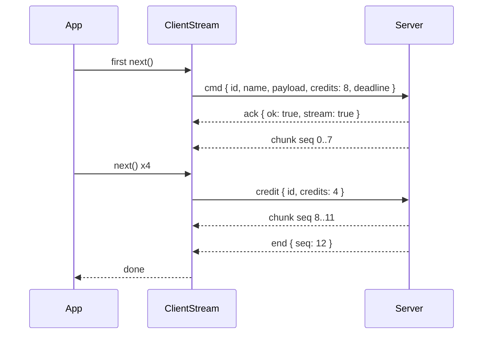

# Streams

`client.stream(name, payload, options)` reads a server command that answers with many chunks. It returns an async iterator: `for await` reads the chunks, and `break` cancels the stream on the server. Credit-based flow control keeps at most `credits` chunks in flight or buffered.

## How it works

1. `SocketClient.stream()` returns a `ClientStream` from `StreamDispatcher.stream()`. Nothing is sent yet.
2. The first `next()` calls `ClientStream.start()`, which settles the stream at once when:
   - `timeoutMs` is out of range or `credits` is not a positive integer: the iterator throws a `RangeError`;
   - the client is closed: `unavailable` (not retryable);
   - the signal is already aborted: `cancelled`;
   - the client is offline and `whenOffline` is `'fail'`: `unavailable` (retryable).
3. Online: `transmit()` sends the request with `credits` and `deadline`. Offline with `'wait'`: the stream is held until `online`, or fails with `unavailable` when `timeoutMs` passes first.
4. The server acknowledges with `{ ok: true, stream: true }`; the stream is open. A plain result instead fails it with `failed_precondition`; an error reply fails it with that error.
5. `chunk` frames arrive in `seq` order. A chunk goes to a waiting `next()` or into the buffer.
6. As you read, `replenish()` grants new credit with a `credit` frame, in batches of at least half the window.
7. An `end` frame finishes the iterator after the buffered chunks. A `fail` frame, a drop or `close()` delivers the buffered chunks first, then the iterator throws.
8. `break` or a `throw` inside `for await` calls `return()`: the client drops buffered chunks and sends `cancel`, and the server generator's `finally` runs. Aborting `signal` does the same, then throws `cancelled`.



## Configuration

`StreamOptions` extends [`CommandOptions`](02-commands.md#configuration):

| Key | Type | Default | Allowed values | Meaning |
| --- | --- | --- | --- | --- |
| `credits` | `number` | `8` (`DEFAULT_STREAM_CREDITS`) | positive integer, at most the server's `http.socket.streams.maxCredits` (64 by default) | Most chunks ever in flight or buffered. |
| `timeoutMs` | `number` | `defaultTimeoutMs` (`15_000`) | `1` to `2_147_483_647` | Bounds the wait for the reply, then each wait in `next()` for the next frame. |
| `signal` | `AbortSignal` | none | | Aborting drops buffered chunks, cancels on the server and throws `cancelled`. |
| `whenOffline` | `WhenOffline` | `'fail'` | `'fail'`, `'wait'` | `'wait'` holds the request until online. |
| `traceparent` | `string` | none | W3C trace context | Carried into the server handler. |

```ts
for await (const frame of client.stream<SnapshotFrame>('docs.snapshot', { docId }, { credits: 16, timeoutMs: 10_000 })) {
  apply(frame);
}
```

## Services and extension points

Streams have no replaceable service. Wrap or subclass `SocketClient.stream()` to add defaults (see [Commands](02-commands.md#socketclient-subclass-that-adds-call-defaults)), and resume a stream yourself as shown below.

## Important behaviour

- The request goes out on the first `next()`, not on `stream()`.
- Calls to `next()` must not overlap: a second `next()` while one is pending rejects with a `TypeError`. `for await` never overlaps.
- A consumer slow to call `next()` is never timed out by the client. The server ends a stream that gets no credit for its `streams.stallTimeoutMs` (60 s) with `deadline_exceeded`.
- The server refuses `credits` above its `streams.maxCredits` with `invalid_argument`.
- Frames out of `seq` order, more chunks than granted, or a malformed reply end the stream with `internal`; buffered chunks are dropped and `cancel` is sent. A malformed `fail` frame also ends it with `internal`, after the buffered chunks.
- `stream()` on a command that answers a plain result fails with `failed_precondition`, and `command()` on a stream command does too.
- The library does **not** resume streams. A drop throws a retryable `unavailable` after the buffered chunks.

## Best practices

- Put the resume position in the payload (`fromChunk`, a cursor, a version) and open a new stream after a retryable failure.
- Combine `whenOffline: 'wait'` with a resume position, so the retry waits for the reconnect instead of failing at once.
- Raise `credits` for small, fast chunks; keep it low for large chunks so memory stays bounded.

## Patterns and antipatterns

```ts
// Don't: overlapping next() calls; the second one rejects with a TypeError
const it = client.stream('logs.tail', { service });
const [a, b] = await Promise.all([it.next(), it.next()]);

// Do
for await (const line of client.stream<string>('logs.tail', { service })) print(line);
```

## Examples

### Download a snapshot and resume after a drop

```ts sample
import { SocketClient, SocketException } from '@spinajs/http-socket-client';

interface SnapshotChunk {
  index: number;
  rows: string[];
}

export async function downloadSnapshot(client: SocketClient, docId: string, maxAttempts = 5): Promise<string[]> {
  const rows: string[] = [];
  let next = 0;

  for (let attempt = 1; ; attempt++) {
    try {
      const chunks = client.stream<SnapshotChunk>('docs.snapshot', { docId, fromChunk: next }, { credits: 16, whenOffline: 'wait' });
      for await (const chunk of chunks) {
        rows.push(...chunk.rows);
        next = chunk.index + 1;
      }
      return rows;
    } catch (error) {
      if (!(error instanceof SocketException) || !error.retryable || attempt >= maxAttempts) throw error;
      // online failures (deadline_exceeded, resource_exhausted) need a pause; offline the next stream waits on its own
      if (client.state === 'online') await new Promise((resolve) => setTimeout(resolve, error.retryAfterMs ?? 200));
    }
  }
}
```

`loadSnapshot` in [`packages/http-socket-example/src/client.ts`](../../packages/http-socket-example/src/client.ts) is a complete version that also detects a document changed between attempts.

### Stop a live log tail from a button

```ts sample
import { SocketClient, SocketException } from '@spinajs/http-socket-client';

export async function tailLogs(client: SocketClient, service: string, stopButton: HTMLButtonElement, print: (line: string) => void): Promise<void> {
  const controller = new AbortController();
  stopButton.onclick = () => controller.abort();

  try {
    for await (const line of client.stream<string>('logs.tail', { service }, { signal: controller.signal, timeoutMs: 60_000 })) {
      print(line);
    }
  } catch (error) {
    if (error instanceof SocketException && error.code === 'cancelled') return;
    throw error;
  }
}
```

## Related

- [Commands](02-commands.md): the shared options and the error behaviour.
- [Typed contracts](07-typed-contracts.md): typing a stream command as `AsyncIterable<Item>`.
- [`@spinajs/http-socket`](../http-socket/README.md): stream handlers, `streams.maxCredits` and `streams.stallTimeoutMs`.
