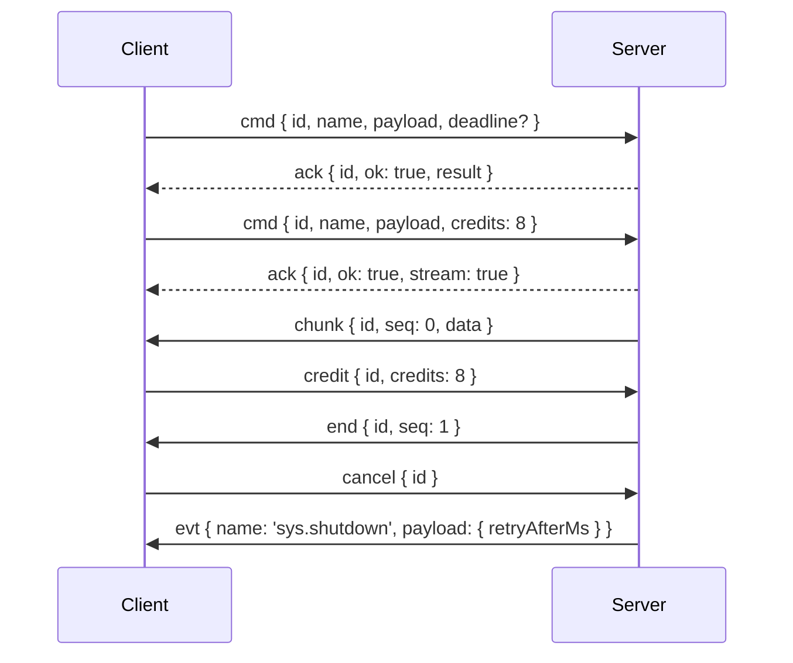

# Wire protocol

The constants and envelope types that the server and the client exchange over socket.io. Use them when you write a peer of your own, a test harness or a protocol-level tool; apps using `SocketClient` and socket controllers never build these frames by hand.

## How it works

Every frame travels as a socket.io event whose name comes from `WIRE_EVENTS`.

### Command

1. The client emits `cmd` (`WIRE_EVENTS.command`) with a `CommandRequest` and a socket.io ack callback.
2. The server checks the frame with `isCommandRequest()`. A malformed frame is answered with a `CommandErrorReply` carrying `invalid_argument`; a frame without an ack callback is ignored.
3. The server runs the handler and calls the ack once with a `CommandReply`:
   - `CommandResultReply`: `{ id, ok: true, result }`, `result` is `null` when the handler returned nothing.
   - `CommandStreamReply`: `{ id, ok: true, stream: true }`, the result follows as stream frames.
   - `CommandErrorReply`: `{ id, ok: false, error }`, `error` is a [`SocketError`](04-error-codes.md).

### Stream

1. The client emits `cmd` with `credits` set: the number of chunks the server may send before the client grants more. A stream command called without `credits` is refused, so a plain command never opens a stream.
2. The server acks with a `CommandStreamReply`.
3. The server emits `chunk` frames (`Chunk`: `id`, `seq`, `data`). `seq` starts at `0`. An `undefined` item travels without its `data` field.
4. The client emits `credit` (`StreamCredit`: `id`, `credits`) to grant more chunks.
5. The server closes the stream with `end` (`StreamEnd`: `id`, `seq` = the number of chunks sent) or `fail` (`StreamFail`: `id`, `error`).

### Cancel

The client emits `cancel` (`CancelFrame`: `id`) for a running command or stream. The server aborts it with a `cancelled` error.

### Events

`evt` (`WIRE_EVENTS.event`) carries an `EventFrame` (`name`, `payload`) in either direction. Events are fire-and-forget: no ack, no reply. The server drops a malformed client event and logs it at debug level.

### System events

The server sends two `evt` frames with names from `SYSTEM_EVENTS`:

| Name | Payload | Meaning |
| --- | --- | --- |
| `sys.shutdown` | `ShutdownNotice` (`retryAfterMs`) | The server is shutting down; the client waits `retryAfterMs` before it reconnects. |
| `sys.disconnect` | `DisconnectNotice` (`reason`) | The server is about to disconnect this client. `reason` is an error code; the client does not reconnect when it is a non-retryable code other than `internal`. |



## Constants

| Export | Value | Meaning |
| --- | --- | --- |
| `PROTOCOL_VERSION` | `1` | Sent in the [handshake](02-handshake.md); a different value is refused with `version_mismatch`. |
| `WIRE_EVENTS.command` | `'cmd'` | Client to server, answered through the socket.io ack. |
| `WIRE_EVENTS.event` | `'evt'` | Either direction, fire-and-forget. |
| `WIRE_EVENTS.chunk` / `end` / `fail` | `'chunk'` / `'end'` / `'fail'` | Server to client stream frames. |
| `WIRE_EVENTS.credit` / `cancel` | `'credit'` / `'cancel'` | Client to server. |
| `SYSTEM_EVENTS.shutdown` | `'sys.shutdown'` | Server shutdown notice. |
| `SYSTEM_EVENTS.disconnect` | `'sys.disconnect'` | Server kick notice. |

`WireEventName` and `SystemEventName` are the unions of these values.

## `CommandRequest` fields

| Field | Type | Rule | Meaning |
| --- | --- | --- | --- |
| `id` | `string` | [`isId`](03-frame-guards.md) | Request id, unique among the connection's commands in flight. A second request with an id already in flight is refused with `invalid_argument`. |
| `name` | `string` | [`isName`](03-frame-guards.md) | Command name, e.g. `notes.open`. |
| `payload` | `P` | none | Command input. |
| `idempotencyKey` | `string?` | [`isKey`](03-frame-guards.md) | Deduplicates the command on the server. Reserved for durable commands. |
| `after` | `string?` | [`isKey`](03-frame-guards.md) | Durable commands: the idempotency key of the command sent before this one. The server runs this one only after that one completed; otherwise it answers a retryable `unavailable` with `details: { after }`. The server refuses `after` without `idempotencyKey`. |
| `deadline` | `number?` | finite number | Milliseconds the caller still waits, counted from when the request was sent. Relative, so client and server clocks never have to agree. |
| `traceparent` | `string?` | any string | Trace context propagated to the server. |
| `credits` | `number?` | integer above `0` | Stream commands only: chunks the server may send before the client grants more. |

## Services and extension points

The protocol has no DI services. Its extension points are the [handshake app fields](02-handshake.md#app-fields-custom-handshake-data) and [custom peers](03-frame-guards.md#custom-peers-and-relays) built on the guards.

## Important behaviour

- One request id identifies a command, its stream frames and its cancel. Reuse an id only after its reply or `end`/`fail` arrived.
- `deadline` is relative. The server applies the earlier of its own deadline and the client's, and answers `deadline_exceeded` when it passes.
- The server ignores a `deadline` of `0` or below: the command then runs without a client deadline, though `isCommandRequest()` accepts it.
- A huge integer `credits` passes the guard. The server bounds it with its `maxCredits` limit and refuses more with `invalid_argument`.
- `PROTOCOL_VERSION` changes only with a breaking wire change. Client and server packages must come from the same protocol version.

## Best practices

- Build socket.io listeners from `WIRE_EVENTS` and `SYSTEM_EVENTS`, never from string literals, so a protocol bump fails at compile time.
- Type replies as `CommandReply<R>` and switch on `ok`, then on `'stream' in reply`, to cover all three reply shapes.

## Patterns and antipatterns

```ts
// Don't: a hard-coded event name breaks silently when the protocol renames it
socket.emit('cmd', request, onReply);

// Do
socket.emit(WIRE_EVENTS.command, request, onReply);
```

## Examples

### Read a command reply in a test harness

```ts sample
import { SocketException, type CommandReply } from '@spinajs/http-socket-common';

export function unwrapReply<R>(reply: CommandReply<R>): R | 'stream' {
  if (!reply.ok) {
    throw SocketException.fromWire(reply.error);
  }
  if ('stream' in reply) {
    return 'stream';
  }
  return reply.result;
}
```

### React to a server shutdown notice

```ts sample
import { SYSTEM_EVENTS, WIRE_EVENTS, isEventFrame, type ShutdownNotice } from '@spinajs/http-socket-common';

interface FrameSource {
  on(event: string, listener: (frame: unknown) => void): void;
}

export function onShutdown(socket: FrameSource, schedule: (delayMs: number) => void): void {
  socket.on(WIRE_EVENTS.event, (frame) => {
    if (isEventFrame(frame) && frame.name === SYSTEM_EVENTS.shutdown) {
      schedule((frame.payload as ShutdownNotice).retryAfterMs);
    }
  });
}
```

## Related

- [Handshake](02-handshake.md): what the client sends before any frame.
- [Frame guards and naming rules](03-frame-guards.md): how each frame is validated.
- [Error codes and `SocketException`](04-error-codes.md): the `error` of `CommandErrorReply` and `StreamFail`.
- [`@spinajs/http-socket`](../../packages/http-socket/README.md): the server side of this protocol.
- [`@spinajs/http-socket-client`](../../packages/http-socket-client/README.md): the client side of this protocol.
