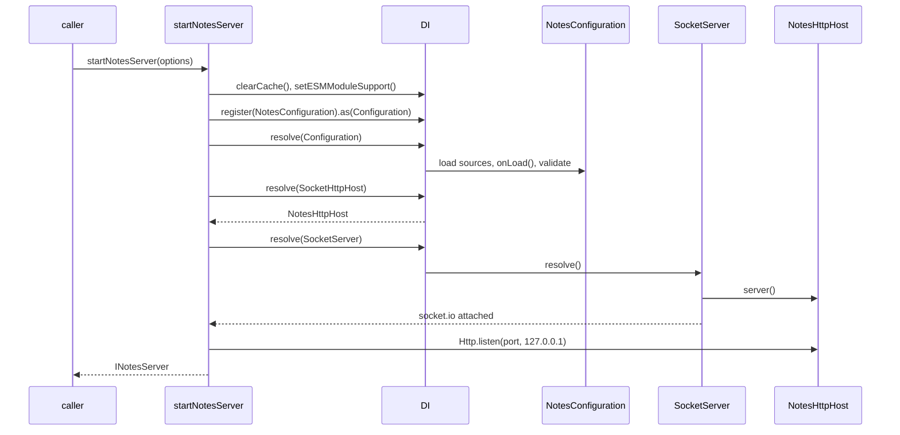

# Server startup

`startNotesServer(options)` in `src/server.ts` boots the whole notes server in one call: it resets the DI cache, installs the example's configuration, resolves `SocketServer`, and listens on `127.0.0.1`. Use it from tests and from `main.ts`; copy it as the boot sequence of a socket server that does not run on `@spinajs/http`.

## How it works

1. Importing `server.js` imports `@spinajs/log`, `@spinajs/http-socket`, `auth.js` and `notes.socket.js`. Their decorators register `DemoTokenSource`, `NotesSocket` and `BlobSocket`. The module then runs `DI.register(NotesHttpHost).as(SocketHttpHost)`.
2. `startNotesServer(options)` stores `options` in a module variable that `NotesConfiguration.onLoad()` reads.
3. `DI.clearCache()` drops every cached instance; registrations stay. The next resolves build a fresh `Configuration`, `SocketServer`, `NotesStore` and controllers.
4. `DI.setESMModuleSupport()` switches the configuration sources to the `mjs` builds. Without it they look for the CommonJS builds, cannot `require` them from an ES module, and the `http.socket` defaults of `@spinajs/http-socket` never load.
5. `DI.register(NotesConfiguration).as(Configuration)`, then `await DI.resolve(Configuration)`: sources load, `onLoad()` merges over them, schemas validate. See [Configuration source](03-configuration-source.md).
6. `DI.resolve(SocketHttpHost)` returns the `NotesHttpHost`; see [HTTP host](04-http-host.md).
7. `await DI.resolve(SocketServer)`: `SocketServer.resolve()` builds the handler registry from the registered controllers, attaches socket.io to `NotesHttpHost.server()`, installs the handshake that runs the principal sources, and starts the revalidation guard.
8. `host.Http.listen(options.port ?? 0, '127.0.0.1')`.
9. The function returns an `INotesServer`.



Errors on the way: an invalid `http.socket` value in `options.socket` fails the configuration schema at step 5; a duplicate command name fails the registry at step 7, before socket.io attaches.

## Configuration

`INotesServerOptions`, the argument of `startNotesServer`:

| Key | Type | Default | Allowed values | Meaning |
| --- | --- | --- | --- | --- |
| `port` | `number` | `0` | `0` or a TCP port | `0` or absent: a free port, read back into `url` |
| `verbose` | `boolean` | `false` | `true`, `false` | `true` logs to the console; otherwise logs go to a `BlackHoleTarget` |
| `socket` | `Record<string, unknown>` | `{}` | Any `http.socket` keys | Spread over the example's `http.socket` object; see [Configuration source](03-configuration-source.md#configuration) |

`INotesServer`, the result:

| Member | Type | Meaning |
| --- | --- | --- |
| `url` | `string` | `http://127.0.0.1:<port>` |
| `path` | `string` | The socket.io path, read from `http.socket.path` (`/socket.io` by default) |
| `server` | `SocketServer` | The running socket server; `server.Io` is the socket.io `Server` |
| `store` | `NotesStore` | The store the controllers use; see [Notes store](09-notes-store.md) |
| `close()` | `() => Promise<void>` | `server.dispose()` (graceful drain), then `closeAllConnections()`, then closes the http server |

## Services and extension points

| Service | DI token and lifetime | Default implementation | Alternatives | How to replace or extend |
| --- | --- | --- | --- | --- |
| `Configuration` | `Configuration`, singleton; registered inside `startNotesServer` | `NotesConfiguration` | `FrameworkConfiguration` | See [Configuration source](03-configuration-source.md) |
| `SocketHttpHost` | `SocketHttpHost`, singleton; registered when `server.js` is imported | `NotesHttpHost` | `HttpServerHost` (`@spinajs/http-socket`) | See [HTTP host](04-http-host.md) |
| `SocketPrincipalSource` | `SocketPrincipalSource`, list | `DemoTokenSource`, `AuthnCredentialSource` | `SessionSocketPrincipalSource` | See [Principal source](05-principal-source.md) |
| `BaseSocketController` | `BaseSocketController`, list | `NotesSocket`, `BlobSocket` | Your controllers | See [Socket controllers](06-socket-controllers.md) |
| `NotesStore` | `NotesStore`, singleton | `NotesStore` | A subclass | See [Notes store](09-notes-store.md) |

### Startup: plug in your own services

Everything the server resolves at step 7 can be swapped before `startNotesServer` runs, because `DI.clearCache()` keeps registrations. Register replacements after importing `server.js`, so they come last under their token. `Configuration` is the exception: `startNotesServer` registers `NotesConfiguration` on every call, so a configuration registered before it loses.

```ts sample
import { DI } from '@spinajs/di';
import { startNotesServer } from '@spinajs/http-socket-example/lib/mjs/server.js';
import { NotesStore } from '@spinajs/http-socket-example/lib/mjs/store.js';

// Counts document reads (open, snapshot, edit) per document, for a usage report.
class CountingNotesStore extends NotesStore {
  public readonly reads = new Map<string, number>();

  public doc(docId: string) {
    this.reads.set(docId, (this.reads.get(docId) ?? 0) + 1);
    return super.doc(docId);
  }
}

DI.register(CountingNotesStore).as(NotesStore);

async function main(): Promise<void> {
  const server = await startNotesServer({ port: 4100, socket: { maxPayloadBytes: 256 * 1024 } });
  console.log(server.url, server.path, server.store instanceof CountingNotesStore);
  await server.close();
}

void main();
```

## Important behaviour

- One notes server per process. DI and the module-level options are process-wide, so a second `startNotesServer` replaces the first one's options and its cached services.
- Call `close()` before starting again. `DI.clearCache()` forgets the old `SocketServer` without disposing it, so a server that was not closed keeps its socket.io and its port.
- The server listens on `127.0.0.1` only. It is **not** reachable from other hosts.
- Every call adds another `NotesConfiguration` registration under `Configuration`. The last one wins, so this is harmless.
- `close()` calls `http.Server.closeAllConnections()`, which needs Node 18.2 or later, although `package.json` declares `"node": ">=16.11"`.
- `path` comes from configuration: pass `socket: { path: '/notes' }` and the result's `path` follows.

## Best practices

- Start one server in `beforeEach` and close it in `afterEach`, as `test/example.test.ts` does; the cache reset gives each test an empty `NotesStore`.
- Pass `port: 0` in tests and read `url` back, so parallel runs do not collide.
- Keep `verbose` off in tests; turn it on with `node lib/mjs/main.js --verbose` when a handshake is refused and you need to see why.

## Patterns and antipatterns

```ts
// Don't: the configuration source registered before startNotesServer is replaced by NotesConfiguration
DI.register(MyConfiguration).as(Configuration);
await startNotesServer();

// Do: pass socket keys through the options
await startNotesServer({ socket: { maxPayloadBytes: 256 * 1024 } });
```

## Examples

### Start a quiet server for an integration test

```ts sample
import { connectNotes } from '@spinajs/http-socket-example/lib/mjs/client.js';
import { startNotesServer, type INotesServer } from '@spinajs/http-socket-example/lib/mjs/server.js';

async function openedBy(token: string): Promise<string> {
  const server: INotesServer = await startNotesServer({ port: 0 });
  const notes = connectNotes(server.url, server.path, token, { reconnect: { minMs: 20, maxMs: 100, jitter: 0 } });

  try {
    const opened = await notes.command('notes.open', { docId: 'doc-1' }, { whenOffline: 'wait' });
    return opened.openedBy;
  } finally {
    notes.close();
    await server.close();
  }
}

void openedBy('bob-token').then((name) => console.log(name));
// bob
```

## Related

- [`@spinajs/http-socket`](../http-socket/README.md): `SocketServer`, its resolve steps and graceful shutdown.
- [`@spinajs/di`](../di/README.md): `clearCache`, `setESMModuleSupport` and "last registration wins".
- [Configuration source](03-configuration-source.md) and [HTTP host](04-http-host.md): the two services this function installs.
