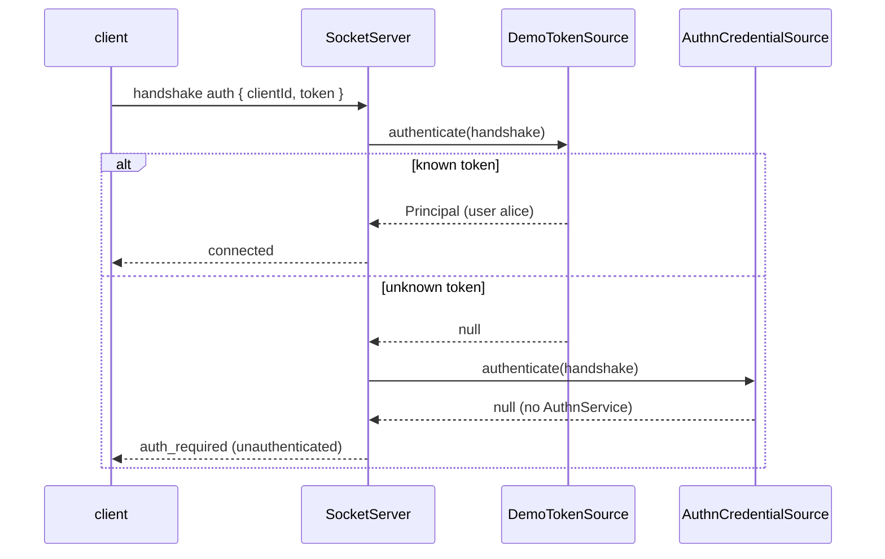

# Principal source

`DemoTokenSource` signs a socket connection in from its handshake: it maps two fixed tokens, `alice-token` and `bob-token`, to a user principal. It shows how a `SocketPrincipalSource` plugs into `@spinajs/http-socket`. It is demo only; a real app uses `AuthnCredentialSource` (bearer tokens, keys and signatures through `@spinajs/authn`) or `SessionSocketPrincipalSource` (the session cookie, from `@spinajs/authn-http/socket`).

## How it works

1. `@Injectable(SocketPrincipalSource)` registers `DemoTokenSource` under `SocketPrincipalSource` and as itself when `auth.js` is imported.
2. `SocketServer` injects every source with `@Autoinject(SocketPrincipalSource)` as a `SocketPrincipalSource[]`.
3. On each handshake the server runs the sources in ascending `order`; the first non-null principal wins. The example has two sources: `DemoTokenSource` (`order` 10) and `AuthnCredentialSource` (`order` 50, registered by `@spinajs/http-socket`, inert without an `AuthnService`).
4. `DemoTokenSource.authenticate(handshake)` reads `handshake.auth.token`. A known token returns a frozen principal: `type: 'user'`, `id` `'1'` or `'2'`, `source: 'demo'`, `identity: { name }`. Any other value returns `null`.
5. No source returns a principal: `http.socket.auth.required` is `true` in the example, so the handshake is refused with `Unauthenticated('authentication required')`. The client receives `auth_required` with code `unauthenticated`.
6. Every `http.socket.auth.revalidateMs` (60 s) the guard calls `revalidate()`. `DemoTokenSource` keeps the base implementation: it re-runs `authenticate()` and requires the same principal.
7. Handlers read the identity as `conn.user`, typed with `SocketConnection<Record<string, unknown>, DemoUser>`.



## Configuration

| Key | Type | Default | Allowed values | Meaning |
| --- | --- | --- | --- | --- |
| `http.socket.auth.required` | `boolean` | `true` in the example | `true`, `false` | Refuse a handshake no source signs in, instead of running it as `UNATTENDED` |
| `http.socket.auth.revalidateMs` | `number` | `60000` | Positive ms | Interval of the `revalidate()` sweep |

## Services and extension points

| Service | DI token and lifetime | Default implementation | Alternatives | How to replace or extend |
| --- | --- | --- | --- | --- |
| `SocketPrincipalSource` | `SocketPrincipalSource` (abstract class), resolved as a list; each source a singleton | `DemoTokenSource` (order 10), `AuthnCredentialSource` (order 50) | `SessionSocketPrincipalSource` (order 40, `@spinajs/authn-http/socket`) | Add a source with `@Injectable(SocketPrincipalSource)`; pick its place with `order`; override `revalidate()` for expiry or revocation |

Members of `SocketPrincipalSource`:

| Member | Kind | Meaning |
| --- | --- | --- |
| `name` | abstract `string` | Source name, kept in the connection's auth state |
| `order` | abstract `number` | Ascending run order; lower runs first |
| `authenticate(handshake)` | abstract, `Promise<Principal \| null>` | `null`: not my credential, try the next source. Throw (eg. `Unauthenticated`): refuse the connection |
| `revalidate(handshake, principal, check?)` | overridable | `'valid'`, `'invalid'` (close now) or `'unavailable'` (one grace window); the default re-runs `authenticate()` |

`ISocketHandshake` gives a source `auth` (the client's `auth` payload), `headers`, `cookies`, `address`, `peerAddress`, `url`, `query`, `secure` and `issuedAt`.

### SocketPrincipalSource: custom implementation

Add a source to accept a credential the shipped sources do not know. Sources are a list, so a new source does not replace the others; set `order` to run before or after them. Import the module before `SocketServer` resolves; a source registered later is not in the injected list.

```ts sample
import { Injectable } from '@spinajs/di';
import { Unauthenticated, type Principal } from '@spinajs/authz';
import { SocketPrincipalSource, type ISocketHandshake, type ISocketRevalidation, type SocketRevalidationResult } from '@spinajs/http-socket';

interface Kiosk {
  serial: string;
  revoked: boolean;
}

// Kiosks send a device key header; a revoked key closes live connections at the next sweep.
const KIOSKS = new Map<string, Kiosk>([['k-7f3a9c', { serial: 'kiosk-12', revoked: false }]]);

@Injectable(SocketPrincipalSource)
export class KioskKeySource extends SocketPrincipalSource {
  public readonly name = 'kiosk-key';
  public readonly order = 20;

  public async authenticate(handshake: ISocketHandshake): Promise<Principal | null> {
    const key = handshake.headers['x-kiosk-key'];
    if (typeof key !== 'string') {
      return null;
    }

    const kiosk = KIOSKS.get(key);
    if (!kiosk || kiosk.revoked) {
      throw new Unauthenticated('unknown or revoked kiosk key');
    }

    return Object.freeze({ type: 'service', id: kiosk.serial, authenticated: true, source: this.name, attributes: Object.freeze({}), identity: kiosk });
  }

  public async revalidate(handshake: ISocketHandshake, principal: Principal, check?: ISocketRevalidation): Promise<SocketRevalidationResult> {
    const kiosk = principal.identity as Kiosk;
    if (kiosk.revoked) {
      return 'invalid';
    }
    return super.revalidate(handshake, principal, check);
  }
}
```

Import the module next to `server.js`, before `startNotesServer()` runs:

```ts
import './kiosk-source.js';
import { startNotesServer } from './server.js';
```

## Important behaviour

- `null` and a throw mean different things: `null` passes the handshake to the next source; a throw refuses the connection without asking the remaining sources.
- A source must not return a system or unattended principal; the server refuses that as a configuration error.
- In `revalidate()`, a throw counts as `'unavailable'`, not as a refusal. `'unavailable'` keeps the connection for one more `revalidateMs` window; a second non-valid answer closes it.
- `DemoTokenSource` reads the token from `handshake.auth`, which socket.io sends in the handshake body, not in a header or query string.
- The demo principal's `attributes` are empty and frozen; the principal is frozen too.

## Best practices

- Return `null` when the handshake carries none of your credential; throw only when your credential is present and wrong.
- Pick `order` relative to the shipped sources: below 40 runs before the session cookie, below 50 before bearer credentials.
- Set `source` on the principal to the source's `name`, as `DemoTokenSource` does with `'demo'`, so audit logs can tell sources apart.

## Patterns and antipatterns

```ts
// Don't: a thrown error on a missing credential stops every later source
public async authenticate(handshake: ISocketHandshake) {
  if (typeof handshake.auth.token !== 'string') throw new Unauthenticated('no token');
  ...
}

// Do: null lets the session or bearer source try
public async authenticate(handshake: ISocketHandshake) {
  if (typeof handshake.auth.token !== 'string') return null;
  ...
}
```

## Related

- [`@spinajs/http-socket`](../http-socket/README.md): the handshake, the guard and `AuthnCredentialSource`.
- [`@spinajs/authz`](../authz/README.md): `Principal` and `Unauthenticated`.
- [Notes client](10-notes-client.md): how the client sends `auth.token`.
