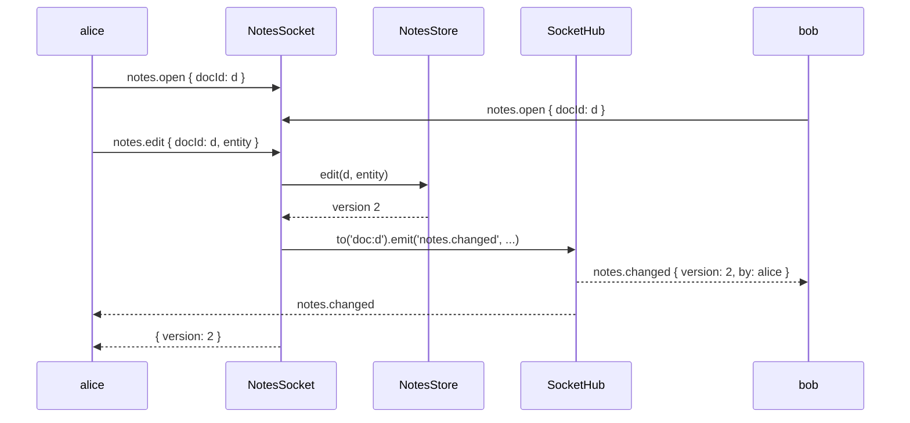

# Socket controllers

`NotesSocket` and `BlobSocket` in `src/notes.socket.ts` serve the commands of the [notes contract](01-notes-contract.md). They show ajv payload schemas, handler parameters, rooms, a push to a room, a stream reply and binary results, all on `@spinajs/http-socket` decorators.

## How it works

1. `@SocketController('notes')` stores the prefix and runs `DI.register(NotesSocket).as(BaseSocketController)`. Importing `notes.socket.js` is what registers both controllers.
2. `SocketServer.resolve()` builds the handler registry. Each `@Command('<name>')` becomes `<prefix>.<name>`: `notes.open`, `notes.snapshot`, `notes.edit`, `blob.put`, `blob.get`.
3. A client sends a command. The dispatcher validates the payload against the `schema` option with ajv; a mismatch answers `invalid_argument` without calling the handler.
4. The dispatcher fills the parameters: `@Payload()` the payload, `@Connection()` the `SocketConnection`, `@Signal()` an `AbortSignal` that fires when the client cancels or disconnects.
5. The handler's return value is the reply. An async generator is a [stream reply](07-snapshot-stream.md). A thrown `InvalidArgument` or `ResourceNotFound` is mapped to `invalid_argument` or `not_found`.

### Commands

| Command | Handler | Schema | Behaviour |
| --- | --- | --- | --- |
| `notes.open` | `NotesSocket.open` | `docId`: string, 1 to 64 chars; no other keys | Joins room `doc:<docId>`; returns `{ docId, version, chunks, openedBy }`, `openedBy` = `conn.user?.name ?? 'nobody'` |
| `notes.snapshot` | `NotesSocket.snapshot` | `docId`; `version`: integer ≥ 1; `fromChunk`: integer ≥ 0 | Stream reply; see [Snapshot stream and resume](07-snapshot-stream.md) |
| `notes.edit` | `NotesSocket.edit` | `docId`; `entity`: `{ id`: 1 to 128 chars, `text`: up to 10 000 chars `}`; no other keys | Stores the entity, pushes `notes.changed` to room `doc:<docId>`, returns `{ version }` |
| `blob.put` | `BlobSocket.put` | none; checked in code | See [Binary blobs](08-binary-blobs.md) |
| `blob.get` | `BlobSocket.get` | `hash`: 64 lowercase hex chars | See [Binary blobs](08-binary-blobs.md) |

### The `notes.changed` push

1. `NotesSocket.open` calls `conn.join('doc:<docId>')`.
2. `NotesSocket.edit` stores the entity with `NotesStore.edit()`, which bumps the document version.
3. It calls `this.Hub.to('doc:<docId>').emit('notes.changed', { docId, version, entity, by })`. Every connection in the room receives it, the editor's own included when it opened the document.



## Decorators

| Decorator | Target | Options | Effect |
| --- | --- | --- | --- |
| `@SocketController(prefix)` | class | `prefix`: `'notes'`, `'blob'` | Registers the class as `BaseSocketController`; prefixes its command names |
| `@Command(name, options)` | method | `schema`: ajv schema of the payload | Request/response command `<prefix>.<name>`, answered through the socket.io ack |
| `@Payload()` | parameter | none | The command payload |
| `@Connection()` | parameter | none | The `SocketConnection`: `user`, `join()`, `leave()`, `clientId` |
| `@Signal()` | parameter | none | `AbortSignal` for cancellation and disconnect |
| `@Autoinject()` | property | none | `Store: NotesStore`, `Hub: SocketHub` |

## Services and extension points

| Service | DI token and lifetime | Default implementation | Alternatives | How to replace or extend |
| --- | --- | --- | --- | --- |
| Socket controllers | `BaseSocketController`, resolved as a list by the registry; each a singleton | `NotesSocket`, `BlobSocket` | Any `@SocketController` class | Add a class with `@SocketController(prefix)` and import it before `SocketServer` resolves, or list its directory in `system.dirs.socketControllers` |
| `SocketHub` | `SocketHub`, singleton (`@Injectable()` in `@spinajs/http-socket`) | `SocketHub` | none | Inject it to push to rooms: `to(room).emit()`, `toLocal()`, `toConnection()` |
| `NotesStore` | `NotesStore`, singleton | `NotesStore` | A subclass | See [Notes store](09-notes-store.md) |

### Socket controller: add one to the notes server

A controller is the extension unit: add commands by adding a class, not by editing `NotesSocket`. Extend `BaseSocketController`, decorate it, and import the module before `startNotesServer()` so the registry sees it. Then add its commands to the contract; see [Notes contract](01-notes-contract.md#contract-add-a-command).

```ts sample
import { Autoinject } from '@spinajs/di';
import { BaseSocketController, Command, Connection, Payload, SocketConnection, SocketController, SocketHub } from '@spinajs/http-socket';
import { NotesStore } from '@spinajs/http-socket-example/lib/mjs/store.js';
import type { DemoUser } from '@spinajs/http-socket-example/lib/mjs/auth.js';
import { startNotesServer } from '@spinajs/http-socket-example/lib/mjs/server.js';

const SearchSchema = {
  type: 'object',
  required: ['docId', 'text'],
  properties: { docId: { type: 'string', minLength: 1, maxLength: 64 }, text: { type: 'string', minLength: 1, maxLength: 200 } },
  additionalProperties: false,
};

// notes.search finds notes by text; it also tells the document's room who is searching.
@SocketController('notes')
export class NotesSearchSocket extends BaseSocketController {
  @Autoinject()
  protected Store: NotesStore;

  @Autoinject()
  protected Hub: SocketHub;

  @Command('search', { schema: SearchSchema })
  public async search(@Payload() req: { docId: string; text: string }, @Connection() conn: SocketConnection<Record<string, unknown>, DemoUser>) {
    const ids = this.Store.doc(req.docId)
      .entities.filter((note) => note.text.includes(req.text))
      .map((note) => note.id);
    this.Hub.to(`doc:${req.docId}`).emit('notes.searching', { docId: req.docId, by: conn.user?.name ?? 'nobody' });
    return { ids };
  }
}

async function main(): Promise<void> {
  // the class above is registered: the registry now also serves notes.search
  const server = await startNotesServer();
  await server.close();
}

void main();
```

Two controllers may share a prefix, as `NotesSocket` and `NotesSearchSocket` do; two handlers with the same full name reject `SocketServer.resolve()`.

## Important behaviour

- Schemas use `additionalProperties: false`: an unknown key is refused with `invalid_argument`, not ignored.
- `notes.open` and `notes.edit` create the document on first use: `NotesStore.doc()` seeds any unknown `docId` with 100 notes. A client may create documents by opening them.
- `notes.edit` does not require `notes.open` first. The editor gets `notes.changed` only when it joined the room.
- Rooms survive a short reconnect only through socket.io connection state recovery; after a full reconnect, call `notes.open` again to rejoin.
- `conn.user` is the principal's `identity`. Without a principal source it is `undefined`, and `openedBy` and `by` read `'nobody'`.
- The controllers have no `@SocketPolicy` or access rules: any signed-in connection may read and edit any document.

## Best practices

- Put a schema on every command that takes structured input; `BlobSocket.put` is the exception because ajv does not describe a `Uint8Array`, so it checks the type in code.
- Name rooms with a type prefix (`doc:<id>`) so rooms of different resources never collide.
- Type the push payload from the contract (`NotesContract['events']['notes.changed']`), as `edit` does, so server and client agree on it.

## Patterns and antipatterns

```ts
// Don't: emit through the raw socket.io server; it skips the hub's push-name check (name pattern, reserved `sys.` prefix)
socketServer.Io?.to(`doc:${docId}`).emit('notes.changed', changed);

// Do
this.Hub.to(`doc:${docId}`).emit('notes.changed', changed);
```

## Related

- [`@spinajs/http-socket`](../http-socket/README.md): every decorator, the dispatcher, rooms and error mapping.
- [Snapshot stream and resume](07-snapshot-stream.md) and [Binary blobs](08-binary-blobs.md): the other handlers.
- [Notes store](09-notes-store.md): the state the controllers share.
