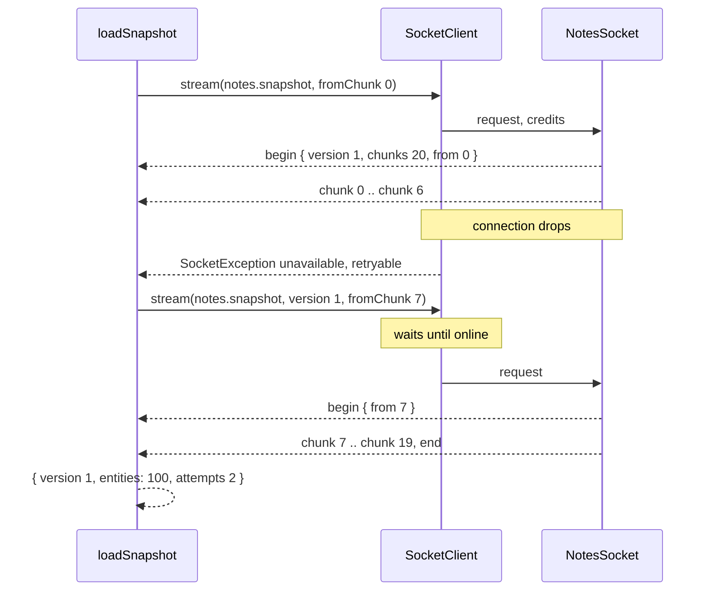

# Snapshot stream and resume

`notes.snapshot` sends a whole document as a stream of chunks with a credit window, and `loadSnapshot()` reads it to the end, resuming from the first missing chunk after a dropped connection. Use the pair as the template for any large read that must survive a network drop without starting over.

## How it works

### Server: `NotesSocket.snapshot`

1. The handler is an `async *` method, so the dispatcher sends its yields as stream frames, gated by the client's credit.
2. It reads the document and copies `entities`: edits made while the stream runs do not shift its chunks.
3. `chunks = chunkCount(entities)`, with `ENTITIES_PER_CHUNK` = 5 notes per chunk (20 chunks for a seeded 100-note document).
4. It picks the first chunk: `from = min(fromChunk, chunks)` when the request's `version` equals the document's version and `fromChunk` is set; otherwise `0`.
5. It records `from` in `NotesStore.snapshotStarts`, for the tests.
6. It yields `{ kind: 'begin', docId, version, chunks, from }`, then `{ kind: 'chunk', index, entities }` for each chunk from `from` on, until the last chunk or until `@Signal()` aborts.
7. Returning ends the generator; the dispatcher sends the stream's end frame.

### Client: `loadSnapshot(notes, docId, options)`

1. It calls `notes.stream('notes.snapshot', { docId, version, fromChunk: next }, { credits, whenOffline: 'wait' })`. The first call has no `version` and `fromChunk: 0`.
2. On `begin`: when `frame.from !== next`, the server could not resume, so it drops the applied entities and sets `next = frame.from`. It stores `frame.version`.
3. On each `chunk`: an `index` other than `next` throws `SocketException('internal')`; otherwise it appends the entities, increments `next` and calls `onChunk(index)`.
4. The stream ends: it returns `{ version, entities, attempts }`.
5. A `SocketException` with `retryable: true` and attempts left starts another stream from `next` with the stored `version`. When the client is still `online` (eg. `resource_exhausted`, `deadline_exceeded`) it first waits `retryAfterMs`, else `retryDelayMs`, else 100 ms. When offline, `whenOffline: 'wait'` holds the next stream until the client reconnects.
6. A non-retryable error, or the `maxAttempts`-th failure, is rethrown.



## Configuration

`ILoadSnapshotOptions`:

| Key | Type | Default | Allowed values | Meaning |
| --- | --- | --- | --- | --- |
| `credits` | `number` | client default, `DEFAULT_STREAM_CREDITS` = 8 | 1 to `http.socket.streams.maxCredits` (16 here) | Chunks the server may send ahead of the reader |
| `maxAttempts` | `number` | `5` | Positive integer | Stream calls before the last error is rethrown |
| `onChunk` | `(index: number) => void` | none | Function | Called after each applied chunk |
| `retryDelayMs` | `number` | `100` | ms | Pause before a retry while online; the error's `retryAfterMs` wins |

Server keys that shape the stream:

| Key | Type | Default | Allowed values | Meaning |
| --- | --- | --- | --- | --- |
| `http.socket.streams.maxCredits` | `number` | `16` in the example | Positive integer | Larger `credits` are refused with `invalid_argument` |
| `http.socket.streams.maxPerConnection` | `number` | `8` | Positive integer | Concurrent streams per connection |
| `http.socket.streams.stallTimeoutMs` | `number` | `60000` | ms | A stream left without credit, or with its connection backlogged, this long fails with `deadline_exceeded` |

`ISnapshot`, the result: `version` (the document version the entities belong to), `entities` (`NoteEntity[]`), `attempts` (stream calls it took; 1 without a drop).

## Services and extension points

| Service | DI token and lifetime | Default implementation | Alternatives | How to replace or extend |
| --- | --- | --- | --- | --- |
| Snapshot handler | `NotesSocket`, registered as `BaseSocketController` | `NotesSocket.snapshot` | none | Change chunk size with `ENTITIES_PER_CHUNK`; add another resumable stream in your own controller |
| `loadSnapshot` hooks | Function options, no DI | none | none | `onChunk` for progress, `retryDelayMs` and `maxAttempts` for retry policy |

### Resumable stream: your own command

The resume protocol is three rules: the request carries the version the client holds and the next index it needs; the first frame says where the server really starts; the client drops what it has when that start differs. Copy them for any long read.

```ts sample
import { BaseSocketController, Command, Payload, Signal, SocketController } from '@spinajs/http-socket';

interface AuditEntry {
  at: string;
  actor: string;
  action: string;
}

type AuditFrame = { kind: 'begin'; generation: number; from: number; pages: number } | { kind: 'page'; index: number; entries: AuditEntry[] };

const PAGE = 50;
const auditLog: AuditEntry[] = [];
let generation = 1;

const ExportSchema = {
  type: 'object',
  properties: { generation: { type: 'integer', minimum: 1 }, fromPage: { type: 'integer', minimum: 0 } },
  additionalProperties: false,
};

// audit.export streams the audit log in pages; a client that dropped resumes while the log was not rotated.
@SocketController('audit')
export class AuditSocket extends BaseSocketController {
  @Command('export', { schema: ExportSchema })
  public async *export(@Payload() req: { generation?: number; fromPage?: number }, @Signal() signal: AbortSignal): AsyncGenerator<AuditFrame> {
    const entries = [...auditLog];
    const pages = Math.ceil(entries.length / PAGE);
    const from = req.generation === generation && req.fromPage !== undefined ? Math.min(req.fromPage, pages) : 0;

    yield { kind: 'begin', generation, from, pages };

    for (let index = from; index < pages && !signal.aborted; index++) {
      yield { kind: 'page', index, entries: entries.slice(index * PAGE, (index + 1) * PAGE) };
    }
  }
}
```

## Important behaviour

- The resume is exact only while the document version is unchanged. One edit during the drop restarts the read at chunk 0 (`begin.from` = 0), and the client discards the chunks it had.
- `fromChunk` beyond the last chunk is clamped to `chunks`: the stream sends only `begin` and ends.
- Finding the end of a stream costs one unit of credit, so stream lengths at a multiple of the window are the edge case; the tests read every length from 1 to 21 frames with the default window of 8.
- A stream command cannot be `ordered` or `idempotent`; the registry rejects that combination at startup.
- `loadSnapshot` sets no `timeoutMs`, so each stream call uses the client's default timeout (`DEFAULT_TIMEOUT_MS`, 15 s, unless the client sets `defaultTimeoutMs`). A client that stays offline fails each attempt with a retryable `unavailable`, retries at once, and rethrows after `maxAttempts`: about 75 s with the defaults.
- `snapshotStarts` grows by one entry per stream and is never cleared. It exists for the tests.
- The server checks `signal.aborted` between chunks: a cancelled or disconnected stream stops yielding at the next chunk.

## Best practices

- Copy the source data before the first `yield`, as `snapshot` does with `[...doc.entities]`; the generator runs across many event-loop turns.
- Send a version in the first frame and check it on resume; a bare index resumes into the wrong data after a concurrent write.
- Keep `credits` at or below the server's `maxCredits`; the example's server allows 16.
- Retry only `SocketException`s with `retryable: true`, and honour `retryAfterMs`, as `loadSnapshot` does.

## Patterns and antipatterns

```ts
// Don't: resume by index alone; an edit during the drop yields chunks of a different version
notes.stream('notes.snapshot', { docId, fromChunk: next });

// Do: send the version you hold; the server restarts at 0 when it changed
notes.stream('notes.snapshot', { docId, version, fromChunk: next });
```

## Examples

### Show load progress for a large document

```ts sample
import { connectNotes, loadSnapshot } from '@spinajs/http-socket-example/lib/mjs/client.js';

async function loadWithProgress(url: string, path: string): Promise<void> {
  const notes = connectNotes(url, path, 'alice-token');
  const { chunks } = await notes.command('notes.open', { docId: 'handbook' }, { whenOffline: 'wait' });

  const snapshot = await loadSnapshot(notes, 'handbook', {
    credits: 16,
    maxAttempts: 10,
    retryDelayMs: 250,
    onChunk: (index) => console.log(`loaded ${index + 1}/${chunks}`),
  });

  console.log(`v${snapshot.version}: ${snapshot.entities.length} notes in ${snapshot.attempts} attempt(s)`);
  notes.close();
}

void loadWithProgress('http://127.0.0.1:3000', '/socket.io');
```

## Related

- [`@spinajs/http-socket`](../http-socket/README.md): stream replies, credit and stall handling on the server.
- [`@spinajs/http-socket-client`](../http-socket-client/README.md): `stream()`, `StreamOptions`, `whenOffline` and reconnect.
- [Notes store](09-notes-store.md): `chunkCount`, `ENTITIES_PER_CHUNK` and document versions.
