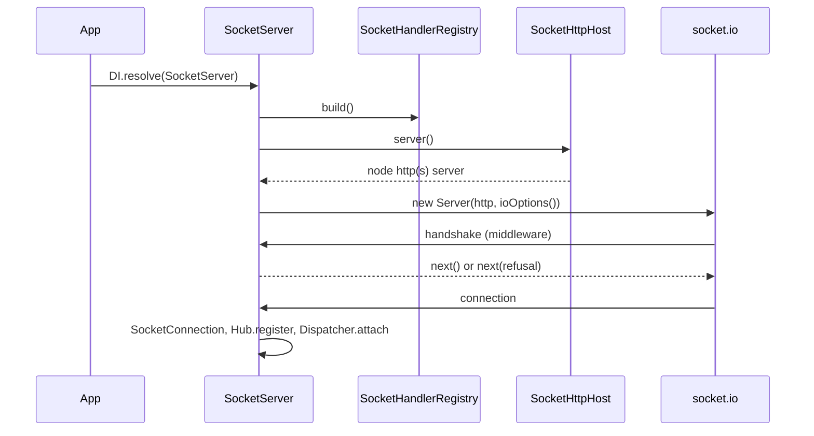

# Socket server and HTTP host

`SocketServer` loads the socket controllers, attaches a socket.io server to a node http(s) server and runs the handshake of every connection. `SocketHttpHost` decides which http server that is: by default the one of `@spinajs/http`.

## How it works

1. You resolve `SocketServer` (`await DI.resolve(SocketServer)`). Its `resolve()` runs once:
   1. Reads the proxy trust from `authn.http.trustProxy`, else `http.trustProxy` (see [client address](08-principal-sources.md#client-address)).
   2. Checks `http.socket.idempotency`, `drainMs` and `shutdownRetryAfterMs`; a bad value throws `RangeError`. Warns when `drainMs` + 3 s reaches `http.shutdownTimeout`.
   3. Awaits `@ListFromFiles('/**/!(*.d).{ts,js}', 'system.dirs.socketControllers')`. Loading a file runs its `@SocketController` decorators.
   4. `SocketHandlerRegistry.build()` resolves every registered controller and indexes its handlers. A duplicate name, an orphan decorator or an invalid name throws `InvalidOperation` here, before socket.io attaches.
   5. Warns about `@SocketAccess` rules a booted authz domain did not check (see [boot checks](10-policies-and-access.md#boot-checks)).
   6. `SocketHttpHost.server()` returns the node server; `new Server(http, options)` attaches socket.io to it.
   7. Registers the handshake middleware and the `connection` handler, attaches `SocketHub`, starts the `SocketPrincipalGuard` sweep and subscribes to the DI event `http.server.closing`.
2. A client connects. The handshake middleware (`SocketServer.authenticate()`):
   1. refuses with `unavailable` while the server shuts down;
   2. refuses a disallowed `Origin` with `forbidden` (see [origins](08-principal-sources.md#origins));
   3. refuses an `auth.protocol` other than `PROTOCOL_VERSION` with `version_mismatch`;
   4. refuses an `auth.clientId` that is missing, empty, longer than `MAX_ID_LENGTH` (128) or not printable ASCII with `invalid_argument`;
   5. asks the `SocketPrincipalSource`s for a principal (see [principal sources](08-principal-sources.md)).
3. A refusal reaches the client as a socket.io `connect_error` whose `data` is the `SocketError`.
4. An accepted socket becomes a `SocketConnection`, is registered with `SocketHub`, and `SocketDispatcher.attach()` starts its connect hooks and listens for commands, events, cancels and credits.
5. On disconnect, the connection's signal aborts, its running commands are answered `unavailable`, its disconnect hooks run and the hub forgets it.



## Configuration

The server reads the whole `http.socket` object; [Configuration](15-configuration.md) lists every key. The keys that shape socket.io itself:

| Key | Type | Default | Allowed values | Meaning |
| --- | --- | --- | --- | --- |
| `http.socket.path` | string | `'/socket.io'` | non-empty | socket.io endpoint path |
| `http.socket.transports` | string[] | `['websocket', 'polling']` | `'websocket'`, `'polling'`, unique, at least one | engine.io transports |
| `http.socket.pingInterval` | integer | `25000` | 1 to 2^31-1 | socket.io heartbeat interval, ms |
| `http.socket.pingTimeout` | integer | `20000` | 1 to 2^31-1 | socket.io heartbeat timeout, ms |
| `http.socket.maxPayloadBytes` | integer | `1048576` | above 0 | socket.io's `maxHttpBufferSize` is twice this |
| `http.socket.cors.origins` | string[] | `[]` | exact origins | passed to socket.io `cors` with `credentials: true` when not empty |
| `http.socket.recovery.maxDisconnectionMs` | number | `120000` | 0 or more | connection state recovery window; `0` turns recovery off |
| `http.socket.adapter` | adapter | `undefined` | a socket.io adapter | see [Running several instances](17-several-instances.md) |
| `system.dirs.socketControllers` | string[] | `[]` | folders | scanned for socket controller files |

```ts
// config of your app
import { join } from 'node:path';

export default {
  http: {
    socket: {
      path: '/ws',
      transports: ['websocket'],
    },
  },
  system: {
    dirs: {
      socketControllers: [join(process.cwd(), 'dist', 'sockets')],
    },
  },
};
```

## Services and extension points

| Service | DI token and lifetime | Default implementation | Alternatives | How to replace or extend |
| --- | --- | --- | --- | --- |
| `SocketHttpHost` | `SocketHttpHost`, singleton; resolved once by `SocketServer` (`@Autoinject()`) | `HttpServerHost` (`@Injectable(SocketHttpHost)`): the `Server` of `@spinajs/http`'s `HttpServer` | Any node `http.Server` or `https.Server`: a dedicated port, a test server | `DI.register(MyHost).as(SocketHttpHost)` before `SocketServer` resolves |
| `SocketServer` | `SocketServer` (self), singleton, `AsyncService` | `SocketServer` | Your subclass | Subclass, override `ioOptions()` (socket.io options) or `identify()` (principal lookup), `DI.register(MyServer).as(SocketServer)` before the first resolve |

### `SocketHttpHost`: serve sockets on another http server

Replace the host when sockets must not share the `@spinajs/http` server: a dedicated port, an https server with its own certificate, or a plain node server in an app without `@spinajs/http`. `server()` is called once, during `SocketServer.resolve()`. You own the server: `SocketServer.dispose()` never closes it, and removes only the listeners socket.io added.

```ts sample
import { readFileSync } from 'node:fs';
import { createServer, Server } from 'node:https';
import { DI } from '@spinajs/di';
import { SocketHttpHost, SocketServer } from '@spinajs/http-socket';

export class TlsSocketHost extends SocketHttpHost {
  public readonly Https: Server = createServer({
    key: readFileSync(process.env.SOCKET_TLS_KEY ?? '/etc/tls/socket.key'),
    cert: readFileSync(process.env.SOCKET_TLS_CERT ?? '/etc/tls/socket.crt'),
  });

  public async server(): Promise<Server> {
    return this.Https;
  }
}

DI.register(TlsSocketHost).as(SocketHttpHost);

export async function startSockets(port: number) {
  const server = await DI.resolve(SocketServer);
  const host = DI.resolve(SocketHttpHost) as TlsSocketHost;
  await new Promise<void>((resolve) => host.Https.listen(port, () => resolve()));
  return server;
}
```

### `SocketServer`: extra socket.io options

`ioOptions()` builds the socket.io `ServerOptions` from `http.socket`. Override it to set an option the configuration does not cover; keep `super.ioOptions()` so the origin check (`allowRequest`), `maxHttpBufferSize` and recovery stay in place.

```ts sample
import { ServerOptions } from 'socket.io';
import { DI } from '@spinajs/di';
import { SocketServer } from '@spinajs/http-socket';

export class CompressedSocketServer extends SocketServer {
  protected ioOptions(): Partial<ServerOptions> {
    return {
      ...super.ioOptions(),
      // drop clients that never finish the namespace handshake
      connectTimeout: 10_000,
      perMessageDeflate: { threshold: 4096 },
    };
  }
}

DI.register(CompressedSocketServer).as(SocketServer);
```

## Important behaviour

- Socket controllers must be registered before `SocketServer` resolves: `SocketHandlerRegistry.build()` runs once. A controller imported later is never routed.
- Keep socket controllers out of `system.dirs.controllers`: the http loader scans those folders.
- With `@spinajs/authz-http`, the root authz domain boots when the http server starts listening. Resolve `SocketServer` **before** `http.start()`, or the domain's boot checks skip the `@SocketAccess` permissions; `SocketServer` then logs a warning that names them. Resolved after `start()`, sockets still work.
- An ES module app must call `DI.setESMModuleSupport()` before it resolves the configuration. Without it, the configuration sources look for the CommonJS builds and the `http.socket` defaults of this package are not loaded.
- `SocketServer.dispose()` runs the graceful shutdown (see [Shutdown](14-shutdown-and-recovery.md)) and never closes the host's http server: socket.io's `io.close()` is not used.
- The http server's `http.server.closing` DI event starts the same shutdown, but only for the server `SocketHttpHost` returned.
- A handshake refusal message is logged at debug level; the client sees only the `SocketError` in `connect_error.data`.
- `SocketServer.Io` is the socket.io `Server`, or `null` before `resolve()` and after shutdown.

## Best practices

- Prefer `transports: ['websocket']` when a principal source reads cookies: a browser always sends `Origin` on a WebSocket upgrade.
- Give `SocketHttpHost` its own server only when you need it; the default host shares the port, TLS and proxy setup of `@spinajs/http`.
- Use `http.socket.path` when a reverse proxy routes `/socket.io` elsewhere; the client must use the same `path`.

## Patterns and antipatterns

```ts
// Don't: controllers resolved after the server never get routed
await DI.resolve(SocketServer);
await import('./sockets/chat.socket.js');

// Do: import (or list in system.dirs.socketControllers) before the server resolves
await import('./sockets/chat.socket.js');
await DI.resolve(SocketServer);
```

## Examples

### Sockets on a dedicated port in an app without `@spinajs/http`

```ts sample
import { createServer, Server } from 'node:http';
import type { AddressInfo } from 'node:net';
import { DI } from '@spinajs/di';
import { Configuration } from '@spinajs/configuration';
import { BaseSocketController, Command, SocketController, SocketHttpHost, SocketServer } from '@spinajs/http-socket';

export class StandaloneHost extends SocketHttpHost {
  public readonly Http: Server = createServer();

  public async server(): Promise<Server> {
    return this.Http;
  }
}

DI.register(StandaloneHost).as(SocketHttpHost);

@SocketController('health')
export class HealthSocket extends BaseSocketController {
  @Command('ping')
  public async ping() {
    return { at: Date.now() };
  }
}

export async function main() {
  DI.setESMModuleSupport();
  await DI.resolve(Configuration);

  const server = await DI.resolve(SocketServer);
  const host = DI.resolve(SocketHttpHost) as StandaloneHost;
  await new Promise<void>((resolve) => host.Http.listen(8081, () => resolve()));
  console.log('sockets on port', (host.Http.address() as AddressInfo).port);

  process.once('SIGTERM', async () => {
    await server.dispose();
    host.Http.close();
  });
}
```

## Related

- [Socket controllers](02-controllers.md): what `SocketHandlerRegistry.build()` indexes.
- [Principal sources and handshake security](08-principal-sources.md): step 2.5 of the handshake.
- [Shutdown and connection recovery](14-shutdown-and-recovery.md): what `dispose()` does.
- [`@spinajs/http`](../http/README.md): `HttpServer`, the default host.
