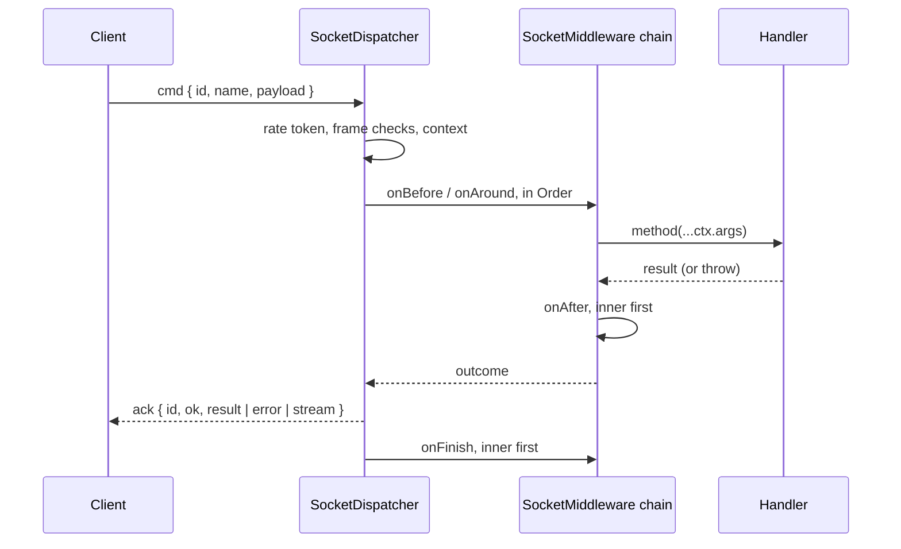

# Command pipeline and socket middlewares

Every client command passes an ordered chain of `SocketMiddleware`s before its handler runs: limits, authentication, lookup, idempotency, ordering, policies and arguments. A socket middleware has the hooks of an http middleware (`onBefore`, `onAfter`, `onFinish`, `onAround`), an `Order`, `isEnabled(handler)` and `onRegister`. The built-in stages are socket middlewares themselves, so you add one for every command, mount one on a controller or a command with `@UseSocketMiddleware`, or replace a built-in one.

## How it works

**At startup**, `SocketHandlerRegistry.build()`, once every controller registered:

1. Resolves the global middlewares, every class registered with `@Injectable(SocketMiddleware)`, once.
2. For each command, resolves the middlewares of `@UseSocketMiddleware(Type, ...options)` on its controller, then on the command, with `container.resolve(Type, options)`. A global middleware whose class the command also declares is left out for it.
3. Keeps those whose `isEnabled(handler)` returns `true`, sorted by `Order`. Equal `Order`s keep the global ones first, then the controller's, then the command's.
4. Calls `onRegister(handler, registration)` of each kept middleware, in that order. A throw fails the build.

The result is the command's chain, kept as `handler.middlewares`. A middleware with no hook at all is called at registration only.

**Per command**:

1. `SocketDispatcher.onCommand()` receives a `cmd` frame. Before the pipeline it:
   1. takes a rate token from the connection's bucket; a refusal is kept for the rate stage;
   2. ignores a frame without an ack callback (logged, one warning per connection per 10 s);
   3. answers a malformed frame `invalid_argument`, a frame during shutdown `unavailable`, and a request id that is already running `invalid_argument`;
   4. builds a `SocketCommandContext` and arms the client's `deadline`.
2. `SocketDispatcher.execute()` runs the command's chain inside the call's AsyncLocalStorage store. A name no command has runs the global middlewares, without `isEnabled`, until `LookupStage` answers it `unimplemented`.
3. After the last middleware, the handler runs with the arguments `ArgumentsStage` built.
4. On the way out, each entered middleware's `onAfter` sees the outcome, inner first, and may change the result.
5. The outcome becomes the reply: `undefined` answers `null`; an async iterable answers `{ stream: true }` and becomes a [stream reply](06-stream-replies.md). An error becomes an error reply through `SocketErrorMapper`.
6. Once the reply is sent (for a stream, once it ended) and the chain has settled, each entered middleware's `onFinish` runs, inner first.
7. An abort (deadline, cancel, disconnect, shutdown) answers the client at once. Before the handler started, the chain stops: the next middleware is not called, `proceed()` rejects with `SocketClientGone`, also when a later middleware was waiting for the connect hooks, an idempotency join or its place in the ordering queue, and the handler does not run. A command queued behind an `ordered` predecessor stops only when its turn comes, and keeps its in-flight slot until then. After the handler started, the chain keeps running, and keeps its in-flight slot and queue place, until the handler settles. The exception is an `ordered` command whose handler still runs `http.socket.ordering.abortGraceMs` after the abort: it is cut loose and gives both back.

| Order | `STAGE_ORDER` key | Built-in | Hooks | What it does | Refusal |
| --- | --- | --- | --- | --- | --- |
| 100 | `Size` | `SizeStage` | `onBefore` | Measures the payload with `payloadSize()` | `resource_exhausted`, not retryable, `details { size, limit }`; `invalid_argument` for a payload that cannot be serialized |
| 200 | `Rate` | `RateStage` | `onBefore` | Throws the refusal of the token taken on arrival | `resource_exhausted` with `retryAfterMs` |
| 300 | `InFlight` | `InFlightStage` | `onAround` | Holds one of `maxInFlightPerConnection` slots until the handler settles | `resource_exhausted`, `retryAfterMs: 100` |
| 320 | `Ready` | `ReadyStage` | `onBefore` | Waits for the connection's connect hooks | the abort reason (deadline, cancel, disconnect) |
| 350 | `Authentication` | `AuthenticationStage` | `onBefore` | `SocketPrincipalGuard.ensure()`; refreshes `Principal` and `AuthnPrincipal` in the store | `unauthenticated` |
| 400 | `Lookup` | `LookupStage` | `onBefore` | Finds the handler, sets `ctx.handler`, arms `timeoutMs` | `unimplemented` |
| 500 | `Idempotency` | `IdempotencyStage` | `onAround`, `onRegister` | Replays, joins or claims an `idempotencyKey`. On a claim it sets `drainGrace` and adds the claim as an outcome recorder. `onRegister` refuses streams of `idempotent` commands | see [Durable commands](12-durable-commands.md) |
| 550 | `Ordering` | `OrderingStage` | `onAround`, `onRegister` | Serial queue for `ordered`, which records the outcome before it frees the place; the `after` fence. `onRegister` refuses streams of `ordered` commands | `unavailable` with `details.after` |
| 600 | `Policies` | `PoliciesStage` | `onBefore` | `@SocketPolicy` and `@SocketAccess` through `SocketPolicyGate` | `unauthenticated`, `forbidden`, `invalid_argument` |
| 650 | `Policies + 50` | `AccessFieldsStage` | `onBefore`, `onAfter` | `@SocketAccess(…, { fields: 'filter' })` limits the result or each chunk; enabled only on commands with such a rule | none |
| 700 | `Arguments` | `ArgumentsStage` | `onBefore` | `SocketArgumentResolver.resolve()` sets `ctx.args` | `invalid_argument` |



### Idempotency before policies

http runs the policy gate before every route middleware, so before `IdempotencyMiddleware`. A socket command runs idempotency (500) and ordering (550) before the policies (600), on purpose:

- Ordering comes before the policies so that they, and the argument hydrators, see what the command's predecessors changed: a durable edit pipelined behind its create would otherwise be checked before the create ran, and its `not_found` stored as final.
- Idempotency comes before the policies so that a resend gets the outcome of the run it repeats. A key is bound to the request it was first sent with: its command name and payload are fingerprinted with the claim, and a reuse with another command or payload answers `failed_precondition` (`details.reason: 'idempotency_key_reuse'`), as http answers `idempotency.key-reuse`. So a replay is always the outcome of the very request that was checked when it first ran. A policy checks the state as it is now: once an idempotent `delete` committed, a `@SocketAccess` rule that loads the row refuses the resend, which would answer a lost ack of a committed command with an error. The stored reply belongs to the principal and `clientId` that ran it, after `AuthenticationStage` (350) checked the principal again, so a replay shows nothing that principal was not given. Anonymous callers share one principal scope, and so do the bearers of one share link without a signed-in companion; the socket scope also holds the connection's `clientId`, which keeps them apart as long as their clients draw distinct ids, but a `clientId` is not a secret, so such clients should also send random keys. A restricted principal (a `ceiling` from a scoped token or a role switch, `onBehalfOf`, an impersonator, a share link, companions) keys its replies by its authority as well (`idempotencyPrincipal()` of `@spinajs/idempotency`): a scoped token or an impersonating admin of a user never gets the reply stored for that user's full session, nor the other way round. A refusal by a policy is itself an outcome of the key: a final one (`forbidden`) is stored and replayed, `unauthenticated` releases the key.

## Hooks

Every hook is optional; a middleware implements only those it needs.

| Hook | Runs | Gets | Can |
| --- | --- | --- | --- |
| `isEnabled(handler): boolean` | once per command, at startup | the `IRegisteredHandler` | keep the middleware off this command; `true` unless overridden |
| `onRegister?(handler, registration)` | once per command, at startup, for enabled middlewares | the handler and an `ISocketStageRegistration` | check configuration, load an optional dependency, `refuseStream()`; a throw fails the build |
| `onBefore?(ctx)` | before the later middlewares and the handler, in `Order` | `ISocketCommandContext` | change `ctx` and `ctx.storage`, throw to refuse, return a value other than `undefined` to answer |
| `onAfter?(ctx)` | on the way out, inner first, before the outer middlewares see the outcome | `ISocketReplyContext` | read `ctx.result` or `ctx.error`; set `ctx.result`; throw to turn the outcome into that error |
| `onFinish?(ctx)` | once the reply is sent (a stream: once it ended) and the chain settled, inner first | `ISocketFinishContext` | log, record metrics; a throw is logged on the `http-socket` logger |
| `onAround?(ctx, proceed)` | wraps its own `onBefore`, the later middlewares, the handler and its own `onAfter` | `ISocketCommandContext` and `proceed` | see [Around middlewares](#around-middlewares) |

### Contexts

There is one context object per command, a `SocketCommandContext`; the three types are views of it.

| Type | Members |
| --- | --- |
| `ISocketCommandContext` | `request`, `connection`, `runtime`, `payload`, `signal`, `storage` (the call's AsyncLocalStorage store), `handler` (set at 400), `args` (set at 700), `idempotency`, `handlerStarted`, `drainGrace`, `abort()`, `armDeadline()`, the outcome recorders |
| `ISocketReplyContext` | `ISocketCommandContext` plus `result` (the outcome so far; writable) and `error` (set when the outcome is an error) |
| `ISocketFinishContext` | `ISocketCommandContext` plus `aborted` (`true` when an abort answered the command, or ended its stream), and the final `result` or `error` |

### Entered middlewares

Only a middleware the chain entered gets `onAfter` and `onFinish`. A middleware is entered when the chain reached it and its `onBefore` resolved, or when the chain reached it and it has no `onBefore`. An around middleware is entered when its `onAround` starts.

| Case | Entered |
| --- | --- |
| An `onBefore` threw | the middlewares before it; not this one, and none after it |
| An `onBefore` returned a value | the middlewares before it and this one; none after it |
| An abort came before the handler started | the middlewares before the point the chain stopped |
| The handler threw | every middleware of the chain |

### Answering in `onBefore`

An `onBefore` that returns a value other than `undefined` answers the command with it: no later middleware and no handler runs, and the `onAfter` of every entered middleware, the answering one included, sees it as `ctx.result`. `null` answers `null`. An async iterable answers a stream, as a handler's would.

The return type is `unknown`, so the compiler does not catch a value returned by accident: `return this.metrics.inc(...)` in a middleware before 350 answers every command and skips authentication, the policies and the handler. Return nothing unless you mean to answer, and declare the hook `: void` (or `: Promise<void>`) when it never answers.

```ts sample
import { Injectable } from '@spinajs/di';
import { ISocketCommandContext, STAGE_ORDER, SocketMiddleware } from '@spinajs/http-socket';

/** Answers `sys.ping` before the lookup, so no controller has to declare it. */
@Injectable(SocketMiddleware)
export class PingAnswer extends SocketMiddleware {
  public readonly Order = STAGE_ORDER.Lookup - 10;

  public onBefore(ctx: ISocketCommandContext): unknown {
    return ctx.request.name === 'sys.ping' ? { pong: Date.now() } : undefined;
  }
}
```

### `onAfter` and errors

`onAfter` runs on success and on error. With an error, `ctx.error` is set and `ctx.result` is `undefined`; setting `ctx.result` then changes nothing. A middleware that acts on results only returns early when `ctx.error !== undefined`. A throwing `onAfter` turns the outcome into its error: the outer middlewares' `onAfter` see that error, and the client gets it.

`onAfter` runs as the chain unwinds, also after an abort has answered the client: what it changes is then not sent, but an outer `onAround` still sees it. `IdempotencyStage` (500) stores what reaches it, so an `onAfter` inside it (Order above 500) changes the stored reply and every replay, and an `onAfter` outside it changes each reply, replays included.

For a stream reply, `ctx.result` is the handler's async iterable when the stream starts, not when it ends. Replace it with a wrapper to change or count the chunks (see [Stream replies](06-stream-replies.md#wrap-every-chunk-of-a-stream)).

### `onFinish`

`onFinish` runs once per command for each entered middleware, inner first, when both the reply is out (the ack sent; for a stream, its `end` or `fail` frame) and the chain has settled. `ctx.result` or `ctx.error` is the chain's own outcome, whatever middlewares it has: what the outermost middleware returned or threw. After an abort that is when the handler settled, so it sees the real outcome, with `ctx.aborted` set; an abort before the handler shows as a `SocketClientGone` error. The calls are not awaited by each other; a throw or a rejection is logged on the `http-socket` logger. The shutdown drain waits for them, within `drainMs`.

### AsyncLocalStorage

Every hook runs inside the call's AsyncLocalStorage context, `onFinish` included, so a service called from a hook reads the same store as the handler. This differs from http, where `onBefore` and `onAround` run outside it.

### Around middlewares

`onAround(ctx, proceed)` wraps the middleware's own `onBefore`, the later middlewares, the handler and its own `onAfter`. Use it when the code before and after needs one scope (a slot, a lock, a queue place) or when it decides whether the rest runs at all.

- `proceed()` runs the rest once and settles with its result or rejects with its error. A second call rejects with `internal` `proceed() called twice by <Middleware>`.
- Not calling `proceed()` ends the chain: the returned value is the result. Throw to fail the command.
- An outer middleware's `onAfter` sees what `onAround` returned.

| What happens | `proceed()` |
| --- | --- |
| The handler returned or threw | Resolves with its raw result (an async iterable for a stream, binary, a `toJSON` class), as the inner `onAfter`s left it, or rejects with the error. |
| An abort came before the handler started | Rejects with `SocketClientGone`, `beforeHandler: true`, also when a later middleware was waiting on the abort (connect hooks, an idempotency join, the ordering queue). No later middleware and no handler ran. Behind an `ordered` predecessor it rejects only when the command's turn comes. |
| An abort came after the handler started | Settles with the handler's real result or error. `ctx.handlerStarted` is `true`. The client has its answer already, so what the middleware returns is not sent. |
| An `ordered` command's handler still runs `http.socket.ordering.abortGraceMs` after the abort (cut loose) | In a middleware before 550: rejects with the abort reason itself, not `SocketClientGone` and not the real result. `ctx.handlerStarted` is `true`. The ordering stage gives up the queue place, and the late result is dropped. Middlewares after the ordering stage still get the real outcome. |

`SocketClientGone` is a `SocketException` with the code, message and retry hint of the abort reason (`cancelled`, `deadline_exceeded`, `unavailable`), which is also its `cause`. Rethrown, it answers as the abort did. Check `err instanceof SocketClientGone` and read `err.cause` for the reason.

## Decorators

| Decorator | Target | Options | Effect |
| --- | --- | --- | --- |
| `@UseSocketMiddleware(type, ...options)` | socket controller class or command method | `type`: a `SocketMiddleware` class; `options`: constructor arguments | Adds the middleware to every command of the controller (class) or to the command (method), at the middleware's `Order` |

- The middleware is resolved per command with `container.resolve(type, options)`, so the class's lifetime decides sharing. Mark a middleware that takes options, or keeps per-command state set in `onRegister`, with `@NewInstance()`: a singleton (the default) is built once, with the options of the first command that resolves it. The registry logs a warning when one shared instance is declared with different options.
- A class that is also a global middleware (`@Injectable(SocketMiddleware)`) runs once on a command that declares it: the declared instance, at its own `Order`.
- Several declarations of one `Order` run in declaration order, the controller's before the command's; decorators apply bottom-up, so the lowest one of a list runs first.
- Events and connect or disconnect hooks never run socket middlewares; the decorator applies to commands only.

```ts sample
import { NewInstance } from '@spinajs/di';
import { BaseSocketController, Command, ISocketReplyContext, STAGE_ORDER, SocketController, SocketMiddleware, UseSocketMiddleware } from '@spinajs/http-socket';

/** Wraps a successful result in an envelope that names the API version. */
@NewInstance()
export class Envelope extends SocketMiddleware {
  public readonly Order = STAGE_ORDER.Arguments + 10;

  constructor(protected Version: number) {
    super();
  }

  public onAfter(ctx: ISocketReplyContext): void {
    if (ctx.error === undefined) {
      ctx.result = { v: this.Version, data: ctx.result };
    }
  }
}

@SocketController('catalog')
@UseSocketMiddleware(Envelope, 1)
export class CatalogSocket extends BaseSocketController {
  @Command('list')
  public async list() {
    return ['lamp', 'chair'];
  }

  // inside the controller's envelope: { v: 1, data: { v: 2, data: [...] } }
  @Command('search')
  @UseSocketMiddleware(Envelope, 2)
  public async search() {
    return ['lamp'];
  }
}
```

## Services and extension points

| Service | DI token and lifetime | Default implementation | Alternatives | How to replace or extend |
| --- | --- | --- | --- | --- |
| `SocketMiddleware` (abstract, extends `AsyncService`) | Global: `SocketMiddleware`; every registered class, resolved once as `Array.ofType(SocketMiddleware)` by `SocketHandlerRegistry.build()`, a singleton each. Per command: by class in `@UseSocketMiddleware`, `container.resolve(Class, options)` | The eleven built-ins in the table above | Your middlewares | Add for every command: `@Injectable(SocketMiddleware)`. For some: `@UseSocketMiddleware`, or `isEnabled(handler)`. Replace a built-in: `DI.unregister(BuiltIn)` and register yours. All before `SocketServer` resolves |
| `SocketHandlerRegistry` | `SocketHandlerRegistry` (self), singleton | `SocketHandlerRegistry` | none | Read `Middlewares` (the global ones, in `Order`), `command(name).middlewares` (one command's chain) and `chainFor(name)` (the chain the dispatcher runs for a name) |
| `SocketDispatcher` | `SocketDispatcher` (self), singleton, `AsyncService` | `SocketDispatcher` | Your subclass | Override `callStorage()` (the per-call store), `observe()` (per-command log and metric); `DI.register(Mine).as(SocketDispatcher)` |
| `SocketCommandContext` | Not in DI; built per command | `SocketCommandContext` | none | Read and write it from a hook: `ctx.storage`, `ctx.args`, `ctx.result`, `ctx.handlerStarted`, `ctx.drainGrace`, `ctx.addOutcomeRecorder()`, `ctx.abort()`, `ctx.armDeadline()` |

`SocketMiddleware` members:

| Member | Meaning |
| --- | --- |
| `Order: number` | Required. Where the middleware runs: ascending, among the built-ins of `STAGE_ORDER`. A field or a getter. |
| `isEnabled(handler): boolean` | Whether the middleware runs on this command. Called once at startup. `true` unless overridden. |
| `onRegister?(handler, registration)` | Called once per command at startup, for enabled middlewares, in `Order`. |
| `onBefore?(ctx): unknown` | Before the rest. A returned value other than `undefined` answers. |
| `onAfter?(ctx): void \| Promise<void>` | On the way out, inner first: `ctx.result`, `ctx.error`. |
| `onFinish?(ctx): void \| Promise<void>` | Once the reply is out and the chain settled: `ctx.aborted`. |
| `onAround?(ctx, proceed): Promise<unknown>` | Wraps the rest; returns the result. |

What a middleware sees depends on its `Order`:

- before 400, `ctx.handler` is not set yet (the chain was picked by the command's name);
- between 550 and 600, it runs inside the queue place of an `ordered` command;
- before 700, `ctx.args` is not set yet.

### `SocketMiddleware`: a middleware of your own

```ts sample
import { Autoinject, Injectable } from '@spinajs/di';
import { IRegisteredHandler, ISocketCommandContext, STAGE_ORDER, SocketException, SocketMiddleware } from '@spinajs/http-socket';

@Injectable()
export class MaintenanceSwitch {
  public until: Date | null = null;
}

/** Refuses write commands during maintenance, before idempotency and ordering claim anything. */
@Injectable(SocketMiddleware)
export class Maintenance extends SocketMiddleware {
  public readonly Order = STAGE_ORDER.Lookup + 10;

  @Autoinject()
  protected Switch: MaintenanceSwitch;

  public isEnabled(handler: IRegisteredHandler): boolean {
    return /\.(create|update|delete)$/.test(handler.fullName);
  }

  public onBefore(_ctx: ISocketCommandContext): void {
    const until = this.Switch.until;
    if (until && until.getTime() > Date.now()) {
      throw new SocketException('unavailable', 'maintenance in progress', { retryAfterMs: until.getTime() - Date.now() });
    }
  }
}
```

### `onRegister`

`onRegister(handler, registration)` runs once per command, when `SocketHandlerRegistry.build()` has registered every controller: in ascending `Order`, after the names were checked for duplicates, the policies resolved and the contract and payload validators were attached, and before socket.io attaches. It runs only for middlewares enabled on the command, and never for events or hooks. Check configuration or load an optional dependency there. A throw fails the build with `InvalidOperation`, which names the middleware and the command: `Socket command audit.export ( AuditSocket::export ): middleware AuditSinkCheck refused the registration: no audit sink configured`. The original error is its `cause`.

`registration.refuseStream(what)` declares that the command cannot reply with a stream while this middleware applies:

- an async-generator handler fails the build: `Socket command X ( C::m ) is <what> and replies with a stream; <what> commands cannot stream`;
- any other async-iterable result is answered `failed_precondition`: `<what> command X cannot reply with a stream`.

When several middlewares refuse, the word of the highest `Order` is used. It is kept as `handler.streamRefusal`. `IdempotencyStage` (500) refuses `idempotent` commands and `OrderingStage` (550) refuses `ordered` ones, so a command that is both is refused as `ordered`.

```ts sample
import { Autoinject, Injectable } from '@spinajs/di';
import { InvalidOperation } from '@spinajs/exceptions';
import { IRegisteredHandler, ISocketFinishContext, STAGE_ORDER, SocketMiddleware } from '@spinajs/http-socket';

@Injectable()
export class AuditSink {
  public configured = false;
  public readonly lines: string[] = [];

  public write(command: string, outcome: string): void {
    this.lines.push(`${command} ${outcome}`);
  }
}

/** Commands under audit.* need an audit sink: fail the boot, not the first call, when none is configured. */
@Injectable(SocketMiddleware)
export class AuditSinkCheck extends SocketMiddleware {
  public readonly Order = STAGE_ORDER.Policies + 10;

  @Autoinject()
  protected Sink: AuditSink;

  public isEnabled(handler: IRegisteredHandler): boolean {
    return handler.fullName.startsWith('audit.');
  }

  public onRegister(): void {
    if (!this.Sink.configured) {
      throw new InvalidOperation('no audit sink configured');
    }
  }

  public onFinish(ctx: ISocketFinishContext): void {
    this.Sink.write(ctx.request.name, ctx.aborted ? 'aborted' : ctx.error !== undefined ? 'failed' : 'ok');
  }
}
```

### Per-command state

- `ctx.handlerStarted` is `false` until the dispatcher calls the handler, and `true` from then on.
- `ctx.drainGrace`: a middleware sets it to `true` when its handler may commit at any moment once started. The first abort of the shutdown drain then leaves the command running if `handlerStarted` is `true` (see [Shutdown and recovery](14-shutdown-and-recovery.md)). `IdempotencyStage` sets it when it claims a key.
- `ctx.addOutcomeRecorder(recorder)` registers an outer middleware's record of the outcome, an object with `settle(outcome)` and `detach(running)`. An inner middleware that serialises commands calls `ctx.recordOutcome(outcome)` before it lets the next command run. That settles every recorder. A failing recorder is ignored, because the middleware that owns it answers the failure. `ctx.detachOutcome(running)` passes a handler the pipeline gave up on to every recorder, which settles once `running` does. `IdempotencyStage` adds its claim as a recorder, and `OrderingStage` records the outcome in the queue place, so neither refers to the other.

### State between middlewares

State is shared, never copied. Every middleware, the argument extractors, the policies and the handler see the same `ctx` and `ctx.storage` objects for the whole command.

- `ctx` is one `SocketCommandContext`. Cancel, credit, disconnect and shutdown reach the same object. The pipeline owns `handler` (set at 400), `idempotency` (500), `args` (700), `result` and `error` (on the way out), `stream`, `rateRefusal`, `handlerStarted`, `drainGrace` and the recorders.
- Typed per-call state goes on `ctx.storage` (`ISocketCallStorage`, extended by declaration merging), as http's goes on `req.storage`.
- Untyped per-call state goes on `ctx.storage` too: it has a string index, so there is no `res.locals`. A middleware's private state goes in its own `WeakMap<ISocketCommandContext, T>`.
- What a middleware writes in `onBefore` is visible to the later middlewares, the extractors, the policies and the handler. In `onAfter` it sees what they wrote.

```ts sample
import { Injectable } from '@spinajs/di';
import { Log, Logger } from '@spinajs/log';
import { ISocketCommandContext, ISocketFinishContext, STAGE_ORDER, SocketMiddleware } from '@spinajs/http-socket';

const STARTED = new WeakMap<ISocketCommandContext, number>();

/** Logs every command that passed the policies, with its duration and outcome. */
@Injectable(SocketMiddleware)
export class AuditLog extends SocketMiddleware {
  public readonly Order = STAGE_ORDER.Policies + 10;

  @Logger('audit')
  protected Log: Log;

  public onBefore(ctx: ISocketCommandContext): void {
    STARTED.set(ctx, Date.now());
  }

  public onFinish(ctx: ISocketFinishContext): void {
    this.Log.info(
      { command: ctx.request.name, principal: ctx.connection.principal.id, ok: ctx.error === undefined, aborted: ctx.aborted, ms: Date.now() - (STARTED.get(ctx) ?? Date.now()) },
      'socket ${command} by ${principal} ok=${ok} aborted=${aborted} in ${ms} ms',
    );
  }
}
```

### Replace a built-in stage

Unregister the built-in class and register your subclass. Do both after `@spinajs/http-socket` is imported and before `SocketServer` resolves: the registry reads the middleware list once.

```ts sample
import { DI, Injectable } from '@spinajs/di';
import { ISocketCommandContext, SizeStage, SocketException, SocketMiddleware, payloadSize } from '@spinajs/http-socket';

const CHAT_LIMIT_BYTES = 4 * 1024;

/** Chat messages get 4 KiB; every other command keeps http.socket.maxPayloadBytes. */
@Injectable(SocketMiddleware)
export class PerCommandSizeStage extends SizeStage {
  public onBefore(ctx: ISocketCommandContext): void {
    if (ctx.request.name.startsWith('chat.')) {
      const size = payloadSize(ctx.payload);
      if (size > CHAT_LIMIT_BYTES) {
        throw new SocketException('resource_exhausted', `chat message of ${size} bytes exceeds ${CHAT_LIMIT_BYTES}`, { retryable: false, details: { size, limit: CHAT_LIMIT_BYTES } });
      }
    }

    super.onBefore(ctx);
  }
}

DI.unregister(SizeStage);
```

### `SocketDispatcher`: add fields to every call store

`callStorage(connection, call, requestId?, traceparent?)` builds the AsyncLocalStorage store of each command, event and hook. Fields you add there are visible to middlewares, policies, hydrators, handlers and log lines.

```ts sample
import { DI, Injectable } from '@spinajs/di';
import { ISocketCallStorage, SocketConnection, SocketDispatcher } from '@spinajs/http-socket';

@Injectable()
export class TenantDispatcher extends SocketDispatcher {
  protected callStorage(connection: SocketConnection, call: string, requestId?: string, traceparent?: string): ISocketCallStorage {
    const storage = super.callStorage(connection, call, requestId, traceparent);
    const tenant = connection.handshake.auth.tenant;
    return { ...storage, tenantId: typeof tenant === 'string' ? tenant : null };
  }
}

DI.register(TenantDispatcher).as(SocketDispatcher);
```

## Migrating from `SocketCommandStage`

`SocketCommandStage` is removed in 4.0. A stage becomes a `SocketMiddleware`:

| 3.x | 4.0 |
| --- | --- |
| `@Injectable(SocketCommandStage) class X extends SocketCommandStage` | `@Injectable(SocketMiddleware) class X extends SocketMiddleware` |
| `get Order()` | unchanged; a `readonly Order = …` field works too |
| `execute(ctx, next)` that only works before `next()` | `onBefore(ctx)` |
| `execute(ctx, next)` that only changes what `next()` returned | `onAfter(ctx)`: read and set `ctx.result` |
| `execute(ctx, next)` that observes the outcome after `next()` | `onAfter(ctx)` (before the reply) or `onFinish(ctx)` (after it) |
| `execute(ctx, next)` that needs one scope around `next()` | `onAround(ctx, proceed)`: same body, `next` renamed |
| `onRegister(handler, registration)` | unchanged; called only when `isEnabled(handler)` |
| a check on `ctx.request.name` / `ctx.handler` that skipped commands | `isEnabled(handler)` |
| "next() called twice by X" | "proceed() called twice by X" |
| `InvalidOperation` "stage X refused the registration" | "middleware X refused the registration" |

A middleware that still defines `execute`, itself or through a base class, fails `SocketHandlerRegistry.build()` with an `InvalidOperation` naming the class, instead of being ignored. The built-in stages keep their class names and `Order`s; a subclass that overrode `execute` overrides the hook the table above lists for that stage.

## Important behaviour

- Socket middlewares apply to commands only. Events and hooks run their own fixed steps (see [Socket controllers](02-controllers.md#important-behaviour)).
- The global middlewares are resolved once, in `SocketHandlerRegistry.build()`. A middleware registered later is never used.
- `Array.ofType` leaves `@NewInstance()` classes out of its result: a `@NewInstance()` middleware runs only where `@UseSocketMiddleware` mounts it.
- Middlewares with the same `Order` run in registration order.
- A command's chain is picked by its name when the frame arrives, so a middleware enabled on that command runs before 400 too. A name no command has runs every global middleware up to `LookupStage`.
- Every `cmd` frame costs a rate token when it arrives, including frames without an ack, malformed frames and duplicate ids.
- An abort answers the client at once, but the in-flight slot comes back only when the chain settles. A command whose handler started holds it until the handler settles, so cancel-and-resend cannot run unbounded handlers. A command queued behind an `ordered` predecessor holds it until its turn comes. A cut-loose `ordered` command gives it back after `http.socket.ordering.abortGraceMs`.
- `onRegister` runs after every controller registered: an invalid name, a duplicate, a policy that fails to resolve or a contract problem fails the build first, and then no `onRegister` runs.
- A client `deadline` of `0` or below aborts the call as `deadline_exceeded` before the handler runs; a `timeoutMs` of `0` or below is ignored.
- The deadline is the earliest of the client's `deadline` and the command's `timeoutMs`, both counted from `receivedAt`. Deadlines above 2^31-1 ms are reached in several timer steps.
- A handler reached without `ctx.handler` or `ctx.args` answers `internal` ("a built-in middleware is missing"): keep `LookupStage` and `ArgumentsStage`, or set those fields yourself.
- `socket.io` encodes the ack synchronously. A result it cannot encode is answered `internal` instead of leaving the client to time out.

## Best practices

- Place a middleware relative to `STAGE_ORDER` keys, never with a literal number: the built-in orders are a contract, offsets keep your intent readable.
- Refuse early (before 500) when the refusal does not depend on the command's predecessors; a refusal after idempotency claims a key first.
- Put work that must see the result of the previous `ordered` command between 550 and 600.
- Prefer `isEnabled(handler)` to a name check in every hook: a disabled middleware costs nothing per command.
- Use `onAround` only for a scope around the rest; `onBefore`, `onAfter` and `onFinish` cover the rest.

## Patterns and antipatterns

```ts
// Don't: an around middleware that catches everything hides the error mapping and the idempotency outcome
public async onAround(ctx: ISocketCommandContext, proceed: () => Promise<unknown>) {
  try {
    return await proceed();
  } catch {
    return null;
  }
}

// Do: observe the error and let it through
public onAfter(ctx: ISocketReplyContext) {
  if (ctx.error !== undefined) {
    this.Failures.record(ctx.request.name);
  }
}
```

## Idempotency storage

Idempotent commands (`@Command(name, { idempotent: true })`) keep their replies through `@spinajs/idempotency`.
`http.socket.idempotency.service` names the store, built with the whole `http.socket.idempotency` object as in 3.x:

| `service` | Store |
|---|---|
| `MemoryIdempotencyStore` (the shipped default) | `@spinajs/idempotency`'s memory store, one process; `maxEntries` caps completed keys |
| `OrmIdempotencyStore` | `__idempotency` on the `idempotency` connection, shared by every instance |
| `null` | the store of `IdempotencyService`, `idempotency.store` (see `docs/idempotency/README.md`) |
| a class of your own | an `IdempotencyStore` of `@spinajs/idempotency`, or a 3.x store of this package |

A running claim is a lease, renewed while the handler runs: `http.socket.idempotency.lease`, or `idempotency.lease`
(default `30s`) when it is not set. When a shutdown aborts a handler that already started, its key stays claimed, because the handler may have
committed. Another instance takes the key over once the lease ends, and a resend meanwhile is told to retry after the
rest of the lease. 3.x tracked no lease, so such a key used to stay running until something released it.
A handler whose lease is lost (a renewal was refused because another instance took the key over) is aborted with
`unavailable`, so it stops instead of running alongside the other instance's run. An error carrying `crash: true`
stands for a dead process: its key is neither stored nor released, and its lease ends on its own.

Stores keep replies as JSON. Binary parts of a reply (a `Buffer`, a typed array, an `ArrayBuffer`) are stored
base64-encoded beside it and replay as binary; a `Buffer` replays as a `Uint8Array`. Base64 makes them about a third
larger in the store. A stored reply that cannot be read back answers the final `failed_precondition`: the command
already ran once, and the store cannot free a completed key.

A claim that loses a lock or serialization conflict on the database (`IdempotencyClaimConflict`) answers `unavailable`,
which the client retries.

http-socket depends on `@spinajs/idempotency`, and importing that package registers the `__idempotency` model and
migration (connection `idempotency`, an alias of `default`). So a socket app with a database gets the `__idempotency`
table even when it keeps the memory store.

A 3.x store (a class extending this package's deprecated `IdempotencyStore`) still works. It is wrapped by
`fromLegacySocketStore`, keeps the 3.x key format, and its running claims never expire. Move it to `IdempotencyStore`
of `@spinajs/idempotency` and run `describeIdempotencyStoreConformance` from `@spinajs/idempotency/testing` against it.

## Related

- [Limits](13-limits.md): the size, rate and in-flight stages in detail.
- [Durable commands](12-durable-commands.md): the idempotency and ordering stages.
- [Policies and `@SocketAccess`](10-policies-and-access.md): the policy and access-field stages.
- [Error mapping](05-error-mapping.md): how a thrown error becomes the reply.
- [Route middlewares](../http/14-route-middlewares.md): the http hooks these mirror.
