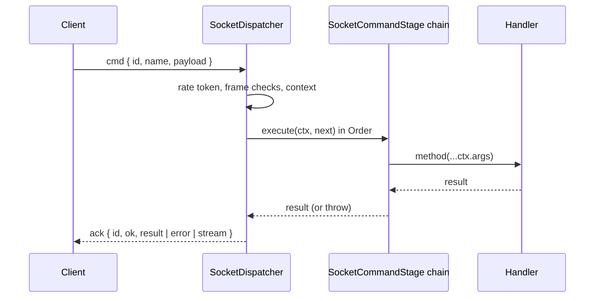

# Command pipeline and custom stages

Every client command passes an ordered chain of `SocketCommandStage`s before its handler runs: limits, authentication, lookup, idempotency, ordering, policies and arguments. Each stage is a DI class, so you add one, wrap the handler with one, or replace a built-in one.

## How it works

1. `SocketDispatcher.onCommand()` receives a `cmd` frame. Before the pipeline it:
   1. takes a rate token from the connection's bucket; a refusal is kept for the rate stage;
   2. ignores a frame without an ack callback (logged, one warning per connection per 10 s);
   3. answers a malformed frame `invalid_argument`, a frame during shutdown `unavailable`, and a request id that is already running `invalid_argument`;
   4. builds a `SocketCommandContext` and arms the client's `deadline`.
2. `SocketDispatcher.execute()` runs the stages in ascending `Order` inside the call's AsyncLocalStorage store. Each stage calls `next()` to continue.
3. After the last stage, the handler runs with the arguments the arguments stage built.
4. The result becomes the reply: `undefined` answers `null`; an async iterable answers `{ stream: true }` and becomes a [stream reply](06-stream-replies.md). A thrown error becomes an error reply through `SocketErrorMapper`.
5. An abort (deadline, cancel, disconnect, shutdown) answers the client at once. The chain keeps running, and keeps its in-flight slot and queue place, until the handler settles.

| Order | `STAGE_ORDER` key | Stage | What it does | Refusal |
| --- | --- | --- | --- | --- |
| 100 | `Size` | `SizeStage` | Measures the payload with `payloadSize()` | `resource_exhausted`, not retryable, `details { size, limit }`; `invalid_argument` for a payload that cannot be serialized |
| 200 | `Rate` | `RateStage` | Throws the refusal of the token taken on arrival | `resource_exhausted` with `retryAfterMs` |
| 300 | `InFlight` | `InFlightStage` | Holds one of `maxInFlightPerConnection` slots until the handler settles | `resource_exhausted`, `retryAfterMs: 100` |
| 320 | `Ready` | `ReadyStage` | Waits for the connection's connect hooks | the abort reason (deadline, cancel, disconnect) |
| 350 | `Authentication` | `AuthenticationStage` | `SocketPrincipalGuard.ensure()`; refreshes `Principal` and `AuthnPrincipal` in the store | `unauthenticated` |
| 400 | `Lookup` | `LookupStage` | Finds the handler, sets `ctx.handler`, arms `timeoutMs` | `unimplemented` |
| 500 | `Idempotency` | `IdempotencyStage` | Replays, joins or claims an `idempotencyKey` | see [Durable commands](12-durable-commands.md) |
| 550 | `Ordering` | `OrderingStage` | Serial queue for `ordered`; the `after` fence | `unavailable` with `details.after` |
| 600 | `Policies` | `PoliciesStage` | `@SocketPolicy` and `@SocketAccess` through `SocketPolicyGate` | `unauthenticated`, `forbidden`, `invalid_argument` |
| 650 | `Policies + 50` | `AccessFieldsStage` | `@SocketAccess(…, { fields: 'filter' })` limits the result or each chunk | none |
| 700 | `Arguments` | `ArgumentsStage` | `SocketArgumentResolver.resolve()` sets `ctx.args` | `invalid_argument` |



## Services and extension points

| Service | DI token and lifetime | Default implementation | Alternatives | How to replace or extend |
| --- | --- | --- | --- | --- |
| `SocketCommandStage` | `SocketCommandStage`; every registered class, resolved once as `Array.ofType(SocketCommandStage)` by `SocketDispatcher.resolve()` and sorted by `Order`; each stage a singleton | The eleven stages in the table above | Your stages | Add: `@Injectable(SocketCommandStage)`. Replace: `DI.unregister(BuiltInStage)` and register yours. Extend: subclass a built-in stage and swap it the same way. All before `SocketServer` resolves |
| `SocketDispatcher` | `SocketDispatcher` (self), singleton, `AsyncService` | `SocketDispatcher` | Your subclass | Override `callStorage()` (the per-call store), `observe()` (per-command log and metric); `DI.register(Mine).as(SocketDispatcher)` |
| `SocketCommandContext` | Not in DI; built per command | `SocketCommandContext` | none | Read and write it from a stage: `ctx.storage`, `ctx.args`, `ctx.abort()`, `ctx.armDeadline()` |

### `SocketCommandStage`: a stage of your own

`Order` places the stage; use `STAGE_ORDER` keys plus an offset. `execute(ctx, next)` is an onion layer: work before `await next()` runs on the way in, work after it on the way out. Return without calling `next()` to answer early; throw to fail the command.

What a stage sees depends on where it sits:

- before 400, `ctx.handler` is not set yet;
- between 550 and 600, it runs inside the queue place of an `ordered` command;
- before 700, `ctx.args` is not set yet;
- for a stream reply, `await next()` returns the handler's async iterable when the stream starts, not when it ends.

```ts sample
import { Autoinject, Injectable } from '@spinajs/di';
import { ISocketCommandContext, STAGE_ORDER, SocketCommandStage, SocketException } from '@spinajs/http-socket';

@Injectable()
export class MaintenanceSwitch {
  public until: Date | null = null;
}

/** Refuses write commands during maintenance, before idempotency and ordering claim anything. */
@Injectable(SocketCommandStage)
export class MaintenanceStage extends SocketCommandStage {
  @Autoinject()
  protected Switch: MaintenanceSwitch;

  public get Order(): number {
    return STAGE_ORDER.Lookup + 10;
  }

  public async execute(ctx: ISocketCommandContext, next: () => Promise<unknown>): Promise<unknown> {
    const until = this.Switch.until;
    const isWrite = /\.(create|update|delete)$/.test(ctx.request.name);

    if (until && isWrite && until.getTime() > Date.now()) {
      throw new SocketException('unavailable', 'maintenance in progress', { retryAfterMs: until.getTime() - Date.now() });
    }

    return next();
  }
}
```

### Replace a built-in stage

Unregister the built-in class by name and register your subclass. Do both after `@spinajs/http-socket` is imported and before `SocketServer` resolves: the dispatcher reads the stage list once.

```ts sample
import { DI, Injectable } from '@spinajs/di';
import { ISocketCommandContext, SizeStage, SocketCommandStage, SocketException, payloadSize } from '@spinajs/http-socket';

const CHAT_LIMIT_BYTES = 4 * 1024;

/** Chat messages get 4 KiB; every other command keeps http.socket.maxPayloadBytes. */
@Injectable(SocketCommandStage)
export class PerCommandSizeStage extends SizeStage {
  public async execute(ctx: ISocketCommandContext, next: () => Promise<unknown>): Promise<unknown> {
    if (ctx.request.name.startsWith('chat.')) {
      const size = payloadSize(ctx.payload);
      if (size > CHAT_LIMIT_BYTES) {
        throw new SocketException('resource_exhausted', `chat message of ${size} bytes exceeds ${CHAT_LIMIT_BYTES}`, { retryable: false, details: { size, limit: CHAT_LIMIT_BYTES } });
      }
    }

    return super.execute(ctx, next);
  }
}

DI.unregister(SizeStage);
```

### `SocketDispatcher`: add fields to every call store

`callStorage(connection, call, requestId?, traceparent?)` builds the AsyncLocalStorage store of each command, event and hook. Fields you add there are visible to stages, policies, hydrators, handlers and log lines.

```ts sample
import { DI, Injectable } from '@spinajs/di';
import { ISocketCallStorage, SocketConnection, SocketDispatcher } from '@spinajs/http-socket';

@Injectable()
export class TenantDispatcher extends SocketDispatcher {
  protected callStorage(connection: SocketConnection, call: string, requestId?: string, traceparent?: string): ISocketCallStorage {
    const storage = super.callStorage(connection, call, requestId, traceparent);
    const tenant = connection.handshake.auth.tenant;
    return { ...storage, tenantId: typeof tenant === 'string' ? tenant : null };
  }
}

DI.register(TenantDispatcher).as(SocketDispatcher);
```

## Important behaviour

- Stages apply to commands only. Events and hooks run their own fixed steps (see [Socket controllers](02-controllers.md#important-behaviour)).
- The stage list is resolved once, in `SocketDispatcher.resolve()`. A stage registered later is never used.
- `Array.ofType` leaves `@NewInstance()` classes out of its result: a stage marked `@NewInstance()` never runs.
- Stages with the same `Order` run in registration order.
- Every `cmd` frame costs a rate token when it arrives, including frames without an ack, malformed frames and duplicate ids.
- An abort answers the client at once; the in-flight slot is held until the handler settles, so cancel-and-resend cannot run unbounded handlers.
- A client `deadline` of `0` or below aborts the call as `deadline_exceeded` before the handler runs; a `timeoutMs` of `0` or below is ignored.
- The deadline is the earliest of the client's `deadline` and the command's `timeoutMs`, both counted from `receivedAt`. Deadlines above 2^31-1 ms are reached in several timer steps.
- A handler reached without `ctx.handler` or `ctx.args` answers `internal` ("a built-in stage is missing"): keep `LookupStage` and `ArgumentsStage`, or set those fields yourself.
- `socket.io` encodes the ack synchronously. A result it cannot encode is answered `internal` instead of leaving the client to time out.

## Best practices

- Place a stage relative to `STAGE_ORDER` keys, never with a literal number: the built-in orders are a contract, offsets keep your intent readable.
- Refuse early (before 500) when the refusal does not depend on the command's predecessors; a refusal after idempotency claims a key first.
- Put work that must see the result of the previous `ordered` command between 550 and 600.
- Write stage data into `ctx.storage` rather than module state; the handler reads it through AsyncLocalStorage.

## Patterns and antipatterns

```ts
// Don't: a stage that catches everything hides the error mapping and the idempotency outcome
public async execute(ctx: ISocketCommandContext, next: () => Promise<unknown>) {
  try {
    return await next();
  } catch {
    return null;
  }
}

// Do: observe, then rethrow
public async execute(ctx: ISocketCommandContext, next: () => Promise<unknown>) {
  try {
    return await next();
  } catch (err) {
    this.Failures.record(ctx.request.name);
    throw err;
  }
}
```

## Examples

### Audit every command that passed the policies

```ts sample
import { Injectable } from '@spinajs/di';
import { Log, Logger } from '@spinajs/log';
import { ISocketCommandContext, STAGE_ORDER, SocketCommandStage } from '@spinajs/http-socket';

@Injectable(SocketCommandStage)
export class AuditStage extends SocketCommandStage {
  @Logger('audit')
  protected Log: Log;

  public get Order(): number {
    return STAGE_ORDER.Policies + 10;
  }

  public async execute(ctx: ISocketCommandContext, next: () => Promise<unknown>): Promise<unknown> {
    const started = Date.now();
    try {
      return await next();
    } finally {
      this.Log.info(
        { command: ctx.request.name, principal: ctx.connection.principal.id, client: ctx.connection.clientId, ms: Date.now() - started },
        'socket ${command} by ${principal} ( ${client} ) in ${ms} ms',
      );
    }
  }
}
```

## Related

- [Limits](13-limits.md): the size, rate and in-flight stages in detail.
- [Durable commands](12-durable-commands.md): the idempotency and ordering stages.
- [Policies and `@SocketAccess`](10-policies-and-access.md): the policy and access-field stages.
- [Error mapping](05-error-mapping.md): how a thrown error becomes the reply.
