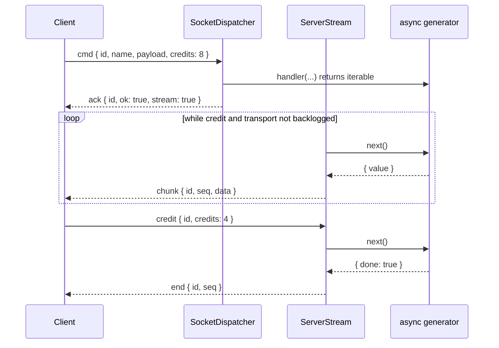

# Stream replies

A command whose handler returns an async iterable answers with a stream: an ack, then numbered `chunk` frames, then `end` or `fail`. The server pulls the next item only while the client has granted credit and the connection is not backlogged, so a slow consumer slows the producer.

## How it works

1. The client opens the stream: a `cmd` request with `credits`, its window (the client's default is 8).
2. The request passes the [command pipeline](04-command-pipeline.md); the handler returns an async iterable, usually from an `async *` method.
3. `SocketDispatcher.openStream()` checks the stream, and closes the iterable (`return()`) when it refuses it:
   - the call was already aborted: its abort reason;
   - the command is `ordered` or `idempotent`: `failed_precondition`;
   - the request has no `credits` (a plain `client.command()`): `failed_precondition`, and the generator never starts;
   - `credits` above `streams.maxCredits`: `invalid_argument` with `details { limit }`;
   - `streams.maxPerConnection` streams already open: `resource_exhausted`, `retryAfterMs: 100`.
4. The ack `{ id, ok: true, stream: true }` goes out first, so the client knows the id is a stream before its first chunk.
5. `ServerStream.run()` pumps:
   1. waits until it holds credit and the connection's engine.io write buffer holds at most `streams.maxCredits` unsent packets;
   2. calls the iterator's `next()` inside the call's AsyncLocalStorage store;
   3. sends `chunk { id, seq, data }` (`seq` from 0; `undefined` is sent as `null`) and spends one credit;
   4. on `done`, sends `end { id, seq }`, where `seq` is the number of chunks.
6. The client grants more credit with `credit { id, credits }` frames as it reads.
7. A failure sends `fail { id, error }` after the chunks already sent, aborts the handler's signal and calls the iterator's `return()`.



## Configuration

| Key | Type | Default | Allowed values | Meaning |
| --- | --- | --- | --- | --- |
| `http.socket.streams.maxCredits` | integer | `64` | above 0 | Largest credit a request, a grant, or the unspent total may reach; also the unsent packets above which a connection's streams pause |
| `http.socket.streams.maxPerConnection` | integer | `8` | above 0 | Streams open on one connection at once |
| `http.socket.streams.stallTimeoutMs` | integer | `60000` | 1 to 2^31-1 | A stream without credit, or with a backlogged connection, this long fails with `deadline_exceeded` |

```ts
http: {
  socket: {
    streams: { maxCredits: 16, maxPerConnection: 4, stallTimeoutMs: 30_000 },
  },
},
```

## Services and extension points

| Service | DI token and lifetime | Default implementation | Alternatives | How to replace or extend |
| --- | --- | --- | --- | --- |
| Stream sources | Not in DI: any async iterable a `@Command` handler returns | `async *` handler methods | Any object with `[Symbol.asyncIterator]` (a database cursor, a `Readable` stream) | Return it from the handler |
| Stream wrappers | A `SocketCommandStage` (see [Command pipeline](04-command-pipeline.md)) that replaces the iterable `next()` returns | `AccessFieldsStage` filters each chunk | Your stage | Wrap the iterable in an object that forwards `next`, `return` and `throw`; a generator wrapper cannot forward `return()` to a source it has not started |

### Wrap every chunk of a stream in a stage

A stage after `Lookup` receives the handler's iterable from `await next()` when the stream starts. Return a wrapper to change or count the chunks. Write it as a plain iterator, not a generator: the dispatcher closes a refused or failed stream through `return()`, and a generator never forwards `return()` to a source it has not started.

```ts sample
import { Injectable } from '@spinajs/di';
import { ISocketCommandContext, STAGE_ORDER, SocketCommandStage } from '@spinajs/http-socket';

function isIterable(value: unknown): value is AsyncIterable<unknown> {
  return value !== null && typeof value === 'object' && typeof (value as Record<symbol, unknown>)[Symbol.asyncIterator] === 'function';
}

/** Stamps every chunk of a 'feed.*' stream with the time it left the source. */
@Injectable(SocketCommandStage)
export class StampChunksStage extends SocketCommandStage {
  public get Order(): number {
    // outside AccessFieldsStage ( Policies + 50 ): it stamps chunks that are already field-filtered
    return STAGE_ORDER.Policies + 40;
  }

  public async execute(ctx: ISocketCommandContext, next: () => Promise<unknown>): Promise<unknown> {
    const result = await next();
    if (!ctx.request.name.startsWith('feed.') || !isIterable(result)) {
      return result;
    }

    return {
      [Symbol.asyncIterator](): AsyncIterator<unknown> {
        const source = result[Symbol.asyncIterator]();
        const stamp = (step: IteratorResult<unknown>): IteratorResult<unknown> => (step.done ? { done: true, value: undefined } : { done: false, value: { at: Date.now(), item: step.value } });

        return {
          next: async () => stamp(await source.next()),
          return: async () => (source.return ? stamp(await source.return()) : { done: true, value: undefined }),
          throw: async (error?: unknown) => {
            await source.return?.();
            throw error;
          },
        };
      },
    };
  }
}
```

## Important behaviour

- `deadline` and `@Command({ timeoutMs })` bound the time until the stream reply only. A running stream is bounded by the stall timeout, a cancel, a disconnect and shutdown.
- A stream holds no `maxInFlightPerConnection` slot. It holds one `streams.maxPerConnection` slot until its source has settled, not just until its `end` frame.
- Nothing else stops a source: a cancel, a disconnect, shutdown, a stall and a refused grant only abort its `@Signal()`. A source that ignores the signal keeps running, and keeps its slot, until it settles.
- Credit is the client's word, not proof that it reads. The server also pauses while the connection's engine.io write buffer holds more than `streams.maxCredits` packets, and resumes when it flushes. Backpressure reads engine.io's private `conn.writeBuffer`.
- A grant that would take the unspent credit above `maxCredits` fails the stream with `invalid_argument` and `details { limit }`. A grant of a non-integer or a number below 1 is ignored.
- Finding the end of a stream needs one credit in hand, but does not spend it.
- A generator that throws ends the stream with `fail` after the chunks it sent. Its error is mapped like any error (see [Error mapping](05-error-mapping.md)).
- Binary chunks (`Uint8Array`, `ArrayBuffer`, `Buffer`) travel as socket.io attachments.
- A stream handler cannot be `ordered` or `idempotent`: an `async *` method declared so is refused at startup; another async iterable returned by such a command is answered `failed_precondition`, after the handler ran.
- A stream command cannot take `after` and is never a fence predecessor: its reply is never stored.
- A dropped connection ends the stream on both sides; there is no automatic resume.
- Every step of the source runs inside the call's AsyncLocalStorage store, so `AuthzService.current()` and the log context are the connection's.

## Best practices

- Check `signal.aborted` in every loop of an `async *` handler, and pass the signal to the I/O it awaits.
- Put the resume position in the payload (`fromChunk`) so a client can restart from the first chunk it has not applied.
- Keep chunks small and roughly equal: credit counts chunks, not bytes.
- Lower `streams.maxCredits` for large chunks; it bounds both the client window and the unsent packets per connection.

## Patterns and antipatterns

```ts
// Don't: ignores the signal, so a cancelled export keeps reading the table to the end
@Command('rows')
public async *rows() {
  for await (const row of this.Db.cursor('SELECT * FROM events')) {
    yield row;
  }
}

// Do: stop when the call is aborted
@Command('rows')
public async *rows(@Signal() signal: AbortSignal) {
  for await (const row of this.Db.cursor('SELECT * FROM events', { signal })) {
    if (signal.aborted) return;
    yield row;
  }
}
```

## Examples

### Resumable document snapshot

```ts sample
import { BaseSocketController, Command, Payload, Signal, SocketController } from '@spinajs/http-socket';

interface Snapshot {
  version: number;
  chunks: string[][];
}

const documents = new Map<string, Snapshot>([['readme', { version: 3, chunks: [['# Title'], ['Intro'], ['Usage']] }]]);

type SnapshotFrame = { kind: 'begin'; version: number; chunks: number; from: number } | { kind: 'chunk'; index: number; lines: string[] };

@SocketController('docs')
export class SnapshotSocket extends BaseSocketController {
  @Command('snapshot', {
    schema: { type: 'object', required: ['doc'], properties: { doc: { type: 'string' }, version: { type: 'integer' }, fromChunk: { type: 'integer', minimum: 0 } } },
  })
  public async *snapshot(@Payload() req: { doc: string; version?: number; fromChunk?: number }, @Signal() signal: AbortSignal): AsyncGenerator<SnapshotFrame> {
    const doc = documents.get(req.doc) ?? { version: 0, chunks: [] };
    // resume only while the document is still at the version the client started from
    const from = req.version === doc.version ? Math.min(req.fromChunk ?? 0, doc.chunks.length) : 0;

    yield { kind: 'begin', version: doc.version, chunks: doc.chunks.length, from };

    for (let index = from; index < doc.chunks.length && !signal.aborted; index++) {
      yield { kind: 'chunk', index, lines: doc.chunks[index] };
    }
  }
}
```

## Related

- [`@spinajs/http-socket-client`](../http-socket-client/README.md): `client.stream()`, credit grants and `break` to cancel.
- [`@spinajs/http-socket-common`](../http-socket-common/README.md): the `Chunk`, `StreamEnd`, `StreamFail` and `StreamCredit` frames.
- [Policies and `@SocketAccess`](10-policies-and-access.md): `fields: 'filter'` on each chunk.
- [Observability](16-observability.md): the per-stream debug line and `socket_streams_total`.
