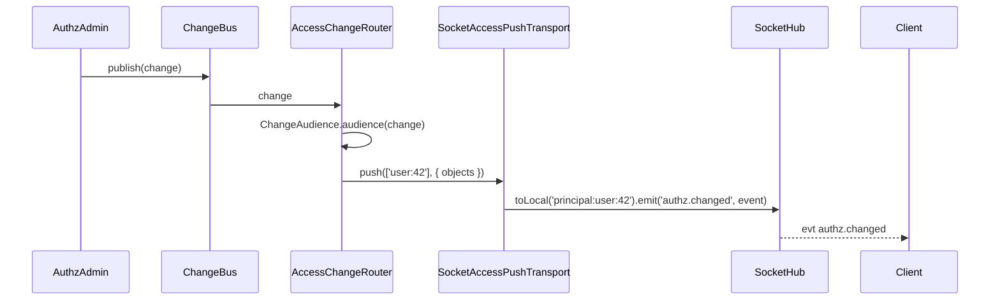

# Access change push

When a grant, role or link changes, connected clients learn about it at once: the server pushes `authz.changed` to the connections of the affected principals, so they refetch what they may see. This package is the socket transport of authz-v3's access change routing.

## How it works

1. Every connection whose principal a source authenticated joins `principal:<principalKey>`, plus the room of each of its `companions` (the signed-in user behind a link), in the `@OnConnect` hook of `AccessPushSocket` (prefix `authz`). `principalRoom(key)` builds the name.
2. An authz change is published on the root domain's `ChangeBus`. The `AccessChangeRouter` of `@spinajs/authz` asks the registered `ChangeAudience`s which principals it affects.
3. The router calls `push(principals, event)` on every `AccessPushTransport`, resolved per change. `SocketAccessPushTransport` (`name: 'socket'`) is one of them as soon as this package is imported.
4. `SocketAccessPushTransport.push()`:
   - does nothing while this instance holds no connection (also while `SocketHub` is detached);
   - for `'*'`, emits `authz.changed` to every local connection;
   - for a principal list, emits `authz.changed` to their rooms with `SocketHub.toLocal()`.
5. The client receives `authz.changed` with `{ objects?: [{ type, id }] }`. `objects` is present only when exact; without it the client refetches everything.



## Services and extension points

| Service | DI token and lifetime | Default implementation | Alternatives | How to replace or extend |
| --- | --- | --- | --- | --- |
| `SocketAccessPushTransport` | `AccessPushTransport` (`@spinajs/authz`), `@Singleton()`; resolved per change as `Array.chainOf(AccessPushTransport)` | `SocketAccessPushTransport` | Your subclass; other transports of your own beside it | Extend: subclass, override `push()`, then `DI.unregister(SocketAccessPushTransport)` and register yours under `AccessPushTransport` (every registered transport is pushed to, so keeping both doubles the push) |
| `AccessPushSocket` | `BaseSocketController`, prefix `authz`, one `@OnConnect` hook | `AccessPushSocket` | none | `DI.unregister(AccessPushSocket)` before `SocketServer` resolves stops the room joins; pushes by principal then reach nobody |
| `ChangeAudience` (`@spinajs/authz`) | `ChangeAudience`, chain | what authz and its adapters register | Yours | See [`@spinajs/authz`](../authz/README.md) |

### `SocketAccessPushTransport`: keep broadcasts away from anonymous sockets

A change that concerns everyone (`'*'`) reaches every local connection, anonymous ones included. A subclass can narrow that, and keep the per-principal path.

```ts sample
import { DI, Injectable, Singleton } from '@spinajs/di';
import { AUTHZ_CHANGED_EVENT, AccessPushTransport } from '@spinajs/authz';
import type { AccessChangedEvent } from '@spinajs/authz';
import { SocketAccessPushTransport } from '@spinajs/http-socket';

@Singleton()
@Injectable(AccessPushTransport)
export class SignedInAccessPushTransport extends SocketAccessPushTransport {
  public async push(principals: readonly string[] | '*', event: AccessChangedEvent): Promise<void> {
    if (principals !== '*') {
      return super.push(principals, event);
    }

    for (const connection of this.Hub.Connections.values()) {
      if (connection.authenticated) {
        connection.emit(AUTHZ_CHANGED_EVENT, event);
      }
    }
  }
}

DI.unregister(SocketAccessPushTransport);
```

## Important behaviour

- Pushes are per node, on purpose: each node's `AccessChangeRouter` pushes to its own connections through `toLocal()`, so an adapter does not deliver them twice.
- With several nodes, set `authz.bus.service: 'QueueChangeBus'` (`@spinajs/authz-queue`) so every node sees every change. With the in-process bus, only clients connected to the node that made the change are told.
- Rooms are joined once, at connect. A source that renews a connection's principal must keep its identity, or the connection stays in the old principal's room.
- `UNATTENDED` connections, and principals that are not `authenticated`, join no room; they still get `'*'` pushes.
- A recovered connection keeps its rooms through connection state recovery, and its connect hook joins them again.
- A failing transport is logged by the router and does not stop the other transports.

## Best practices

- On `authz.changed`, refetch only `objects` when present, else everything the screen shows.
- Do not use `principal:*` room names for your own rooms; the prefix belongs to this feature.

## Patterns and antipatterns

```ts
// Don't: push the change from your own code after an admin command; nodes without the bus never hear it
await admin.assign(actor, grant);
hub.to(principalRoom(key)).emit('authz.changed', {});

// Do: let the ChangeBus route it; every node pushes to its own connections
await admin.assign(actor, grant);
```

## Examples

### Read who is notified for a principal

```ts sample
import { DI } from '@spinajs/di';
import { principalKey } from '@spinajs/authz';
import type { Principal } from '@spinajs/authz';
import { SocketHub, principalRoom } from '@spinajs/http-socket';

/** Connection ids, on every instance, that an access change of this principal reaches. */
export async function notifiedConnections(principal: Principal): Promise<string[]> {
  const hub = (await DI.resolve(SocketHub)) as SocketHub;
  return hub.connectionsIn(principalRoom(principalKey(principal)));
}
```

## Related

- [`@spinajs/authz`](../authz/README.md): `ChangeBus`, `ChangeAudience`, `AccessChangeRouter`, `AccessPushTransport`.
- [Rooms and server push](07-rooms-and-push.md): `toLocal()` and principal rooms.
- [Running several instances](17-several-instances.md): adapters and the cluster change bus.
