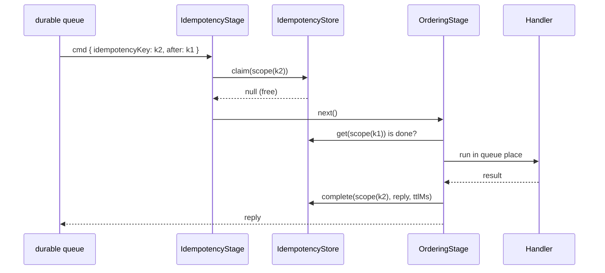

# Durable commands: idempotency and ordering

A command declared `idempotent` runs once per idempotency key, however often the client resends it; `ordered` runs a connection's or a client's commands one at a time; the `after` fence runs a command only once its predecessor completed. Together they serve the durable queue of `@spinajs/http-socket-client` (`client.durable()`), which survives reconnects and reloads.

## How it works

`IdempotencyStage` (order 500):

1. A request without `idempotencyKey` continues; with `after` but no key it answers `invalid_argument`.
2. A key on a command that is not `idempotent` answers `failed_precondition`: the client would believe it is deduplicated.
3. `SocketIdempotency.begin()` claims the scoped key `principalKey:clientId:key` (each part URI-encoded) in the `IdempotencyStore`:
   - free: the command runs under the claim;
   - completed: the stored reply is answered (a stored error is thrown again, with its `errorId`);
   - running on this instance: the call waits for that run's reply, or claims again if that run released the key;
   - running elsewhere: `unavailable` with `retryAfterMs: 1000`.
4. When the handler settles, the claim records the outcome once:
   - a result is stored in its wire (JSON) form, and the reply is that form, so a live reply and every replay are the same payload;
   - a non-retryable error is stored;
   - a retryable error, `unauthenticated`, the call's own abort (deadline, cancel, disconnect, shutdown while queued) and a stream result release the key, so a resend runs the command again;
   - a shutdown abort after the handler started keeps the key running: the handler may have committed.
5. A store that fails to keep a reply: the reply is still answered and the key released.

`OrderingStage` (order 550):

1. Without `ordered`, a request with `after` runs only if the store holds `after` as completed; otherwise `unavailable` with `details { after }`.
2. With `ordered: 'connection'` the queue key is the connection id; with `ordered: 'client'` it is the principal key and `clientId`, across reconnects.
3. In its queue place the command is skipped if it was aborted while waiting, checks `after`, and runs the rest of the pipeline. Policies and arguments therefore see what earlier commands changed.
4. The place is held until the handler settles, even after an abort answered the client. A handler still running `ordering.abortGraceMs` after its abort is cut loose: the place is released, an error is logged, and its idempotency key stays running until it settles.
5. The outcome is recorded before the place is released, so the next command's `after` check sees it.



## Decorators

| Decorator | Target | Options | Effect |
| --- | --- | --- | --- |
| `@Command(name, { idempotent: true })` | handler method | `idempotent` | Accepts an `idempotencyKey`; replays the stored outcome |
| `@Command(name, { ordered: 'connection' \| 'client' })` | handler method | `ordered` | Serial queue per connection, or per principal and `clientId` |

`client.durable()` needs `{ idempotent: true, ordered: 'client' }`.

## Configuration

| Key | Type | Default | Allowed values | Meaning |
| --- | --- | --- | --- | --- |
| `http.socket.idempotency.service` | string | `'MemoryIdempotencyStore'` | name of a class registered under `IdempotencyStore` | The store; this whole object is its first constructor argument |
| `http.socket.idempotency.ttlMs` | number | `600000` | (0, 2^31-1] | How long a completed key replays its reply |
| `http.socket.idempotency.maxEntries` | integer | `100000` | above 0 | `MemoryIdempotencyStore`: completed keys kept; least recently used go first |
| `http.socket.ordering.abortGraceMs` | number | `30000` | (0, 2^31-1] | How long an aborted `ordered` command whose handler still runs keeps its queue place |

```ts
http: {
  socket: {
    idempotency: { service: 'KvIdempotencyStore', ttlMs: 15 * 60_000, maxEntries: 100_000 },
    ordering: { abortGraceMs: 10_000 },
  },
},
```

A bad `idempotency` value makes `SocketServer.resolve()` throw `RangeError`.

## Services and extension points

| Service | DI token and lifetime | Default implementation | Alternatives | How to replace or extend |
| --- | --- | --- | --- | --- |
| `IdempotencyStore` | `IdempotencyStore`; one class picked by name from `http.socket.idempotency.service` (`@AutoinjectService`) and built with that config object; singleton | `MemoryIdempotencyStore` (process memory, LRU over completed keys) | A shared store of your own (Redis, ORM) | Extend `IdempotencyStore`, `@Injectable(IdempotencyStore)`, set `http.socket.idempotency.service` to the class name |
| `MemoryIdempotencyStore` | registered under `IdempotencyStore` | `MemoryIdempotencyStore` | Your subclass | Override `claim()`, `complete()`, `release()`, `get()` and call `super`; register under `IdempotencyStore` with its own class name and select it in config |
| `SocketIdempotency` | `SocketIdempotency` (self), singleton; shared by both stages | `SocketIdempotency` | Your subclass | Override `scope()` (the key scheme), `record()` (what is kept); `DI.register(Mine).as(SocketIdempotency)` |
| `IdempotencyStage`, `OrderingStage` | `SocketCommandStage`, orders 500 and 550 | as named | Your stages | Replace as any stage; see [Command pipeline](04-command-pipeline.md#replace-a-built-in-stage) |

### `IdempotencyStore`: a store shared by several instances

The contract:

| Method | Must |
| --- | --- |
| `claim(key)` | Atomically: mark a free key `running` and return `null`, or return the record that holds it |
| `complete(key, reply, ttlMs)` | Store `{ state: 'done', reply }` for `ttlMs` |
| `release(key)` | Drop a `running` claim; never a completed key |
| `get(key)` | Return the record or `null` |

A shared store must make `claim` atomic and should expire the running claims of a dead instance (a lease). The example uses a stand-in key-value client; swap in your Redis or database client.

```ts sample
import { Injectable } from '@spinajs/di';
import { IdempotencyRecord, IdempotencyStore, IdempotentReply, ISocketIdempotencyConfig } from '@spinajs/http-socket';

/** Stand-in for a shared key-value client with an atomic set-if-absent. */
export class KvClient {
  protected data = new Map<string, { value: string; expiresAt: number }>();

  public async setIfAbsent(key: string, value: string, ttlMs: number): Promise<boolean> {
    const held = await this.get(key);
    if (held !== null) {
      return false;
    }
    this.data.set(key, { value, expiresAt: Date.now() + ttlMs });
    return true;
  }

  public async set(key: string, value: string, ttlMs: number): Promise<void> {
    this.data.set(key, { value, expiresAt: Date.now() + ttlMs });
  }

  public async get(key: string): Promise<string | null> {
    const entry = this.data.get(key);
    return entry && entry.expiresAt > Date.now() ? entry.value : null;
  }

  public async deleteIfEquals(key: string, value: string): Promise<void> {
    if ((await this.get(key)) === value) {
      this.data.delete(key);
    }
  }
}

const RUNNING = JSON.stringify({ state: 'running' });
// a running claim of a crashed instance expires after this lease
const LEASE_MS = 5 * 60_000;

@Injectable(IdempotencyStore)
export class KvIdempotencyStore extends IdempotencyStore {
  protected kv = new KvClient();
  protected prefix: string;

  constructor(options: Partial<ISocketIdempotencyConfig> & { prefix?: string } = {}) {
    super();
    this.prefix = options.prefix ?? 'socket-idem:';
  }

  public async claim(key: string): Promise<IdempotencyRecord | null> {
    if (await this.kv.setIfAbsent(this.prefix + key, RUNNING, LEASE_MS)) {
      return null;
    }
    return this.get(key);
  }

  public async complete(key: string, reply: IdempotentReply, ttlMs: number): Promise<void> {
    await this.kv.set(this.prefix + key, JSON.stringify({ state: 'done', reply }), ttlMs);
  }

  public async release(key: string): Promise<void> {
    await this.kv.deleteIfEquals(this.prefix + key, RUNNING);
  }

  public async get(key: string): Promise<IdempotencyRecord | null> {
    const raw = await this.kv.get(this.prefix + key);
    return raw === null ? null : (JSON.parse(raw) as IdempotencyRecord);
  }
}

// config: http.socket.idempotency = { service: 'KvIdempotencyStore', ttlMs: 900_000, maxEntries: 100_000, prefix: 'app1:' }
```

### `SocketIdempotency`: scope keys by tenant as well

`scope(connection, key)` builds the store key for both the claim and the `after` fence. A subclass can add a part; keep the principal key in it, because a `clientId` is not a secret.

```ts sample
import { DI, Injectable } from '@spinajs/di';
import { SocketConnection, SocketIdempotency } from '@spinajs/http-socket';

@Injectable()
export class TenantScopedIdempotency extends SocketIdempotency {
  public scope(connection: SocketConnection, key: string): string {
    const tenant = connection.handshake.auth.tenant;
    return `${encodeURIComponent(typeof tenant === 'string' ? tenant : '-')}:${super.scope(connection, key)}`;
  }
}

DI.register(TenantScopedIdempotency).as(SocketIdempotency);
```

## Important behaviour

- A completed key replays its reply whatever the new request's name or payload: never reuse a key for another command.
- An `after` on an `idempotent` command that is not `ordered: 'client'` gets the fence check alone, without a queue place.
- `idempotencyKey` and `after` are 1 to 256 printable ASCII characters; anything else is a malformed request (`invalid_argument`).
- A result JSON cannot represent (a BigInt, a cycle) answers `internal` and releases the key. A value JSON drops (a function) is answered and stored as `undefined`.
- A stream handler cannot be `idempotent` or `ordered`; see [Stream replies](06-stream-replies.md).
- `MemoryIdempotencyStore` is per process: exactly-once across disconnects and graceful restarts, not across crashes. `maxEntries` counts completed keys only; running claims stay until they settle.
- No store has a lease by default: a handler that never settles keeps its key running, and every resend of it waits or is refused.
- `ordered` queues and the `after` fence are per instance; several instances need sticky sessions.
- Unauthenticated connections share one principal key, so their keys and fences are scoped by `clientId` only.
- A principal switch mid-queue changes the key scope: an anonymous command whose ack was lost runs again after login.
- A completed key is forgotten after `ttlMs`; a command resent after a longer offline period runs again.

## Best practices

- Check `signal.aborted` before you commit, and make the commit the last step. A handler that commits and then throws its abort reason, or another retryable error, releases its key, and a resend runs it again.
- Roll back on abort for every reason (disconnect, cancel, deadline, shutdown), or never throw the abort after committing.
- Use a shared store with a lease when you run several instances or need exactly-once across restarts.
- Keep `ttlMs` above the longest time a client may stay offline with a queued command.

## Patterns and antipatterns

```ts
// Don't: commit, then let the abort escape; the key is released and a resend runs the insert again
@Command('create', { idempotent: true, ordered: 'client' })
public async create(@Payload() note: NewNote, @Signal() signal: AbortSignal) {
  await this.Notes.insert(note);
  signal.throwIfAborted();
  return { ok: true };
}

// Do: check the signal first; the commit is the last step
@Command('create', { idempotent: true, ordered: 'client' })
public async create(@Payload() note: NewNote, @Signal() signal: AbortSignal) {
  signal.throwIfAborted();
  return this.Notes.insert(note);
}
```

## Examples

### An offline-safe note editor command

```ts sample
import { Autoinject, Injectable } from '@spinajs/di';
import { ResourceNotFound } from '@spinajs/exceptions';
import { BaseSocketController, Command, Payload, Signal, SocketController } from '@spinajs/http-socket';

@Injectable()
export class NoteStore {
  protected notes = new Map<string, { text: string; version: number }>();

  public async create(id: string, text: string) {
    this.notes.set(id, { text, version: 1 });
    return { id, version: 1 };
  }

  public async edit(id: string, text: string) {
    const note = this.notes.get(id);
    if (!note) {
      // stored as final: the client moves the command to its failed list
      throw new ResourceNotFound(`note ${id} does not exist`);
    }
    note.text = text;
    note.version++;
    return { id, version: note.version };
  }
}

@SocketController('notes')
export class NotesSocket extends BaseSocketController {
  @Autoinject()
  protected Notes: NoteStore;

  @Command('create', { idempotent: true, ordered: 'client', schema: { type: 'object', required: ['id', 'text'], properties: { id: { type: 'string' }, text: { type: 'string' } } } })
  public async create(@Payload() req: { id: string; text: string }, @Signal() signal: AbortSignal) {
    signal.throwIfAborted();
    return this.Notes.create(req.id, req.text);
  }

  // a durable edit sent right behind its create runs only after the create completed ( the after fence )
  @Command('edit', { idempotent: true, ordered: 'client', schema: { type: 'object', required: ['id', 'text'], properties: { id: { type: 'string' }, text: { type: 'string' } } } })
  public async edit(@Payload() req: { id: string; text: string }, @Signal() signal: AbortSignal) {
    signal.throwIfAborted();
    return this.Notes.edit(req.id, req.text);
  }
}
```

## Related

- [`@spinajs/http-socket-client`](../http-socket-client/README.md): `client.durable()`, outbox stores, `acked` / `failed` / `held`.
- [Command pipeline](04-command-pipeline.md): stages 500 and 550 in context.
- [Shutdown and connection recovery](14-shutdown-and-recovery.md): what a shutdown does to keyed commands.
- [Configuration](15-configuration.md): startup checks of `idempotency`.
