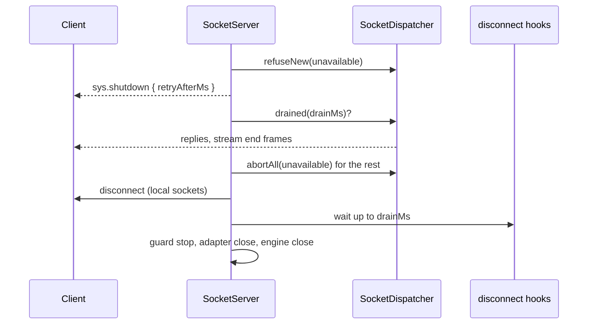

# Shutdown and connection recovery

`SocketServer.shutdown()` drains the server: it refuses new work, tells clients when to come back, lets running commands and streams finish, then closes. Connection state recovery restores a connection after a short network drop, with its rooms, `data` and missed pushes, once its principal is checked again.

## How it works

### Graceful shutdown

1. `shutdown()` starts once; later calls, `dispose()` and the host's `http.server.closing` DI event share the same run.
2. New handshakes, recovered sockets and new commands are refused with a retryable `unavailable` carrying `retryAfterMs = http.socket.shutdownRetryAfterMs`. New events are dropped.
3. Every local connection gets `sys.shutdown { retryAfterMs }`.
4. Running commands, open streams and their stage chains get up to `drainMs` to finish.
5. Still running after that: commands are answered `unavailable` and open streams get `fail unavailable`, except keyed (idempotent) commands whose handler already started. Those get 1 s more to answer, and record, their real outcome, then are aborted too.
6. The server waits up to 1 s for those replies to be written, disconnects only its own clients (`io.local`), and waits up to 1 s for the transports to flush and up to `drainMs` for the disconnect hooks, which can still push.
7. It stops the principal guard, closes the adapter (waiting at most 1 s), closes engine.io, removes the listeners it added to the http server and detaches `SocketHub`. The http server stays open: the host owns it.

### Connection state recovery

1. With `http.socket.recovery.maxDisconnectionMs` above 0, socket.io keeps a dropped connection's session (rooms, `socket.data`, missed packets) for that long.
2. Before socket.io restores a session, the server checks it (`SocketPrincipalGuard.restorable()`): a revoked connection, a missing handshake state, an expired principal or one due for revalidation is not restored. The client then gets a full handshake and a new id, without the missed pushes.
3. A restored socket skips the handshake middleware, so its new `Origin` is checked again, and `clientId`, protocol and principal come from the restored state only.
4. `SocketDispatcher` re-checks the principal with its source (`trigger: 'recovery'`), whatever `revalidateMs` says. An `'invalid'` answer closes it with `sys.disconnect { reason: 'unauthenticated' }` and skips its hooks; `'unavailable'` keeps it for one grace window.
5. The connect hooks run again, with `conn.recovered === true`. Commands and events wait for them.



## Configuration

| Key | Type | Default | Allowed values | Meaning |
| --- | --- | --- | --- | --- |
| `http.socket.drainMs` | number | `5000` | 0 to 2^31-1; not `null` or a boolean | How long running commands and streams get to finish |
| `http.socket.shutdownRetryAfterMs` | number | `5000` | finite, above 0 | `retryAfterMs` of `sys.shutdown` and of every refusal during the drain |
| `http.socket.recovery.maxDisconnectionMs` | number | `120000` | 0 or more; not `null` or a boolean | Recovery window; `0` turns recovery off |
| `http.shutdownTimeout` (`@spinajs/http`) | number | `10000` | ms | The http server destroys connections this long after it starts closing |

```ts
http: {
  shutdownTimeout: 15_000,
  socket: {
    drainMs: 10_000,
    shutdownRetryAfterMs: 3_000,
    recovery: { maxDisconnectionMs: 60_000 },
  },
},
```

Startup warns when `drainMs + 3000` reaches `http.shutdownTimeout`: the http server would destroy sockets mid-drain.

## Services and extension points

| Service | DI token and lifetime | Default implementation | Alternatives | How to replace or extend |
| --- | --- | --- | --- | --- |
| `SocketServer.shutdown()` | `SocketServer`, singleton | the drain above | Your subclass | Override `shutdown()` to run app work first and return `super.shutdown()`; keep it idempotent |
| `SocketPrincipalGuard.restorable()` | `SocketPrincipalGuard`, singleton | refuses revoked, expired and due sessions | Your subclass | Override `restorable(data)` to refuse more sessions; call `super` first |
| socket.io adapter | `http.socket.adapter` | in memory | Redis and other adapters | Recovery needs an adapter that supports connection state recovery |

### `SocketServer`: announce maintenance before the drain

```ts sample
import { DI, Injectable } from '@spinajs/di';
import { SocketServer } from '@spinajs/http-socket';

@Injectable()
export class AnnouncingSocketServer extends SocketServer {
  protected announced = false;

  public shutdown(): Promise<void> {
    if (!this.announced && this.Io) {
      this.announced = true;
      for (const connection of this.Hub.Connections.values()) {
        connection.emit('app.maintenance', { at: new Date().toISOString() });
      }
    }
    return super.shutdown();
  }
}

DI.register(AnnouncingSocketServer).as(SocketServer);
```

### `SocketPrincipalGuard`: no recovery for one kind of client

`restorable(data)` sees the stored `socket.data`: `client` (`clientId`, `protocol`), `auth` (principal, source, check times) and `app` (your `conn.data`).

```ts sample
import { DI, Injectable } from '@spinajs/di';
import { SocketPrincipalGuard } from '@spinajs/http-socket';

/** Kiosk clients always start fresh: their connect hooks load state the kiosk may have lost. */
@Injectable()
export class KioskAwareGuard extends SocketPrincipalGuard {
  public restorable(data: unknown): boolean {
    const clientId = (data as { client?: { clientId?: string } } | null)?.client?.clientId;
    return super.restorable(data) && !clientId?.startsWith('kiosk-');
  }
}

DI.register(KioskAwareGuard).as(SocketPrincipalGuard);
```

## Important behaviour

- Polling clients do not drain: `@spinajs/http` stops listening before it emits `http.server.closing`, so a polling client loses its transport at its next poll. WebSocket clients drain fully.
- A keyed command still running after the drain keeps its idempotency key running, because it may have committed; see [Durable commands](12-durable-commands.md).
- Exactly-once across a graceful restart needs a shared idempotency store, and handlers that finish within `drainMs` + 1 s or roll back on abort.
- A recovered connection keeps its socket id. The dropped connection's disconnect hooks ran at the drop and may still be running when the new connect hooks start.
- Pushes reach a recovered connection until its re-check answers, at most `min(revalidateMs, 10 s)`.
- A session restored through a serializing adapter carries a flattened `Principal.identity`; only a `'valid'` answer that carries the principal brings the real one back.
- The restore filter wraps socket.io 4.8 internals (`adapter.restoreSession`, `Namespace._initAdapter`).
- `drainMs: 0` closes at once; tests that stop servers with handlers still running use it.

## Best practices

- Wire `SIGTERM` to `HttpServer.stop()` (or `DI.dispose()`): the `http.server.closing` event drains the sockets of that server.
- Make connect hooks idempotent: they run again on every recovery.
- Read `conn.recovered` in a connect hook to skip what recovery restored (room joins, `conn.data`).

## Patterns and antipatterns

```ts
// Don't: exit right away; running commands are cut and clients see a plain drop
process.on('SIGTERM', () => process.exit(0));

// Do: let the server drain, then exit
process.on('SIGTERM', async () => {
  await DI.dispose();
  process.exit(0);
});
```

## Examples

### Restore room joins only on a fresh connection

```ts sample
import { BaseSocketController, Connection, OnConnect, SocketConnection, SocketController } from '@spinajs/http-socket';

@SocketController('inbox')
export class InboxSocket extends BaseSocketController {
  @OnConnect()
  public async joined(@Connection() conn: SocketConnection<{ joinedAt?: number }, { id: string }>) {
    if (conn.recovered) {
      // rooms and data survived the drop
      return;
    }

    if (conn.user) {
      conn.join(`inbox:${conn.user.id}`);
      conn.data.joinedAt = Date.now();
    }
  }
}
```

## Related

- [Principal revalidation](09-revalidation.md): the re-check of recovered connections.
- [Durable commands](12-durable-commands.md): keyed commands during a drain.
- [Running several instances](17-several-instances.md): adapters and recovery.
- [`@spinajs/http`](../http/README.md): `http.shutdownTimeout`, `HttpServer.stop()`.
