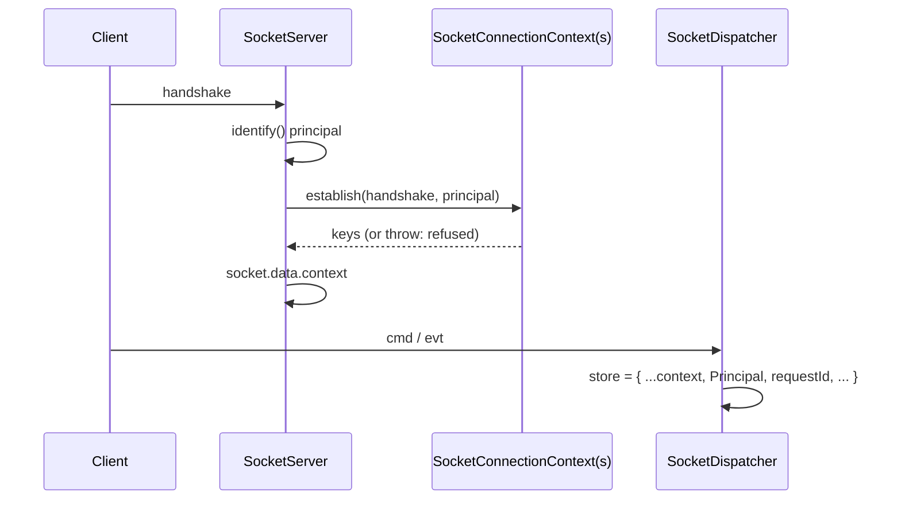

# Connection context

A `SocketConnectionContext` adds keys to the AsyncLocalStorage store of every call of a connection: commands, events, connect and disconnect hooks. It runs once, in the handshake, after the principal is known. Use it for a value fixed for the connection's life that services read from the ambient store, such as the tenant of `@spinajs/tenancy-http/socket`.

## How it works

1. The handshake middleware (`SocketServer.authenticate()`) runs the origin, protocol and `clientId` checks, then `identify()` resolves the principal (see [Principal sources](08-principal-sources.md)).
2. `SocketServer.connectionContext(handshake, principal)` returns `{}` when no class is registered under `SocketConnectionContext`. Otherwise it resolves `Array.ofType(SocketConnectionContext)` from the server's container and calls `establish(handshake, principal)` on each.
3. The keys of all contributors are merged. Two contributors that set the same key throw `AuthzConfigError` (`socket connection contexts <A> and <B> both set the key <key>`), answered `internal`.
4. A throw from `establish()` refuses the handshake: the client gets the mapped `SocketError` in `connect_error.data`, as for any handshake refusal.
5. The merged keys are copied into `socket.data.context`. `SocketConnection.context` returns a copy of them.
6. For every call, `SocketDispatcher` builds a fresh store: the connection's context keys first, then the fixed keys (`Principal`, `AuthnPrincipal`, `requestId`, `traceId`, `spanId`, `realIp`, `connectionId`, `clientId`, `socketCall`). Middlewares, policies, argument extractors, the handler and the services it calls read that store.



## Services and extension points

| Service | DI token and lifetime | Default implementation | Alternatives | How to replace or extend |
| --- | --- | --- | --- | --- |
| `SocketConnectionContext` | `SocketConnectionContext`; every registered class, resolved as a list (`Array.ofType`) from the `SocketServer` container on each handshake | none | `TenantSocketContext` from `import '@spinajs/tenancy-http/socket'`; your contexts | Add: `@Injectable(SocketConnectionContext)` and implement `establish()`. Remove one: `DI.unregister(TheClass)` |
| `SocketServer.connectionContext()` | protected method of `SocketServer` | merges the contributors, refuses a key set twice | Your `SocketServer` subclass | Override to change how the keys are gathered; register with `DI.register(MyServer).as(SocketServer)` before the first resolve |

### `SocketConnectionContext`: a context of your own

`establish(handshake, principal)` returns the keys to add, as a plain object. Return `{}` to add nothing. Throw a `SocketException` (or any mapped exception) to refuse the connection.

```ts sample
import { AsyncLocalStorage } from 'node:async_hooks';
import { DI, Injectable } from '@spinajs/di';
import type { Principal } from '@spinajs/authz';
import { BaseSocketController, Command, Connection, SocketConnection, SocketConnectionContext, SocketController } from '@spinajs/http-socket';
import type { ISocketCallStorage, ISocketHandshake } from '@spinajs/http-socket';

const LOCALES = new Set(['en', 'pl', 'de']);

/** Clients send `io(url, { auth: { locale } })`; the locale holds for every call of the connection. */
@Injectable(SocketConnectionContext)
export class LocaleContext extends SocketConnectionContext {
  public async establish(handshake: ISocketHandshake, _principal: Principal): Promise<Readonly<Record<string, unknown>>> {
    const locale = handshake.auth.locale;
    return { Locale: typeof locale === 'string' && LOCALES.has(locale) ? locale : 'en' };
  }
}

/** Any service called inside a socket call reads the key from the ambient store. */
export function currentLocale(): string {
  const store = (DI.resolve(AsyncLocalStorage) as AsyncLocalStorage<ISocketCallStorage>).getStore();
  return typeof store?.Locale === 'string' ? store.Locale : 'en';
}

@SocketController('greeting')
export class GreetingSocket extends BaseSocketController {
  @Command('hello')
  public async hello(@Connection() conn: SocketConnection) {
    return { locale: currentLocale(), handshakeLocale: conn.context.Locale };
  }
}
```

## Important behaviour

- `establish()` runs once per handshake. Nothing re-runs it while the connection lives: a [revalidation](09-revalidation.md) that adopts a renewed principal keeps the keys the handshake set.
- Connection state recovery restores `socket.data`, so a recovered connection keeps its keys without a new `establish()` call. A socket restored from state stored without `socket.data.context` gets no keys.
- The fixed keys win: a contributor key named `Principal`, `requestId`, `connectionId` or another fixed key is replaced in every call's store.
- Each call gets its own shallow copy of the keys. Assigning a key in one call's store does not reach other calls; mutating an object value does, since the object is shared.
- Contributors are resolved on every handshake, so one registered after `SocketServer` resolved is asked from the next handshake on.
- A key set by two contributors refuses every handshake with `internal`, whichever values they return: the later one would silently replace a value the earlier one checked.
- `establish()` runs inside the handshake middleware: a slow contributor delays every connection.

- Through an adapter that serializes sessions, the keys come back as the adapter deserialized them: keep the values plain data (strings, numbers, plain objects), not class instances or `Map`s.

## Best practices

- Give keys a name of your own feature (`Tenant`, `Locale`), never a fixed key name or a name another package already uses.
- Keep values small, frozen data: every call copies the keys into its store.
- Refuse in `establish()` with a `SocketException` whose code the client can act on (`forbidden`, `not_found`), not with a plain `Error`, which answers `internal`.
- Read the value through the ambient store in services, and through `conn.context` in a handler or hook that already has the connection.

## Patterns and antipatterns

```ts
// Don't: resolve per-connection state on every command; the store already carries it
@Command('report')
public async report(@Connection() conn: SocketConnection) {
  const locale = await this.Locales.lookup(conn.handshake.auth.locale);
}

// Do: resolve it once in a SocketConnectionContext and read the store
@Command('report')
public async report() {
  const locale = currentLocale();
}
```

## Related

- [Principal sources and handshake security](08-principal-sources.md): the step that runs before `establish()`.
- [Command pipeline and socket middlewares](04-command-pipeline.md): what runs inside the call's store.
- [Rooms and server push](07-rooms-and-push.md): `SocketConnection.context`.
- [`@spinajs/tenancy-http`](../tenancy-http/README.md): `TenantSocketContext`, one tenant per socket connection.
