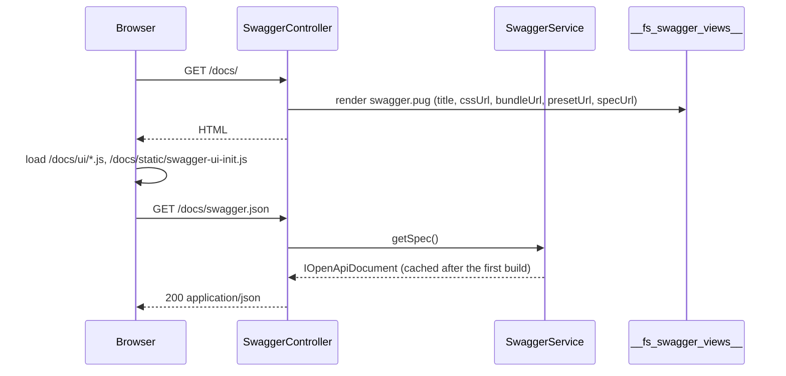

# Spec and UI endpoints

`SwaggerController` serves the OpenAPI document as JSON and a Swagger UI page that loads it. Configure both under `http.swagger`; replace the page template or add your own docs controller when the defaults do not fit.

## How it works

1. **Boot.** The package config file `config/http-swagger.ts` adds the package's `controllers` folder to `system.dirs.controllers`. `@spinajs/http` loads `SwaggerController` with every other controller, under `@BasePath('docs')` and the global `http.controllers.route.prefix`.
2. **Spec.** `GET /docs/swagger.json` runs `SwaggerController.getSpec()`:
   - `SwaggerService.IsEnabled` is `false` → `404` with `{ error: 'Swagger documentation is disabled' }`;
   - otherwise `SwaggerService.getSpec()` returns the cached document or builds it ([Swagger service](06-swagger-service.md)), sent with `Json`, so the answer is `application/json` whatever the `Accept` header says.
3. **UI.** `GET /docs/` runs `SwaggerController.getUI()`:
   - disabled → the same `404`;
   - otherwise it renders `swagger.pug` from the `__fs_swagger_views__` file provider with five locals: `title`, `cssUrl`, `bundleUrl`, `presetUrl`, `specUrl`.
4. **Browser.** The page loads the CSS and the two Swagger UI scripts, then `/docs/static/swagger-ui-init.js`. That script calls `SwaggerUIBundle` with the URL from `data-spec-url`, `deepLinking: true` and the `StandaloneLayout`.
5. **Static files.** `/docs/ui` serves the `swagger-ui-dist` folder; `/docs/static` serves the package's `lib/views` folder. Both are `http.Static` entries and are **not** prefixed with `http.controllers.route.prefix`.



## HTTP surface

| Route | Status | Body |
| --- | --- | --- |
| `GET /docs/swagger.json` | `200` | The OpenAPI 3.0.3 document (`IOpenApiDocument`) |
| `GET /docs/swagger.json` | `404` | `{ "error": "Swagger documentation is disabled" }` when `http.swagger.enabled` is `false` |
| `GET /docs/swagger.json` | `400` | The build failed: one line per controller that could not be documented. `SwaggerService.buildSpec()` throws `InvalidArgument`, which `@spinajs/http` maps to Bad Request |
| `GET /docs/` | `200` | Swagger UI HTML page |
| `GET /docs/` | `404` | Same body as above, when disabled |
| `GET /docs/ui/*` | `200` | Files of `swagger-ui-dist` |
| `GET /docs/static/swagger-ui-init.js` | `200` | The UI bootstrap script |

With `http.controllers.route.prefix: 'api'` the two controller routes become `/api/docs/swagger.json` and `/api/docs/`. The static routes stay at `/docs/ui` and `/docs/static`.

## Configuration

| Key | Type | Default | Allowed values | Meaning |
| --- | --- | --- | --- | --- |
| `http.swagger.enabled` | `boolean` | `true` | `true`, `false` | `false` makes both routes answer `404` and `getSpec()` return `null`. Any other value, or a missing `http.swagger`, counts as enabled |
| `http.swagger.title` | `string` | `'API Documentation'` | any | `info.title` |
| `http.swagger.version` | `string` | `'1.0.0'` | any | `info.version` |
| `http.swagger.description` | `string` | `''` | Markdown | `info.description`. The builder appends a Policies section to it; see [Policies and access](05-policies-and-access.md) |
| `http.swagger.basePath` | `string` | `''` | path without leading or trailing `/`, eg. `'api'` | Prefix for every documented path. Empty falls back to `http.controllers.route.prefix`. A leading `/` produces `//api/...` |
| `http.swagger.servers` | `{ url: string; description?: string }[]` | `[]` | any | `servers` of the document. Arrays concatenate across config files |
| `http.swagger.securitySchemes` | `Record<string, ISecurityScheme>` | unset | `type`: `'apiKey'`, `'http'`, `'oauth2'`, `'openIdConnect'` | `components.securitySchemes` |
| `http.swagger.security` | `Record<string, string[]>[]` | unset | scheme names from `securitySchemes` | Document-wide security requirement. Override per route with `@security`; see [Documenting routes](02-documenting-routes.md#security) |
| `http.swagger.ui.cssUrl` | `string` | `'/docs/ui/swagger-ui.css'` | URL | Swagger UI stylesheet. Empty falls back to `https://cdn.jsdelivr.net/npm/swagger-ui-dist@5/swagger-ui.css` |
| `http.swagger.ui.bundleUrl` | `string` | `'/docs/ui/swagger-ui-bundle.js'` | URL | Swagger UI bundle. Empty falls back to the jsDelivr `swagger-ui-dist@5` file |
| `http.swagger.ui.presetUrl` | `string` | `'/docs/ui/swagger-ui-standalone-preset.js'` | URL | Standalone preset. Empty falls back to the jsDelivr `swagger-ui-dist@5` file |
| `http.swagger.ui.specUrl` | `string` | `'/<prefix>/docs/swagger.json'`, or `'/docs/swagger.json'` without a prefix | URL | Where the page loads the document from. The default is a `ConfigVar` that reads `http.controllers.route.prefix` |
| `http.swagger.ui.pageTitle` | `string` | `'API Documentation'` | any | `<title>` of the page. Empty falls back to `info.title` of the built document, which builds the spec on the first page view |

The package config also sets these keys:

| Key | Value | Purpose |
| --- | --- | --- |
| `system.dirs.controllers` | `<root>/node_modules/@spinajs/http-swagger/lib/<mjs\|cjs>/controllers` | Loads `SwaggerController` |
| `system.dirs.cli` | `<root>/node_modules/@spinajs/http-swagger/lib/<mjs\|cjs>/cli` | Loads `SwaggerCacheCommand` |
| `fs.providers` `__fs_swagger_views__` | `fsNative`, `<root>/node_modules/@spinajs/http-swagger/lib/views` | Template folder of the UI page |
| `fs.providers` `__fs_swagger_cache__` | `fsNative`, `<cwd>/__cache__/__swagger__` | Declared, but no code in this package reads it |
| `http.Static` `/docs/ui` | first `node_modules/swagger-ui-dist` found walking up from `<root>` | Swagger UI assets |
| `http.Static` `/docs/static` | `<root>/node_modules/@spinajs/http-swagger/lib/views` | `swagger-ui-init.js` |

`<root>` is `WORKSPACE_ROOT_PATH`, or the working directory when it is unset; see [Config files](../configuration/03-config-files.md).

```ts
// config/app.ts
export default {
  http: {
    swagger: {
      title: 'Billing API',
      version: '2.3.0',
      description: 'Invoices, payments and refunds.',
      servers: [{ url: 'https://billing.example.com', description: 'Production' }],
      securitySchemes: {
        cookieAuth: { type: 'apiKey', in: 'cookie', name: 'ssid', description: 'Session cookie set after login' },
      },
      security: [{ cookieAuth: [] }],
      ui: {
        pageTitle: 'Billing API docs',
      },
    },
  },
};
```

## Services and extension points

| Service | DI token and lifetime | Default implementation | Alternatives | How to replace or extend |
| --- | --- | --- | --- | --- |
| `SwaggerController` | Controller loaded from `system.dirs.controllers`; resolved by `@spinajs/http` | `SwaggerController` (`@BasePath('docs')`) | none | Add your own controller under another `@BasePath` that injects `SwaggerService`; see below |
| UI template | `fs` provider named `__fs_swagger_views__`, file `swagger.pug` | the package's `lib/views` | none | Declare a provider with the same name in the app config; the last entry with a name wins |
| `SwaggerService` | class `SwaggerService`, singleton | `SwaggerService` | none | See [Swagger service](06-swagger-service.md) |

### UI template: custom page

Replace the page when you need your own branding, a login banner, or Swagger UI options such as `persistAuthorization`. `fs.providers` entries collapse by `name` and the app config loads after package configs, so your entry wins.

```ts
// config/app.ts
import { join } from 'path';

export default {
  fs: {
    providers: [{ service: 'fsNative', name: '__fs_swagger_views__', basePath: join(process.cwd(), 'views', 'swagger') }],
  },
};
```

`views/swagger/swagger.pug` receives the same five locals:

```pug
doctype html
html(lang="en")
  head
    title #{title}
    link(rel="stylesheet" href=cssUrl)
  body
    div.banner Internal API - do not share
    div#swagger-ui
    script(src=bundleUrl)
    script(src=presetUrl)
    script.
      window.onload = function () {
        SwaggerUIBundle({ url: '#{specUrl}', dom_id: '#swagger-ui', persistAuthorization: true });
      };
```

### Docs controller: custom implementation

`SwaggerController` has no hooks; its base path is fixed. To publish another view of the same document, add a controller that injects `SwaggerService`. It shares the cached build, so it costs no second build.

```ts sample
import { Autoinject } from '@spinajs/di';
import { BaseController, BasePath, Get, Json, NotFound } from '@spinajs/http';
import { IOpenApiDocument, IOpenApiPathItem, SwaggerService } from '@spinajs/http-swagger';

/**
 * Spec subset published to partners.
 * @tags Docs
 */
@BasePath('partner-docs')
export class PartnerDocsController extends BaseController {
  @Autoinject()
  protected Swagger!: SwaggerService;

  /**
   * OpenAPI document with only the operations tagged Partner
   */
  @Get('swagger.json')
  public async partnerSpec() {
    const spec = await this.Swagger.getSpec();
    if (!spec) {
      return new NotFound({ error: 'Swagger documentation is disabled' });
    }

    // getSpec() returns the cached document itself; trim a copy
    const copy = JSON.parse(JSON.stringify(spec)) as IOpenApiDocument;
    const paths: Record<string, IOpenApiPathItem> = {};

    for (const [path, item] of Object.entries(copy.paths)) {
      const kept: IOpenApiPathItem = {};
      for (const [method, operation] of Object.entries(item)) {
        if (operation.tags?.includes('Partner')) {
          kept[method] = operation;
        }
      }
      if (Object.keys(kept).length > 0) {
        paths[path] = kept;
      }
    }

    copy.paths = paths;
    copy.tags = copy.tags?.filter((t) => t.name === 'Partner');
    return new Json(copy);
  }
}
```

## Important behaviour

- The document is built on the first request to `swagger.json`, not at boot. With `ui.pageTitle` empty, the first `GET /docs/` builds it too.
- Turning `enabled` off does not remove the static routes: `/docs/ui` and `/docs/static` keep serving files.
- `swagger-ui-dist` missing from every `node_modules` up the tree does not stop the boot. The static handler logs a warning and skips the route; point the `ui.*Url` keys at a CDN in that case.
- `swagger-ui-init.js` is loaded from the fixed path `/docs/static/swagger-ui-init.js`. A custom template that keeps this script also needs that static route.
- A failed build answers `400` with the full list of broken controllers in the message. Fix the controllers; see [Parameters and request bodies](03-parameters-and-request-bodies.md#path-parameters).

## Best practices

- Leave `basePath` empty when the documented paths should match `http.controllers.route.prefix`; set it only when a proxy mounts the API under another prefix.
- Declare security once in `http.swagger.security` and mark public routes with `@security []`, instead of tagging every protected route.
- Keep `http.swagger.ui.specUrl` at its default; it already follows the route prefix.

## Patterns and antipatterns

```ts
// Don't: a leading slash doubles it, every path becomes //api/...
http: { swagger: { basePath: '/api' } }

// Do
http: { swagger: { basePath: 'api' } }
```

```ts
// Don't: mutating the cached document changes what /docs/swagger.json serves
const spec = await swagger.getSpec();
spec!.paths = {};

// Do: copy before changing, or change the document once in SwaggerService.buildSpec()
const copy = JSON.parse(JSON.stringify(await swagger.getSpec()));
```

## Related

- [Swagger service](06-swagger-service.md): what `getSpec()` does behind both routes.
- [Documenting routes](02-documenting-routes.md): the JSDoc that fills the document.
- [Config files](../configuration/03-config-files.md): load order and how arrays merge.
- [Providers and configuration](../fs/01-providers-and-configuration.md): how `fs.providers` entries with one name collapse.
