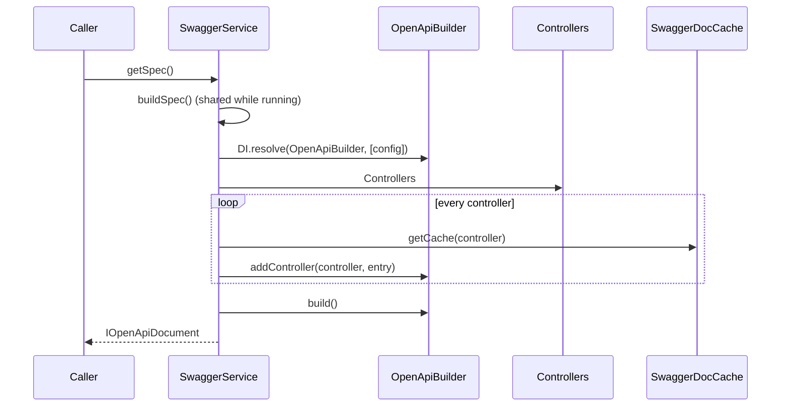

# Swagger service

`SwaggerService` builds the OpenAPI document once, caches it, and hands it to `SwaggerController` and to any code that asks. Subclass it to post-process the document, change when docs are enabled, or rebuild after controllers are added at runtime.

## How it works

`SwaggerService.getSpec()`:

1. Returns `null` when `IsEnabled` is `false` (`http.swagger.enabled === false`).
2. Returns the cached document when there is one.
3. Otherwise starts `buildSpec()`, unless a build is already running; concurrent callers wait on the same promise. It logs `Building Swagger/OpenAPI documentation...` and, when done, the number of paths.
4. Returns the cached document the build stored.

`SwaggerService.buildSpec()`:

1. Takes `http.swagger`, or `{ enabled: true, title: 'API Documentation', version: '1.0.0' }` when the key is missing.
2. Sets `basePath` to `http.swagger.basePath`, else `http.controllers.route.prefix`, else `''`.
3. Resolves `OpenApiBuilder` with that config: `DI.resolve(OpenApiBuilder, [config])`.
4. Reads `Controllers.Controllers` from `@spinajs/http`.
5. For each controller, calls `SwaggerDocCache.getCache(controller)` and `OpenApiBuilder.addController()`. An error is recorded with the controller name, and the loop goes on.
6. Any errors: logs them at `error` level and throws `InvalidArgument('Cannot build the OpenAPI spec: <n> controller(s) could not be documented.' + one line per controller)`. Nothing is cached, so the next call tries again.
7. No errors: caches `OpenApiBuilder.build()` and returns it.

`SwaggerService.invalidate()` drops the cached document; the next `getSpec()` builds again.



## Configuration

| Key | Type | Default | Allowed values | Meaning |
| --- | --- | --- | --- | --- |
| `http.swagger` | `ISwaggerConfig` | the package config | see [Spec and UI endpoints](01-spec-and-ui-endpoints.md#configuration) | Passed to `OpenApiBuilder` |
| `http.controllers.route.prefix` | `string` | `''` | path segment | Fallback for `basePath` |

## Services and extension points

| Service | DI token and lifetime | Default implementation | Alternatives | How to replace or extend |
| --- | --- | --- | --- | --- |
| `SwaggerService` | class `SwaggerService`, `@Singleton()`; resolved by type through `@Autoinject()` in `SwaggerController`, on first use | `SwaggerService` | none | Subclass and `DI.register(Sub).as(SwaggerService)` before the first request reaches `/docs`. Override `buildSpec()`, `getSpec()` or the `IsEnabled` getter |
| `OpenApiBuilder` | class `OpenApiBuilder`, no lifetime decorator (singleton) | `OpenApiBuilder` | none | See [OpenAPI builder](07-openapi-builder.md) |
| `SwaggerDocCache` | class `SwaggerDocCache`, `@Singleton()` | `SwaggerDocCache` | none | See [Documentation cache](08-documentation-cache.md) |

Members a subclass can use: `Log` (`http-swagger` logger), `ControllersService` (`Controllers`, lazy), `DocCache` (`SwaggerDocCache`), `SwaggerConfig` (`http.swagger`), `RoutePrefix` (`http.controllers.route.prefix`).

### `SwaggerService`: custom implementation

Override `buildSpec()` to change the document once per build: stamp a release, set servers from the environment, drop internal paths. Call `super.buildSpec()` and change the object it returns **in place**: `getSpec()` serves the object the base class cached, not the value your override returns.

Override `IsEnabled` to switch the docs off by a rule rather than by config. Both routes then answer `404`.

```ts sample
import { DI } from '@spinajs/di';
import { IOpenApiDocument, SwaggerService } from '@spinajs/http-swagger';

export class ReleaseSwaggerService extends SwaggerService {
  public get IsEnabled(): boolean {
    return super.IsEnabled && process.env.PUBLISH_API_DOCS === 'true';
  }

  public async buildSpec(): Promise<IOpenApiDocument> {
    const spec = await super.buildSpec();

    spec.info.version = process.env.RELEASE_TAG ?? spec.info.version;
    spec.servers = [{ url: process.env.PUBLIC_API_URL ?? 'http://localhost:1337', description: 'This deployment' }];

    for (const path of Object.keys(spec.paths)) {
      if (path.includes('/internal/')) {
        delete spec.paths[path];
      }
    }

    return spec;
  }
}

// Before the HTTP server starts.
DI.register(ReleaseSwaggerService).as(SwaggerService);
```

## Important behaviour

- The first build runs on the first `getSpec()`, usually the first `GET /docs/swagger.json`. It is not part of the boot, so a broken controller does not stop the app; it fails the docs.
- A failed build is not cached. Every request retries the full build and fails again until the controller is fixed.
- `getSpec()` returns the cached object itself, not a copy. Whatever a caller changes on it is served from then on.
- `invalidate()` during a running build is lost: the build finishes and caches its result.
- `OpenApiBuilder` has no lifetime decorator, so `DI.resolve(OpenApiBuilder, [config])` returns the instance built on the first build. After `invalidate()` the next build adds to that builder's existing paths, tags and components, and the config given on the first build stays. Register a `@NewInstance()` builder to start from scratch each time; see [OpenAPI builder](07-openapi-builder.md#openapibuilder-custom-implementation).
- A controller added with `Controllers.add()` after the first build is not in the document until `invalidate()` runs.

## Best practices

- Call `invalidate()` right after `Controllers.add()`.
- Keep `buildSpec()` overrides deterministic; the document is built once and cached for the process lifetime.
- Resolve `SwaggerService` from DI in scripts that export the document; the result matches what `/docs/swagger.json` serves.

## Patterns and antipatterns

```ts
// Don't: getSpec() keeps serving the original object, this copy is never seen
public async buildSpec() {
  const spec = await super.buildSpec();
  return { ...spec, info: { ...spec.info, version: '2.0.0' } };
}

// Do: change the cached object
public async buildSpec() {
  const spec = await super.buildSpec();
  spec.info.version = '2.0.0';
  return spec;
}
```

## Examples

### Document a controller registered at runtime

```ts sample
import { DI } from '@spinajs/di';
import { BaseController, BasePath, Controllers, Get, Ok } from '@spinajs/http';
import { SwaggerService } from '@spinajs/http-swagger';

/**
 * Reports added by the reporting plugin.
 * @tags Reports
 */
@BasePath('plugins/reports')
export class ReportsPluginController extends BaseController {
  /**
   * List available reports
   */
  @Get('/')
  public async list() {
    return new Ok([]);
  }
}

export async function enableReportsPlugin() {
  const controllers = await DI.resolve(Controllers);
  await controllers.add(ReportsPluginController);

  const swagger = await DI.resolve(SwaggerService);
  swagger.invalidate();
}
```

### Export the document for a client generator

```ts sample
import { writeFile } from 'fs/promises';
import { DI } from '@spinajs/di';
import { SwaggerService } from '@spinajs/http-swagger';

// Run after the app booted (configuration, file systems, controllers).
export async function exportOpenApi(file: string) {
  const swagger = await DI.resolve(SwaggerService);
  const spec = await swagger.buildSpec();
  await writeFile(file, JSON.stringify(spec, null, 2), 'utf8');
}
```

`buildSpec()` ignores `IsEnabled`, so the export works with the docs endpoint switched off.

## Related

- [Spec and UI endpoints](01-spec-and-ui-endpoints.md): the routes that call `getSpec()`.
- [OpenAPI builder](07-openapi-builder.md): what `addController()` and `build()` do.
- [Documentation cache](08-documentation-cache.md): what `getCache()` returns.
- [Registering services](../di/01-registering-services.md): `DI.register(...).as(...)`.
