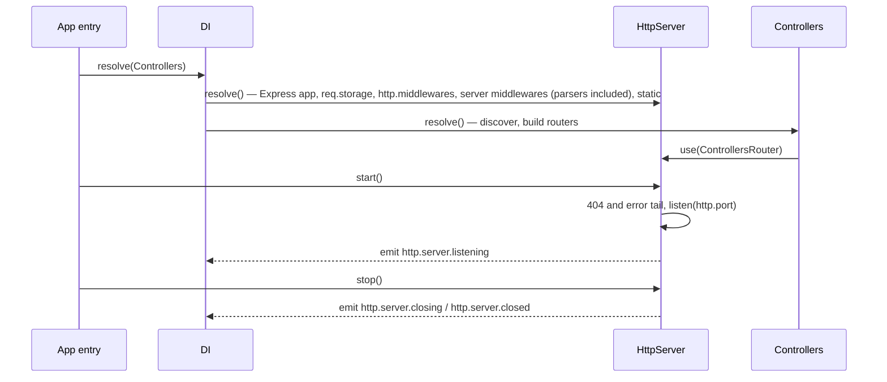

# HTTP server

`HttpServer` owns the Express app and the Node `http` or `https` server. It builds the global middleware stack, serves static files, listens on `http.port` and shuts down gracefully. Resolve it once, after the controllers, and call `start()`.

## How it works

1. **Resolve.** `DI.resolve(HttpServer)` builds the singleton. `@Inject(Templates)` makes the template engine resolve first; `@Autoinject(ServerMiddleware)` collects every registered [server middleware](15-server-middlewares.md).
2. **`HttpServer.resolve()`** creates the Express app and sorts the server middlewares by `Order`, ascending.
3. It creates an HTTPS server when the top-level `https` key is `true` (reading `http.ssl.key` and `http.ssl.cert` from disk), otherwise an HTTP server. Both track open sockets and log server-level `error` events.
4. It logs where response templates live (`__fs_http_response_templates__` file provider), or that HTML error pages are off when the provider is missing.
5. It adds its own first handler, which creates `req.storage = {}`, then the raw Express handlers from `http.middlewares` (helmet by default), in array order.
6. It mounts each enabled server middleware (`handler()`, or its `onAround` and `onBefore` handlers), lowest `Order` first. The cookie parser (Order 0.5), the per-path body limits (3.4, see [Body size limits](04-route-arguments.md#body-size-limits)) and the body parsers (3.5) are server middlewares too: see [Body and cookie parsers](#body-and-cookie-parsers).
7. Among them, at `http.static.order` (default 4.5: after `CsrfGuard`, before authentication), it serves every `http.Static` entry with `express.static`, deduplicated by `Path`. A missing directory is skipped with a warning. See [Static files](#static-files).
8. **`Controllers.resolve()`** (see [Controllers and routing](02-controllers-and-routing.md)) mounts one router holding every controller with `HttpServer.use()`.
9. **`start()`** adds, once per instance, the `NotFoundMiddleware` and `ErrorHandlerMiddleware` tail. Then it listens on `http.port` and emits `http.server.listening`.
10. **`stop()`** or **`dispose()`** emits `http.server.closing`, stops accepting connections, closes idle keep-alive sockets at once, and waits for in-flight requests. A request that still arrives on a kept-alive connection meanwhile gets a 503 with `Connection: close` from [`MaintenanceMode`](27-maintenance-mode.md). After `http.shutdownTimeout` ms it destroys the remaining sockets. It then emits `http.server.closed`.



The resulting Express stack, top to bottom: `req.storage` → `http.middlewares` → server middlewares by `Order`, the parsers and the static files (4.5) among them → controllers router → the 404 → the global error answer. Every framework reply, the 404 and the error answer included, goes out through the [reply pipeline](15-server-middlewares.md#request-timeline).

### Lifecycle

| State (`LifecycleState`) | Entered when | `start()` | `stop()` |
| --- | --- | --- | --- |
| `Created` | constructed | listens | no-op |
| `Listening` | `listen` callback fires | no-op | closes |
| `Closing` | `stop()` began | waits for the close, then listens again | returns the same promise |
| `Closed` | close callback fired | listens again on the same port | no-op |

Read the state from `server.State` and the Node server from `server.Server`.

## Configuration

| Key | Type | Default | Allowed values | Meaning |
| --- | --- | --- | --- | --- |
| `http.port` | `number` | `1337` | a TCP port | Port `start()` listens on. |
| `https` | `boolean` | `false` | `true`, `false` | Top-level key, not under `http`. `true` creates an HTTPS server. `HTTPS_CONFIGURATION_SCHEMA` refuses anything else, `null` included. |
| `http.ssl.key` | `string` | `''` | file path | Private key file, read with `fs.readFileSync` when `https` is `true`. |
| `http.ssl.cert` | `string` | `''` | file path | Certificate file, read when `https` is `true`. |
| `http.middlewares` | `express.RequestHandler[]` | `defaultMiddlewares()`: `helmet(...)` | any Express handlers | Raw handlers added first, before every server middleware. Your list replaces the defaults; spread `defaultMiddlewares()` to keep them. |
| `http.bodyParsers.{json,urlencoded,text,cookies}` | object | see [Body and cookie parsers](#body-and-cookie-parsers) | `enabled` plus the options of the express or cookie-parser function | The built-in parser server middlewares. |
| `http.bodyLimits` | `{ path: string; limit: string }[]` | `[]` | `limit` as `16kb`, `1mb` | Per-path body limits, applied by `BodyLimits` (Order 3.4) just before the body parsers; see [Body size limits](04-route-arguments.md#body-size-limits). |
| `http.Static` | `{ Route: string; Path: string }[]` | `[{ Route: '/_static', Path: <package>/lib/static }]` | | Static directories. `Route` defaults to `/static` when empty. |
| `http.static.order` | `number` | `4.5` | any number, `Infinity` | The `Order` among the server middlewares at which `http.Static` mounts; see [Static files](#static-files). |
| `http.shutdownTimeout` | `number` | `10000` | milliseconds | Grace period for in-flight requests on `stop()`. |
| `http.AcceptHeaders` | `HttpAcceptHeaders` | `1 \| 2` (JSON and HTML) | bit flags `JSON` 1, `HTML` 2, `XML` 4 | Formats the response negotiation offers; see [Responses](10-responses.md#content-negotiation). |
| `http.FatalTemplate` | `string` | built-in "HTTP 500" page | HTML with an optional `{ticket}` | Page sent when even the error page fails to render. |
| `http.controllers.route.prefix` | `string` | `''` | path without slashes at the ends | Prefix for every controller route; see [Controllers and routing](02-controllers-and-routing.md#path-rules). |
| `system.dirs.controllers` | `string[]` | not set | directories | Where controllers are scanned; see [Controller discovery](03-controller-discovery.md). |
| `http.errors.handlers` | `{ service: string }[]` | `[]` | names of registered `ErrorHandlerService` classes | App-wide route error handlers; see [Error handling](11-error-handling.md#app-wide-handlers). |
| `http.routes.middlewares` | `GlobalRouteMiddlewareEntry[]` | `[]` | `RouteMiddleware` names or classes, `{ service, options }` | Route middlewares on every route, before the controller and route ones; see [Route middlewares](14-route-middlewares.md#global-route-middlewares). |
| `http.csrf.*` | object | `enabled: true`, empty lists | | The default-deny `CsrfGuard`; see [CSRF guard](23-csrf-guard.md#configuration). |
| `http.bot.*` | object | `enabled: false` | | `@BotCheck` verifiers and checks; see [Bot checks](23-bot-check.md#configuration). |
| `http.throttle.*` | object | `enabled: false`, `ipv6Prefix: 64`, `rules: []` | | Per-IP, per-path rate limits; see [Throttling](18-throttling.md). |
| `http.maintenance.*` | object | `enabled: false`, `retryAfter: 60`, `allow: []` | | 503 answers during maintenance; see [Maintenance mode](27-maintenance-mode.md). |
| `http.concurrency.*` | object | `enabled: false`, `max: 500`, `retryAfter: 1` | | Load shedding over a cap of requests in flight; see [Concurrency limit](28-concurrency-limit.md). |
| `http.deadline.*` | object | `enabled: false`, `ms: 30000` | | A deadline for every request, 504 when nothing was sent by it; see [Request deadlines](29-request-deadlines.md). |
| `http.audit.*` | object | `redact: ['password', 'token', 'secret', 'authorization', 'cookie', 'card']`, `includeBody: true`, `maxBodyBytes: 16384` | | The `Audit` route middleware: methods, redacted keys, body; see [Audit](30-audit.md#configuration). |

The default `http.middlewares` hold one handler:

| Handler | Settings | Why |
| --- | --- | --- |
| `helmet` | `referrerPolicy: 'strict-origin-when-cross-origin'` | helmet's default `no-referrer` makes browsers send `Origin: null` on same-origin form posts, which the [CSRF guard](23-csrf-guard.md) (and its `@spinajs/authn-http` subclass) refuses |

### Body and cookie parsers

The parsers are [server middlewares](15-server-middlewares.md) mounted through `handler()`. The body parsers run after CORS, `RequestId`, `RealIp`, the access log and the throttle, and before `CsrfGuard` (4) and authentication (5). A malformed body (400) or one over its limit (413) goes to the global error answer through the reply pipeline: the answer carries `x-request-id` and the CORS headers, and the access log and every server middleware entered before the parser see it.

| Server middleware | Order | `http.bodyParsers` key | Defaults | Why |
| --- | --- | --- | --- | --- |
| `CookieParserMiddleware` | 0.5 | `cookies` | secret from `http.cookie.secret` | signed cookies (see [Cookies](20-cookies.md)); before `IntlHttpMiddleware` (Order 1), which reads the language cookie |
| `BodyLimits` | 3.4 | none: `http.bodyLimits` | no rules: not mounted | [per-path limits](04-route-arguments.md#body-size-limits) |
| `JsonBodyParser` | 3.5 | `json` | `limit: '5mb'`; the raw bytes go to `req.rawBody` | feeds [`@RawBody()`](04-route-arguments.md); your `verify` runs after the raw bytes are stored, under `http.bodyLimits` paths too |
| `UrlencodedBodyParser` | 3.5 | `urlencoded` | `extended: true` | form posts |
| `TextBodyParser` | 3.5 | `text` | types `application/xml`, `text/xml`, `application/*+xml`, `limit: '5mb'` | feeds [`@FromXml()`](04-route-arguments.md) |

Each key takes `enabled` (default `true`; `false` mounts nothing) and the options of `express.json()`, `express.urlencoded()`, `express.text()` or `cookie-parser`; your keys merge over the defaults. A parser limit answers 413 with `EntityTooLargeException`, as `http.bodyLimits` does. A server middleware below Order 3.5 sees no `req.body`; one below 0.5 sees no `req.cookies`.

A 3.x `http.middlewares` list that still holds `express.json()`, `express.urlencoded()`, `express.text()`, `cookieParser(...)` or `configuredCookieParser` keeps parsing with them: the matching built-in recognises that handler (express's and cookie-parser's own handlers, also inside a nested array, and the tagged `configuredCookieParser`; not a parser wrapped in a function of yours, nor a function of yours that only shares the name), is not mounted, and logs one warning. The other built-ins stay on: a 3.x list holding only `express.json()` now also gets the form, XML-text and cookie parsers; switch off the ones you do not want with `enabled: false`. Such a list parses before every server middleware, so its failures get no request id or CORS headers. Move the options to `http.bodyParsers` and drop the handlers.

`http.bodyLimits` goes before `http.middlewares` whenever that list holds a handler the package did not ship (anything but `defaultMiddlewares()` and `configuredCookieParser`), since such a handler might read the body; its 413 then has no request id or CORS headers. With only the shipped handlers, `BodyLimits` runs at 3.4. A body something read before the limit (a server middleware below 3.4, say) answers 413 under a rule's path, with one warning: its size can no longer be bounded.

```ts
// config/http.ts in your app
import helmet from 'helmet';

export default {
  https: true,
  system: {
    dirs: {
      controllers: ['/app/dist/controllers'],
    },
  },
  http: {
    port: 8443,
    ssl: { key: '/run/secrets/tls.key', cert: '/run/secrets/tls.crt' },
    shutdownTimeout: 25000,
    controllers: { route: { prefix: 'api/v1' } },
    // Replacing the array drops the defaults: keep the ones you need.
    middlewares: [helmet({ referrerPolicy: { policy: 'strict-origin-when-cross-origin' } })],
    bodyParsers: {
      json: { limit: '1mb' },
      text: { enabled: false },
    },
    // signs and verifies cookies, CookieParserMiddleware included
    cookie: { secret: process.env.COOKIE_SECRET },
    Static: [{ Route: '/assets', Path: '/app/public' }],
  },
};
```

### Static files

`http.Static` directories mount among the server middlewares at `http.static.order`, after the middlewares of an equal `Order`. Server middlewares below `http.static.order` still run for static files: at the default 4.5 a static file gets CORS, the request id, the access log, the throttle, the body parsers, the CSRF guard and any guard of yours placed there (a maintenance switch answers static requests too unless it lets their path through). It skips authentication (`AuthnMiddleware`, 5), `PrincipalMiddleware` (10) and `AccessEpochMiddleware` (11): no session lookup per asset, and neither the `authn.http.hooks.request` refusal hook nor the session `Cache-Control: no-store` applies to it. The server middlewares entered before it get `onFinish`, none gets `onAfter` (a static file is not a framework reply). A path under a static `Route` that is no file goes on to the later middlewares and routing.

Static assets behind authentication need a higher order, for example `static: { order: 10.5 }` to serve them after the principal is known, with your own server middleware refusing unauthenticated requests. `Infinity` restores the 3.x placement after every server middleware.

### Configuration schema and file providers

The package registers the `http.configuration` JSON schema twice: at import (`registerConfigurationSchemaAtImport`) and from `HttpConfigBootstrapper`. The configuration validates the merged tree against it and fills its defaults. It checks `http.cookie.secret`, `http.trustProxy`, `http.cors`, `http.bodyLimits`, `http.bodyParsers` (`enabled` and `limit`), `http.static.order`, `http.errors`, `http.csrf`, `http.throttle` and `http.bot`.

The package configuration also adds three `fs.providers` entries and two `system.dirs` entries:

| Entry | Value | Used by |
| --- | --- | --- |
| `fs.providers` `__file_upload_default_provider__` | `fsNative` at `os.tmpdir()` | [File uploads](08-file-uploads.md) |
| `fs.providers` `__fs_http_response_templates__` | `fsNative` at `<package>/lib/views/responses` | HTML responses and error pages |
| `fs.providers` `__fs_controller_cache__` | `fsNative` at `<cwd>/__cache__/__controllers__` | [Controller cache](21-controller-cache-and-cli.md) |
| `system.dirs.locales` | `<package>/lib/locales` | translations |
| `system.dirs.cli` | `<package>/lib/cli` | the `http:controllers:cache` command |

`<package>` resolves to `node_modules/@spinajs/http` under `WORKSPACE_ROOT_PATH`, or under the current directory when that variable is not set.

## Events

`HttpServer` emits on the root DI container. Subscribe with `DI.on(event, listener)`; the listener receives the server.

| Event | When |
| --- | --- |
| `http.server.listening` | `listen` succeeded, once per `start()` |
| `http.server.closing` | `stop()` began, once per shutdown |
| `http.server.closed` | the Node server closed and sockets were destroyed |

A listener that throws is logged at `warn` and does not break `start()` or `stop()`.

## Services and extension points

| Service | DI token and lifetime | Default implementation | Alternatives | How to replace or extend |
| --- | --- | --- | --- | --- |
| `HttpServer` | Class `HttpServer`, `@Injectable()`, singleton; resolved by `Controllers` (`@Autoinject`) and by the app entry | `HttpServer` | none shipped | Subclass and `DI.register(MyServer).as(HttpServer)` before anything resolves `HttpServer`. Override `resolve()` (call `super.resolve()` first) to add Express settings; call `use()` to add a handler. |
| `HttpBootstrapper` | `Bootstrapper` list, singleton | Attaches the last registered `DateTimeHydrator` to luxon `DateTime` | | See [Argument hydrators](06-argument-hydrators.md#datetimehydrator). |
| `HttpConfigBootstrapper` | `Bootstrapper` list, singleton | Registers `HTTP_CONFIGURATION_SCHEMA` | | Register your own schema for your own keys; do not unregister this one. |

### `HttpServer`: custom implementation

Subclass the server when you need Express settings that a middleware cannot set, such as `trust proxy`, `etag` or `x-powered-by`, or a socket timeout on the Node server. `this.Express` exists after `super.resolve()`; `this.Server` returns the HTTP or HTTPS server.

```ts sample
import { DI } from '@spinajs/di';
import { HttpServer } from '@spinajs/http';

export class TunedHttpServer extends HttpServer {
  public async resolve(): Promise<void> {
    await super.resolve();

    this.Express.set('etag', 'strong');
    this.Express.disable('x-powered-by');

    // Long-polling endpoints answer within 2 minutes; drop sockets idle longer than that.
    this.Server.setTimeout(120_000);
  }
}

// Register before the first resolve of HttpServer (eg. in a Bootstrapper or at the top of the entry file).
DI.register(TunedHttpServer).as(HttpServer);

async function main() {
  const server = await DI.resolve(HttpServer);
  await server.start();
}

void main();
```

## Important behaviour

- `start()` is idempotent and restartable. A second call while listening does nothing; `stop()` then `start()` listens again on the same port without stacking the 404 and error tail twice.
- `start()` rejects when `listen` fails. `EADDRINUSE` also logs `Port <port> is busy`.
- `stop()` and `dispose()` share one shutdown. Concurrent or repeated calls get the same promise and never reject.
- The shutdown watchdog is `unref`'d: it never keeps the process alive.
- Server middlewares are collected when `HttpServer` resolves. A `ServerMiddleware` module imported later is ignored.
- The controllers router is mounted after the static files. A static file wins over a route with the same path.
- At the default `http.static.order` a static file is served before authentication: never put private files in an `http.Static` directory without raising the order.
- `http.middlewares` replaces the whole default array. To keep the defaults, spread them: `middlewares: [...defaultMiddlewares(), requestId]`. `defaultMiddlewares()` and `missingDefaultMiddlewares(list)` are exported from `@spinajs/http`. `HttpServer` logs one warning at boot when the list lost the shipped helmet. It recognises the shipped handler by a tag, so your own `helmet()` counts as missing: ignore the warning when your handler does that work.
- `http.bodyParsers.json.enabled: false` turns off JSON bodies and `@RawBody()`; `http.bodyParsers.cookies.enabled: false` turns off `req.cookies` and `@Cookie()`.

## Best practices

- Await `server.start()` so a busy port fails the boot instead of an unhandled rejection.
- Call `server.stop()` (or dispose the container) on `SIGTERM`; set `http.shutdownTimeout` below your orchestrator's kill timeout.
- Subscribe to `http.server.listening` to report readiness instead of polling the port.

## Patterns and antipatterns

```ts
// Don't: Express settings added after start() apply to nothing already routed,
// and Express's own 'trust proxy' makes req.ip trust a client-set X-Forwarded-For.
const server = await DI.resolve(HttpServer);
await server.start();
(server as any).Express.set('trust proxy', true);

// Do: subclass HttpServer for Express settings, and use http.trustProxy for the client address.
DI.register(TunedHttpServer).as(HttpServer);
```

## Examples

### Report readiness and stop on SIGTERM

```ts sample
import { Bootstrapper, DI } from '@spinajs/di';
import { Configuration } from '@spinajs/configuration';
import { fsService } from '@spinajs/fs';
import { Controllers, HttpServer, LifecycleState } from '@spinajs/http';

async function main() {
  for (const bootstrapper of DI.resolve(Array.ofType(Bootstrapper))) {
    await bootstrapper.bootstrap();
  }
  await DI.resolve(Configuration);
  await DI.resolve(fsService);
  await DI.resolve(Controllers);

  DI.on('http.server.listening', () => console.log('ready'));
  DI.on('http.server.closed', () => console.log('drained'));

  const server = await DI.resolve(HttpServer);
  await server.start();

  process.once('SIGTERM', async () => {
    await server.stop();
    console.log(server.State === LifecycleState.Closed);
    process.exit(0);
  });
}

void main();
```

## Related

- [Controllers and routing](02-controllers-and-routing.md): what the controllers router contains.
- [Server middlewares](15-server-middlewares.md): their hooks, `Order` and the request timeline. Compression is the `Compression` server middleware (`http.compression.*`); the default `http.middlewares` hold none.
- [Responses](10-responses.md): `http.AcceptHeaders` and `http.FatalTemplate` in use.
- [`@spinajs/configuration`](../configuration/README.md): config files, schemas and defaults.
- [`@spinajs/fs`](../fs/README.md): the file providers the server and responses read.
