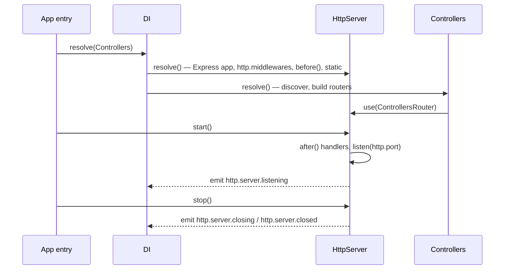

# HTTP server

`HttpServer` owns the Express app and the Node `http` or `https` server. It builds the global middleware stack, serves static files, listens on `http.port` and shuts down gracefully. Resolve it once, after the controllers, and call `start()`.

## How it works

1. **Resolve.** `DI.resolve(HttpServer)` builds the singleton. `@Inject(Templates)` makes the template engine resolve first; `@Autoinject(ServerMiddleware)` collects every registered [server middleware](15-server-middlewares.md).
2. **`HttpServer.resolve()`** creates the Express app and sorts the server middlewares by `Order`, ascending.
3. It creates an HTTPS server when the top-level `https` key is `true` (reading `http.ssl.key` and `http.ssl.cert` from disk), otherwise an HTTP server. Both track open sockets and log server-level `error` events.
4. It logs where response templates live (`__fs_http_response_templates__` file provider), or that HTML error pages are off when the provider is missing.
5. It adds the per-path body limit gate when `http.bodyLimits` has rules (see [Body size limits](04-route-arguments.md#body-size-limits)), then the raw Express handlers from `http.middlewares`, in array order.
6. It adds each server middleware's `before()` handler, lowest `Order` first.
7. It serves every `http.Static` entry with `express.static`, deduplicated by `Path`. A missing directory is skipped with a warning.
8. **`Controllers.resolve()`** (see [Controllers and routing](02-controllers-and-routing.md)) mounts one router holding every controller with `HttpServer.use()`.
9. **`start()`** adds each server middleware's `after()` handler once per instance, highest `Order` first, so the error handler ends up last. Then it listens on `http.port` and emits `http.server.listening`.
10. **`stop()`** or **`dispose()`** emits `http.server.closing`, stops accepting connections, closes idle keep-alive sockets at once, and waits for in-flight requests. After `http.shutdownTimeout` ms it destroys the remaining sockets. It then emits `http.server.closed`.



The resulting Express stack, top to bottom: the body limit gate (only when `http.bodyLimits` has rules) → `http.middlewares` → `ServerMiddleware.before()` by `Order` → static files → controllers router → `ServerMiddleware.after()` (404 handler, then error handler).

### Lifecycle

| State (`LifecycleState`) | Entered when | `start()` | `stop()` |
| --- | --- | --- | --- |
| `Created` | constructed | listens | no-op |
| `Listening` | `listen` callback fires | no-op | closes |
| `Closing` | `stop()` began | waits for the close, then listens again | returns the same promise |
| `Closed` | close callback fired | listens again on the same port | no-op |

Read the state from `server.State` and the Node server from `server.Server`.

## Configuration

| Key | Type | Default | Allowed values | Meaning |
| --- | --- | --- | --- | --- |
| `http.port` | `number` | `1337` | a TCP port | Port `start()` listens on. |
| `https` | `boolean` | not set | `true`, `false` | Top-level key, not under `http`. `true` creates an HTTPS server. |
| `http.ssl.key` | `string` | `''` | file path | Private key file, read with `fs.readFileSync` when `https` is `true`. |
| `http.ssl.cert` | `string` | `''` | file path | Certificate file, read when `https` is `true`. |
| `http.middlewares` | `express.RequestHandler[]` | `helmet(...)`, `express.json(...)`, `express.urlencoded(...)`, `express.text(...)`, `configuredCookieParser`, `compression()` | any Express handlers | Raw handlers added first, before every server middleware. Replacing the array drops the defaults. |
| `http.bodyLimits` | `{ path: string; limit: string }[]` | `[]` | `limit` as `16kb`, `1mb` | Per-path body limits, applied before `http.middlewares`; see [Body size limits](04-route-arguments.md#body-size-limits). |
| `http.Static` | `{ Route: string; Path: string }[]` | `[{ Route: '/_static', Path: <package>/lib/static }]` | | Static directories. `Route` defaults to `/static` when empty. |
| `http.shutdownTimeout` | `number` | `10000` | milliseconds | Grace period for in-flight requests on `stop()`. |
| `http.AcceptHeaders` | `HttpAcceptHeaders` | `1 \| 2` (JSON and HTML) | bit flags `JSON` 1, `HTML` 2, `XML` 4 | Formats the response negotiation offers; see [Responses](10-responses.md#content-negotiation). |
| `http.FatalTemplate` | `string` | built-in "HTTP 500" page | HTML with an optional `{ticket}` | Page sent when even the error page fails to render. |
| `http.controllers.route.prefix` | `string` | `''` | path without slashes at the ends | Prefix for every controller route; see [Controllers and routing](02-controllers-and-routing.md#path-rules). |
| `system.dirs.controllers` | `string[]` | not set | directories | Where controllers are scanned; see [Controller discovery](03-controller-discovery.md). |
| `http.errors.handlers` | `{ service: string }[]` | `[]` | names of registered `ErrorHandlerService` classes | App-wide route error handlers; see [Error handling](11-error-handling.md#app-wide-handlers). |
| `http.csrf.*` | object | `enabled: true`, empty lists | | The default-deny `CsrfGuard`; see [CSRF guard](23-csrf-guard.md#configuration). |
| `http.bot.*` | object | `enabled: false` | | `@BotCheck` verifiers and checks; see [Bot checks](23-bot-check.md#configuration). |
| `http.throttle.*` | object | `enabled: false`, `ipv6Prefix: 64`, `rules: []` | | Per-IP, per-path rate limits; see [Throttling](18-throttling.md). |

The default `http.middlewares` are:

| Handler | Settings | Why |
| --- | --- | --- |
| `helmet` | `referrerPolicy: 'strict-origin-when-cross-origin'` | helmet's default `no-referrer` makes browsers send `Origin: null` on same-origin form posts, which the [CSRF guard](23-csrf-guard.md) (and its `@spinajs/authn-http` subclass) refuses |
| `express.json` | `limit: '5mb'`, `verify` stores the raw bytes in `req.rawBody` | feeds [`@RawBody()`](04-route-arguments.md) |
| `express.urlencoded` | `extended: true` | form posts |
| `express.text` | types `application/xml`, `text/xml`, `application/*+xml`, `limit: '5mb'` | feeds [`@FromXml()`](04-route-arguments.md) |
| `configuredCookieParser` | secret from `http.cookie.secret` | signed cookies; see [Cookies](20-cookies.md) |
| `compression()` | package defaults | gzip; the [`Compression`](15-server-middlewares.md) server middleware compresses as well |

```ts
// config/http.ts in your app
import express from 'express';
import helmet from 'helmet';
import cookieParser from 'cookie-parser';

export default {
  https: true,
  system: {
    dirs: {
      controllers: ['/app/dist/controllers'],
    },
  },
  http: {
    port: 8443,
    ssl: { key: '/run/secrets/tls.key', cert: '/run/secrets/tls.crt' },
    shutdownTimeout: 25000,
    controllers: { route: { prefix: 'api/v1' } },
    // Replacing the array drops the defaults: keep the ones you need.
    middlewares: [
      helmet({ referrerPolicy: { policy: 'strict-origin-when-cross-origin' } }),
      express.json({ limit: '1mb', verify: (req: any, _res: any, buf: Buffer) => { req.rawBody = buf; } }),
      express.urlencoded({ extended: true }),
      // or configuredCookieParser from @spinajs/http, which reads http.cookie.secret itself.
      cookieParser(process.env.COOKIE_SECRET),
    ],
    cookie: { secret: process.env.COOKIE_SECRET },
    Static: [{ Route: '/assets', Path: '/app/public' }],
  },
};
```

### Configuration schema and file providers

The package registers the `http.configuration` JSON schema twice: at import (`registerConfigurationSchemaAtImport`) and from `HttpConfigBootstrapper`. The configuration validates the merged tree against it and fills its defaults. It checks `http.cookie.secret`, `http.trustProxy`, `http.cors`, `http.bodyLimits`, `http.errors`, `http.csrf`, `http.throttle` and `http.bot`.

The package configuration also adds three `fs.providers` entries and two `system.dirs` entries:

| Entry | Value | Used by |
| --- | --- | --- |
| `fs.providers` `__file_upload_default_provider__` | `fsNative` at `os.tmpdir()` | [File uploads](08-file-uploads.md) |
| `fs.providers` `__fs_http_response_templates__` | `fsNative` at `<package>/lib/views/responses` | HTML responses and error pages |
| `fs.providers` `__fs_controller_cache__` | `fsNative` at `<cwd>/__cache__/__controllers__` | [Controller cache](21-controller-cache-and-cli.md) |
| `system.dirs.locales` | `<package>/lib/<cjs\|mjs>/locales` | translations |
| `system.dirs.cli` | `<package>/lib/<cjs\|mjs>/cli` | the `http:controllers:cache` command |

`<package>` resolves to `node_modules/@spinajs/http` under `WORKSPACE_ROOT_PATH`, or under the current directory when that variable is not set.

## Events

`HttpServer` emits on the root DI container. Subscribe with `DI.on(event, listener)`; the listener receives the server.

| Event | When |
| --- | --- |
| `http.server.listening` | `listen` succeeded, once per `start()` |
| `http.server.closing` | `stop()` began, once per shutdown |
| `http.server.closed` | the Node server closed and sockets were destroyed |

A listener that throws is logged at `warn` and does not break `start()` or `stop()`.

## Services and extension points

| Service | DI token and lifetime | Default implementation | Alternatives | How to replace or extend |
| --- | --- | --- | --- | --- |
| `HttpServer` | Class `HttpServer`, `@Injectable()`, singleton; resolved by `Controllers` (`@Autoinject`) and by the app entry | `HttpServer` | none shipped | Subclass and `DI.register(MyServer).as(HttpServer)` before anything resolves `HttpServer`. Override `resolve()` (call `super.resolve()` first) to add Express settings; call `use()` to add a handler. |
| `HttpBootstrapper` | `Bootstrapper` list, singleton | Attaches the last registered `DateTimeHydrator` to luxon `DateTime` | | See [Argument hydrators](06-argument-hydrators.md#datetimehydrator). |
| `HttpConfigBootstrapper` | `Bootstrapper` list, singleton | Registers `HTTP_CONFIGURATION_SCHEMA` | | Register your own schema for your own keys; do not unregister this one. |

### `HttpServer`: custom implementation

Subclass the server when you need Express settings that a middleware cannot set, such as `trust proxy`, `etag` or `x-powered-by`, or a socket timeout on the Node server. `this.Express` exists after `super.resolve()`; `this.Server` returns the HTTP or HTTPS server.

```ts sample
import { DI } from '@spinajs/di';
import { HttpServer } from '@spinajs/http';

export class TunedHttpServer extends HttpServer {
  public async resolve(): Promise<void> {
    await super.resolve();

    this.Express.set('etag', 'strong');
    this.Express.disable('x-powered-by');

    // Long-polling endpoints answer within 2 minutes; drop sockets idle longer than that.
    this.Server.setTimeout(120_000);
  }
}

// Register before the first resolve of HttpServer (eg. in a Bootstrapper or at the top of the entry file).
DI.register(TunedHttpServer).as(HttpServer);

async function main() {
  const server = await DI.resolve(HttpServer);
  await server.start();
}

void main();
```

## Important behaviour

- `start()` is idempotent and restartable. A second call while listening does nothing; `stop()` then `start()` listens again on the same port without stacking the `after()` handlers twice.
- `start()` rejects when `listen` fails. `EADDRINUSE` also logs `Port <port> is busy`.
- `stop()` and `dispose()` share one shutdown. Concurrent or repeated calls get the same promise and never reject.
- The shutdown watchdog is `unref`'d: it never keeps the process alive.
- Server middlewares are collected when `HttpServer` resolves. A `ServerMiddleware` module imported later is ignored.
- The controllers router is mounted after the static files. A static file wins over a route with the same path.
- `http.middlewares` replaces the whole default array. Leaving out `express.json` turns off JSON bodies and `@RawBody()`; leaving out the cookie parser turns off `req.cookies` and `@Cookie()`. Re-add the default parser with `configuredCookieParser` (exported from `@spinajs/http`), or use `cookieParser(secret)` from `cookie-parser` with the same secret as `http.cookie.secret`.

## Best practices

- Await `server.start()` so a busy port fails the boot instead of an unhandled rejection.
- Call `server.stop()` (or dispose the container) on `SIGTERM`; set `http.shutdownTimeout` below your orchestrator's kill timeout.
- Subscribe to `http.server.listening` to report readiness instead of polling the port.

## Patterns and antipatterns

```ts
// Don't: Express settings added after start() apply to nothing already routed,
// and Express's own 'trust proxy' makes req.ip trust a client-set X-Forwarded-For.
const server = await DI.resolve(HttpServer);
await server.start();
(server as any).Express.set('trust proxy', true);

// Do: subclass HttpServer for Express settings, and use http.trustProxy for the client address.
DI.register(TunedHttpServer).as(HttpServer);
```

## Examples

### Report readiness and stop on SIGTERM

```ts sample
import { Bootstrapper, DI } from '@spinajs/di';
import { Configuration } from '@spinajs/configuration';
import { fsService } from '@spinajs/fs';
import { Controllers, HttpServer, LifecycleState } from '@spinajs/http';

async function main() {
  for (const bootstrapper of DI.resolve(Array.ofType(Bootstrapper))) {
    await bootstrapper.bootstrap();
  }
  await DI.resolve(Configuration);
  await DI.resolve(fsService);
  await DI.resolve(Controllers);

  DI.on('http.server.listening', () => console.log('ready'));
  DI.on('http.server.closed', () => console.log('drained'));

  const server = await DI.resolve(HttpServer);
  await server.start();

  process.once('SIGTERM', async () => {
    await server.stop();
    console.log(server.State === LifecycleState.Closed);
    process.exit(0);
  });
}

void main();
```

## Related

- [Controllers and routing](02-controllers-and-routing.md): what the controllers router contains.
- [Server middlewares](15-server-middlewares.md): the `before()` and `after()` handlers and their `Order`.
- [Responses](10-responses.md): `http.AcceptHeaders` and `http.FatalTemplate` in use.
- [`@spinajs/configuration`](../configuration/README.md): config files, schemas and defaults.
- [`@spinajs/fs`](../fs/README.md): the file providers the server and responses read.
