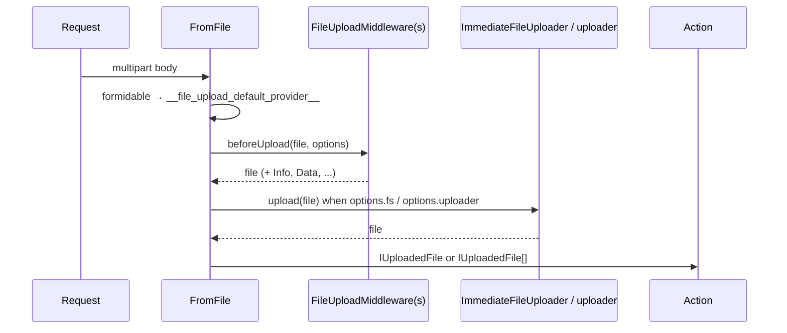

# File uploads

Multipart requests are parsed with `formidable` into a local temporary directory. `@File()` and `@Files()` hand the action `IUploadedFile` objects, after [upload middlewares](09-upload-middlewares-and-uploaders.md) have inspected or transformed them and, when asked, after the files were copied to a target file provider. `@CsvFile()` and `@JsonFile()` parse an uploaded file into data; `@Form()` and `@FormField()` read the text fields of the same request.

## How it works

`@File(options)` on a parameter, per request:

1. **Parse once.** `FromFile` has `Priority` 9999, so it runs before every other argument. `FromFormBase.extract()` checks that the `__file_upload_default_provider__` file provider exists, is an `fsNative` provider and has a `basePath`; otherwise it throws `IOFail`.
2. It parses the request with `formidable.IncomingForm`, using the parameter options plus `uploadDir` = that `basePath`. The parsed fields and files go into `IRouteCall.Payload.Form`, so later form arguments of the same request reuse them.
   - formidable error code 1009 (file too large) throws `EntityTooLargeException` (413);
   - any other parse error throws `Exception` (500).
3. It takes the files of the form field named like the parameter. With `required: true` and no file, it throws `ValidationFailed` (400).
4. It builds one `IUploadedFile` per file: `Size`, `Name` (client file name), `BaseName` (temporary file name), `Type` (MIME type sent by the client), `LastModifiedDate`, `Hash`, `OriginalFile` (the formidable file), and `Provider` = the file provider named in `options.fs`, or the default upload provider.
5. **Middlewares.** It resolves the middlewares from `http.upload.middlewares` followed by `options.middlewares` and calls `beforeUpload(file, options)` on each file, middleware by middleware. The returned fields are merged into the file.
6. **Copy.** When `options.fs` names another provider than the default upload provider, `ImmediateFileUploader` copies each file there and deletes the temporary copy.
7. **Uploader.** When `options.uploader` is set, that `FormFileUploader` uploads each file as well.
8. Any failure in steps 5 to 7 deletes the temporary files and rethrows. Several failed uploads are reported together as one `IOFail`.
9. The action receives an array when the parameter is typed as an array or declared with `@Files()`, otherwise the first file.



### `@CsvFile()`

1. Parses the form as above, takes the first file of the field, or throws `BadRequest('Missing csv file')`.
2. Streams it through `csv-parse` with the decorator options (minus `Schema` and `DeleteFile`). A parse error throws `BadRequest`.
3. Deletes the file when `DeleteFile` is `true`.
4. Validates every row against `Schema` (from the options) and collects all failures into one `ValidationFailed`, with paths like `[3]/email`.
5. Builds each row with `tryHydrateParam()` against the element type: `@Type(Array.ofType(Row))` or `@Type(Row)` gives `Row` instances; a hydrator on the type runs per row.

### `@FormField()` and `@Form()`

- `@FormField(schema?, options?)` reads the text field named like the parameter. A missing field throws `BadRequest`. One value is passed as is, unless the parameter is an array; the value is converted and validated like a query value.
- `@Form()` collects all text fields into one object with `qs`, so `address[city]` becomes `{ address: { city } }` and `tags[]` an array, then builds the parameter type from it.

## Decorators

| Decorator | Target | Options | Effect |
| --- | --- | --- | --- |
| `@File(options?)` | parameter | `IUploadOptions` | One uploaded file (or an array when the parameter type is an array). |
| `@Files(options?)` | parameter | `IUploadOptions` | Always an array, even for one file. |
| `@CsvFile(options?)` | parameter | `csv-parse` options, plus `Schema` (row JSON schema) and `DeleteFile` | Parsed, validated and hydrated rows. |
| `@JsonFile(options?)` | parameter | `IUploadOptions`, plus `encoding` and `DeleteFile` | Intended: the parsed content of an uploaded JSON file. **No handler resolves for it** (see Important behaviour). |
| `@FormField(schema?, options?)` | parameter | JSON schema; formidable options | One text field. |
| `@Form(options?)` | parameter | see Important behaviour | All text fields as one object of the parameter type. |

### `IUploadOptions`

| Option | Type | Default | Meaning |
| --- | --- | --- | --- |
| `required` | `boolean` | `false` | No file → `ValidationFailed` (400). |
| `maxFileSize` | `number` | formidable: 200 MB | Bytes; larger → `EntityTooLargeException` (413). |
| `minFileSize` | `number` | formidable: 1 | Bytes. |
| `keepExtensions` | `boolean` | `false` | Keep the extension in the temporary name. |
| `hashAlgorithm` | `false \| 'sha1' \| 'md5' \| 'sha256'` | `false` | Fills `Hash`. |
| `encoding` | `string` | `'utf-8'` | Field encoding. |
| `multiples` | `boolean` | formidable default | Passed to formidable. |
| `enabledPlugins` | `string[]` | formidable default | Passed to formidable. |
| `fs` | `string` | `'__file_upload_default_provider__'` | File provider the files end up in; another name triggers the copy in step 6. |
| `uploader` | `string \| Class<FormFileUploader> \| { service, options }` | none | Extra uploader; see [Upload middlewares and uploaders](09-upload-middlewares-and-uploaders.md). |
| `middlewares` | `UploadFileMiddlewareDescriptor[]` | none | Added after `http.upload.middlewares`. |
| `fileInfo` | `boolean` | `false` | Lets `FileInfoMiddleware` fill `Info` (MIME type from content, dimensions, ...). |

All options are passed to `formidable` as well.

### `IUploadedFile`

| Field | Meaning |
| --- | --- |
| `Size` | Size in bytes. |
| `Name` | File name sent by the client. Untrusted. |
| `BaseName` | File name inside `Provider`. |
| `Type` | MIME type sent by the client. Untrusted; use `Info.MimeType` for the content-detected one. |
| `LastModifiedDate`, `Hash` | From formidable. |
| `Provider` | The `fs` provider holding the file, or `null` when an uploader moved it elsewhere. |
| `Info` | `IFileInfo` from `FileInfoService`, when `fileInfo` is set. |
| `Data` | Extra data a middleware attached, eg. the original name before zipping. |
| `OriginalFile` | The formidable `File`. |

## Configuration

| Key | Type | Default | Allowed values | Meaning |
| --- | --- | --- | --- | --- |
| `http.upload.middlewares` | `UploadFileMiddlewareDescriptor[]` | `['FileInfoMiddleware']` | names, classes or `{ service, options }` | Middlewares run for every `@File()`/`@Files()`, before the per-route ones. |
| `fs.providers` `__file_upload_default_provider__` | provider config | `fsNative` at `os.tmpdir()` | must be `fsNative` with `basePath` | Where formidable writes incoming files. |

```ts
import os from 'os';

export default {
  fs: {
    providers: [
      { service: 'fsNative', name: '__file_upload_default_provider__', basePath: os.tmpdir() },
      { service: 'fsNative', name: 'documents', basePath: '/var/app/documents' },
    ],
  },
  http: {
    upload: {
      middlewares: ['FileInfoMiddleware'],
    },
  },
};
```

## Services and extension points

| Service | DI token and lifetime | Default implementation | Alternatives | How to replace or extend |
| --- | --- | --- | --- | --- |
| `FromFile`, `FromCSV`, `FromFormField`, `FromForm`, `FromJsonFile` | Class names, `@Injectable()` + `@NewInstance()`; `FromFormBase` is their abstract base | | | Subclass and `DI.register(Mine).as(FromFile)`, as for any [route argument](05-custom-route-arguments.md#replacing-a-built-in-route-argument). |
| `FileUploadMiddleware` | Resolved by name or class from `http.upload.middlewares` and `options.middlewares` | `FileInfoMiddleware` | `FileValidationMiddleware`, `ZipFileTransformer`, `UnzipFileTransformer`, `AuthzUploadMiddleware` (`@spinajs/authz-fs`) | See [Upload middlewares and uploaders](09-upload-middlewares-and-uploaders.md). |
| `FormFileUploader` | Resolved from `options.uploader` | `ImmediateFileUploader` for `options.fs` | `HttpLazyFileUploader` (`@spinajs/http-lazy-file-uploader`) | See [Upload middlewares and uploaders](09-upload-middlewares-and-uploaders.md). |
| `__file_upload_default_provider__` | `fs` provider by name | `fsNative` at `os.tmpdir()` | any `fsNative` | Redefine the provider in `fs.providers`. |

## Important behaviour

- Temporary files stay in the upload directory after a **successful** request unless an uploader or `options.fs` moved them. Delete or move what you keep, or clean the directory periodically.
- `Name` and `Type` come from the client. Validate the content with `FileValidationMiddleware` and `Info`, not with `Type`.
- `@JsonFile()` records `ParameterType.FromJSONFile` (`'FromJSONFile'`), but its handler class is named `FromJsonFile`, so the argument fails with `UnexpectedServerError` (500). Register the alias before the first request: `DI.register(FromJsonFile).as('FromJSONFile')`.
- `@Form(options)` passes its options as the **schema** of the parameter, not as formidable options: an options object becomes a JSON schema for the form data. Call `@Form()` without arguments and put formidable options on the `@File()` of the same route.
- A route mixing `@Param()` or `@Query()` with several form arguments can lose the shared parsed form: those handlers replace `IRouteCall.Payload`. A later form handler then parses the already-read request body again.
- `@CsvFile()` takes `csv-parse` options typed as `CsvParseOptions`; pass `Schema` and `DeleteFile` in a variable, not an object literal, to get past the excess-property check.
- The upload provider must be local (`fsNative`): formidable writes to disk before anything else runs.

## Best practices

- Set `maxFileSize` on every `@File()`; the formidable default is 200 MB.
- Add `FileValidationMiddleware` with `types` and `size` rules to every public upload route.
- Use `options.fs` to land files in their final provider; use an uploader such as `HttpLazyFileUploader` for slow remote storage.
- Set `DeleteFile: true` on `@CsvFile()` unless you need the file afterwards.

## Patterns and antipatterns

```ts
// Don't: trust the client's MIME type and name.
@Post('avatar')
public avatar(@File() file: IUploadedFile) {
  if (file.Type !== 'image/png') throw new BadRequest('png only');
  return new Ok({ path: `/avatars/${file.Name}` });
}

// Do: detect the type from the content and keep the generated name.
@Post('avatar')
public avatar(@File({ maxFileSize: 2_000_000, middlewares: [{ service: FileValidationMiddleware, options: { types: [FileTypeEnum.png] } }] }) file: IUploadedFile) {
  return new Ok({ path: `/avatars/${file.BaseName}` });
}
```

## Examples

### Import contacts from a CSV file

```ts sample
import { Schema } from '@spinajs/validation';
import { BaseController, BasePath, CsvFile, Ok, Post, Type } from '@spinajs/http';

const CONTACT_ROW = {
  type: 'object',
  properties: {
    email: { type: 'string', format: 'email' },
    name: { type: 'string', minLength: 1 },
  },
  required: ['email', 'name'],
};

@Schema(CONTACT_ROW)
export class ContactRow {
  public email: string;
  public name: string;

  constructor(data: Partial<ContactRow>) {
    Object.assign(this, data);
  }
}

// In a variable: Schema and DeleteFile are not csv-parse options.
const CSV_OPTIONS = { delimiter: ';', columns: ['email', 'name'], from: 2, DeleteFile: true };

@BasePath('contacts')
export class ContactsImportController extends BaseController {
  /** POST /contacts/import  multipart, field "contacts" = contacts.csv */
  @Post('import')
  public import(@CsvFile(CSV_OPTIONS) @Type(Array.ofType(ContactRow)) contacts: ContactRow[]) {
    return new Ok({ imported: contacts.length });
  }
}
```

### Store signed contracts in a documents provider

```ts sample
import { BaseController, BasePath, File, FileTypeEnum, FileValidationMiddleware, FormField, IUploadedFile, Ok, Post } from '@spinajs/http';

@BasePath('contracts')
export class ContractsController extends BaseController {
  /** POST /contracts  multipart: "customer" = text, "contract" = PDF up to 10 MB */
  @Post('/')
  public upload(
    @File({
      required: true,
      maxFileSize: 10 * 1024 * 1024,
      fs: 'documents',
      middlewares: [{ service: FileValidationMiddleware, options: { types: [FileTypeEnum.pdf] } }],
    })
    contract: IUploadedFile,
    @FormField() customer: string,
  ) {
    return new Ok({ customer, stored: contract.BaseName, bytes: contract.Size });
  }
}
```

## Related

- [Upload middlewares and uploaders](09-upload-middlewares-and-uploaders.md): `FileUploadMiddleware` and `FormFileUploader`.
- [Route arguments](04-route-arguments.md): conversion and validation of `@FormField()` and `@Form()`.
- [`@spinajs/fs`](../fs/README.md): file providers, `FileInfoService`.
- [`@spinajs/http-lazy-file-uploader`](../http-lazy-file-uploader/README.md): background uploads.
- [`@spinajs/configuration-http`](../configuration-http/README.md): its own file upload page shows these decorators in a configuration API.
