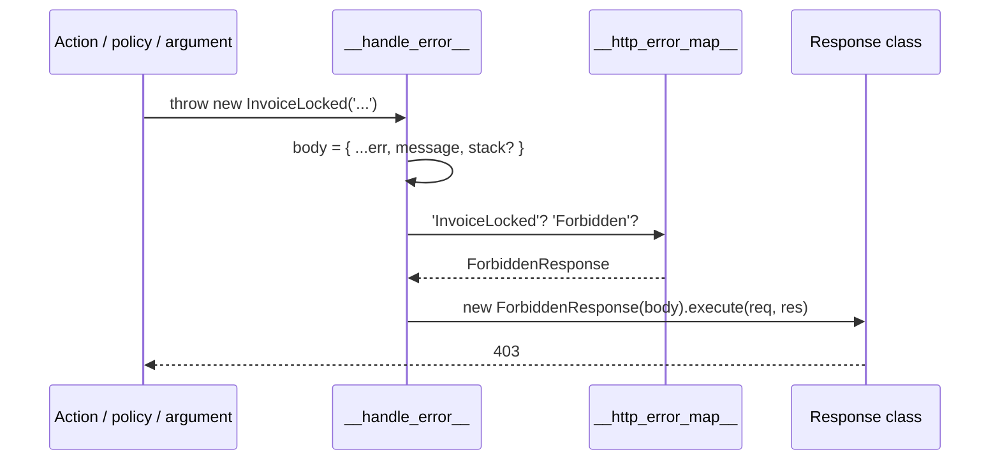

# Error handling

Any exception thrown in a policy, middleware, route argument, action or response ends in one handler that picks a `Response` class for it from the error map and answers with that class's status. Map your own exceptions with `@HandleException`, or subclass a mapped exception and inherit its status. Requests that match no route get a 404 the same way.

The exception side of this mapping, with the full list of mapped exceptions, is on [HTTP error mapping](../exceptions/03-http-error-mapping.md) in `@spinajs/exceptions`.

## How it works

Errors reach the handler from two places:

- **Matched routes.** Every route's handler chain ends with `__handle_error__()`, an Express error handler created when the controller builds its router. Policy rejections, argument errors, action errors and `execute()` errors land here.
- **Everything else.** `NotFoundMiddleware.after()` turns an unmatched request into `ResourceNotFound`; `ErrorHandlerMiddleware.after()`, last in the Express stack, runs `__handle_error__()` for it and for errors from server middlewares.

`__handle_error__()` reads, once when it is created: the `'__http_error_map__'` map, `configuration.isProduction`, `http.AcceptHeaders` and `http.FatalTemplate`. Per error:

1. **Body-parser failures.** Invalid JSON answers 400 with `request body is not valid JSON`. A `verify` hook failure answers with the response mapped for the thrown class, or 400 `request body was refused` when it is not mapped. Both log at `warn` and never echo the request body.
2. **Error body.** `{ ...err, message: err.message }`: the exception's own enumerable fields plus its message; a body-parser `body` field is removed. Outside production, `stack` is added.
3. It logs the error at `error` with method and URL; query values in the URL are replaced by `[redacted]`.
4. **Lookup.** It walks from the exception's class up its prototype chain and takes the first class **name** found in the map. No match: it logs a warning and uses `ServerError` (500).
5. It runs `new ResponseClass(body).execute(req, res)`: JSON, HTML or XML by [content negotiation](10-responses.md#content-negotiation).
6. **Last resort.** When that fails, it logs at `fatal`, answers 500 with `http.FatalTemplate` (HTML clients, when HTML is enabled) or the JSON error body.



## Decorators

| Decorator | Target | Options | Effect |
| --- | --- | --- | --- |
| `@HandleException(exception)` | class (a `Response` subclass) | one exception class or an array | For each class: `DI.register(target).asMapValue('__http_error_map__', exception.name)`. |

## Configuration

| Key | Type | Default | Allowed values | Meaning |
| --- | --- | --- | --- | --- |
| `configuration.isProduction` | `boolean` | `false` | | `true` leaves `stack` out of error bodies. |
| `http.AcceptHeaders` | `HttpAcceptHeaders` | `1 \| 2` | | Formats the error response may use; HTML enables the fatal template. |
| `http.FatalTemplate` | `string` | built-in page | HTML with `{ticket}` | Last-resort page. |

## Services and extension points

| Service | DI token and lifetime | Default implementation | Alternatives | How to replace or extend |
| --- | --- | --- | --- | --- |
| Error map | String token `'__http_error_map__'`, a `Map<string, Constructor<Response>>` filled with `asMapValue`, read with `DI.get` | entries from the response classes (see [Responses](10-responses.md#response-classes)) | `OrmNotFound` maps `OrmNotFoundException` (`@spinajs/orm-http`) | `@HandleException` on your response class. Re-registering a name replaces its entry. Register before `Controllers` resolves. |
| `NotFoundMiddleware` | `ServerMiddleware` list, `Order` `Number.MIN_SAFE_INTEGER` | `NotFoundMiddleware` | | `DI.register(Mine).as(NotFoundMiddleware)` before `HttpServer` resolves; see [Server middlewares](15-server-middlewares.md). |
| `ErrorHandlerMiddleware` | `ServerMiddleware` list, `Order` `Number.MIN_SAFE_INTEGER - 1` | `ErrorHandlerMiddleware` | | `DI.register(Mine).as(ErrorHandlerMiddleware)`; `after()` must return a 4-argument Express error handler. |

### Error map: custom implementation

Two ways to give an exception a status:

- **Subclass a mapped exception.** `class InvoiceLocked extends Forbidden {}` answers 403 with no registration; the lookup walks the prototype chain.
- **Map a new exception.** Write a response class with the status and decorate it with `@HandleException`.

```ts sample
import { Exception, Forbidden } from '@spinajs/exceptions';
import { BaseController, BasePath, HandleException, IResponseOptions, Param, Post, Response } from '@spinajs/http';

/** Domain refusal: answers 403 through the Forbidden mapping, no registration needed. */
export class InvoiceLocked extends Forbidden {}

/** A new status: 402 for an expired subscription. */
export class SubscriptionExpired extends Exception {
  constructor(message: string, public readonly renewUrl: string) {
    super(message);
  }
}

@HandleException(SubscriptionExpired)
export class PaymentRequired<T = any> extends Response<T> {
  protected _errorCode = 402;
  protected _template = 'badRequest.pug';

  constructor(data: T, options?: IResponseOptions) {
    super(data, options);
  }
}

@BasePath('invoices')
export class InvoiceActionsController extends BaseController {
  @Post(':id/lock')
  public lock(@Param() id: number) {
    throw new InvoiceLocked(`invoice ${id} is already sent`);
  }

  @Post(':id/export')
  public export(@Param() _id: number) {
    // Body: { "message": "...", "renewUrl": "/billing", "stack"?: "..." }, status 402.
    throw new SubscriptionExpired('exports need an active plan', '/billing');
  }
}
```

The exception's public fields (`renewUrl` above) are copied into the error body, so the client can act on them.

## Important behaviour

- Lookup is by class **name**. Two exception classes with the same name share one mapping.
- An exact registration wins over an inherited one, because the walk starts at the concrete class.
- Every own enumerable field of the exception goes into the body. Do not put secrets, SQL or tokens on exceptions.
- Unmapped errors (a plain `Error`, a `TypeError`) answer 500 and log `Error type X dont have assigned http response`.
- Outside production the body carries `stack`. Set `configuration.isProduction` in production.
- The map and the configuration are read when each handler is created (controller startup and `HttpServer.start()`). Register mappings before that.
- A request to an unknown path answers 404 with `Route not found: <METHOD> <path>`.
- The error map lives in the DI cache, not in the registry: `DI.clearCache()` (eg. in a test suite) empties it, and every error then answers 500. Uncache only the types you registered.

## Best practices

- Model refusals as exception subclasses of `BadRequest`, `Forbidden`, `ResourceNotFound`, `ResourceDuplicated`; the status follows with no HTTP code in the service layer.
- Keep the HTTP mapping in the HTTP layer: put `@HandleException` on a response class in your HTTP package, not on the exception.
- Use one response class per status, mapped to many exceptions with an array.

## Patterns and antipatterns

```ts
// Don't: catch and convert in every action.
@Post(':id/lock')
public async lock(@Param() id: number) {
  try {
    await this.invoices.lock(id);
    return new Ok();
  } catch (err) {
    return new ForbiddenResponse({ message: (err as Error).message });
  }
}

// Do: let the mapped exception reach the error handler.
@Post(':id/lock')
public async lock(@Param() id: number) {
  await this.invoices.lock(id); // throws InvoiceLocked extends Forbidden
  return new Ok();
}
```

## Examples

### Map several infrastructure errors to 503

```ts sample
import { Exception } from '@spinajs/exceptions';
import { HandleException, IResponseOptions, Response } from '@spinajs/http';

export class DatabaseUnavailable extends Exception {}
export class QueueUnavailable extends Exception {}

@HandleException([DatabaseUnavailable, QueueUnavailable])
export class Unavailable<T = any> extends Response<T> {
  protected _errorCode = 503;
  protected _template = 'serverError.pug';

  constructor(data: T, options?: IResponseOptions) {
    super(data, { ...options, Headers: [...(options?.Headers ?? []), { Name: 'Retry-After', Value: '30' }] });
  }
}
```

## Related

- [HTTP error mapping](../exceptions/03-http-error-mapping.md): the exception side, every default entry.
- [Responses](10-responses.md): the response classes and content negotiation.
- [Data transformers](12-data-transformers.md): reshape error bodies with `x-error-transform`.
- [Server middlewares](15-server-middlewares.md): where `NotFoundMiddleware` and `ErrorHandlerMiddleware` sit.
