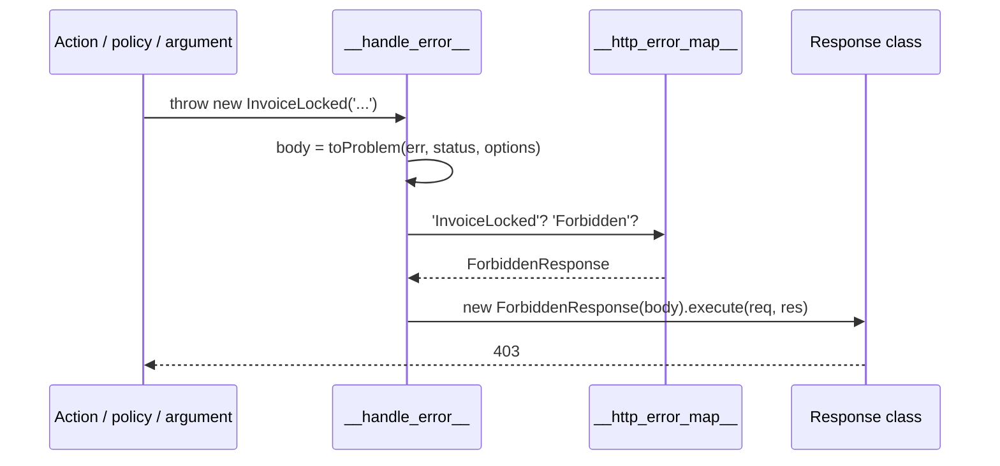

# Error handling

Any exception thrown in a policy, middleware, route argument, action or response ends in one handler that picks a `Response` class for it from the error map and answers with that class's status. Map your own exceptions with `@HandleException`, or subclass a mapped exception and inherit its status. Requests that match no route get a 404 the same way.

The exception side of this mapping, with the full list of mapped exceptions, is on [HTTP error mapping](../exceptions/03-http-error-mapping.md) in `@spinajs/exceptions`.

A route or controller can handle its own errors first with [`@OnError`](#route-error-handlers): answer them, replace them, or only observe them.

An API whose clients branch on a stable error code throws a [`CodedHttpException`](#coded-errors): it carries its own status and code, and answers a problem document with its `code` and `details?`.

## How it works

Errors reach the handler from two places:

- **Matched routes.** Every route's handler chain ends with the [route error handlers](#route-error-handlers), then `__handle_response__()`, then `__handle_error__()`, an Express error handler created when the controller builds its router. Policy rejections, argument errors, action errors and `execute()` errors land here.
- **Everything else.** `NotFoundMiddleware.after()` turns an unmatched request into `ResourceNotFound`; `ErrorHandlerMiddleware.after()`, last in the Express stack, runs `__handle_error__()` for it and for errors from server middlewares.

`__handle_error__()` reads, once when it is created: the `'__http_error_map__'` map, `configuration.isProduction`, `http.AcceptHeaders` and `http.FatalTemplate`. Per error:

1. **Body-parser failures.** Invalid JSON answers 400 with `request body is not valid JSON`. A `verify` hook failure answers with the response mapped for the thrown class, or 400 `request body was refused` when it is not mapped. Both log at `warn` and never echo the request body.
2. **Error body.** A [problem document](#problem-bodies) (`application/problem+json`): `type`, `title`, `status`, `detail` (the message), `instance`, and `code` or `errors` when the exception has them. Other fields of the exception are dropped unless listed in `http.errors.includeFields`. `stack` is added only when `http.errors.includeStack` is true outside production.
3. It logs the error at `error` with method and URL; query values in the URL are replaced by `[redacted]`.
4. **Lookup.** It walks from the exception's class up its prototype chain and takes the first class **name** found in the map. No match: it logs a warning and uses `ServerError` (500).
5. It runs `new ResponseClass(body).execute(req, res)`: JSON, HTML or XML by [content negotiation](10-responses.md#content-negotiation).
6. **Last resort.** When that fails, it logs at `fatal`, answers 500 with `http.FatalTemplate` (HTML clients, when HTML is enabled) or the JSON error body.



## Decorators

| Decorator | Target | Options | Effect |
| --- | --- | --- | --- |
| `@HandleException(exception)` | class (a `Response` subclass) | one exception class or an array | For each class: `DI.register(target).asMapValue('__http_error_map__', exception.name)`. |
| `@OnError(on, handler, options?)` | controller class or action method | `on`: an error class or an array; `handler(err, ctx)`; `{ stages?: ErrorStage[] }` | Adds a route error handler; see [Route error handlers](#route-error-handlers). Stackable. |

## Configuration

| Key | Type | Default | Allowed values | Meaning |
| --- | --- | --- | --- | --- |
| `configuration.isProduction` | `boolean` | `false` | | `true` leaves `stack` out of error bodies, whatever `http.errors.includeStack` says. |
| `http.errors.includeStack` | `boolean` | `false` | | Adds the exception `stack` to error bodies outside production. |
| `http.errors.includeFields` | `string[]` | `[]` | own enumerable exception property names | Copied into the problem body as extension members. Names the body already defines are ignored. |
| `http.AcceptHeaders` | `HttpAcceptHeaders` | `1 \| 2` | | Formats the error response may use; HTML enables the fatal template. |
| `http.FatalTemplate` | `string` | built-in page | HTML with `{ticket}` | Last-resort page. |
| `http.errors.handlers` | `{ service: string }[]` | `[]` | names of registered `ErrorHandlerService` classes | App-wide route error handlers, run after the route and controller `@OnError` handlers, in this order. |

## Services and extension points

| Service | DI token and lifetime | Default implementation | Alternatives | How to replace or extend |
| --- | --- | --- | --- | --- |
| Error map | String token `'__http_error_map__'`, a `Map<string, Constructor<Response>>` filled with `asMapValue`, read with `DI.get` | entries from the response classes (see [Responses](10-responses.md#response-classes)) | `OrmNotFound` maps `OrmNotFoundException` (`@spinajs/orm-http`) | `@HandleException` on your response class. Re-registering a name replaces its entry. Register before `Controllers` resolves. |
| `NotFoundMiddleware` | `ServerMiddleware` list, `Order` `Number.MIN_SAFE_INTEGER` | `NotFoundMiddleware` | | `DI.register(Mine).as(NotFoundMiddleware)` before `HttpServer` resolves; see [Server middlewares](15-server-middlewares.md). |
| `ErrorHandlerMiddleware` | `ServerMiddleware` list, `Order` `Number.MIN_SAFE_INTEGER - 1` | `ErrorHandlerMiddleware` | | `DI.register(Mine).as(ErrorHandlerMiddleware)`; `after()` must return a 4-argument Express error handler. |
| `ErrorHandlerService` | Abstract class, resolved by class name from `http.errors.handlers` when each controller builds its router | none | | Extend it, register it as `ErrorHandlerService`, list it in `http.errors.handlers`; see [App-wide handlers](#app-wide-handlers). |

The building blocks of the route error handlers are exported for custom route chains and error handlers (a custom controller base, a test, an `@OnError` handler):

| Export | What it does |
| --- | --- |
| `markStage(res, stage)` | Records the `ErrorStage` the chain is in on `res.locals`; the policy gate, middleware wrappers and action handler call it. A `res` without `locals` is ignored. |
| `stageOf(res)` | The stage last recorded on `res`; `'action'` when none was. |
| `createOnErrorHandler(descriptors, route, controller, container, log)` | The Express error handler that runs the descriptors in order, as described in [Order](#order). With no descriptors, or once headers are sent, it passes the error on. |
| `resolveConfigErrorHandlers(cfg, container)` | Resolves the `http.errors.handlers` entries into descriptors, in config order; `[]` when the list is empty. Throws `InvalidOption` for a name no registered `ErrorHandlerService` has. |
| `toErrorDescriptor(service)` | Turns an `ErrorHandlerService` into an `IOnErrorDescriptor` (`On`, `Handler`, `Stages`). |
| `answeredAsServerError(err)` | `true` when the error handler answers `err` with the generic 500: no response is mapped for its class chain, or the mapped one is `ServerError` or a subclass. Such a body carries the error's message, which can reveal internals. A body-parser failure that answers 400 gives `false`. Use it in an `@OnError` handler to replace the body of an unexpected error. |

### Error map: custom implementation

Two ways to give an exception a status:

- **Subclass a mapped exception.** `class InvoiceLocked extends Forbidden {}` answers 403 with no registration; the lookup walks the prototype chain.
- **Map a new exception.** Write a response class with the status and decorate it with `@HandleException`.

```ts sample
import { Exception, Forbidden } from '@spinajs/exceptions';
import { BaseController, BasePath, HandleException, IResponseOptions, Param, Post, Response } from '@spinajs/http';

/** Domain refusal: answers 403 through the Forbidden mapping, no registration needed. */
export class InvoiceLocked extends Forbidden {}

/** A new status: 402 for an expired subscription. */
export class SubscriptionExpired extends Exception {
  constructor(message: string, public readonly renewUrl: string) {
    super(message);
  }
}

@HandleException(SubscriptionExpired)
export class PaymentRequired<T = any> extends Response<T> {
  protected _errorCode = 402;
  protected _template = 'badRequest.pug';

  constructor(data: T, options?: IResponseOptions) {
    super(data, options);
  }
}

@BasePath('invoices')
export class InvoiceActionsController extends BaseController {
  @Post(':id/lock')
  public lock(@Param() id: number) {
    throw new InvoiceLocked(`invoice ${id} is already sent`);
  }

  @Post(':id/export')
  public export(@Param() _id: number) {
    // Body: { "type": "about:blank", "title": "Subscription Expired", "status": 402, "detail": "...", "renewUrl": "/billing" }
    // renewUrl is there only when http.errors.includeFields lists it.
    throw new SubscriptionExpired('exports need an active plan', '/billing');
  }
}
```

List the exception's public fields the client needs (`renewUrl` above) in `http.errors.includeFields`; no other field reaches the body.

## Problem bodies

Every error answers `Content-Type: application/problem+json` (RFC 9457) when the client takes JSON:

```json
{ "type": "about:blank", "title": "Validation Failed", "status": 400, "detail": "...", "instance": "/orders", "errors": [] }
```

| Member | Source |
| --- | --- |
| `type` | static `problemType` on the exception class, else `about:blank` |
| `title` | the exception class name in words |
| `status` | the mapped response's status |
| `detail` | `err.message` |
| `instance` | the request URL, query secrets redacted |
| `code` | `err.code` when it is a string |
| `errors` | the Ajv errors of `ValidationFailed` |

`ProblemDetails`, `toProblem` and the JSON Schema `PROBLEM_DETAILS_SCHEMA` are exported from `@spinajs/http`. HTML clients still get the mapped template, which shows `detail`.

## Coded errors

`CodedHttpException` is a refusal with its own HTTP status and a stable, machine-readable code. It is defined in `@spinajs/exceptions` and re-exported by `@spinajs/http`, so a package with no HTTP layer can throw it. `CodedHttpExceptionResponse` is mapped to it with `@HandleException` when `@spinajs/http` loads, so every subclass answers the same way. `UploadError` of `@spinajs/upload` is one.

`new CodedHttpException<TCode, TDetails>(status, code, message?, details?, inner?)`:

| Parameter | Type | Default | Meaning |
| --- | --- | --- | --- |
| `status` | `number` | | An integer from 400 to 599. Anything else throws `UnexpectedServerError`, which answers 500: the status is the server's mistake, not the client's. |
| `code` | `TCode extends string` | | Stable code the client branches on, such as `invoice.locked`. |
| `message` | `string` | `code` | Text for people. |
| `details` | `TDetails` (default `unknown`) | | Data the client acts on, such as the parts to resend. Sent as `details`. Plain JSON data only, see below. |
| `inner` | `unknown` | | The cause. Kept as `inner` and `cause`, never sent. |

`status`, `code` and `details` are own enumerable fields; `name`, `inner` and `cause` are not.

`CodedHttpExceptionResponse` answers:

1. The status: `IResponseOptions.StatusCode` when given, else the exception's `status`, else 500.
2. The body, a problem document: `status`, `code`, `detail` (the message), plus `details` when the exception has them. No other field of the exception, and no `stack`, whatever `http.errors.includeStack` says.
3. Always JSON through `jsonResponse`: no `Accept` negotiation, no `x-error-transform` transformer. A browser asking for HTML gets the same JSON.

`details` goes through `res.json()`, so it must survive `JSON.stringify`: no cycles, no `BigInt`. When it does not, the coded answer fails and one of the error handler's fallbacks answers 500 instead, which is not the coded body and, outside production, can carry a `stack`.

```json
{ "type": "about:blank", "title": "Coded Http Exception", "status": 409, "detail": "The invoice is sent and cannot change", "instance": "/invoices/42/lock", "code": "invoice.locked", "details": { "invoice": "2026-0042" } }
```

Narrow the code with one subclass per app. It inherits the mapping, because the lookup walks the prototype chain:

```ts sample
import { BaseController, BasePath, CodedHttpException, Get, OnError, Ok, Param } from '@spinajs/http';

type ApiErrorCode = 'input.invalid' | 'invoice.locked' | 'invoice.missing' | 'storage.unavailable';

/** Every refusal of the API; a code outside ApiErrorCode does not compile. */
export class ApiException extends CodedHttpException<ApiErrorCode> {}

class InvoiceLockedError extends Error {}

@BasePath('invoices')
// A domain error of any route of this controller becomes a coded 409.
@OnError(InvoiceLockedError, (err) => new ApiException(409, 'invoice.locked', err.message))
export class InvoicesController extends BaseController {
  @Get(':number')
  public read(@Param() number: string) {
    if (!/^\d{4}-\d{4}$/.test(number)) {
      // 400 problem: code "input.invalid", detail "An invoice number is YYYY-NNNN"
      throw new ApiException(400, 'input.invalid', 'An invoice number is YYYY-NNNN');
    }
    if (number.endsWith('0000')) {
      throw new InvoiceLockedError(`invoice ${number} is sent and cannot change`);
    }
    return new Ok({ number });
  }
}
```

An `@OnError` handler can also return `new CodedHttpExceptionResponse(exception)` to answer at once, without the later handlers and the error map.

## Route error handlers

`@OnError(on, handler, { stages? })` lets a controller answer, replace or observe an error of its own route chain before the error map sees it. Use it when one route must answer differently from the global mapping, for example a login that answers invalid input with the same 401 as a wrong password.

| Part | Meaning |
| --- | --- |
| `on` | One error class or an array of classes. The handler runs only when the error is an `instanceof` one of them. `Error` catches everything. |
| `handler` | `(err, ctx: ErrorContext) => Error \| Response \| void`, sync or async. |
| `stages` | Optional `ErrorStage[]`: `'policy'`, `'middleware'` (route middleware `onBefore`), `'arguments'` (input filters, required check, conversion, validation, hydration), `'action'` (the action and `onResponse`), `'after'` (route middleware `onAfter`). Omitted: every stage. |

What the handler returns decides what happens next:

| Return | Effect |
| --- | --- |
| an `Error` | It replaces the error. Later handlers match their `on` against the new error; the global handler answers what is left. |
| a `Response` | The error is swallowed and this response is the answer. `onAfter` and `onResponse` do not run, as for any error answer. |
| nothing | The handler did something else (log, audit, metrics) and the error continues unchanged. |

`ErrorContext` carries `req`, `res`, `route`, `controller`, `stage` and `container` (the controller's DI container).

### Order

Several `@OnError` may sit on one action and on the controller class. For each error, in this order:

1. the route's handlers, top to bottom as declared;
2. the controller's handlers, top to bottom;
3. the app-wide handlers from `http.errors.handlers`, in config order.

Every handler whose `on` and `stages` match runs. The first `Response` stops the chain. A handler that throws is logged at `error` and the **original** error goes to `__handle_error__()`. A route with no handler at any level behaves exactly as before.

`@OnError` sees only errors of the route chain. Errors raised before routing (body parsers and body limits, CORS, throttling, the same-origin guard, authentication middlewares) stay with `ErrorHandlerMiddleware`.

```ts sample
import { InvalidArgument } from '@spinajs/exceptions';
import { BaseController, BasePath, Body, OnError, Ok, Post, Unauthorized } from '@spinajs/http';
import { Schema, ValidationFailed } from '@spinajs/validation';

@Schema({
  $id: 'app.LoginBody',
  type: 'object',
  required: ['login', 'password'],
  additionalProperties: false,
  properties: { login: { type: 'string', minLength: 1, maxLength: 254 }, password: { type: 'string', minLength: 1, maxLength: 1024 } },
})
export class LoginBody {
  public login!: string;
  public password!: string;

  constructor(data: object) {
    Object.assign(this, data);
  }
}

const NO_STORE = { Name: 'Cache-Control', Value: 'no-store' };

@BasePath('session')
export class SessionController extends BaseController {
  @Post('login')
  // Invalid input answers like a wrong password, so the body shape reveals nothing.
  @OnError([ValidationFailed, InvalidArgument], () => new Unauthorized({ error: 'invalid_credentials' }, { Headers: [NO_STORE] }), { stages: ['arguments'] })
  // Observe and let the error continue.
  @OnError(Error, (err, ctx) => {
    console.warn(`login failed at ${ctx.stage}: ${err.name}`);
  })
  public login(@Body() body: LoginBody) {
    return new Ok({ login: body.login });
  }
}
```

### App-wide handlers

Extend `ErrorHandlerService`, register the class, and list it in `http.errors.handlers`. Each entry is `{ service: '<class name>' }`; the whole entry is passed to the service as its options. The service has the same contract as a decorator handler: `on`, optional `stages` and `handle(err, ctx)`.

```ts sample
import { Injectable } from '@spinajs/di';
import { InvalidArgument } from '@spinajs/exceptions';
import { ErrorContext, ErrorHandlerService, ErrorStage } from '@spinajs/http';

@Injectable(ErrorHandlerService)
export class CountInvalidInput extends ErrorHandlerService {
  public readonly on = InvalidArgument;
  public readonly stages: readonly ErrorStage[] = ['arguments'];
  public count = 0;

  public handle(_err: Error, _ctx: ErrorContext): void {
    this.count++;
  }
}

// config: { http: { errors: { handlers: [{ service: 'CountInvalidInput' }] } } }
```

A name in `http.errors.handlers` that no registered `ErrorHandlerService` has fails every controller at startup with `InvalidOption`.

## Important behaviour

- Lookup is by class **name**. Two exception classes with the same name share one mapping.
- An exact registration wins over an inherited one, because the walk starts at the concrete class.
- Only the problem members and the fields listed in `http.errors.includeFields` go into the body. Do not list fields that hold secrets, SQL or tokens.
- Unmapped errors (a plain `Error`, a `TypeError`) answer 500 and log `Error type X dont have assigned http response`.
- The body carries `stack` only when `http.errors.includeStack` is true and `configuration.isProduction` is not.
- The map and the configuration are read when each handler is created (controller startup and `HttpServer.start()`). Register mappings before that.
- A request to an unknown path answers 404 with `Route not found: <METHOD> <path>`.
- The error map lives in the DI cache, not in the registry: `DI.clearCache()` (eg. in a test suite) empties it, and every error then answers 500. Uncache only the types you registered.

## Best practices

- Model refusals as exception subclasses of `BadRequest`, `Forbidden`, `ResourceNotFound`, `ResourceDuplicated`; the status follows with no HTTP code in the service layer.
- Keep the HTTP mapping in the HTTP layer: put `@HandleException` on a response class in your HTTP package, not on the exception.
- Use one response class per status, mapped to many exceptions with an array.
- For an API with error codes, subclass `CodedHttpException` once with the app's code union, and map domain errors to it in `@OnError` at the controller.

## Patterns and antipatterns

```ts
// Don't: catch and convert in every action.
@Post(':id/lock')
public async lock(@Param() id: number) {
  try {
    await this.invoices.lock(id);
    return new Ok();
  } catch (err) {
    return new ForbiddenResponse({ message: (err as Error).message });
  }
}

// Do: let the mapped exception reach the error handler.
@Post(':id/lock')
public async lock(@Param() id: number) {
  await this.invoices.lock(id); // throws InvoiceLocked extends Forbidden
  return new Ok();
}
```

## Examples

### Map several infrastructure errors to 503

```ts sample
import { Exception } from '@spinajs/exceptions';
import { HandleException, IResponseOptions, Response } from '@spinajs/http';

export class DatabaseUnavailable extends Exception {}
export class QueueUnavailable extends Exception {}

@HandleException([DatabaseUnavailable, QueueUnavailable])
export class Unavailable<T = any> extends Response<T> {
  protected _errorCode = 503;
  protected _template = 'serverError.pug';

  constructor(data: T, options?: IResponseOptions) {
    super(data, { ...options, Headers: [...(options?.Headers ?? []), { Name: 'Retry-After', Value: '30' }] });
  }
}
```

## Related

- [HTTP error mapping](../exceptions/03-http-error-mapping.md): the exception side, every default entry.
- [Responses](10-responses.md): the response classes and content negotiation.
- [Data transformers](12-data-transformers.md): reshape error bodies with `x-error-transform`.
- [Server middlewares](15-server-middlewares.md): where `NotFoundMiddleware` and `ErrorHandlerMiddleware` sit.
