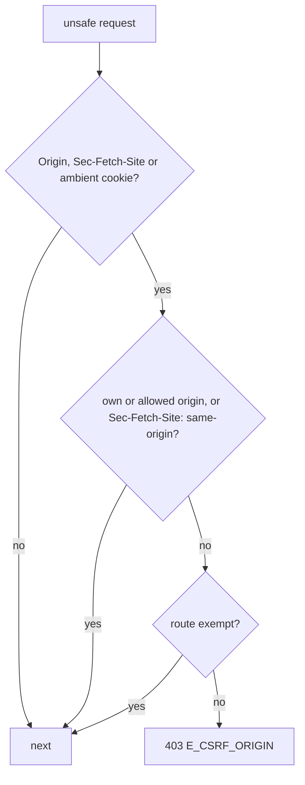

# CSRF guard

`CsrfGuard` protects every route against cross-site request forgery by `Origin` and Fetch Metadata, without tokens. It is default-deny: an unsafe request that a browser sends (it carries `Origin` or `Sec-Fetch-Site`) or that carries an ambient cookie must come from the app's own origin or a listed one, whatever route it targets. A new route is protected without anyone listing it. Server-to-server callbacks opt out with `@CsrfExempt()` or `http.csrf.exempt`. The guard is registered by `@spinajs/http` and is on by default.

## How it works

At startup (`CsrfGuard.before()`, Order 4, after `ThrottleMiddleware` and before any authentication middleware):

1. Normalises `http.csrf.allowedOrigins` with `parseAllowedOrigins()` and compiles `http.csrf.exempt`. A bad entry throws `InvalidOption` naming the key, even while the guard is off.
2. With `http.csrf.enabled: false` it adds no handler.
3. When a subclass of `CsrfGuard` is registered as a `ServerMiddleware` (as `@spinajs/authn-http` does), the plain guard adds no handler and the subclass does the work.

Per request:

1. `GET`, `HEAD` and `OPTIONS` pass.
2. A request with neither `Origin` nor `Sec-Fetch-Site` and none of the ambient cookies (`http.csrf.ambientCookies`) passes: it is a server, a CLI or a script, not a browser acting for a user.
3. Otherwise it is checked with `checkSameOrigin()` (see [Same-origin guard](22-same-origin-guard.md)):
   - `Origin` must be the serialized origin a browser sends (no other case, no trailing slash) and equal the own origin or an allowed one;
   - without `Origin`, only `Sec-Fetch-Site: same-origin` passes;
   - `Origin` wins over `Sec-Fetch-Site`.
4. A refused request whose route is exempt passes. Exemption is looked up only for refused requests.
5. Otherwise **403** `{ "error": { "code": "E_CSRF_ORIGIN", "message": "Cross-origin request refused" } }`.

The own origin is `requestOrigin(req, requestProxyTrust(req))`: the connection scheme and `Host`, or `X-Forwarded-Proto` and `X-Forwarded-Host` from a proxy trusted by `http.trustProxy`.



## Configuration

| Key | Type | Default | Allowed values | Meaning |
| --- | --- | --- | --- | --- |
| `http.csrf.enabled` | `boolean` | `true` | `true`, `false` | `false` turns the guard off. |
| `http.csrf.allowedOrigins` | `string[]` | `[]` | origins `scheme://host[:port]` | Origins allowed besides the own one. An SPA on another origin that posts to the API, even with a bearer token, must be listed here. |
| `http.csrf.exempt` | `string[]` | `[]` | absolute route paths | Paths never refused, written after `http.controllers.route.prefix` and matched as the router matches routes: `:params`, any case, an optional trailing slash, any method. A path that is not a valid route fails the boot. |
| `http.csrf.ambientCookies` | `string[]` | `[]` | cookie names | Cookies the browser attaches on its own (sessions). A request carrying one is checked even without `Origin` and `Sec-Fetch-Site`, so it needs `Sec-Fetch-Site: same-origin` or an allowed `Origin`. |
| `http.trustProxy` | see [Client IP](17-client-ip-and-trust-proxy.md) | | | Proxies whose `X-Forwarded-Proto` and `-Host` set the own origin. |

```ts
export default {
  http: {
    trustProxy: ['10.0.0.0/8'],
    csrf: {
      allowedOrigins: ['https://admin.example.com'],
      // A third-party webhook route the app does not own as a controller.
      exempt: ['/webhooks/:provider'],
      ambientCookies: ['app_sid'],
    },
  },
};
```

## Exempting a route

`@CsrfExempt()` on a route method exempts that route; on a controller class it exempts every route of the controller, and subclasses inherit it. The guard reads the decorators from the resolved controllers and the path each one is served at, so a controller moved by `@BasePath({ config, default })` or added later with `Controllers.add()` is matched at its actual path.

```ts
import { BaseController, BasePath, CsrfExempt, Post } from '@spinajs/http';

@BasePath('payments')
export class PaymentHooksController extends BaseController {
  // The provider posts from its servers; the request is authenticated by its signature.
  @CsrfExempt()
  @Post('webhook')
  public async webhook() { /* verify the signature first */ }
}
```

Prefer the decorator for routes you own; the config list is for routes you cannot decorate, and a moved controller needs its list entry written at the resolved path.

## Services and extension points

| Service | DI token and lifetime | Default implementation | Alternatives | How to replace or extend |
| --- | --- | --- | --- | --- |
| `CsrfGuard` | `ServerMiddleware` list, `@Injectable(ServerMiddleware)`, Order 4 | `CsrfGuard` | `CsrfOriginGuard` (`@spinajs/authn-http`) | Subclass and register with `@Injectable(ServerMiddleware)`; the plain guard then steps aside. Override `ambientCookies()`, `allowedOrigins()`, `exemptPaths()`, `enabled()`, `ownOrigin(req)`, `controllers()` or `refuse(reason, req, res, next)`. |
| `@CsrfExempt()` | decorator | | | On a route method or a controller class. |
| `isCsrfExempt(controller, member)` | exported function | | | Whether the decorator marks a route. |
| `CSRF_REFUSED_BODY` | exported constant | | | The 403 body. |

## Important behaviour

- **Cross-origin API clients must be listed.** A browser app on another origin sends `Origin` with every `POST`, also with a bearer token. List it in `http.csrf.allowedOrigins`; listing it only in `http.cors.origins` is not enough.
- **Non-browser clients pass** when they send no `Origin`, no `Sec-Fetch-Site` and no ambient cookie.
- **`Sec-Fetch-Site: none`** (a typed URL or bookmark) is refused on an unsafe request.
- **Origins compare exactly.** Another port, scheme or a longer host is another origin; `Origin: null` is refused.
- The plain guard logs refusals at debug level only. `@spinajs/authn-http`'s guard logs them as rate-limited warnings.

## Related

- [Same-origin guard](22-same-origin-guard.md): `checkSameOrigin`, `SameOriginGuard`, on which this guard is built.
- [CSRF origin guard of `@spinajs/authn-http`](../authn-http/04-csrf-origin-guard.md): adds the session cookie and the boot check for `SameSite=None`.
- [CORS](16-cors.md): which origins may read answers.
- [Server middlewares](15-server-middlewares.md): `Order`.
