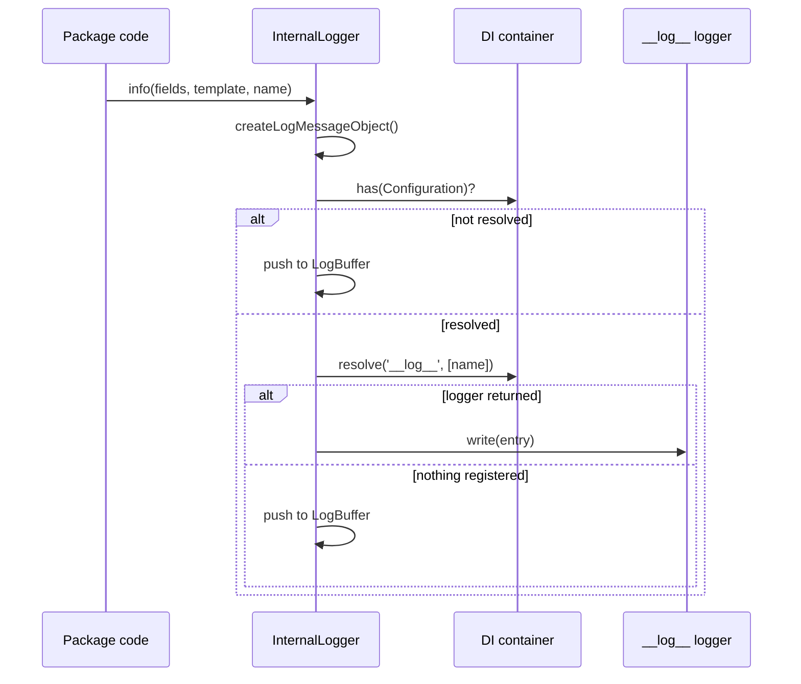

# Logging API

`InternalLogger` has one static method per log level. Framework packages call it when `@spinajs/log` may not be loaded or configured yet. Each call builds a log entry, then forwards or buffers it.

## How it works

1. A package calls a level method, eg. `InternalLogger.warn(fields, template, name)`. The call returns `void` at once.
2. The private `_write()` picks the call form from the first argument (see [Call forms](#call-forms)) and builds an entry with `createLogMessageObject()` from `@spinajs/log-common`.
3. `createLogMessageObject()` returns an `ILogEntry` with `Level` and `Variables`: ambient context fields, `error`, `level`, `logger`, `message`, then the call's own fields. Serializers run on the variables, so `error` becomes a plain record.
4. `InternalLogger.writeLogEntry(entry)` routes it:
   - `DI.has(Configuration)` is `false` (not resolved yet): the entry goes to the static buffer.
   - `Configuration` is resolved but `DI.resolve('__log__', [entry.Variables.logger])` returns nothing: the entry goes to the buffer.
   - The buffer keeps at most `InternalLogger.LogBufferLimit` entries (default `1000`); past that the oldest are dropped.
   - A logger is returned: `logger.write(entry)` runs. A rejected target prints `Couldnt write to logger <name> message {...}, reason: ...` with `console.error`. A rejected `write()` prints `Couldnt write to logger <name>, reason: ...`.
5. Buffered entries wait for the [buffer flush or the exit dump](02-buffer-flush-and-exit-dump.md).



## Call forms

Every level method (`trace`, `debug`, `info`, `success`, `warn`, `error`, `fatal`, `security`) takes the same three forms.

| Form | Call | Logger name | Message | Extra variables |
| --- | --- | --- | --- | --- |
| Fields | `InternalLogger.info(fields, template, name, ...args)` | `name` | `template` with `${field}` replaced from `fields`, then printf-formatted with `args` | Every key of `fields` |
| Error | `InternalLogger.error(err, message, name, ...args)` | `name` | `message` printf-formatted with `args`; `err.message` when `message` is `undefined` | `error`: the serialized error (`name`, `message`, `stack`, ...) |
| String | `InternalLogger.info(message, name, ...args)` | `name` | `message` printf-formatted with `args` | none |

- Fields form: a `${name}` missing from `fields` renders as empty. `${?name}...${/name}` keeps its body only when the field is set. `fields` is any non-array object.
- Fields form with `args`: `%` inside field values is escaped, so a value cannot inject a printf specifier.
- A nested `error` key in `fields` is serialized like the error form.
- The level is the method name: `LogLevel.Trace` (0) up to `LogLevel.Fatal` (6), and `LogLevel.Security` (999).

### Low-level methods

| Method | Use |
| --- | --- |
| `InternalLogger.write(err, message, level, name, vars, ...args)` | Builds an entry with an explicit `LogLevel` and extra `vars`, then routes it |
| `InternalLogger.writeLogEntry(entry)` | Routes a ready `ILogEntry`; the logger name is read from `entry.Variables.logger` |

## Services and extension points

The static methods are not resolved from DI and cannot be overridden: callers name the class directly. Change where the messages go instead:

| Service | DI token and lifetime | Default implementation | Alternatives | How to replace or extend |
| --- | --- | --- | --- | --- |
| Log sink | `__log__`; factory | `@spinajs/log` factory | `@spinajs/electron` renderer factory, your factory | [Log sink](04-log-sink.md) |
| Buffer handling | `Bootstrapper`; singleton | `InternalLogger` instance | Your subclass | [Buffer flush and exit dump](02-buffer-flush-and-exit-dump.md) |

## Important behaviour

- There is no level filtering here. Every call is built and routed; the real logger's rules decide what reaches a target.
- Calls never throw for a failed target and never return a promise. Write errors only reach `console.error`.
- `DI.has(Configuration)` is true only after `Configuration` finished its async `resolve()`. Messages logged while configuration loads are buffered.
- The buffer is capped at `InternalLogger.LogBufferLimit` entries (default `1000`). With `Configuration` resolved but no `__log__` registered, every call is buffered, and past the limit the oldest entries are dropped.

## Best practices

- Use the fields form for messages with values, so the fields stay searchable in structured targets.
- Use the error form for caught errors, so the stack is kept in `error`.
- Name the logger after the package or subsystem (`Configuration`, `PluginLoader`); log rules in `@spinajs/log` match on that name.

## Patterns and antipatterns

```ts
// Don't: interpolating values into the template loses them as fields
// and lets a value containing `${...}` change the message.
InternalLogger.info({}, `Loaded ${count} values`, 'Configuration');

// Do
InternalLogger.info({ count }, 'Loaded ${count} values', 'Configuration');
```

## Examples

### Log a failed config source with its error

```ts sample
import { InternalLogger } from '@spinajs/internal-logger';

export async function loadRemoteConfig(url: string): Promise<Record<string, unknown>> {
  try {
    const response = await fetch(url);
    return (await response.json()) as Record<string, unknown>;
  } catch (err) {
    InternalLogger.error(err as Error, 'Cannot load remote config, using defaults', 'RemoteConfigSource');
    return {};
  }
}
```

### Combine fields and printf arguments

```ts sample
import { InternalLogger } from '@spinajs/internal-logger';

export function reportSync(source: string, changed: number, total: number) {
  // `${source}` comes from the fields, each `%d` from the trailing arguments.
  InternalLogger.info({ source }, 'Synced ${source}: %d of %d options changed', 'ConfigSync', changed, total);
}
```

The entry has `message` `Synced db: 3 of 10 options changed` (for `source = 'db'`), `logger` `ConfigSync` and a `source` variable.

### Log at an explicit level

```ts sample
import { InternalLogger } from '@spinajs/internal-logger';
import { LogLevel } from '@spinajs/log-common';

export function logAudit(level: LogLevel, user: string, action: string) {
  InternalLogger.write(null as unknown as string, 'User action recorded', level, 'Audit', { user, action });
}
```

`write()` does not render `${...}` in the message against `vars`; only the fields form does. `vars` are merged into the entry's variables last, so they override `level`, `logger` and `message` when they use those keys.

## Related

- [Buffer flush and exit dump](02-buffer-flush-and-exit-dump.md): what happens to buffered entries.
- [Log sink](04-log-sink.md): the `__log__` logger that receives forwarded entries.
- [Logger proxy](03-logger-proxy.md): a `Log` instance with the same routing, for code that expects a logger object.
