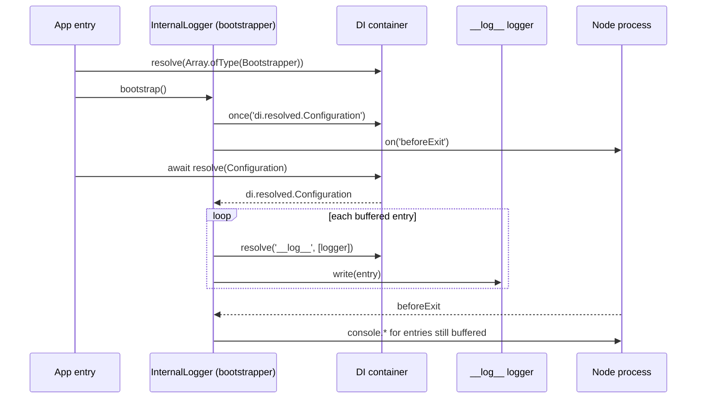

# Buffer flush and exit dump

The `InternalLogger` class is also a `Bootstrapper`. Its `bootstrap()` hands buffered entries to the real logger once `Configuration` is resolved, and prints whatever is still buffered when Node is about to exit. Replace or subclass it to change where leftover messages go.

## How it works

1. Importing `@spinajs/internal-logger` runs `@Injectable(Bootstrapper)`: `InternalLogger` is registered under `Bootstrapper` and under itself.
2. The app entry resolves `DI.resolve(Array.ofType(Bootstrapper))` and calls `bootstrap()` on each. The `spinajs` CLI does this in `@spinajs/cli`; your own entry point must do it too.
3. `InternalLogger.bootstrap()` checks `DI.has(Configuration)`:
   - resolved: it flushes the buffer now;
   - not resolved: it subscribes with `DI.once('di.resolved.Configuration', ...)` and flushes when the event fires.
4. The flush takes every buffered entry in order, resolves `DI.resolve('__log__', [entry.Variables.logger])` and calls `write(entry)` on the result. Entries for which `__log__` resolves to nothing stay in the buffer.
5. When `process.on` exists (Node), the first `bootstrap()` call on an instance registers a `process.on('beforeExit', ...)` listener.
6. On `beforeExit` the listener prints each remaining entry with `console.error`, `console.warn`, `console.log` or `console.debug`, coloured by level, and empties the buffer. The line layout is `${datetime} ${level} ${message} ${error:message} (<logger>)`, rendered by `format()` from `@spinajs/configuration-common`; `${datetime}` is the time the entry was buffered.



### Exit dump levels

| Level | Console method | Colour |
| --- | --- | --- |
| `Trace`, `Debug` | `console.debug` | gray |
| `Info` | `console.log` | white |
| `Success` | `console.log` | white on green |
| `Warn` | `console.warn` | yellow |
| `Error` | `console.error` | red |
| `Fatal` | `console.error` | white on red |
| `Security` | `console.error` | yellow on red |

Colours are raw ANSI escape codes; the package has no colour dependency.

## Services and extension points

| Service | DI token and lifetime | Default implementation | Alternatives | How to replace or extend |
| --- | --- | --- | --- | --- |
| `InternalLogger` (instance side) | `Bootstrapper` list and `InternalLogger`; singleton (default lifetime). Registered by `@Injectable(Bootstrapper)` when the module is imported | `InternalLogger` | none shipped | Subclass, register with `@Injectable(Bootstrapper)` and remove the default with `DI.unregister(InternalLogger)`, before the entry resolves `Array.ofType(Bootstrapper)` |

Members meant for a subclass:

| Member | Kind | Use |
| --- | --- | --- |
| `bootstrap()` | public method | Override to change when the buffer flushes or what runs on exit. Call `super.bootstrap()` to keep the default behaviour |
| `StdConsoleCallbackMap` | protected field, `LogLevel` to console function | Override to send a level to another console method |
| `theme` | protected field, `LogLevel` to colour function | Override to change the exit dump colours |
| `InternalLogger.LogBuffer` | protected static array of `ILogEntry` | The shared buffer. Read and reset it through `InternalLogger`, not through the subclass name |
| `InternalLogger.LogBufferLimit` | public static number, default `1000` | Max buffered entries; the oldest are dropped past it |
| `InternalLogger.writeInternal(entry)` | protected static method | Pushes to the buffer. Static, so a subclass cannot intercept it for callers of `InternalLogger.*` |

The static logging methods stay on `InternalLogger`: callers name the class, so a subclass changes only the bootstrap side.

### Bootstrapper: custom implementation

Replace the bootstrapper when the default console dump is wrong for your process, eg. a CLI whose stdout must stay machine-readable. Register the replacement in a module imported before the entry resolves the bootstrapper list.

```ts sample
import { Bootstrapper, DI, Injectable } from '@spinajs/di';
import { InternalLogger } from '@spinajs/internal-logger';
import { LogLevel } from '@spinajs/log-common';

// Every leftover startup message goes to stderr, so `my-tool export > out.json` stays valid JSON.
@Injectable(Bootstrapper)
export class StderrInternalLogger extends InternalLogger {
  protected StdConsoleCallbackMap = {
    [LogLevel.Error]: console.error,
    [LogLevel.Fatal]: console.error,
    [LogLevel.Security]: console.error,
    [LogLevel.Info]: console.error,
    [LogLevel.Success]: console.error,
    [LogLevel.Trace]: console.error,
    [LogLevel.Debug]: console.error,
    [LogLevel.Warn]: console.error,
  };
}

// Removes the default from the `Bootstrapper` list and its own key; the subclass stays.
DI.unregister(InternalLogger);

export async function runBootstrappers() {
  for (const bootstrapper of DI.resolve(Array.ofType(Bootstrapper))) {
    await bootstrapper.bootstrap();
  }
}
```

### Bootstrapper: extend instead of replace

Keep the default flush and exit dump, and add a step. Here the leftovers are also saved to a file before the console dump runs.

```ts sample
import { appendFileSync } from 'node:fs';
import { Bootstrapper, DI, Injectable } from '@spinajs/di';
import { InternalLogger } from '@spinajs/internal-logger';
import { ILogEntry } from '@spinajs/log-common';

@Injectable(Bootstrapper)
export class CrashDumpInternalLogger extends InternalLogger {
  public bootstrap(): void {
    // Registered before super's listener, so it sees the buffer before the console dump empties it.
    process.on('beforeExit', () => {
      const pending: ILogEntry[] = InternalLogger.LogBuffer;
      for (const entry of pending) {
        appendFileSync('startup-log.jsonl', `${JSON.stringify(entry.Variables)}\n`);
      }
    });

    super.bootstrap();
  }
}

DI.unregister(InternalLogger);
```

## Important behaviour

- The flush runs only if something calls `bootstrap()`. Without it, buffered entries are never forwarded and never printed.
- The flush keeps entries it cannot deliver. When `__log__` resolves to nothing at flush time, those entries stay buffered and appear in the exit dump.
- Entries logged after the flush, while `__log__` is still unregistered, are buffered too and only appear in the exit dump.
- `beforeExit` fires when the event loop empties. It does **not** fire on `process.exit()`, an uncaught exception or a signal, so the exit dump is skipped in those cases.
- `${datetime}` in the exit dump is the time the entry was buffered, not the time of printing.
- Calling `bootstrap()` again on the same instance does not add another `beforeExit` listener.
- In a browser (`process` undefined) no exit dump is registered; buffered entries are kept until the flush.

## Best practices

- Import `@spinajs/log` (or another `__log__` provider) before resolving `Configuration`, so the flush has somewhere to deliver.
- Call `bootstrap()` before `await DI.resolve(Configuration)`. Configuration resolution itself logs through `InternalLogger`; those entries flush when the `di.resolved.Configuration` event fires.
- Reset the buffer as `InternalLogger.LogBuffer = []` in a subclass, never `MySubclass.LogBuffer = []`. The second creates a separate static on the subclass while `InternalLogger.*` keeps pushing to the original.

## Patterns and antipatterns

```ts
// Don't: registering the subclass without removing the default leaves both in the
// Bootstrapper list. The default's beforeExit listener can empty the buffer first.
@Injectable(Bootstrapper)
class StderrInternalLogger extends InternalLogger {}

// Do
@Injectable(Bootstrapper)
class StderrInternalLogger extends InternalLogger {}
DI.unregister(InternalLogger);
```

## Examples

### Boot a custom entry point so early messages reach the logger

```ts sample
import '@spinajs/log';
import { Bootstrapper, DI } from '@spinajs/di';
import { Configuration } from '@spinajs/configuration';
import { InternalLogger } from '@spinajs/internal-logger';

async function main() {
  InternalLogger.info({}, 'Worker starting', 'Worker');

  // Arms the flush for the moment Configuration resolves.
  for (const bootstrapper of DI.resolve(Array.ofType(Bootstrapper))) {
    await bootstrapper.bootstrap();
  }

  // When this resolves, 'Worker starting' and every configuration message are written to the configured targets.
  await DI.resolve(Configuration);
}

void main();
```

## Related

- [Logging API](01-logging-api.md): how entries reach the buffer.
- [Log sink](04-log-sink.md): the `__log__` logger the flush writes to.
- [`Bootstrapper` in `@spinajs/di`](../di/10-service-lifecycle.md): how bootstrappers are registered and run.
- [Container events in `@spinajs/di`](../di/12-container-events.md): the `di.resolved.Configuration` event that triggers the flush.
- [`@spinajs/cli`](../cli/01-running-the-cli.md): runs all bootstrappers before resolving `Configuration`.
