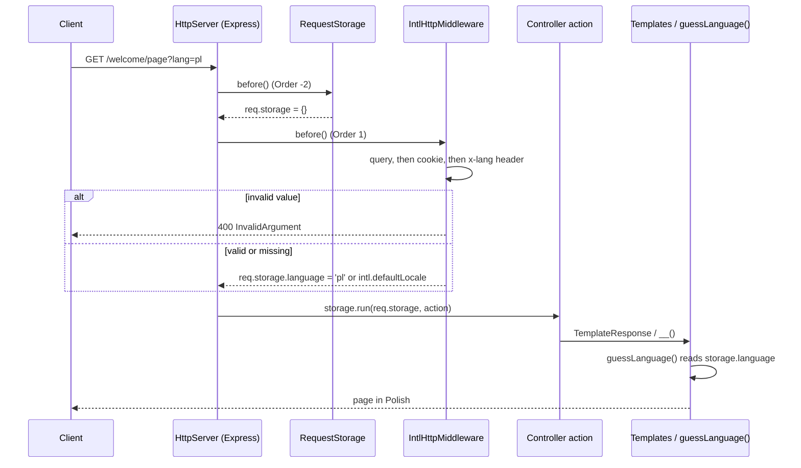

# Request language

`IntlHttpMiddleware` detects the language of every HTTP request and stores it in `req.storage.language`. Everything that runs inside the request then translates into that language without passing it around: `__()` in templates, `guessLanguage()` from `@spinajs/intl`, translated models from `@spinajs/intl-orm`.

## How it works

1. Importing `@spinajs/intl-http` registers `IntlHttpMiddleware` with `@Injectable(ServerMiddleware)`.
2. `HttpServer.resolve()` resolves every `ServerMiddleware`, sorts them by `Order` ascending, and mounts their `before()` handlers after the plain Express handlers of `http.middlewares` (body parsers, cookie parser).
3. `RequestStorage` (`Order = -2`, in `@spinajs/http`) creates an empty `req.storage` object.
4. `IntlHttpMiddleware.before()` (`Order = 1`) looks for the language under the name in `intl.queryParameter`, first match wins:
   1. query string: `req.query[<name>]`, eg. `?lang=pl`;
   2. cookie: `req.cookies[<name>]`, eg. `lang=pl`;
   3. header: `req.headers['x-<name>']`, eg. `x-lang: pl`.
5. A value found is validated: it must be a string of 2 to 5 characters. Otherwise the middleware throws `InvalidArgument` and `@spinajs/http` answers `400 Bad Request`.
6. The middleware sets `req.storage.language` to the value found, or to `intl.defaultLocale` when there is none, and calls `next()`.
7. The controller action runs inside `AsyncLocalStorage.run(req.storage, ...)`. Code called from it reads the language back:
   - `guessLanguage()` from `@spinajs/intl` returns `storage.language`;
   - `TemplateResponse` renders through `@spinajs/templates`, which calls `guessLanguage()` when no language is passed;
   - `@spinajs/intl-orm` models translate their fields with `guessLanguage()`.



## Configuration

The keys belong to `@spinajs/intl`; its config file ships the defaults.

| Key | Type | Default | Allowed values | Meaning |
| --- | --- | --- | --- | --- |
| `intl.queryParameter` | `string` | `'lang'` | any name | Name of the query parameter and of the cookie, and suffix of the `x-<name>` header. |
| `intl.defaultLocale` | `string` | `'en'` | a locale with translations | Language stored when the request carries none. |
| `intl.locales` | `string[]` | `['en']` | locale codes | Not read by this package. It does **not** limit the accepted languages. |
| `http.middlewares` | Express handlers | includes `configuredCookieParser` | any | Keep a cookie parser to read the language from a cookie. |

```js
export default {
  intl: {
    defaultLocale: 'en',
    locales: ['en', 'pl', 'de'],
    queryParameter: 'lang',
  },
};
```

## Services and extension points

| Service | DI token and lifetime | Default implementation | Alternatives | How to replace or extend |
| --- | --- | --- | --- | --- |
| Language middleware | Registered by `@Injectable(ServerMiddleware)` under `ServerMiddleware` (a list) and under `IntlHttpMiddleware` (the old `IntHttpMiddleware` name is a deprecated alias); singleton. Resolved as a list by `HttpServer` through `@Autoinject(ServerMiddleware)` when the server resolves. | `IntlHttpMiddleware` | none shipped | Replace: subclass or write a `ServerMiddleware`, register it with `@Injectable(ServerMiddleware)`, and call `DI.unregister(IntlHttpMiddleware)` before `HttpServer` resolves. Extend: override `before()` and call `super.before()`, or add a second middleware with a higher `Order` ([example](03-custom-language-resolution.md#refine-the-language-with-a-second-middleware)). |
| Request storage field | `IActionLocalStoregeContext.language: string`, added to `@spinajs/http` by `declare module` | set by `IntlHttpMiddleware` | none | Read it from `req.storage.language` or `guessLanguage()`; overwrite it from a later middleware. |

`IntlHttpMiddleware` exposes two protected fields to subclasses:

| Member | Source | Meaning |
| --- | --- | --- |
| `LangQueryParameter` | `@Config('intl.queryParameter')` | Name looked up in query, cookies and `x-` header. |
| `defaultLocale` | `@Config('intl.defaultLocale')` | Fallback language. |
| `Order` | constructor, `1` | Position among server middlewares. Keep it above `-2` (`RequestStorage`). |

### IntlHttpMiddleware: custom implementation

Replace the middleware when the detection rules change for every request, eg. to honour the browser's `Accept-Language` header when the client makes no explicit choice. `HttpServer` collects the whole `ServerMiddleware` list, so registering a class `.as(IntlHttpMiddleware)` does **not** replace the default: unregister it.

- Give the class a different name: `DI.unregister()` matches registrations by class name.
- Run the module before `HttpServer` resolves, eg. import it from your app entry before the server starts.

```ts sample
import { DI, Injectable } from '@spinajs/di';
import { Config } from '@spinajs/configuration';
import { ServerMiddleware, Request } from '@spinajs/http';
import { IntlHttpMiddleware } from '@spinajs/intl-http';
import * as express from 'express';

@Injectable(ServerMiddleware)
export class AcceptLanguageMiddleware extends IntlHttpMiddleware {
  @Config('intl.locales')
  protected Locales!: string[];

  public before() {
    const detect = super.before();

    return (req: express.Request, res: express.Response, next: express.NextFunction) => {
      try {
        detect(req, res, () => {
          const name = this.LangQueryParameter;
          const explicit = req.query[name] || req.cookies?.[name] || req.headers[`x-${name}`];

          if (!explicit) {
            const best = req.acceptsLanguages(...this.Locales);
            if (best) {
              (req as Request).storage.language = best;
            }
          }

          next();
        });
      } catch (err) {
        next(err);
      }
    };
  }
}

// The default stays in the ServerMiddleware list unless it is removed.
DI.unregister(IntlHttpMiddleware);
```

## Important behaviour

- **Lookup order:** query string, then cookie, then `x-<name>` header. An empty value (`?lang=`) counts as missing and falls through to the next source.
- **No locale check:** any string of 2 to 5 characters passes, eg. `?lang=xx`. `@spinajs/intl` has no `xx` table and falls back to the default locale's translations.
- **Length limit:** `en-US` and `pt_BR` pass; `zh-Hans` (7 characters) fails with `400`.
- **Repeated parameter:** `?lang=en&lang=pl` parses to an array, fails the string check and answers `400`.
- **Every request is checked:** the middleware runs before static files and before routing, so `GET /static/logo.png?lang=toolong` also answers `400`.
- **Header name is lower-cased:** the lookup uses `x-<name>` lower-cased, because Node lower-cases incoming header names. Query and cookie names keep the configured case.
- **Plain cookies only:** the middleware reads `req.cookies`, not `req.signedCookies`. A signed language cookie is ignored or rejected.
- **Cookie parser optional:** with no cookie parser in `http.middlewares`, the cookie source is skipped and the header is read next.
- **Order matters:** `Order` must stay above `RequestStorage`'s `-2`. Below it, `req.storage` is `undefined` and every request fails with `500`.
- **Per request only:** the language is not written back to a cookie or session.

## Best practices

- Send `x-lang` from API clients and SPAs; use `?lang=` for links and the cookie for a remembered choice.
- Use `@Lang(['en', 'pl'])` on routes that must refuse unsupported languages; the middleware alone accepts any short string.
- Read the language with `guessLanguage()` from `@spinajs/intl` in services, not from a parameter threaded through every call.

## Patterns and antipatterns

```ts
// Don't: the cookie parser moves a signed cookie into `req.signedCookies`, which the middleware
// does not read, so the language choice is ignored.
return new Ok({ lang }, { Coockies: [{ Name: 'lang', Value: lang, Options: { signed: true } }] });

// Do: store the language in a plain cookie. It is a preference, not a credential.
return new Ok({ lang }, { Coockies: [{ Name: 'lang', Value: lang, Options: { httpOnly: false, maxAge: 31536000000 } }] });
```

## Examples

### Let users switch language and remember it

The middleware reads the `lang` cookie on every later request, so templates and translated models follow the user's choice.

```ts sample
import '@spinajs/intl-http';
import { Lang } from '@spinajs/intl-http';
import { BasePath, BaseController, Post, Ok } from '@spinajs/http';

@BasePath('preferences')
export class PreferencesController extends BaseController {
  // POST /preferences/language?lang=pl
  @Post()
  public language(@Lang(['en', 'pl', 'de']) lang: string) {
    return new Ok(
      { lang },
      {
        Coockies: [
          {
            Name: 'lang',
            Value: lang,
            Options: { httpOnly: false, maxAge: 365 * 24 * 60 * 60 * 1000 },
          },
        ],
      },
    );
  }
}
```

### Render a page in the request language

`test-view-intl.pug`:

```pug
html
  body
    p #{__(greeting)}
```

```ts sample
import '@spinajs/intl-http';
import { BasePath, BaseController, Get, TemplateResponse } from '@spinajs/http';

@BasePath('pages')
export class PagesController extends BaseController {
  // GET /pages/home?lang=pl renders "witaj świecie", ?lang=en renders "hello world"
  // when locales/en.json maps "witaj świecie" to "hello world".
  @Get()
  public home() {
    return new TemplateResponse('test-view-intl.pug', { greeting: 'witaj świecie' });
  }
}
```

## Related

- [`@Lang()` route argument](02-lang-route-argument.md): the same detection, as an action parameter with an allow-list.
- [Custom language resolution](03-custom-language-resolution.md): refine the stored language without replacing this middleware.
- [`@spinajs/http`](../http/README.md): `ServerMiddleware`, `Order`, `RequestStorage` and `http.middlewares`.
- [`@spinajs/intl`](../intl/README.md): `guessLanguage()`, `__()` and the `intl.*` config.
- [`@spinajs/templates`](../templates/README.md): language resolution for rendered views.
- [`@spinajs/di`](../di/README.md): `@Injectable`, lists of implementations and `DI.unregister()`.
