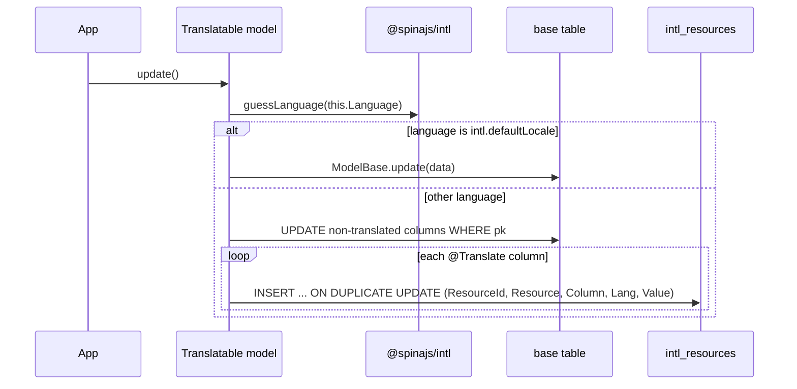

# Translatable models

Mark the columns that have a value per language with `@Translate()`, and extend `Translatable` instead of `ModelBase`. The base table keeps the default-language value; every other language lives in `intl_resources`, one row per entity, column and language.

Use it for user-facing text stored in your own tables: product names, category titles, CMS page bodies.

## How it works

### Declaring

1. `@Translate()` runs at class definition. It finds the column descriptor named like the property and sets `IColumnDescriptor.Translate = true`. When the descriptor has no such column yet, it adds `{ Name, Translate: true }`; the ORM merges the rest from the table schema.
2. The decorator also sets `Translatable = true` on the model descriptor. Nothing in the package reads this flag.

### Loading one entity: `Translatable.translate(lang?)`

1. `guessLanguage(lang)` from `@spinajs/intl` picks the language: the `lang` argument, else the `language` of the current `AsyncLocalStorage` store, else `intl.defaultLocale`.
2. `IntlResource.where({ ResourceId: this.PrimaryKeyValue, Resource: this.constructor.name, Lang })` loads the rows of this entity.
3. Each row's `Value` is assigned to the property named by its `Column`.
4. `Language` is set to the chosen language, so a later `update()` saves into the same language.

### Saving: `Translatable.update(data?)`

1. `guessLanguage(this.Language)` picks the language: the one set by `translate()` or `setLanguage()`, else the async-storage language, else `intl.defaultLocale`.
2. When it equals `intl.defaultLocale`, `ModelBase.update(data)` runs unchanged and writes the base table.
3. Otherwise the model's columns are split:
   - Columns without `Translate`: `toSql()` minus the translated columns go into one `UPDATE <table> ... WHERE <pk>`. When the descriptor has `@UpdatedAt`, that column is set to `new Date()` first.
   - Columns with `Translate`: one `IntlResource` per column is written with `insert(InsertBehaviour.InsertOrUpdate)`, one statement per column, in sequence.
4. It returns `{ RowsAffected: 0, LastInsertId: 0 }` in the non-default branch, whatever was written.



## Decorators

| Decorator | Target | Options | Effect |
| --- | --- | --- | --- |
| `@Translate()` | property of a model | none | Sets `Translate = true` on the column descriptor; the column is then read from and written to `intl_resources` for non-default languages. |

## Configuration

| Key | Type | Default | Allowed values | Meaning |
| --- | --- | --- | --- | --- |
| `intl.defaultLocale` | `string` | `'en'` (from `@spinajs/intl`) | any locale name, max 6 characters in `intl_resources.Lang` | The language stored in the base table. `update()` writes the base table only for this language. |
| `db.DefaultConnection` | `string` | none | a configured connection name | The connection behind `@Connection('default')`, which `IntlResource` uses. See [Connections](../orm/01-connections.md). |

```ts
intl: {
  defaultLocale: 'pl_PL',
  locales: ['pl_PL', 'en_GB'],
},
db: {
  DefaultConnection: 'main',
}
```

## Schema

`Translatable` reads and writes [`intl_resources`](06-schema-and-migration.md#intl_resources).

| Column written | Value |
| --- | --- |
| `ResourceId` | `this.PrimaryKeyValue` |
| `Resource` | `this.constructor.name`, eg. `Product` |
| `Column` | the property name, eg. `Name` |
| `Lang` | the chosen language |
| `Value` | the property value |

## Services and extension points

| Service | DI token and lifetime | Default implementation | Alternatives | How to replace or extend |
| --- | --- | --- | --- | --- |
| `Translatable` | Not in DI: a base class your models extend | `Translatable` | none | Subclass it as your own base model and override `translate()`, `update()` or `destroy()`; call `super`. |
| `@Translate()` and `IColumnDescriptor.Translate` | Not in DI: a `declare module '@spinajs/orm'` augmentation plus a property decorator | `@Translate()` | Set `Translate` on a descriptor yourself, eg. in your own decorator built on `extractDecoratorPropertyDescriptor` | Read `descriptor.Columns.filter((c) => c.Translate)` in your own code to find translatable columns. |

Members of `Translatable`:

| Member | Meant to be overridden | Behaviour |
| --- | --- | --- |
| `translate(lang?)` | yes | Loads the rows of this entity and language into the properties; sets `Language`. |
| `setLanguage(lang)` | rarely | Sets `Language` without loading anything. Called by `IntlModelMiddleware` after a query translation. |
| `update(data?)` | yes | Default language: `ModelBase.update(data)`. Other languages: the split write above. |
| `Language` (protected) | read in subclasses | The language the entity holds and saves into. |

### `Translatable`: custom base model

Subclass `Translatable` when every translatable model of your app needs the same extra step. The package does not delete translations when an entity is deleted, so a base model that cleans `intl_resources` in `destroy()` is a common addition. Models then extend your base instead of `Translatable`.

```ts sample
import { Connection, extractModelDescriptor, Model, Primary } from '@spinajs/orm';
import { IntlResource, Translatable, Translate } from '@spinajs/intl-orm';

/** App-wide base: deleting an entity also deletes its translations. */
export abstract class CleanTranslatable extends Translatable {
  public async destroy() {
    const id = this.PrimaryKeyValue;
    const result = await super.destroy();

    const driver = extractModelDescriptor(IntlResource)!.Driver!;
    await driver.del().from('intl_resources').where('Resource', this.constructor.name).where('ResourceId', id);

    return result;
  }
}

@Connection('default')
@Model('categories')
export class Category extends CleanTranslatable {
  @Primary()
  public Id: number;

  @Translate()
  public Title: string;
}

export async function deleteCategory(id: number): Promise<void> {
  const category = await Category.getOrFail(id);
  await category.destroy();
}
```

## Important behaviour

- The `Resource` value is the class name (`this.constructor.name`). Renaming a model class, or a bundler that mangles class names, orphans its translations.
- `ResourceId` is an `int` column and only the first primary key column is used. Models with string, UUID or composite keys cannot be translated.
- `update(data)` ignores `data` in the non-default branch. Assign properties before calling `update()`.
- In the non-default branch `update()` writes every non-translated column and every translated column, changed or not. A translated column you did not touch is saved with its current value, which is the default-language text when the entity was not translated first.
- The non-default branch issues one `UPDATE` plus one upsert per translated column, with no transaction. Wrap the call in `Model.transaction()` when a partial write matters.
- `insert()` is not overridden: a new entity always writes its translated columns to the base table, whatever the current language.
- `destroy()` is not overridden: the entity's `intl_resources` rows stay behind.
- `translate()` assigns only the columns that have a row. A column without a row in that language keeps its current value; there is no fallback language.
- `translate(defaultLocale)` loads no rows, so it does not restore base values on an entity translated earlier. Reload the entity instead.
- `update()` reads `intl.defaultLocale` through `DI.get(Configuration)`, so the configuration must be resolved before the first save.
- Inside an async-storage store whose `language` is not the default, every model select, including the `IntlResource` select of `translate()`, passes through [`IntlQueryMiddleware`](04-automatic-translation.md). In the current source that path throws; load entities outside such a store, or see [Automatic translation](04-automatic-translation.md#important-behaviour).

## Best practices

- Extend `Translatable` directly. The package tests mix it in with `typescript-mix` (`@use(Translatable)`), which loses the type of `translate()` and `update()` on the model.
- Call `translate(lang)` or `setLanguage(lang)` before editing, so `update()` saves into the language you mean and not into the ambient one.
- Keep model class names stable once translations exist; they are the `Resource` key.
- Keep translated property names within 16 characters: `intl_resources.Column` is `string(16)`.

## Patterns and antipatterns

```ts
// Don't: `data` is dropped for a non-default language, so the English name is never saved
product.setLanguage('en_GB');
await product.update({ Name: 'Desk lamp' });

// Do
product.setLanguage('en_GB');
product.Name = 'Desk lamp';
await product.update();
```

```ts
// Don't: Description was never translated, so its Polish text is saved as the English translation too
const product = await Product.getOrFail(id);
product.setLanguage('en_GB');
product.Name = 'Desk lamp';
await product.update();

// Do: load the English values first, then edit
const product = await Product.getOrFail(id);
await product.translate('en_GB');
product.Name = 'Desk lamp';
await product.update();
```

## Examples

### Edit the English title of a CMS page

```ts sample
import { Connection, Model, Primary } from '@spinajs/orm';
import { Translatable, Translate } from '@spinajs/intl-orm';

@Connection('default')
@Model('cms_pages')
export class CmsPage extends Translatable {
  @Primary()
  public Id: number;

  public Slug: string;

  @Translate()
  public Title: string;

  @Translate()
  public Body: string;
}

export async function editEnglishTitle(id: number, title: string): Promise<void> {
  const page = await CmsPage.getOrFail(id);

  // loads Title and Body in en_GB, so Body is saved back unchanged
  await page.translate('en_GB');
  page.Title = title;
  await page.update();
}
```

### Save in the language of the current request

```ts sample
import { AsyncLocalStorage } from 'node:async_hooks';
import { DI } from '@spinajs/di';
import { IIntlAsyncStorage } from '@spinajs/intl';
import { Connection, Model, Primary } from '@spinajs/orm';
import { Translatable, Translate } from '@spinajs/intl-orm';

@Connection('default')
@Model('categories')
export class Category extends Translatable {
  @Primary()
  public Id: number;

  @Translate()
  public Title: string;
}

// @spinajs/intl-http fills the same store for every HTTP request; this runs it by hand.
export async function retitleAs(lang: string, id: number, title: string): Promise<void> {
  const category = await Category.getOrFail(id);
  const store = DI.resolve(AsyncLocalStorage) as AsyncLocalStorage<IIntlAsyncStorage>;

  // no setLanguage(): update() takes the language from the store
  await store.run({ language: lang }, async () => {
    category.Title = title;
    await category.update();
  });
}
```

## Related

- [Query translation](02-query-translation.md): translates a whole result set and calls `setLanguage()` on each model.
- [Schema and migration](06-schema-and-migration.md): the `intl_resources` table and the `IntlResource` model.
- [Models](../orm/02-models.md): the ORM decorators `@Translate()` sits next to.
- [Model API](../orm/03-model-api.md): `ModelBase.update()`, which the default-language branch calls.
