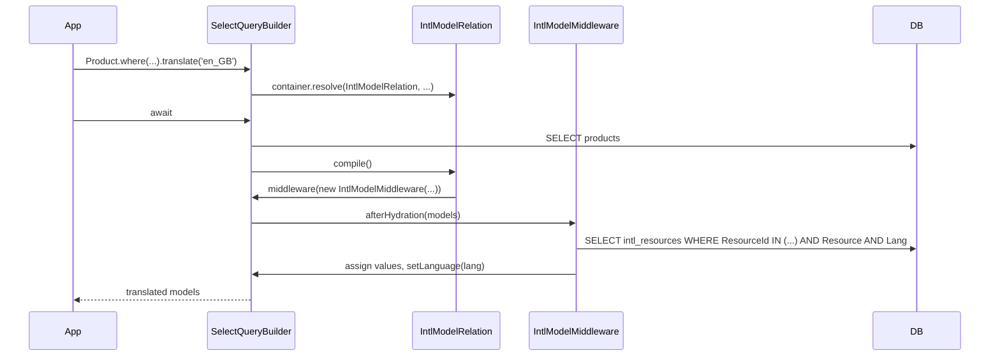

# Query translation

`translate(lang)` on a model select builder loads the `intl_resources` rows for every model in the result and writes them into the translated properties. It is a prototype extension: importing `@spinajs/intl-orm` adds it to every `SelectQueryBuilder`.

## How it works

1. Importing `@spinajs/intl-orm` assigns `translate` to `SelectQueryBuilder.prototype` and declares `translate()`, `translated` and `AllowTranslate` on `ISelectQueryBuilder<T>` with `declare module '@spinajs/orm'`.
2. `query.translate(lang)` checks its target:
   - `query.Owner` is an `IntlModelRelation` (the internal query that reads `intl_resources`): returns the builder unchanged.
   - `query.Model` is unset (`driver.select()` and other raw builders), or `query.translated` is already set: returns the builder unchanged.
3. It sets `query.translated = true`, so [`IntlQueryMiddleware`](04-automatic-translation.md) and later `translate()` calls leave the builder alone.
4. For every relation already on the builder (`populate()` called earlier), it calls `relation.execute()` with a callback that calls `translate(lang)` on the relation query.
5. When the model has at least one `@Translate` column, it resolves an [`IntlModelRelation`](03-translation-relation.md) from the builder's container, calls its `execute()` and appends it to the builder's relations. A model without `@Translate` columns gets no `intl_resources` query.
6. It returns the builder.
7. When the query runs, the driver compiles it; `IntlModelRelation.compile()` adds an `IntlModelMiddleware` to the builder.
8. After hydration, `IntlModelMiddleware.afterHydration()` reads `intl_resources` for the hydrated primary keys, the model name and `lang`, assigns each `Value` to its `Column` and calls `setLanguage(lang)` on each model.



## Configuration

`translate(lang)` reads no configuration. The language is the argument. The `intl_resources` query runs on the `default` connection; see [Schema and migration](06-schema-and-migration.md).

## Services and extension points

| Service | DI token and lifetime | Default implementation | Alternatives | How to replace or extend |
| --- | --- | --- | --- | --- |
| `ISelectQueryBuilder.translate(lang)` | Not in DI: assigned to `SelectQueryBuilder.prototype` when `@spinajs/intl-orm` is imported | the package's `translate` function | none | Wrap `SelectQueryBuilder.prototype.translate` after importing the package, or add your own method next to it with the same augmentation pattern. |
| `ISelectQueryBuilder.translated` | Not in DI: augmented builder property | set to `true` by `translate()` | none | Set it to `true` yourself to keep `IntlQueryMiddleware` off a builder. |
| `ISelectQueryBuilder.AllowTranslate` | Not in DI: augmented builder property | `undefined` | none | Set it to `false` to keep `IntlQueryMiddleware` off a builder. |
| `IntlModelRelation` | Class token, `@NewInstance()` | `IntlModelRelation` | none | See [Translation relation](03-translation-relation.md). |

### `translate()`: wrap the prototype extension

Wrap the method when every caller should get the same pre-processing, eg. short language codes from a URL mapped to the locales stored in `intl_resources.Lang`. Import `@spinajs/intl-orm` first: the import is what installs the original. Every select builder class inherits the wrapper, relation queries included.

```ts sample
import { SelectQueryBuilder } from '@spinajs/orm';
import '@spinajs/intl-orm';

const LOCALE_BY_CODE: Record<string, string> = { en: 'en_GB', pl: 'pl_PL', de: 'de_DE' };

type TranslateFn = (this: SelectQueryBuilder, lang: string) => SelectQueryBuilder;

const proto = SelectQueryBuilder.prototype as unknown as { translate: TranslateFn };
const original = proto.translate;

proto.translate = function (this: SelectQueryBuilder, lang: string) {
  return original.call(this, LOCALE_BY_CODE[lang] ?? lang);
};
```

The general pattern, with its caveats, is in [Scopes and builder extensions](../orm/16-scopes-and-builder-extensions.md#prototype-extensions).

## Important behaviour

- On a raw builder, or on the internal `intl_resources` query, `translate()` does nothing and returns the builder, so chaining still works but nothing is translated.
- Only relations added before `translate()` are visited. Call `populate()` first.
- The `intl_resources` query matches `ResourceId` with `===` against the first primary key column. A model whose key is not a number gets no values.
- Every model in the result gets `setLanguage(lang)` when it has that method. A model with `@Translate` columns that does not extend `Translatable` gets its values but no `Language`.
- A row without a translation keeps its base-table value. There is no fallback language.
- The `intl_resources` query runs once per translated builder, after the main query; it is not a join.

## Best practices

- Prefer `translate()` on the query over [`Translatable.translate()`](01-translatable-models.md) per entity: the query runs one `intl_resources` select for the whole result, the entity method one per entity.
- Call `translate()` only on queries of models that extend `Translatable`.
- Call `translate()` last in the chain, after `where()` and `populate()`, and before `first()` or `await`.

## Patterns and antipatterns

```ts
// Don't: driver.select() has no Model, so translate() does nothing and the row keeps its base values
const row = await driver.select().from('products').where('Id', 1).translate('en_GB').first();

// Do: query through the model
const product = await Product.where('Id', 1).translate('en_GB').first();
```

## Examples

### List products in the shop language

```ts sample
import { Connection, Model, Primary } from '@spinajs/orm';
import { Translatable, Translate } from '@spinajs/intl-orm';

@Connection('default')
@Model('products')
export class Product extends Translatable {
  @Primary()
  public Id: number;

  @Translate()
  public Name: string;

  public Price: number;

  public Active: boolean;
}

export async function activeProducts(lang: string): Promise<Product[]> {
  return await Product.where('Active', true).translate(lang);
}
```

### Translate entity by entity

```ts sample
import { Connection, Model, Primary } from '@spinajs/orm';
import { Translatable, Translate } from '@spinajs/intl-orm';

@Connection('default')
@Model('products')
export class Product extends Translatable {
  @Primary()
  public Id: number;

  @Translate()
  public Name: string;

  public Active: boolean;
}

export async function activeProductsPerEntity(lang: string): Promise<Product[]> {
  const products = await Product.where('Active', true);
  await Promise.all(products.map((p) => p.translate(lang)));
  return products;
}
```

## Related

- [Translation relation](03-translation-relation.md): the relation and middleware `translate()` installs.
- [Automatic translation](04-automatic-translation.md): calls `translate()` for you from the request language.
- [Translatable models](01-translatable-models.md): `@Translate()`, `setLanguage()` and per-entity `translate()`.
- [Query builder](../orm/05-query-builder.md): `IBuilderMiddleware` and the builder lifecycle.
