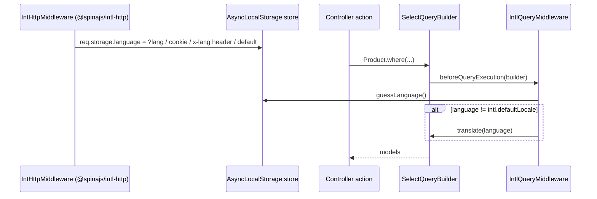

# Automatic translation

`IntlQueryMiddleware` is a `QueryMiddleware` that calls [`translate(lang)`](02-query-translation.md) on model selects when the current language differs from `intl.defaultLocale`. With `@spinajs/intl-http` installed, a request with `?lang=en_GB` gets English model values without any `translate()` call in your code.

> In the current source the `translate()` call it makes throws, so every model select under a non-default request language fails. See [Important behaviour](#important-behaviour).

## How it works

1. Importing `@spinajs/intl-orm` registers `IntlQueryMiddleware` with `@Injectable(QueryMiddleware)`.
2. Every query builder constructor resolves `Array.ofType(QueryMiddleware)` and sorts it by `order`. `IntlQueryMiddleware.order` is `1000`, so it runs after middlewares with a lower order, eg. the access guard of `@spinajs/authz-orm`.
3. `afterQueryCreation()` does nothing.
4. `beforeQueryExecution(builder)` runs for every builder type and stops at the first check that fails:
   1. `DI.has(Configuration)` is false: no default language can be read, skip.
   2. On Node (`AsyncLocalStorage` exists), `DI.get(AsyncLocalStorage)` is read and its `noTranslate` compared with `false`. See the bug note below.
   3. `builder.AllowTranslate === false`: skip.
   4. `builder.Model` is unset (raw builder): skip.
   5. The builder is not a `SelectQueryBuilder`, or `builder.translated` is set: skip.
   6. `guessLanguage()` reads the `language` of the current `AsyncLocalStorage` store, else `intl.defaultLocale`. When it differs from `defaultLanguage()`, the middleware calls `builder.translate(lang)`.
5. The query then compiles and runs; [`IntlModelRelation`](03-translation-relation.md) loads the translations after hydration.



## Configuration

| Key | Type | Default | Allowed values | Meaning |
| --- | --- | --- | --- | --- |
| `intl.defaultLocale` | `string` | `'en'` (from `@spinajs/intl`) | any locale name | The language that needs no translation. Selects run untranslated when the current language equals it. |
| `intl.queryParameter` | `string` | `'lang'` (from `@spinajs/intl`) | any name | Read by `@spinajs/intl-http`, not by this package: the query parameter, cookie and `x-<name>` header the request language comes from. |

```ts
intl: {
  defaultLocale: 'pl_PL',
  locales: ['pl_PL', 'en_GB'],
  queryParameter: 'lang',
}
```

## Services and extension points

| Service | DI token and lifetime | Default implementation | Alternatives | How to replace or extend |
| --- | --- | --- | --- | --- |
| `IntlQueryMiddleware` | `QueryMiddleware` list (`@Injectable(QueryMiddleware)`), also under its own class; singleton. Resolved with `Array.ofType(QueryMiddleware)` by every builder constructor, sorted by `order`. | `IntlQueryMiddleware` | none | Subclass it and override `beforeQueryExecution()`; register the subclass with `@Injectable(QueryMiddleware)`, then `DI.unregister(IntlQueryMiddleware)` and `DI.uncache(QueryMiddleware)` before the first query. Change `order` in the subclass to move it in the pipeline. |
| `AllowTranslate` | Not in DI: augmented `ISelectQueryBuilder` property | `undefined` | none | Set `false` on one builder to skip it. |
| `IIntlAsyncStorage` (`@spinajs/intl`) | The store of the DI `AsyncLocalStorage` | filled by `@spinajs/intl-http` per request | your own `store.run({ language })` | Run code in a store with `language` set to translate it outside HTTP. |

Members of `IntlQueryMiddleware`:

| Member | Meant to be overridden | Behaviour |
| --- | --- | --- |
| `order` | yes | `1000`. Lower runs first. |
| `beforeQueryExecution(builder)` | yes | The checks in step 4, then `translate()`. Synchronous. |
| `afterQueryCreation(builder)` | rarely | No-op. |

### `IntlQueryMiddleware`: custom implementation

Replace it when you need to translate only models that have `@Translate` columns, or to honour `noTranslate` from the store. The stock middleware translates every model select and reads `noTranslate` from the wrong object. Call the setup function after `@spinajs/intl-orm` is imported and before the first query: `@Injectable` registers the stock class at import time, and the cached singleton keeps coming back until the list is uncached.

```ts sample
import { AsyncLocalStorage } from 'node:async_hooks';
import { DI, Injectable } from '@spinajs/di';
import { IIntlAsyncStorage } from '@spinajs/intl';
import { extractModelDescriptor, QueryBuilder, QueryMiddleware } from '@spinajs/orm';
import { IntlQueryMiddleware } from '@spinajs/intl-orm';

@Injectable(QueryMiddleware)
export class TranslatableOnlyQueryMiddleware extends IntlQueryMiddleware {
  public beforeQueryExecution(builder: QueryBuilder): void {
    const storage = DI.get<AsyncLocalStorage<IIntlAsyncStorage>>(AsyncLocalStorage)?.getStore();
    if (storage?.noTranslate === true) {
      return;
    }

    const descriptor = builder.Model ? extractModelDescriptor(builder.Model) : null;
    if (!descriptor || !descriptor.Columns.some((c) => c.Translate)) {
      return;
    }

    super.beforeQueryExecution(builder);
  }
}

export function useTranslatableOnlyMiddleware(): void {
  DI.unregister(IntlQueryMiddleware);
  DI.uncache(QueryMiddleware);
}
```

## Important behaviour

- **Throws under a non-default language in the current source.** The middleware calls `translate()`, which fails as described in [Query translation](02-query-translation.md#important-behaviour). With `@spinajs/intl-http`, any request whose language differs from `intl.defaultLocale` fails on its first model select.
- **`noTranslate` is never honoured.** Step 4.2 reads `noTranslate` from the `AsyncLocalStorage` instance returned by `DI.get()`, not from its store, so the value is always `undefined`. The comparison is also `=== false`, the opposite of the flag's meaning in `IIntlAsyncStorage`.
- **Every model select is translated**, not only models with `@Translate` columns. `IntlModelMiddleware` calls `setLanguage()` on each result, which models that do not extend `Translatable` lack.
- Inserts, updates and deletes are never translated. Saving in a language is [`Translatable.update()`](01-translatable-models.md)'s job.
- `guessLanguage()` reads `DI.get(AsyncLocalStorage)`, which returns only an instance that something already resolved. `@spinajs/http` controllers resolve it; standalone code calls `DI.resolve(AsyncLocalStorage)` before `store.run()`.
- On a runtime without `AsyncLocalStorage` (browser, Electron renderer), the store check is skipped and `guessLanguage()` returns `intl.defaultLocale`, so nothing is translated.
- The middleware is resolved from the root container and applies to every connection.

## Best practices

- Set `AllowTranslate = false` on reports, exports and internal lookups that must read base values whatever the request language.
- Keep `order` above the authorization middlewares, so translation runs on queries already scoped by them. `1000` does this.
- Drive the language through the async-storage store (`@spinajs/intl-http`, or `store.run({ language })` in jobs), not by calling `translate()` in every repository method.

## Patterns and antipatterns

```ts
// Don't: noTranslate is ignored by IntlQueryMiddleware, so this export is still translated
await store.run({ language: 'en_GB', noTranslate: true }, () => Product.where('Id', '>', 0));

// Do: opt the builder out
const query = Product.where('Id', '>', 0);
query.AllowTranslate = false;
await query;
```

## Examples

### Export base-language product names during an English request

```ts sample
import { Connection, Model, Primary } from '@spinajs/orm';
import { Translatable, Translate } from '@spinajs/intl-orm';

@Connection('default')
@Model('products')
export class Product extends Translatable {
  @Primary()
  public Id: number;

  @Translate()
  public Name: string;
}

export async function exportProductNames(): Promise<string[]> {
  const query = Product.where('Id', '>', 0);
  query.AllowTranslate = false;

  const products = await query;
  return products.map((p) => p.Name);
}
```

### Translate a nightly feed job to English

```ts sample
import { AsyncLocalStorage } from 'node:async_hooks';
import { DI } from '@spinajs/di';
import { IIntlAsyncStorage } from '@spinajs/intl';
import { Connection, Model, Primary } from '@spinajs/orm';
import { Translatable, Translate } from '@spinajs/intl-orm';

@Connection('default')
@Model('products')
export class Product extends Translatable {
  @Primary()
  public Id: number;

  @Translate()
  public Name: string;
}

export async function buildEnglishFeed(): Promise<string[]> {
  const store = DI.resolve(AsyncLocalStorage) as AsyncLocalStorage<IIntlAsyncStorage>;

  return await store.run({ language: 'en_GB' }, async () => {
    const products = await Product.where('Id', '>', 0);
    return products.map((p) => `${p.Id};${p.Name}`);
  });
}
```

## Related

- [Query translation](02-query-translation.md): the `translate()` call this middleware makes.
- [Query builder](../orm/05-query-builder.md#querymiddleware-hooks): `QueryMiddleware` hooks and ordering.
- [Multiple implementations](../di/06-multiple-implementations.md): `Array.ofType`, `DI.unregister()` and list resolution.
- `@spinajs/intl-http`: `IntHttpMiddleware` fills `language` in the request store.
