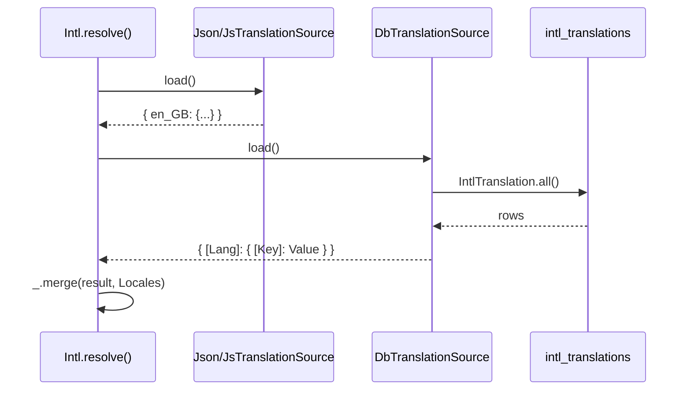

# Database translation source

`DbTranslationSource` loads the phrase catalogue of `@spinajs/intl` (`__()`, `__n()`, `__l()`, `__h()`) from the `intl_translations` table. Use it when editors change UI phrases in the database instead of in locale files.

It translates phrases, not model columns. Model columns are [Translatable models](01-translatable-models.md).

## How it works

1. Importing `@spinajs/intl-orm` registers `DbTranslationSource` with `@Injectable(TranslationSource)`, after the file sources of `@spinajs/intl` (`JsonTranslationSource`, `JsTranslationSource`), which its own import of `@spinajs/intl` registers first.
2. The `Intl` service of `@spinajs/intl` (`SpineJsInternationalizationFromJson`) resolves at startup. Its `resolve()` resolves `Array.ofType(TranslationSource)` and calls `load()` on each source in list order.
3. `DbTranslationSource.load()` runs `IntlTranslation.all()`, groups the rows by `Lang` and returns `{ [Lang]: { [Key]: Value } }`.
4. `Intl` merges each result with `_.merge(result, this.Locales)`: a phrase already loaded by an earlier source keeps its value.



## Configuration

`DbTranslationSource` reads no key. It queries through `IntlTranslation`, which is bound to `@Connection('default')`, so `db.DefaultConnection` picks the database. See [Schema and migration](06-schema-and-migration.md).

## Schema

Reads [`intl_translations`](06-schema-and-migration.md#intl_translations): `Key`, `Value` and `Lang` of every row.

## Services and extension points

| Service | DI token and lifetime | Default implementation | Alternatives | How to replace or extend |
| --- | --- | --- | --- | --- |
| `TranslationSource` (`@spinajs/intl`) | Abstract class; a list resolved with `Array.ofType(TranslationSource)` by `Intl.resolve()`; each source a singleton | `JsonTranslationSource`, `JsTranslationSource` (`@spinajs/intl`) | `DbTranslationSource` (this package) | Add a source with `@Injectable(TranslationSource)`; remove one with `DI.unregister(Source)` before `Intl` resolves. |
| `DbTranslationSource` | `@Injectable(TranslationSource)`, also under its own class; singleton | `DbTranslationSource` | none | Subclass it and override `load()`; register the subclass with `@Injectable(TranslationSource)` and `DI.unregister(DbTranslationSource)`. |

Members inherited from `TranslationSource`:

| Member | Behaviour |
| --- | --- |
| `load(): Promise<{}>` | Abstract. Returns `{ [locale]: { [phrase]: translation } }`. |
| `Configuration` (protected) | `@Autoinject()`ed `Configuration`. |
| `Log` (protected) | `@Logger('intl')`. |

### `DbTranslationSource`: custom implementation

The storefront and the admin panel share `intl_translations`, but the storefront must not ship admin phrases. Subclass the source, filter its result, and swap it for the stock one before `Intl` resolves.

```ts sample
import { DI, Injectable } from '@spinajs/di';
import { TranslationSource } from '@spinajs/intl';
import { DbTranslationSource } from '@spinajs/intl-orm';

type Catalogue = Record<string, Record<string, string>>;

@Injectable(TranslationSource)
export class StorefrontTranslationSource extends DbTranslationSource {
  public async load(): Promise<Catalogue> {
    const all = (await super.load()) as Catalogue;
    const result: Catalogue = {};

    for (const [lang, phrases] of Object.entries(all)) {
      result[lang] = Object.fromEntries(Object.entries(phrases).filter(([key]) => !key.startsWith('admin.')));
      this.Log.trace(`Loaded ${Object.keys(result[lang]).length} storefront phrases for ${lang}`);
    }

    return result;
  }
}

export function useStorefrontPhrases(): void {
  DI.unregister(DbTranslationSource);
}
```

### `TranslationSource`: add a source from another table

Add a source when phrases live in a table of your own. It joins the list next to `DbTranslationSource`; nothing is replaced.

```ts sample
import { Injectable } from '@spinajs/di';
import { TranslationSource } from '@spinajs/intl';
import { Connection, Model, ModelBase, Primary } from '@spinajs/orm';

@Connection('default')
@Model('cms_labels')
export class CmsLabel extends ModelBase<CmsLabel> {
  @Primary()
  public Id: number;

  public Locale: string;

  public Label: string;

  public Text: string;
}

@Injectable(TranslationSource)
export class CmsLabelTranslationSource extends TranslationSource {
  public async load(): Promise<Record<string, Record<string, string>>> {
    const labels = await CmsLabel.all();
    const result: Record<string, Record<string, string>> = {};

    for (const l of labels) {
      result[l.Locale] = { ...result[l.Locale], [l.Label]: l.Text };
    }

    return result;
  }
}
```

## Important behaviour

- Phrases load once, when `Intl` resolves. A row changed later is not seen until the process restarts or `Intl` is resolved again.
- `load()` reads the whole table in one query, with no paging.
- On a key present in a file and in the table for the same language, the file wins: the file sources are registered first, and `Intl` keeps phrases already loaded.
- Two rows with the same `Key` and `Lang` cannot exist: the migration adds the unique index `intl_translations_idx`.
- `intl_translations.Key` is `string(32)`. Longer phrase keys need your own migration that widens the column.
- `load()` queries through the `IntlTranslation` model, so `Orm` must have opened the `default` connection before `Intl` resolves.

## Best practices

- Resolve `Orm` before `Intl` in your bootstrap.
- Use short, stable keys (`cart.empty`) rather than full sentences as `Key`, given the 32-character column.
- Keep a phrase in one place, file or table, to avoid the file silently winning.

## Examples

### Add a German phrase from an admin action

```ts sample
import { DI } from '@spinajs/di';
import { Intl } from '@spinajs/intl';
import { InsertBehaviour } from '@spinajs/orm';
import { IntlTranslation } from '@spinajs/intl-orm';

export async function setPhrase(key: string, lang: string, value: string): Promise<void> {
  const row = new IntlTranslation({ Key: key, Lang: lang, Value: value });
  await row.insert(InsertBehaviour.InsertOrUpdate);

  // the running catalogue is not reloaded; patch it so the change shows without a restart
  const intl = DI.get(Intl);
  if (intl) {
    const locales = intl.Locales as Record<string, Record<string, string>>;
    locales[lang] = { ...locales[lang], [key]: value };
  }
}
```

## Related

- [Schema and migration](06-schema-and-migration.md): the `intl_translations` table and the `IntlTranslation` model.
- [Multiple implementations](../di/06-multiple-implementations.md): how the `TranslationSource` list is built and trimmed.
- `@spinajs/intl`: `Intl`, `TranslationSource` and the file sources.
