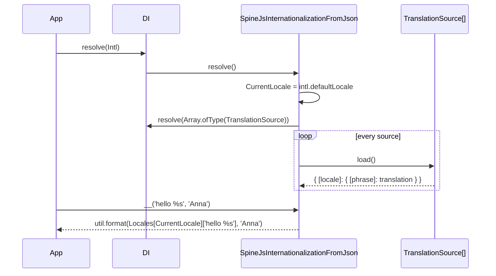

# Translating text

The `Intl` service turns a phrase into its translation for the current or a given locale, with `util.format` placeholders (`%s`, `%d`, `%j`). Use `__()` for one phrase, `__l()` and `__h()` to list a phrase in every loaded locale.

## How it works

1. `await DI.resolve(Intl)` builds the registered implementation, `SpineJsInternationalizationFromJson` by default. `Intl` extends `AsyncService`, so the resolve is async.
2. `SpineJsInternationalizationFromJson.resolve()` sets `CurrentLocale` from `intl.defaultLocale` (`'en'` when the key is missing).
3. It resolves `Array.ofType(TranslationSource)`, awaits `load()` on each and merges the results into `Locales`. See [Translation sources](03-translation-sources.md).
4. `__(text, ...args)` picks the phrase table:
   - a string `text` uses `Locales[CurrentLocale]`;
   - an `IPhraseWithOptions` (`{ phrase, locale }`) uses `Locales[locale]`, or `Locales[CurrentLocale]` when that locale is not loaded.
5. It returns `util.format(table[phrase] ?? phrase, ...args)`. A missing table or a missing phrase gives the formatted original phrase; nothing throws.



## API

| Member | Signature | Returns |
| --- | --- | --- |
| `Intl.__` | `(text: string \| IPhraseWithOptions, ...args: any[]) => string` | The translation, formatted with `args`; `''` for an empty `text` |
| `Intl.__n` | `(text: string \| IPhraseWithOptions, count: number) => string` | The plural form for `count`. See [Plural forms](02-plural-forms.md) |
| `Intl.__l` | `(text: string) => string[]` | The phrase's value in every loaded locale, in `Locales` key order; `undefined` where a locale lacks it; `[]` for an empty `text` |
| `Intl.__h` | `(text: string) => any[]` | One `{ [key]: value }` object per locale; see [Important behaviour](#important-behaviour) for the key |
| `Intl.CurrentLocale` | `string` (get and set) | The locale used for string phrases. Setting `''`, `null` or `undefined` throws `InvalidArgument` |
| `Intl.Locales` | `{}` (in practice `Record<string, Record<string, string \| object>>`) | Every loaded phrase table, keyed by locale |
| `IPhraseWithOptions` | `{ phrase: string; locale: string }` | A phrase pinned to one locale |

### Global functions

Importing `@spinajs/intl` assigns four functions to `global`. Each calls `DI.get(Intl)` and forwards to the method of the same name, so a replaced `Intl` serves them too.

| Global | Forwards to |
| --- | --- |
| `__(text, ...args)` | `Intl.__` |
| `__n(text, count)` | `Intl.__n` |
| `__l(text)` | `Intl.__l` |
| `__h(text)` | `Intl.__h` |

The package declares no TypeScript types for them. Add a declaration once in your app:

```ts
import type { IPhraseWithOptions } from '@spinajs/intl';

declare global {
  function __(text: string | IPhraseWithOptions, ...args: unknown[]): string;
  function __n(text: string | IPhraseWithOptions, count: number): string;
}
```

## Configuration

| Key | Type | Default | Allowed values | Meaning |
| --- | --- | --- | --- | --- |
| `intl.defaultLocale` | `string` | `'en'` (package config file and code fallback) | Any key present in `Locales` | Initial `CurrentLocale`; the locale `guessLanguage()` and `defaultLanguage()` return when nothing else is set |
| `intl.locales` | `string[]` | `['en']` | Locale codes | Shipped in the package config, read by **no** code in this package |
| `intl.queryParameter` | `string` | `'lang'` | Any name | Read by `@spinajs/intl-http`: query parameter, cookie and `x-<name>` header that carry the request language |

The package config file ships these defaults:

```ts
const config = {
  intl: {
    defaultLocale: 'en',
    locales: ['en'],
    queryParameter: 'lang',
  },
};
```

## Services and extension points

| Service | DI token and lifetime | Default implementation | Alternatives | How to replace or extend |
| --- | --- | --- | --- | --- |
| `Intl` | `Intl` key, singleton, `AsyncService`; `@Injectable(Intl)` at import of `@spinajs/intl` | `SpineJsInternationalizationFromJson` | `ElectronRendererIntl` in `@spinajs/electron` (renderer process) | `DI.register(MyIntl).as(Intl)` before the first resolve, or subclass `SpineJsInternationalizationFromJson`. See [Custom `Intl` service](05-custom-intl-service.md) |
| `TranslationSource` | `TranslationSource` key, list via `Array.ofType`, each element singleton | `JsonTranslationSource`, `JsTranslationSource` | `DbTranslationSource` in `@spinajs/intl-orm` | `@Injectable(TranslationSource)` on your class. See [Translation sources](03-translation-sources.md) |

## Important behaviour

- **No per-phrase fallback.** When `CurrentLocale` has a table but not the phrase, `__()` returns the original phrase, **not** the `intl.defaultLocale` translation. The locale fallback applies only when the whole table of an `IPhraseWithOptions.locale` is missing.
- **`CurrentLocale` is process-wide.** It lives on the singleton, so setting it changes every concurrent request. `__()` does **not** read the request language; pass the locale (see [Request language](04-request-language.md)).
- **Globals throw before resolve.** `__()` and the other globals call `DI.get(Intl)!`, which is `undefined` until `Intl` has been resolved: the call throws a `TypeError`.
- **Extra arguments are appended.** `util.format` appends arguments that have no placeholder: `__('hello', 'Anna')` gives `'hello Anna'`.
- **`__l()` and `__h()` read a lodash property path; `__()` does not.** `__l('errors.notFound')` finds `{ errors: { notFound: ... } }` (a flat key of that exact name wins), while `__()` and `__n()` look up flat keys only.
- **`__h()` keys are locale codes**, one object per locale in `Locales` key order: `__h('hello')` gives `[{ pl: 'witaj' }, { en: 'hello' }]`.
- **A plural object passed to `__()`** is formatted by `util.format` as an object; use `__n()` for plural phrases.
- The class name `Intl` shadows the ECMAScript global `Intl` in any module that imports it.

## Best practices

- Write phrases in the source language as keys (`'hello %s'`) and let a missing translation fall back to the key itself.
- Resolve `Intl` during boot (`await DI.resolve(Intl)`) before any code calls the global `__`.
- Inject `Intl` with `@Autoinject()` in services instead of the globals; the dependency then shows in the class and tests can swap it.
- Import `Intl` under an alias when the same module needs the native one: `import { Intl as Translator } from '@spinajs/intl'`.

## Patterns and antipatterns

```ts
// Don't: CurrentLocale is shared by all requests; a concurrent request reads the wrong language
intl.CurrentLocale = requestLanguage;
const title = intl.__('Order confirmed');

// Do: pin the locale on the phrase
const title = intl.__({ phrase: 'Order confirmed', locale: requestLanguage });
```

## Examples

### Translate a notification for a user's stored language

```ts sample
import { Autoinject, DI, Injectable } from '@spinajs/di';
import { Intl } from '@spinajs/intl';

interface User {
  name: string;
  language: string;
}

@Injectable()
class WelcomeNotifier {
  @Autoinject()
  protected Intl: Intl;

  public subject(user: User): string {
    // An unknown user.language falls back to the CurrentLocale table.
    return this.Intl.__({ phrase: 'Welcome, %s!', locale: user.language }, user.name);
  }
}

async function main() {
  await DI.resolve(Intl);
  const notifier = await DI.resolve(WelcomeNotifier);
  console.log(notifier.subject({ name: 'Anna', language: 'pl' }));
}

main();
```

### List a phrase in every language for a language picker

```ts sample
import { DI } from '@spinajs/di';
import { Intl } from '@spinajs/intl';

async function languageLabels() {
  const intl = await DI.resolve(Intl);
  const locales = Object.keys(intl.Locales);
  const labels = intl.__l('language.name');

  // __l() follows Locales key order, so zip the two arrays.
  return locales.map((locale, index) => ({ locale, label: labels[index] ?? locale }));
}

languageLabels().then((labels) => console.log(labels));
```

## Related

- [Plural forms](02-plural-forms.md): `__n()`.
- [Translation sources](03-translation-sources.md): what fills `Locales`.
- [Request language](04-request-language.md): pick the locale per request instead of `CurrentLocale`.
- [Custom `Intl` service](05-custom-intl-service.md): change the lookup rules.
- [`@spinajs/cli` `Cli` service](../cli/07-cli-service.md): uses the global `__` to translate help text.
