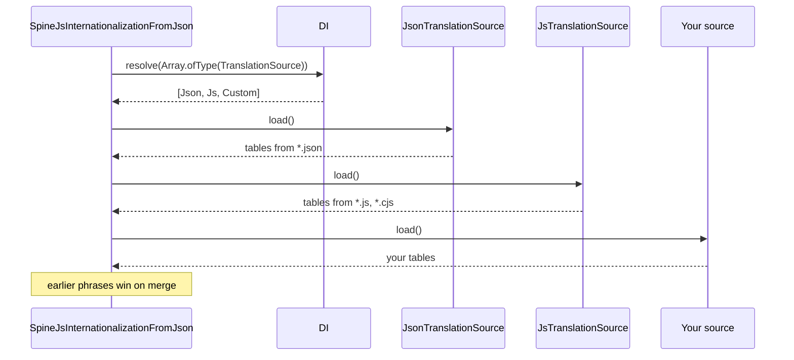

# Translation sources

A translation source loads phrase tables for the `Intl` service. The package ships two, for `.json` and `.js`/`.cjs` files in the directories of `system.dirs.locales`; register your own to read phrases from a database, an API or another file format.

## How it works

1. Importing `@spinajs/intl` in Node (the `node` and `default` export conditions) registers `JsonTranslationSource` and then `JsTranslationSource` with `@Injectable(TranslationSource)`. The `browser` entry registers neither.
2. `SpineJsInternationalizationFromJson.resolve()` resolves `Array.ofType(TranslationSource)`: every registered source, in registration order.
3. It awaits `load()` on each source in turn. A source returns `{ [locale]: { [phrase]: translation } }`.
4. It merges each result into `Intl.Locales` with `_.merge(result, Locales)`: a phrase already loaded **wins** over the same phrase from a later source.
5. Sources run once. A source registered after `Intl` has resolved is never loaded.

### `JsonTranslationSource.load()`

1. Reads `system.dirs.locales` (`[]` when missing) and drops directories that do not exist.
2. Globs `<dir>/**/*.json` in each directory, subdirectories included.
3. Takes the locale from the file name: `pl.json` and `admin/pl.json` both feed `pl`.
4. Parses the file. When the parsed object has a key equal to the locale (`{ "pl": { ... } }`), it uses that object; otherwise the whole file.
5. Merges the files in glob order; the first file that defines a phrase wins.
6. A file that fails to parse is logged as a warning and skipped; the load goes on.

### `JsTranslationSource.load()`

Same as the JSON source, with these differences:

- Globs `<dir>/**/*.{js,cjs}`; `de.js` and `de.cjs` both feed `de`.
- Loads each file with `DI.__spinajs_require__(file)` (see [Module loading](../di/13-module-loading.md)). The module's export is the table; a `{ de: { ... } }` export is unwrapped like in JSON.
- A file that throws on load is logged as a warning and skipped, like a broken JSON file.



## Configuration

| Key | Type | Default | Allowed values | Meaning |
| --- | --- | --- | --- | --- |
| `system.dirs.locales` | `string[]` | `[]` in code; `@spinajs/http` and `@spinajs/users-http` add their own `lib/<mjs\|cjs>/locales` directories | Absolute directory paths | Directories the file sources scan recursively |

Configuration arrays from several files are concatenated, so your directory is added to the package directories, not substituted for them (see [Config files](../configuration/03-config-files.md)).

```ts
import { join } from 'path';

const config = {
  system: {
    dirs: {
      locales: [join(process.cwd(), 'locales')],
    },
  },
};

export default config;
```

A JSON locale file holds flat phrases and plural objects:

```json
{
  "Order %s shipped": "Zamówienie %s zostało wysłane",
  "%d items": { "one": "%d produkt", "few": "%d produkty", "many": "%d produktów", "other": "%d produktu" }
}
```

## Services and extension points

| Service | DI token and lifetime | Default implementation | Alternatives | How to replace or extend |
| --- | --- | --- | --- | --- |
| `TranslationSource` | `TranslationSource` key; a list resolved once with `Array.ofType(TranslationSource)` by `Intl.resolve()`; each element a singleton | `JsonTranslationSource`, `JsTranslationSource` (both registered at import, Node entry only) | `DbTranslationSource` in `@spinajs/intl-orm` (rows of the `IntlTranslation` model) | Add: `@Injectable(TranslationSource)` or `DI.register(MySource).as(TranslationSource)` before `Intl` resolves. Remove: `DI.unregister(JsTranslationSource)`. Extend: subclass a shipped source and override `load()` |

`TranslationSource` is an abstract class with one abstract method and two injected members:

| Member | Kind | Meaning |
| --- | --- | --- |
| `load(): Promise<{}>` | abstract method | Returns `{ [locale]: { [phrase]: string \| pluralObject } }` |
| `Configuration` | protected, `@Autoinject()` | The app `Configuration`; read your source's keys from it |
| `Log` | protected, `@Logger('intl')` | Logger named `intl` |

### TranslationSource: custom implementation

Write a source when phrases live outside the locale directories. Extend `TranslationSource`, implement `load()`, and register it before the first `DI.resolve(Intl)`; import its module during boot so the decorator runs.

To let your source **override** file phrases, it has to run before the file sources. Unregister them, register yours, then register them again: the list follows registration order.

```ts sample
import { DI, Injectable } from '@spinajs/di';
import { Intl, JsonTranslationSource, JsTranslationSource, TranslationSource } from '@spinajs/intl';

interface ExportedPhrase {
  locale: string;
  key: string;
  text: string;
}

// Loads phrases exported by a translation management service.
// Config: { intl: { remote: { url: 'https://translations.example.com/export/app' } } }
@Injectable()
export class RemoteTranslationSource extends TranslationSource {
  public async load(): Promise<{}> {
    const url = this.Configuration.get<string>('intl.remote.url');
    if (!url) {
      return {};
    }

    try {
      const response = await fetch(url);
      const phrases = (await response.json()) as ExportedPhrase[];
      const tables: Record<string, Record<string, string>> = {};

      for (const p of phrases) {
        tables[p.locale] = tables[p.locale] ?? {};
        tables[p.locale][p.key] = p.text;
      }

      this.Log.info(`Loaded ${phrases.length} remote phrases`);
      return tables;
    } catch (err) {
      // Keep the app booting on file translations when the service is down.
      this.Log.warn(`Cannot load remote translations from ${url}: ${(err as Error).message}`);
      return {};
    }
  }
}

// Remote phrases first, so they win over the files.
DI.unregister(JsonTranslationSource);
DI.unregister(JsTranslationSource);
DI.register(RemoteTranslationSource).as(TranslationSource);
DI.register(JsonTranslationSource).as(TranslationSource);
DI.register(JsTranslationSource).as(TranslationSource);

async function main() {
  const intl = await DI.resolve(Intl);
  console.log(intl.__('Order %s shipped', 'A-1042'));
}

main();
```

When file phrases should win, skip the reordering and decorate the class with `@Injectable(TranslationSource)` instead of `@Injectable()`.

### JsonTranslationSource: extending a shipped source

Subclass a shipped source to post-process what it loads, then swap the registration. Here only the locales the app supports are kept.

```ts sample
import { DI } from '@spinajs/di';
import { Intl, JsonTranslationSource, TranslationSource } from '@spinajs/intl';

class SupportedLocalesJsonSource extends JsonTranslationSource {
  public async load(): Promise<{}> {
    const all = (await super.load()) as Record<string, unknown>;
    const supported = this.Configuration.get<string[]>('intl.locales', ['en']);

    return Object.fromEntries(Object.entries(all).filter(([locale]) => supported.includes(locale)));
  }
}

DI.unregister(JsonTranslationSource);
DI.register(SupportedLocalesJsonSource).as(TranslationSource);

DI.resolve(Intl).then((intl) => console.log(Object.keys(intl.Locales)));
```

## Important behaviour

- **First wins.** Between sources and between files of one source, the first value of a phrase stays. A source registered after the file sources can only add phrases, not change them.
- **Load once.** `Intl` reads the sources during its own `resolve()`. Changing a file or a database row afterwards has no effect until the process restarts or your `Intl` subclass reloads (see [Custom `Intl` service](05-custom-intl-service.md#reload-phrases-without-a-restart)).
- **Locale from the file name.** `pl-PL.json` creates a `pl-PL` table; `__n()` uses the `pl` plural rule for it (see [Plural forms](02-plural-forms.md#important-behaviour)).
- **Plural objects merge deeply.** A later file can add a missing category (`many`) to a plural phrase defined earlier.
- **Logger required.** Both file sources log every file they find with `this.Log.trace`; without `@spinajs/log` imported, the first found file throws.
- **Broken files are skipped.** A `.json` file that fails to parse or a `.js` file that throws on load gives a warning and a missing locale; the boot goes on.

## Best practices

- Keep one directory per module and add it to `system.dirs.locales` from that module's config file, as `@spinajs/http` does.
- Return `{}` from a custom `load()` when its backend is unavailable; a thrown error fails `Intl.resolve()` and every service that depends on it.
- Read the source's settings through `this.Configuration` instead of `process.env`, so tests can supply them with a `FrameworkConfiguration`.

## Patterns and antipatterns

```ts
// Don't: registered after Intl has resolved, this source is never loaded
await DI.resolve(Intl);
DI.register(RemoteTranslationSource).as(TranslationSource);

// Do: register sources during boot, before anything resolves Intl
DI.register(RemoteTranslationSource).as(TranslationSource);
await DI.resolve(Intl);
```

## Examples

### Ship translations with a feature module

```ts sample
import { join } from 'path';
import { DI } from '@spinajs/di';
import { Configuration, FrameworkConfiguration } from '@spinajs/configuration';
import { Intl } from '@spinajs/intl';

// billing/locales/pl.json: { "pl": { "Invoice %s is overdue": "Faktura %s jest przeterminowana" } }
// app/locales/pl.json:     { "Welcome, %s!": "Witaj, %s!" }
class AppConfiguration extends FrameworkConfiguration {
  protected onLoad(): unknown {
    return {
      system: {
        dirs: {
          locales: [join(process.cwd(), 'app', 'locales'), join(process.cwd(), 'billing', 'locales')],
        },
      },
      intl: { defaultLocale: 'pl' },
    };
  }
}

async function main() {
  DI.register(AppConfiguration).as(Configuration);
  const intl = await DI.resolve(Intl);

  console.log(intl.__('Invoice %s is overdue', 'FV/2026/10/17'));
  console.log(intl.__('Welcome, %s!', 'Anna'));
}

main();
```

## Related

- [Translating text](01-translating-text.md): how `Intl` reads the merged tables.
- [Multiple implementations](../di/06-multiple-implementations.md): `Array.ofType` and list order.
- [Registering services](../di/01-registering-services.md): `DI.unregister()` and its cache caveat.
- [Config files](../configuration/03-config-files.md): where `system.dirs.locales` comes from and how arrays merge.
- `@spinajs/intl-orm` (no docs folder yet): `DbTranslationSource`, a database-backed source.
