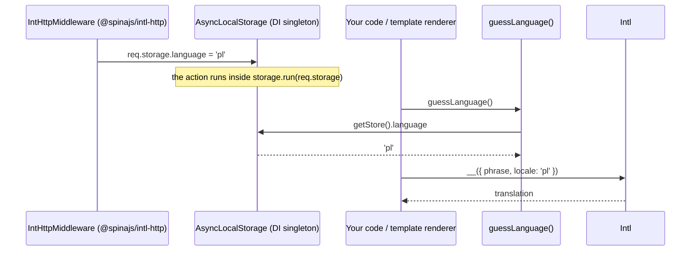

# Request language

`guessLanguage()` returns the language of the current async context: the `language` field of the `AsyncLocalStorage` store, or `intl.defaultLocale`. The `__translate*` helpers bind `Intl` calls to one language, for template engines and other code that renders for a request.

## How it works

1. Something writes the language into the store of the DI-resolved `AsyncLocalStorage` singleton. In an HTTP app, `IntHttpMiddleware` from `@spinajs/intl-http` sets `req.storage.language`, and `@spinajs/http` runs the action inside `storage.run(req.storage, ...)`.
2. `guessLanguage(lang?)` returns `lang` when given.
3. Without `lang`, it calls `DI.get(AsyncLocalStorage)`. When an instance exists and `getStore()?.language` is set, it returns that language.
4. Otherwise it returns `Configuration.get('intl.defaultLocale')`.
5. A caller passes the result to `Intl` in an `IPhraseWithOptions`, or to `__translate(lang)` to get a bound translator.



## API

| Export | Signature | Returns |
| --- | --- | --- |
| `guessLanguage` | `(lang?: string) => string` | `lang`, else the store's `language`, else `intl.defaultLocale` |
| `defaultLanguage` | `() => string` | `intl.defaultLocale` |
| `__translate` | `(lang: string) => (text: string \| IPhraseWithOptions, ...args: any[]) => string` | A `__()` bound to `lang`; an `IPhraseWithOptions` keeps its own locale |
| `__translateNumber` | `(lang: string) => (text: string \| IPhraseWithOptions, count: number) => string` | A `__n()` bound to `lang` |
| `__translateL` | `(text: string) => string[]` | `Intl.__l(text)` |
| `__translateH` | `(text: string) => any[]` | `Intl.__h(text)` |
| `IIntlAsyncStorage` | `{ language?: string; noTranslate?: boolean }` | The store shape `guessLanguage()` reads (`language`) |

`noTranslate` is not read by this package. `IntlQueryMiddleware` in `@spinajs/intl-orm` checks a `noTranslate` field on the `AsyncLocalStorage` instance, not on its store, so setting it in the store has no effect.

## Configuration

| Key | Type | Default | Allowed values | Meaning |
| --- | --- | --- | --- | --- |
| `intl.defaultLocale` | `string` | `'en'` (package config file) | A loaded locale | Returned by `defaultLanguage()` and by `guessLanguage()` when the store has no language |
| `intl.queryParameter` | `string` | `'lang'` | Any name | Read by `@spinajs/intl-http`: query parameter, then cookie, then `x-<name>` header |

## Services and extension points

| Service | DI token and lifetime | Default implementation | Alternatives | How to replace or extend |
| --- | --- | --- | --- | --- |
| Language store | `AsyncLocalStorage` key, singleton; created by the first `DI.resolve(AsyncLocalStorage)` or `@Autoinject()` of it (`@spinajs/http` controllers inject it) | Node's `AsyncLocalStorage`, store shape `IIntlAsyncStorage` | `IActionLocalStoregeContext` of `@spinajs/http`, augmented with `language` by `@spinajs/intl-http` | Run work inside `DI.resolve(AsyncLocalStorage).run({ language }, fn)`; any code that writes `language` into the active store sets the language |
| Language detection | `IntHttpMiddleware` in `@spinajs/intl-http` (a `ServerMiddleware`) | query, cookie, `x-lang` header, then `intl.defaultLocale` | Your own middleware or job wrapper | Write `language` into the active store; `guessLanguage()` picks it up |

### Language store: set the language outside HTTP

Queue workers, socket handlers and CLI commands have no HTTP middleware. Open a store yourself; everything awaited inside it sees the language, including `@spinajs/intl-orm` queries and `@spinajs/templates` renders that call `guessLanguage()`.

```ts sample
import { AsyncLocalStorage } from 'node:async_hooks';
import { DI } from '@spinajs/di';
import { IIntlAsyncStorage, Intl, __translate, guessLanguage } from '@spinajs/intl';

interface PasswordResetJob {
  email: string;
  language: string;
}

function subjectLine(): string {
  // No language argument: read from the store opened by the job runner.
  return __translate(guessLanguage())('Reset your password');
}

async function runJob(job: PasswordResetJob) {
  await DI.resolve(Intl);
  const storage = DI.resolve(AsyncLocalStorage) as AsyncLocalStorage<IIntlAsyncStorage>;

  return storage.run({ language: job.language }, async () => {
    return { to: job.email, subject: subjectLine() };
  });
}

runJob({ email: 'anna@example.com', language: 'pl' }).then((mail) => console.log(mail));
```

## Important behaviour

- **Only `guessLanguage()` reads the store.** `Intl.__()`, `__n()` and the global `__` use `CurrentLocale`, never the request language. Pass `guessLanguage()` explicitly.
- **`DI.get`, not `DI.resolve`.** `guessLanguage()` sees the store only when some code has already resolved `AsyncLocalStorage` from DI. A store created with `new AsyncLocalStorage()` is invisible to it.
- **No default without the config key.** `guessLanguage()` and `defaultLanguage()` read `intl.defaultLocale` with no code default; without the package config file loaded they return `undefined`. `Intl` itself falls back to `'en'`.
- **Helpers resolve late.** `__translate()` and the others call `DI.get(Intl)!` on every call; before `Intl` is resolved they throw a `TypeError`.
- `guessLanguage(lang)` returns `lang` unchecked, even when no table exists for it; `Intl` then falls back to the `CurrentLocale` table.
- In browsers and Electron renderers `AsyncLocalStorage` is not a function, so `guessLanguage()` returns the argument or `intl.defaultLocale`.

## Best practices

- Pass the language explicitly when you know it (`guessLanguage(user.language)`); the store is a fallback for code deep in the call stack.
- Give template engines bound helpers: `__translate(lang)` and `__translateNumber(lang)`, as `@spinajs/templates-pug` and `@spinajs/templates-handlebars` do.
- Type the store with `AsyncLocalStorage<IIntlAsyncStorage>` when you open it yourself.

## Patterns and antipatterns

```ts
// Don't: the global __ ignores the request language and uses CurrentLocale
const message = __('Your order has shipped');

// Do: resolve the request language and bind the translator to it
const message = __translate(guessLanguage())('Your order has shipped');
```

## Examples

### Expose translation helpers to a custom template engine

```ts sample
import { DI } from '@spinajs/di';
import { Intl, __translate, __translateH, __translateL, __translateNumber, guessLanguage } from '@spinajs/intl';

// What a renderer passes as template locals, so `{{ __('Total') }}` and `{{ __n('%d items', n) }}` work.
function translationLocals(language?: string) {
  const lang = guessLanguage(language);

  return {
    lang,
    __: __translate(lang),
    __n: __translateNumber(lang),
    __l: __translateL,
    __h: __translateH,
  };
}

async function main() {
  await DI.resolve(Intl);
  const locals = translationLocals('pl');
  console.log(locals.lang, locals.__('Total'), locals.__n('%d items', 3));
}

main();
```

## Related

- [Translating text](01-translating-text.md): `IPhraseWithOptions` and the locale fallback.
- [Plural forms](02-plural-forms.md): what `__translateNumber` calls.
- [Lifetimes](../di/04-lifetimes.md): why the `AsyncLocalStorage` instance is shared.
- `@spinajs/intl-http` (no docs folder yet): `IntHttpMiddleware` and `@Lang()` set and read the request language.
- `@spinajs/intl-orm` (no docs folder yet): `IntlQueryMiddleware` translates model queries to `guessLanguage()`.
- `@spinajs/templates` (no docs folder yet): `CompiledTemplateRenderer` renders with `guessLanguage()` when no language is given.
