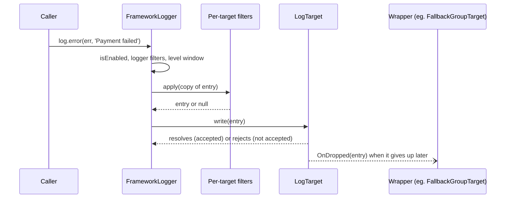

# Log targets

A `LogTarget` is a sink: it receives finished `ILogEntry` objects and writes them somewhere (console, file, HTTP, memory). Every target is a DI service registered under a string name, and the logger config picks targets by that name. This page also documents the config shapes `@spinajs/log` reads for targets and rules, since their types live here.

## How it works

1. **Register.** A target class is decorated `@Injectable('<TypeName>')`. The string is the `type` that config uses.
2. **Configure.** A target definition (`ITargetsOption`) in `logger.targets` names an instance and its `type`. A rule (`ILogRule`) in `logger.rules` routes loggers matching a glob to target names, for a level window.
3. **Resolve.** `FrameworkLogger.resolve()` (in `@spinajs/log`) calls `DI.resolve(def.type, [def])` for each target its rules route to. `addTarget()` does the same at runtime.
4. **Construct.** The `LogTarget` constructor deep-merges `{ enabled: true, layout: <default layout> }` with the whole definition into `this.Options`. A target's own settings sit in `this.Options.options`.
5. **Initialise.** DI calls `resolve()` (from `SyncService`). Override it to open connections, start timers or resolve inner targets, then call `super.resolve()`.
6. **Write.** For each entry in the target's level window, the logger runs the per-target filters on a copy of the entry, then calls `target.write(entry)`.
7. **Flush and dispose.** `Log.flush()` calls `forceFlush()`. DI disposal calls `dispose()`.



## The `LogTarget` contract

```ts
abstract class LogTarget<T extends ICommonTargetOptions> extends SyncService {
  public HasError: boolean;                          // false by default
  public Error: Error | null | unknown;              // null by default
  public Options: T;                                 // the merged target definition
  public OnDropped: ((entry: ILogEntry) => void) | null; // null by default
  public abstract write(data: ILogEntry): void;      // may return a Promise
  public forceFlush(): Promise<void>;                // resolves at once by default
}
```

| Member | Your target's job |
| --- | --- |
| `write(entry)` | Return when `Options.enabled` is `false`. Render `entry.Variables` (eg. with `format(entry.Variables, Options.layout)` from `@spinajs/configuration-common`) and deliver it. |
| Rejection | Return a rejected promise when the entry was **not** accepted. `RetryingTarget` retries and `FallbackGroupTarget` moves to the next target on rejection. Resolving means "accepted for delivery", not "delivered". |
| `HasError`, `Error` | Set `true` and the error after a failed delivery; reset to `false` and `null` after a success. Nothing in the framework reads them; they are for health checks. |
| `OnDropped` | A buffering target that gives up on an entry (buffer overflow, non-retryable failure) calls `this.OnDropped?.(entry)`. `FallbackGroupTarget` sets it to forward exactly those entries to the next target. |
| `forceFlush()` | Buffered targets write out what they hold. `Log.flush()`, `Log.flushAll()` and `removeTarget()` call it. |
| `dispose()` | From `Service`. Stop timers, close handles, final flush. |

## Configuration

`@spinajs/log` reads these keys under `logger`; the types are exported here. See [`@spinajs/log`](../log/README.md) for routing details and the shipped targets' own options.

### `ILogOptions`

| Key | Type | Default | Allowed values | Meaning |
| --- | --- | --- | --- | --- |
| `logger.targets` | `ITargetsOption[]` | `[{ name: 'Console', type: 'ConsoleTarget' }]` | Definitions with unique `name` + `type` pairs | Target instances. Duplicates (same `name` and `type`) are removed. |
| `logger.rules` | `ILogRule[]` | `[{ name: '*', level: 'trace', target: 'Console' }]` | | Routing rules, evaluated in order. |
| `logger.filters` | `ILogFilterOptions[]` | `[]` | `{ type, ...options }` | Filters for every entry of a logger; see [Log filters](07-log-filters.md). |
| `logger.whenRepeated` | `IWhenRepeatedOptions` | not set | `{ timeout?, maxKeys? }` | Deprecated. Prepends a `WhenRepeatedFilter` to `logger.filters`. |
| `logger.variables` | `Record<string, unknown>` | not set | | Declared in the type; `@spinajs/log` does not read it. Use `addVariable()`. |

### `ITargetsOption` (one entry of `logger.targets`)

| Key | Type | Default | Allowed values | Meaning |
| --- | --- | --- | --- | --- |
| `logger.targets[].name` | `string` | required | | Instance name that rules reference. |
| `logger.targets[].type` | `string` | required | A registered DI name | The `@Injectable('<TypeName>')` of the target class. |
| `logger.targets[].enabled` | `boolean` | `true` | | `false`: the target is never constructed; rules naming it skip it silently. |
| `logger.targets[].layout` | `string` | the default layout | A `format()` layout | Line layout for text targets. |
| `logger.targets[].options` | `object` | `{}` | Target-specific | The target's own settings, read from `this.Options.options`. Typed as `Record<string, any>`; each target defines its own shape. |
| `logger.targets[].filters` | `ILogFilterOptions[]` | `[]` | `{ type, ...options }` | Filters for this target only, run on a per-target copy of the entry. |

### `ILogRule` (one entry of `logger.rules`)

| Key | Type | Default | Allowed values | Meaning |
| --- | --- | --- | --- | --- |
| `logger.rules[].name` | `string` | required | Glob, eg. `*`, `orm.*` | Logger names the rule matches. |
| `logger.rules[].level` | `string` | required | `trace` `debug` `info` `success` `warn` `error` `fatal` `security` | Lowest level routed. |
| `logger.rules[].maxLevel` | `string` | `security` | Same as `level` | Highest level routed, inclusive. |
| `logger.rules[].target` | `string \| string[]` | required | Target names | Where matching entries go. A name with no definition throws `InvalidOption`. |
| `logger.rules[].final` | `boolean` | `false` | | Stop evaluating later rules for a logger this rule matches. |

### `ICommonTargetOptions` (what every target's `Options` holds)

| Key | Type | Default | Meaning |
| --- | --- | --- | --- |
| `layout` | `string` | `${datetime} ${level} ${message}${?error} Exception: ${error:message}${/error} (${logger})` | Line layout. |
| `name` | `string` | from the definition | Instance name. |
| `type` | `string` | from the definition | DI name. |
| `enabled` | `boolean` | `true` | `write()` must return early when `false`. |

### `IColoredConsoleTargetOptions` and `IFileTargetOptions`

Option shapes of `@spinajs/log`'s `ConsoleTarget` and `FileTarget`, exported here so other packages can type them.

- `IColoredConsoleTargetOptions.theme`: one colour (or list) per level name. `ColoredConsoleTarget` uses its built-in colours and does not read this key.
- `IFileTargetOptions.options`: the file target settings. `@spinajs/log` fills defaults from its `logger.file` config:

| Key | Type | Default (`@spinajs/log`) | Meaning |
| --- | --- | --- | --- |
| `logger.targets[].options.path` | `string` | required | Active log path, relative to the `fs` provider; variables allowed. |
| `logger.targets[].options.archivePath` | `string` | the active log's directory | Archive directory, relative to `archiveFs`; variables allowed. |
| `logger.targets[].options.fs` | `string` | `fs-log-default` | `@spinajs/fs` provider for the active file. |
| `logger.targets[].options.archiveFs` | `string` | same as `fs` | `@spinajs/fs` provider for archives. |
| `logger.targets[].options.archiveStrategy` | `string` | `SizeLogArchiveStrategy` | When to rotate. `CronLogArchiveStrategy` needs `rotate`. |
| `logger.targets[].options.retentionStrategies` | `string[]` | `['CountLogRetentionStrategy']` | Applied in order after each rotation. |
| `logger.targets[].options.maxSize` | `number` | `1048576` (1 MB) | Rotate past this many bytes. |
| `logger.targets[].options.compress` | `boolean` | `false` | Zip archived files. |
| `logger.targets[].options.rotate` | `string` | not set | Cron expression for `CronLogArchiveStrategy`. |
| `logger.targets[].options.maxBufferSize` | `number` | `100` | Flush after this many buffered lines. |
| `logger.targets[].options.maxQueueSize` | `number` | `100000` | Hard cap on buffered lines; the oldest are dropped. |
| `logger.targets[].options.maxArchiveFiles` | `number` | `5` | Archives kept by `CountLogRetentionStrategy`. |
| `logger.targets[].options.maxAge` | `number` | `604800` (7 days, seconds) | Archive age limit for `AgeLogRetentionStrategy`. |
| `logger.targets[].options.archiveInterval` | `number` | `60` (seconds) | Size check interval of `SizeLogArchiveStrategy`. |
| `logger.targets[].options.flushInterval` | `number` | `1000` (ms) | Periodic flush tick. |

```ts
// Config file: everything to the console, errors and up also to a Slack channel.
export default {
  logger: {
    targets: [
      { name: 'Console', type: 'ConsoleTarget' },
      {
        name: 'ops-slack',
        type: 'SlackTarget',
        layout: '${level} ${logger}: ${message}',
        options: { webhookUrl: 'https://hooks.slack.com/services/T000/B000/XXXX' },
      },
    ],
    rules: [
      { name: '*', level: 'info', target: 'Console' },
      { name: '*', level: 'error', target: 'ops-slack' },
    ],
  },
};
```

### `ILogTargetDesc`

The resolved routing record a logger keeps per target, in `Log.Targets`: `instance` (the target), `options` (its definition), `rule` (the rule with the lowest level routing to it), `ranges` (`{ min, max }` level windows, the union of every rule routing to it), `filters` (resolved per-target filters). Custom `Log` implementations fill it the same way so `flush()` works.

## Services and extension points

| Service | DI token and lifetime | Default implementation | Alternatives | How to replace or extend |
| --- | --- | --- | --- | --- |
| Log target | The string `type`, eg. `'FileTarget'`. Lifetime is the class's: `@Injectable` alone is a singleton. Resolved by name, with `[definition]` as the constructor argument | none here (abstract) | `@spinajs/log`: `ConsoleTarget` (`ColoredConsoleTarget` in Node, `BrowserConsoleTarget` in the browser), `FileTarget`, `JsonFileTarget`, `JsonTarget`, `MemoryTarget`, `BlackHoleTarget`, wrappers `RetryingTarget`, `FallbackGroupTarget`, `SplitGroupTarget`, `AutoFlushTarget`. `OtlpLogTarget` (`@spinajs/log-otlp`), `GraphanaLogTarget` (`@spinajs/log-source-graphana-loki`) | New target: subclass `LogTarget`, `@Injectable('<NewType>')`, reference the type in config. Replace a shipped type: register your class under the same string (eg. `@Injectable('ConsoleTarget')`) after `@spinajs/log` is imported. Wrap: resolve an inner target by its `type` in `resolve()`, as the wrapper targets do. |

### Choosing a lifetime

DI caches a singleton by class, and ignores the constructor options of later resolves. With two definitions of the same `type`, a singleton target is built once, with the first definition.

| Lifetime | Use when | Example |
| --- | --- | --- |
| Singleton (`@Injectable` alone, or `@Singleton()`) | One instance per type is enough: console, stdout, memory | `ConsoleTarget`, `JsonTarget` |
| `@PerInstanceCheck()` + `__checkInstance__()` | Several definitions of the type, one instance per `name` | `FileTarget`, `OtlpLogTarget`, `GraphanaLogTarget` |
| `@NewInstance()` | Every resolve gets its own instance, including each logger that routes to it | Rarely right: a buffered target would be duplicated per logger |

### LogTarget: custom implementation

Write a target to deliver entries to a system the shipped targets do not cover. Override `write()`; override `resolve()`, `forceFlush()` and `dispose()` when the target holds resources or buffers. Register it before the first logger resolves, so the config `type` can be found: import the module in your app's entry file.

```ts sample
import { DI, IInstanceCheck, Injectable, PerInstanceCheck } from '@spinajs/di';
import { createLogMessageObject, ICommonTargetOptions, ILogEntry, LogLevel, LogTarget } from '@spinajs/log-common';

interface ISlackTargetOptions extends ICommonTargetOptions {
  options: { webhookUrl: string };
}

// Posts entries to a Slack incoming webhook. One instance per target name, so
// several channels can be configured with the same type.
@PerInstanceCheck()
@Injectable('SlackTarget')
class SlackTarget extends LogTarget<ISlackTargetOptions> implements IInstanceCheck {
  public __checkInstance__(creationOptions: ISlackTargetOptions[]): boolean {
    return this.Options.name === creationOptions[0].name;
  }

  public async write(entry: ILogEntry): Promise<void> {
    if (!this.Options.enabled) return;

    const text = `${entry.Variables.level} ${entry.Variables.logger}: ${entry.Variables.message}`;
    try {
      const response = await fetch(this.Options.options.webhookUrl, {
        method: 'POST',
        headers: { 'content-type': 'application/json' },
        body: JSON.stringify({ text }),
      });
      if (!response.ok) throw new Error(`Slack responded ${response.status}`);
      this.HasError = false;
      this.Error = null;
    } catch (err) {
      this.HasError = true;
      this.Error = err;
      throw err; // not accepted: RetryingTarget / FallbackGroupTarget act on this
    }
  }
}

const ops = DI.resolve<SlackTarget>('SlackTarget', [{ name: 'ops-slack', type: 'SlackTarget', options: { webhookUrl: 'https://hooks.slack.com/services/T000/B000/OPS' } }]);
const sec = DI.resolve<SlackTarget>('SlackTarget', [{ name: 'sec-slack', type: 'SlackTarget', options: { webhookUrl: 'https://hooks.slack.com/services/T000/B000/SEC' } }]);
console.log(ops !== sec); // true: one instance per name

void sec.write(createLogMessageObject('Admin role granted to %s', '', LogLevel.Security, 'authz', {}, 'u-42')).catch(() => {
  console.log(sec.HasError); // true while Slack is unreachable
});
```

### LogTarget: wrapping another target

Wrap a target to change entries before another target writes them, without touching that target. The inner target is any registered `type`, resolved exactly as the logger would resolve it. Forward `forceFlush()`, `dispose()` and `OnDropped` so the wrapper is transparent.

```ts sample
import { DI, IInstanceCheck, Injectable, PerInstanceCheck } from '@spinajs/di';
import { createLogMessageObject, ICommonTargetOptions, ILogEntry, ITargetsOption, LogLevel, LogTarget } from '@spinajs/log-common';

interface IRedactingTargetOptions extends ICommonTargetOptions {
  options: { target: ITargetsOption };
}

const CARD_NUMBER = /\b\d(?:[ -]?\d){12,15}\b/g;

// Masks card numbers in the message, then hands the entry to the wrapped target.
@PerInstanceCheck()
@Injectable('RedactingTarget')
class RedactingTarget extends LogTarget<IRedactingTargetOptions> implements IInstanceCheck {
  protected Inner!: LogTarget<ICommonTargetOptions>;

  public __checkInstance__(creationOptions: IRedactingTargetOptions[]): boolean {
    return this.Options.name === creationOptions[0].name;
  }

  public resolve(): void {
    const inner = this.Options.options.target;
    this.Inner = DI.resolve<LogTarget<ICommonTargetOptions>>(inner.type, [inner]);
    this.Inner.OnDropped = (entry) => this.OnDropped?.(entry);
    super.resolve();
  }

  public write(entry: ILogEntry): Promise<void> {
    if (!this.Options.enabled) return Promise.resolve();
    const message = entry.Variables.message.replace(CARD_NUMBER, '[card]');
    return Promise.resolve(this.Inner.write({ Level: entry.Level, Variables: { ...entry.Variables, message } }));
  }

  public forceFlush(): Promise<void> {
    return this.Inner.forceFlush();
  }

  public async dispose(): Promise<void> {
    await this.Inner.dispose();
  }
}

@Injectable('StdoutTarget')
class StdoutTarget extends LogTarget<ICommonTargetOptions> {
  public write(entry: ILogEntry): void {
    if (this.Options.enabled) process.stdout.write(`${entry.Variables.level} ${entry.Variables.message}\n`);
  }
}

const target = DI.resolve<RedactingTarget>('RedactingTarget', [
  { name: 'payments', type: 'RedactingTarget', options: { target: { name: 'payments-out', type: 'StdoutTarget' } } },
]);
void target.write(createLogMessageObject('Charge for card 4111 1111 1111 1111 declined', '', LogLevel.Warn, 'payments', {}));
// WARN Charge for card [card] declined
```

## Important behaviour

- `Options` is the **whole** target definition merged over the defaults, not only `options`. Read `name`, `layout` and `enabled` from `this.Options`, target settings from `this.Options.options`.
- The merge is a deep `_.merge`, so a subclass constructor that sets defaults after `super(options)` must merge, not replace, as `JsonTarget` does with `Object.assign({ stream: 'stdout' }, this.Options)`.
- A synchronous throw from `write()` propagates out of the caller's `log.info()` in `FrameworkLogger`. Catch inside `write()`, or make `write()` async so the error becomes a rejection.
- A definition whose `type` is not registered resolves to `null` without an error. The first entry routed to it makes the log call throw `InvalidOperation('Target <name> for rule <rule> not exists')`. Import the module that registers the target before the first logger resolves.
- `write()` is not awaited by the code that logs. Rejections end up only in the `PromiseSettledResult` array of `Log.write()`.
- Several rules routing to one target produce one `write()` per entry: the logger keeps one descriptor per target, with the union of the rule windows.
- Per-target filters get a shallow copy of the entry (`{ Level, Variables: { ...Variables } }`); a target that changes `entry.Variables` affects only its own copy, unless it mutates nested objects.
- `removeTarget()` flushes a target but does not dispose it; the instance may be shared with other loggers.
- `@spinajs/log`'s wrapper targets (`RetryingTarget`, `FallbackGroupTarget`, `SplitGroupTarget`, `AutoFlushTarget`) are singletons, so two definitions of the same wrapper type share the first definition's inner targets.

## Best practices

- Make `write()` async and reject on failure, so `RetryingTarget` and `FallbackGroupTarget` can wrap your target.
- Buffer network writes with [`BatchQueue`](08-batch-queue.md) and call `OnDropped` for every entry the buffer drops.
- Use `@PerInstanceCheck()` with a `name` check for any target with per-definition settings (URL, file, credentials).
- Use `safeStringify()` for JSON output; a circular field must not throw out of `write()`.

## Patterns and antipatterns

```ts
// Don't: a singleton target with per-definition settings. The second definition
// silently gets the first one's webhook.
@Injectable('SlackTarget')
class SlackTarget extends LogTarget<ISlackTargetOptions> { /* ... */ }

// Do
@PerInstanceCheck()
@Injectable('SlackTarget')
class SlackTarget extends LogTarget<ISlackTargetOptions> implements IInstanceCheck {
  public __checkInstance__(o: ISlackTargetOptions[]) {
    return this.Options.name === o[0].name;
  }
}
```

```ts
// Don't: swallow failures; wrappers then never retry or fall back.
public async write(entry: ILogEntry) {
  await send(entry).catch(() => undefined);
}

// Do: record the failure and reject.
public async write(entry: ILogEntry) {
  try {
    await send(entry);
    this.HasError = false;
  } catch (err) {
    this.HasError = true;
    this.Error = err;
    throw err;
  }
}
```

## Related

- [Log entries](03-log-entries.md): the `Variables` a target renders and the default layout.
- [Log filters](07-log-filters.md): per-target `filters`.
- [Batch queue](08-batch-queue.md): buffering for network and file targets.
- [`@spinajs/log`](../log/README.md): the shipped targets, wrappers and routing.
- [`@spinajs/di` lifetimes](../di/04-lifetimes.md): `@Singleton`, `@NewInstance`, `@PerInstanceCheck`.
